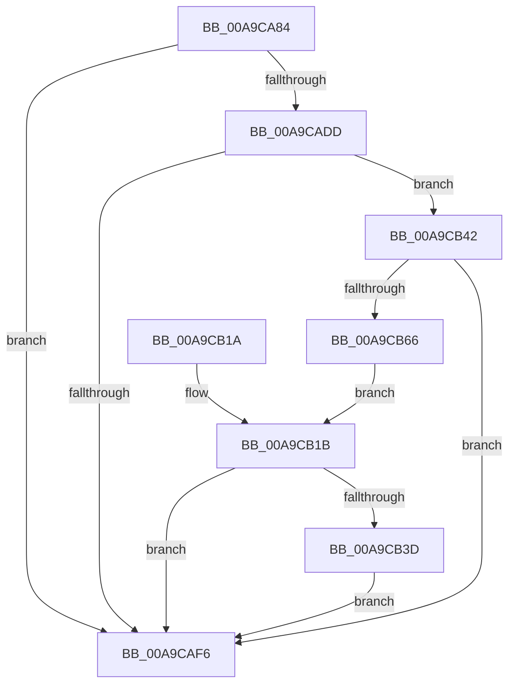

# PiSwFindSwDevice

- RVA: `0x00A9CA84`–`0x00A9CB68` (길이 `228` bytes)
- VA: `0x0000000140A9CA84`
- 실행 섹션: `PAGE`
- PDB 이름 있음: `예`; PDB Function 태그: `아니요`
- unwind 정보 RVA: `0x000BA658`
- 디코드: `53`개 명령, `228/228` bytes 표시
- 미해석 바이트: `0` (있으면 어셈블리에 `.byte`로 보존)

> 이 문서는 커널 이미지의 기계어와 PDB 기호를 분석해 생성했습니다. 4번과 5번은 함수 원형과 자료형을 바이너리 사용 방식에서 추정한 C 해석이며 원본 소스 복구 결과는 아닙니다.

## 1. Dependencies

- 직접 호출 지점: **6**; 고유 호출 대상: **6**
- 직접 호출자로 확인된 함수: **2**
- RIP 상대 이미지 참조: **3**

### Outgoing calls
- `0x00A9CAB3` → [memset](../../text/6C/memset_function_006C6C40.md) (function, `0x006C6C40`)
- `0x00A9CAD2` → [wcsnicmp](../../text/50/wcsnicmp_function_005001C0.md) (function, `0x005001C0`)
- `0x00A9CAED` → [RtlStringCbCopyW](../../text/43/RtlStringCbCopyW_function_0043B910.md) (function, `0x0043B910`)
- `0x00A9CB04` → [_security_check_cookie](../../text/6A/_security_check_cookie_function_006AC640.md) (function, `0x006AC640`)
- `0x00A9CB33` → [RtlLookupElementGenericTableAvl](../../text/3F/RtlLookupElementGenericTableAvl_function_003FEFB0.md) (function, `0x003FEFB0`)
- `0x00A9CB5C` → [wcschr](../../text/50/wcschr_function_00501A60.md) (function, `0x00501A60`)

### Direct callers
- [PiSwIrpCleanup](../73/PiSwIrpCleanup_function_0073AC10.md) at `0x0073AC86`
- [PiSwProcessParentRemoveIrp](../8F/PiSwProcessParentRemoveIrp_function_008FCD6C.md) at `0x008FCE2A`

### Static image references
- `0x00A9CA91` → RVA `0x00E0A740` (`.data`; read)
- `0x00A9CAC3` → RVA `0x0001C650` (`.rdata`; read)
- `0x00A9CB27` → RVA `0x00F8AAA0` (`.data`; read)

## 2. Other-region calls and transfers

- 다른 실행 섹션으로 향하는 call: **6**
  - `0x00A9CAB3` → [memset](../../text/6C/memset_function_006C6C40.md) (`PAGE` → `.text`)
  - `0x00A9CAD2` → [wcsnicmp](../../text/50/wcsnicmp_function_005001C0.md) (`PAGE` → `.text`)
  - `0x00A9CAED` → [RtlStringCbCopyW](../../text/43/RtlStringCbCopyW_function_0043B910.md) (`PAGE` → `.text`)
  - `0x00A9CB04` → [_security_check_cookie](../../text/6A/_security_check_cookie_function_006AC640.md) (`PAGE` → `.text`)
  - `0x00A9CB33` → [RtlLookupElementGenericTableAvl](../../text/3F/RtlLookupElementGenericTableAvl_function_003FEFB0.md) (`PAGE` → `.text`)
  - `0x00A9CB5C` → [wcschr](../../text/50/wcschr_function_00501A60.md) (`PAGE` → `.text`)
- 별도 외부 분기/꼬리 이동을 확인하지 못했습니다.

## 3. Assembly (complete function range)

```asm
00A9CA84  48 89 5C 24 10                  mov qword ptr [rsp + 0x10], rbx
00A9CA89  57                              push rdi
00A9CA8A  48 81 EC A0 02 00 00            sub rsp, 0x2a0
00A9CA91  48 8B 05 A8 DC 36 00            mov rax, qword ptr [rip + 0x36dca8]
00A9CA98  48 33 C4                        xor rax, rsp
00A9CA9B  48 89 84 24 90 02 00 00         mov qword ptr [rsp + 0x290], rax
00A9CAA3  48 8B F9                        mov rdi, rcx
00A9CAA6  33 D2                           xor edx, edx
00A9CAA8  48 8D 4C 24 30                  lea rcx, [rsp + 0x30]
00A9CAAD  41 B8 D0 00 00 00               mov r8d, 0xd0
00A9CAB3  E8 88 A1 C2 FF                  call 0x1406c6c40
00A9CAB8  48 8D 44 24 30                  lea rax, [rsp + 0x30]
00A9CABD  41 B8 04 00 00 00               mov r8d, 4
00A9CAC3  48 8D 15 86 FB 57 FF            lea rdx, [rip - 0xa8047a]
00A9CACA  48 89 44 24 20                  mov qword ptr [rsp + 0x20], rax
00A9CACF  48 8B CF                        mov rcx, rdi
00A9CAD2  E8 E9 36 A6 FF                  call 0x1405001c0
00A9CAD7  33 DB                           xor ebx, ebx
00A9CAD9  85 C0                           test eax, eax
00A9CADB  75 19                           jne 0x140a9caf6
00A9CADD  4C 8B C7                        mov r8, rdi
00A9CAE0  48 8D 8C 24 00 01 00 00         lea rcx, [rsp + 0x100]
00A9CAE8  BA 90 01 00 00                  mov edx, 0x190
00A9CAED  E8 1E EE 99 FF                  call 0x14043b910
00A9CAF2  85 C0                           test eax, eax
00A9CAF4  79 4C                           jns 0x140a9cb42
00A9CAF6  48 8B C3                        mov rax, rbx
00A9CAF9  48 8B 8C 24 90 02 00 00         mov rcx, qword ptr [rsp + 0x290]
00A9CB01  48 33 CC                        xor rcx, rsp
00A9CB04  E8 37 FB C0 FF                  call 0x1406ac640
00A9CB09  48 8B 9C 24 B8 02 00 00         mov rbx, qword ptr [rsp + 0x2b8]
00A9CB11  48 81 C4 A0 02 00 00            add rsp, 0x2a0
00A9CB18  5F                              pop rdi
00A9CB19  C3                              ret
00A9CB1A  CC                              int3
00A9CB1B  66 89 18                        mov word ptr [rax], bx
00A9CB1E  48 8D 54 24 20                  lea rdx, [rsp + 0x20]
00A9CB23  48 83 C0 02                     add rax, 2
00A9CB27  48 8D 0D 72 DF 4E 00            lea rcx, [rip + 0x4edf72]
00A9CB2E  48 89 44 24 40                  mov qword ptr [rsp + 0x40], rax
00A9CB33  E8 78 24 96 FF                  call 0x1403fefb0
00A9CB38  48 85 C0                        test rax, rax
00A9CB3B  74 B9                           je 0x140a9caf6
00A9CB3D  48 8B 18                        mov rbx, qword ptr [rax]
00A9CB40  EB B4                           jmp 0x140a9caf6
00A9CB42  48 8D 84 24 00 01 00 00         lea rax, [rsp + 0x100]
00A9CB4A  BA 5C 00 00 00                  mov edx, 0x5c
00A9CB4F  48 8D 8C 24 0A 01 00 00         lea rcx, [rsp + 0x10a]
00A9CB57  48 89 44 24 38                  mov qword ptr [rsp + 0x38], rax
00A9CB5C  E8 FF 4E A6 FF                  call 0x140501a60
00A9CB61  48 85 C0                        test rax, rax
00A9CB64  74 90                           je 0x140a9caf6
00A9CB66  EB B3                           jmp 0x140a9cb1b
```

## 4. C-style interpretation (structured pseudocode)

```c
__int64 __fastcall PiSwFindSwDevice(__int64 a1, int a2)
{
    __int64 result;
    __int64 v_rbx;
    __int64 v_rsp;
    unsigned __int64 v_stack_m18;
    unsigned __int64 v_stack_m1A8;
    unsigned __int64 v_stack_m278;
    unsigned __int64 v_stack_m288;
    unsigned __int64 v_stack_p10;
    unsigned __int64 v_stack_p100;
    unsigned __int64 v_stack_p10A;
    unsigned __int64 v_stack_p20;
    unsigned __int64 v_stack_p38;
    unsigned __int64 v_stack_p40;

    v_stack_p10 = v_rbx;
    v_rsp = (v_rsp) - (672);
    result = (*(unsigned __int64 *)(v_rip + 3595432)) ^ (v_rsp);
    v_stack_m18 = result;
    a2 = 0;
    result = memset(v_stack_m278, a2, 208, a4);
    v_stack_m288 = v_stack_m278;
    result = wcsnicmp(a1, v_rip - 11011194, 4, a4);
    v_rbx = 0;
    if ((unsigned int)(result) != 0) goto loc_00A9CAF6;
    result = RtlStringCbCopyW(v_stack_m1A8, 400, a1, a4);
    if (!sign_flag) goto loc_00A9CB42;
loc_00A9CAF6:
    a1 = (v_stack_m18) ^ (v_rsp);
    result = _security_check_cookie(a1, 400, a1, a4);
    v_rsp = (v_rsp) + (672);
    return result;
loc_00A9CB1B:
    *(unsigned __int16 *)(result) = (unsigned __int16)(v_stack_p10);
    result = (result) + (2);
    v_stack_p40 = result;
    result = RtlLookupElementGenericTableAvl(v_rip + 5169010, v_stack_p20, a1, a4);
    if (result == 0) goto loc_00A9CAF6;
    goto loc_00A9CAF6;
loc_00A9CB42:
    v_stack_p38 = v_stack_p100;
    result = wcschr(v_stack_p10A, 92, a1, a4);
    if (result == 0) goto loc_00A9CAF6;
    goto loc_00A9CB1B;
}
```

## 5. (Beta) C Style

```c
int64_t PiSwFindSwDevice(int64_t Arg1, int32_t Arg2)
{
    int64_t result;
    int64_t local_rbx;
    int64_t local_rsp;
    uint64_t v_stack_m18;
    uint64_t v_stack_m1A8;
    uint64_t v_stack_m278;
    uint64_t v_stack_m288;
    uint64_t v_stack_p10;
    uint64_t v_stack_p100;
    uint64_t v_stack_p10A;
    uint64_t v_stack_p20;
    uint64_t v_stack_p38;
    uint64_t v_stack_p40;

    v_stack_p10 = local_rbx;
    local_rsp = (local_rsp) - (672);
    result = (*(uint64_t *)(v_rip + 0x36DCA8)) ^ (local_rsp);
    v_stack_m18 = result;
    Arg2 = 0;
    result = memset(v_stack_m278, Arg2, 208, a4);
    v_stack_m288 = v_stack_m278;
    result = wcsnicmp(Arg1, v_rip - 11011194, 4, a4);
    local_rbx = 0;
    if ((uint32_t)(result) != 0) goto loc_00A9CAF6;
    result = RtlStringCbCopyW(v_stack_m1A8, 400, Arg1, a4);
    if (!sign_flag) goto loc_00A9CB42;
loc_00A9CAF6:
    Arg1 = (v_stack_m18) ^ (local_rsp);
    result = _security_check_cookie(Arg1, 400, Arg1, a4);
    local_rsp = (local_rsp) + (672);
    return result;
loc_00A9CB1B:
    *(uint16_t *)(result) = (uint16_t)(v_stack_p10);
    result = (result) + (2);
    v_stack_p40 = result;
    result = RtlLookupElementGenericTableAvl(v_rip + 5169010, v_stack_p20, Arg1, a4);
    if (result == 0) goto loc_00A9CAF6;
    goto loc_00A9CAF6;
loc_00A9CB42:
    v_stack_p38 = v_stack_p100;
    result = wcschr(v_stack_p10A, 92, Arg1, a4);
    if (result == 0) goto loc_00A9CAF6;
    goto loc_00A9CB1B;
}
```

## 6. Execution-region graph

[열기: 2D/3D 그래프와 함수 탐색 컨트롤 패널](../../../control-panel.html?section=page&rva=0x00A9CA84&view=graph)

- 2D 그래프는 위에서 아래로 흐르고, 3D 그래프는 빈 공간을 드래그해 회전합니다. Shift+드래그는 이동, 휠은 확대·축소, 함수 노드 선택은 대상 보고서 이동입니다.

### Static fallback


