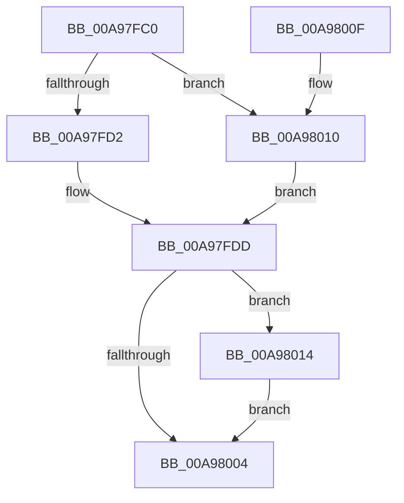

# PiSwProcessParentStartIrp

- RVA: `0x00A97FC0`–`0x00A98023` (길이 `99` bytes)
- VA: `0x0000000140A97FC0`
- 실행 섹션: `PAGE`
- PDB 이름 있음: `예`; PDB Function 태그: `아니요`
- unwind 정보 RVA: `0x00065624`
- 디코드: `28`개 명령, `99/99` bytes 표시
- 미해석 바이트: `0` (있으면 어셈블리에 `.byte`로 보존)

> 이 문서는 커널 이미지의 기계어와 PDB 기호를 분석해 생성했습니다. 4번과 5번은 함수 원형과 자료형을 바이너리 사용 방식에서 추정한 C 해석이며 원본 소스 복구 결과는 아닙니다.

## 1. Dependencies

- 직접 호출 지점: **5**; 고유 호출 대상: **5**
- 직접 호출자로 확인된 함수: **2**
- RIP 상대 이미지 참조: **1**

### Outgoing calls
- `0x00A97FDD` → [PiSwLock](../8F/PiSwLock_function_008F7D50.md) (function, `0x008F7D50`)
- `0x00A97FE6` → [PiSwFindChildren](../8F/PiSwFindChildren_function_008F8ED0.md) (function, `0x008F8ED0`)
- `0x00A97FF5` → [ExReleaseResourceLite](../../text/25/ExReleaseResourceLite_function_0025FA10.md) (function, `0x0025FA10`)
- `0x00A97FFA` → [KeLeaveCriticalRegion](../../text/25/KeLeaveCriticalRegion_function_0025D8B0.md) (function, `0x0025D8B0`)
- `0x00A9801C` → [IoInvalidateDeviceRelations](../../text/49/IoInvalidateDeviceRelations_function_0049E160.md) (function, `0x0049E160`)

### Direct callers
- [PnpDeviceCompletionProcessCompletedRequest](../8F/PnpDeviceCompletionProcessCompletedRequest_function_008FB654.md) at `0x008FB6ED`
- [PnpStartDeviceNode](../8F/PnpStartDeviceNode_function_008FE38C.md) at `0x008FE5D0`

### Static image references
- `0x00A97FEB` → RVA `0x00F8AB20` (`.data`; read)

## 2. Other-region calls and transfers

- 다른 실행 섹션으로 향하는 call: **3**
  - `0x00A97FF5` → [ExReleaseResourceLite](../../text/25/ExReleaseResourceLite_function_0025FA10.md) (`PAGE` → `.text`)
  - `0x00A97FFA` → [KeLeaveCriticalRegion](../../text/25/KeLeaveCriticalRegion_function_0025D8B0.md) (`PAGE` → `.text`)
  - `0x00A9801C` → [IoInvalidateDeviceRelations](../../text/49/IoInvalidateDeviceRelations_function_0049E160.md) (`PAGE` → `.text`)
- 별도 외부 분기/꼬리 이동을 확인하지 못했습니다.

## 3. Assembly (complete function range)

```asm
00A97FC0  48 89 5C 24 08                  mov qword ptr [rsp + 8], rbx
00A97FC5  57                              push rdi
00A97FC6  48 83 EC 20                     sub rsp, 0x20
00A97FCA  48 8B F9                        mov rdi, rcx
00A97FCD  48 85 C9                        test rcx, rcx
00A97FD0  74 3E                           je 0x140a98010
00A97FD2  48 8B 81 38 01 00 00            mov rax, qword ptr [rcx + 0x138]
00A97FD9  48 8B 58 28                     mov rbx, qword ptr [rax + 0x28]
00A97FDD  E8 6E FD E5 FF                  call 0x1408f7d50
00A97FE2  48 8D 4B 28                     lea rcx, [rbx + 0x28]
00A97FE6  E8 E5 0E E6 FF                  call 0x1408f8ed0
00A97FEB  48 8D 0D 2E 2B 4F 00            lea rcx, [rip + 0x4f2b2e]
00A97FF2  48 8B D8                        mov rbx, rax
00A97FF5  E8 16 7A 7C FF                  call 0x14025fa10
00A97FFA  E8 B1 58 7C FF                  call 0x14025d8b0
00A97FFF  48 85 DB                        test rbx, rbx
00A98002  75 10                           jne 0x140a98014
00A98004  48 8B 5C 24 30                  mov rbx, qword ptr [rsp + 0x30]
00A98009  48 83 C4 20                     add rsp, 0x20
00A9800D  5F                              pop rdi
00A9800E  C3                              ret
00A9800F  CC                              int3
00A98010  33 DB                           xor ebx, ebx
00A98012  EB C9                           jmp 0x140a97fdd
00A98014  BA 05 00 00 00                  mov edx, 5
00A98019  48 8B CF                        mov rcx, rdi
00A9801C  E8 3F 61 A0 FF                  call 0x14049e160
00A98021  EB E1                           jmp 0x140a98004
```

## 4. C-style interpretation (structured pseudocode)

```c
__int64 __fastcall PiSwProcessParentStartIrp(__int64 a1)
{
    __int64 result;
    __int64 v_rbx;
    __int64 v_rsp;
    unsigned __int64 v_stack_p8;

    v_stack_p8 = v_rbx;
    v_rsp = (v_rsp) - (32);
    if (a1 == 0) goto loc_00A98010;
loc_00A97FDD:
    result = PiSwLock(a1, a2, a3, a4);
    result = PiSwFindChildren(*(unsigned __int64 *)(*(unsigned __int64 *)(a1 + 312) + 40) + 40, a2, a3, a4);
    result = ExReleaseResourceLite(v_rip + 5188398, a2, a3, a4);
    result = KeLeaveCriticalRegion(v_rip + 5188398, a2, a3, a4);
    if (result != 0) goto loc_00A98014;
loc_00A98004:
    v_rsp = (v_rsp) + (32);
    return result;
loc_00A98010:
    v_rbx = 0;
    goto loc_00A97FDD;
loc_00A98014:
    result = IoInvalidateDeviceRelations(a1, 5, a3, a4);
    goto loc_00A98004;
}
```

## 5. (Beta) C Style

```c
int64_t PiSwProcessParentStartIrp(int64_t Arg1)
{
    int64_t result;
    int64_t local_rbx;
    int64_t local_rsp;
    uint64_t v_stack_p8;

    v_stack_p8 = local_rbx;
    local_rsp = (local_rsp) - (32);
    if (Arg1 == 0) goto loc_00A98010;
loc_00A97FDD:
    result = PiSwLock(Arg1, a2, a3, a4);
    result = PiSwFindChildren(*(uint64_t *)(*(uint64_t *)(Arg1 + 0x138) + 0x28) + 40, a2, a3, a4);
    result = ExReleaseResourceLite(v_rip + 5188398, a2, a3, a4);
    result = KeLeaveCriticalRegion(v_rip + 5188398, a2, a3, a4);
    if (result != 0) goto loc_00A98014;
loc_00A98004:
    local_rsp = (local_rsp) + (32);
    return result;
loc_00A98010:
    local_rbx = 0;
    goto loc_00A97FDD;
loc_00A98014:
    result = IoInvalidateDeviceRelations(Arg1, 5, a3, a4);
    goto loc_00A98004;
}
```

## 6. Execution-region graph

[열기: 2D/3D 그래프와 함수 탐색 컨트롤 패널](../../../control-panel.html?section=page&rva=0x00A97FC0&view=graph)

- 2D 그래프는 위에서 아래로 흐르고, 3D 그래프는 빈 공간을 드래그해 회전합니다. Shift+드래그는 이동, 휠은 확대·축소, 함수 노드 선택은 대상 보고서 이동입니다.

### Static fallback


