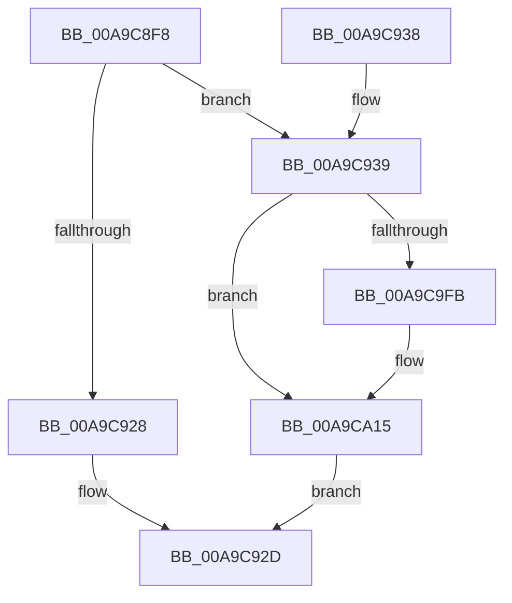

# PipAllocateDeviceNode

- RVA: `0x00A9C8F8`–`0x00A9CA7C` (길이 `388` bytes)
- VA: `0x0000000140A9C8F8`
- 실행 섹션: `PAGE`
- PDB 이름 있음: `예`; PDB Function 태그: `아니요`
- unwind 정보 RVA: `0x000BA648`
- 디코드: `92`개 명령, `388/388` bytes 표시
- 미해석 바이트: `0` (있으면 어셈블리에 `.byte`로 보존)

> 이 문서는 커널 이미지의 기계어와 PDB 기호를 분석해 생성했습니다. 4번과 5번은 함수 원형과 자료형을 바이너리 사용 방식에서 추정한 C 해석이며 원본 소스 복구 결과는 아닙니다.

## 1. Dependencies

- 직접 호출 지점: **1**; 고유 호출 대상: **1**
- 직접 호출자로 확인된 함수: **6**
- RIP 상대 이미지 참조: **1**

### Outgoing calls
- `0x00A9C918` → [ExAllocatePool2](../../poolcode/B8/ExAllocatePool2_function_00B820F0.md) (function, `0x00B820F0`)

### Direct callers
- [IoReportDetectedDevice](../72/IoReportDetectedDevice_function_00725CD0.md) at `0x0072612B`
- [PiInitializeDevice](../73/PiInitializeDevice_function_0073EC5C.md) at `0x0073EE88`
- [PipProcessEnumeratedChildDevice](../8F/PipProcessEnumeratedChildDevice_function_008FBF4C.md) at `0x008FBFC2`
- [IopFindLegacyDeviceNode](../AC/IopFindLegacyDeviceNode_function_00AC7338.md) at `0x00AC739A`
- [IopFindLegacyDeviceNode](../AC/IopFindLegacyDeviceNode_function_00AC7338.md) at `0x00AC7455`
- [sub_00B420B0](../B4/Unknown_function_00B420B0.md) at `0x00B42138`
- [IopInitializePlugPlayServices](../../init/C2/IopInitializePlugPlayServices_function_00C2F298.md) at `0x00C2FCC6`

### Static image references
- `0x00A9C939` → RVA `0x00F8C668` (`.data`; read/write)

## 2. Other-region calls and transfers

- 다른 실행 섹션으로 향하는 call: **1**
  - `0x00A9C918` → [ExAllocatePool2](../../poolcode/B8/ExAllocatePool2_function_00B820F0.md) (`PAGE` → `POOLCODE`)
- 별도 외부 분기/꼬리 이동을 확인하지 못했습니다.

## 3. Assembly (complete function range)

```asm
00A9C8F8  48 89 5C 24 08                  mov qword ptr [rsp + 8], rbx
00A9C8FD  57                              push rdi
00A9C8FE  48 83 EC 20                     sub rsp, 0x20
00A9C902  48 8B DA                        mov rbx, rdx
00A9C905  48 8B F9                        mov rdi, rcx
00A9C908  BA 88 03 00 00                  mov edx, 0x388
00A9C90D  B9 40 00 00 00                  mov ecx, 0x40
00A9C912  41 B8 44 6E 6F 64               mov r8d, 0x646f6e44
00A9C918  E8 D3 57 0E 00                  call 0x140b820f0
00A9C91D  45 33 C0                        xor r8d, r8d
00A9C920  48 89 03                        mov qword ptr [rbx], rax
00A9C923  48 85 C0                        test rax, rax
00A9C926  75 11                           jne 0x140a9c939
00A9C928  B8 9A 00 00 C0                  mov eax, 0xc000009a
00A9C92D  48 8B 5C 24 30                  mov rbx, qword ptr [rsp + 0x30]
00A9C932  48 83 C4 20                     add rsp, 0x20
00A9C936  5F                              pop rdi
00A9C937  C3                              ret
00A9C938  CC                              int3
00A9C939  F0 FF 05 28 FD 4E 00            lock inc dword ptr [rip + 0x4efd28]
00A9C940  48 8B 03                        mov rax, qword ptr [rbx]
00A9C943  83 C9 FF                        or ecx, 0xffffffff
00A9C946  83 CA FF                        or edx, 0xffffffff
00A9C949  89 88 C0 01 00 00               mov dword ptr [rax + 0x1c0], ecx
00A9C94F  48 8B 03                        mov rax, qword ptr [rbx]
00A9C952  89 90 C4 01 00 00               mov dword ptr [rax + 0x1c4], edx
00A9C958  48 8B 03                        mov rax, qword ptr [rbx]
00A9C95B  89 88 C8 01 00 00               mov dword ptr [rax + 0x1c8], ecx
00A9C961  48 B9 14 00 00 00 80 F7 FF FF   movabs rcx, 0xfffff78000000014
00A9C96B  48 8B 03                        mov rax, qword ptr [rbx]
00A9C96E  89 90 CC 01 00 00               mov dword ptr [rax + 0x1cc], edx
00A9C974  48 8B 03                        mov rax, qword ptr [rbx]
00A9C977  66 81 88 D0 01 00 00 FF FF      or word ptr [rax + 0x1d0], 0xffff
00A9C980  48 8B 03                        mov rax, qword ptr [rbx]
00A9C983  C7 80 2C 01 00 00 01 03 00 00   mov dword ptr [rax + 0x12c], 0x301
00A9C98D  48 8B 09                        mov rcx, qword ptr [rcx]
00A9C990  48 8B 03                        mov rax, qword ptr [rbx]
00A9C993  48 89 88 78 03 00 00            mov qword ptr [rax + 0x378], rcx
00A9C99A  48 8B 03                        mov rax, qword ptr [rbx]
00A9C99D  44 89 80 58 02 00 00            mov dword ptr [rax + 0x258], r8d
00A9C9A4  48 8B 03                        mov rax, qword ptr [rbx]
00A9C9A7  44 89 80 80 02 00 00            mov dword ptr [rax + 0x280], r8d
00A9C9AE  48 8B 03                        mov rax, qword ptr [rbx]
00A9C9B1  4C 89 80 88 02 00 00            mov qword ptr [rax + 0x288], r8
00A9C9B8  48 8B 03                        mov rax, qword ptr [rbx]
00A9C9BB  44 89 80 90 02 00 00            mov dword ptr [rax + 0x290], r8d
00A9C9C2  48 8B 03                        mov rax, qword ptr [rbx]
00A9C9C5  89 90 94 02 00 00               mov dword ptr [rax + 0x294], edx
00A9C9CB  48 8B 03                        mov rax, qword ptr [rbx]
00A9C9CE  66 44 89 80 D2 01 00 00         mov word ptr [rax + 0x1d2], r8w
00A9C9D6  48 8B 03                        mov rax, qword ptr [rbx]
00A9C9D9  48 05 E8 01 00 00               add rax, 0x1e8
00A9C9DF  48 89 40 08                     mov qword ptr [rax + 8], rax
00A9C9E3  48 89 00                        mov qword ptr [rax], rax
00A9C9E6  48 8B 03                        mov rax, qword ptr [rbx]
00A9C9E9  48 05 F8 01 00 00               add rax, 0x1f8
00A9C9EF  48 89 40 08                     mov qword ptr [rax + 8], rax
00A9C9F3  48 89 00                        mov qword ptr [rax], rax
00A9C9F6  48 85 FF                        test rdi, rdi
00A9C9F9  74 1A                           je 0x140a9ca15
00A9C9FB  48 8B 03                        mov rax, qword ptr [rbx]
00A9C9FE  48 89 78 20                     mov qword ptr [rax + 0x20], rdi
00A9CA02  48 8B 03                        mov rax, qword ptr [rbx]
00A9CA05  48 8B 8F 38 01 00 00            mov rcx, qword ptr [rdi + 0x138]
00A9CA0C  48 89 41 28                     mov qword ptr [rcx + 0x28], rax
00A9CA10  0F BA 77 30 07                  btr dword ptr [rdi + 0x30], 7
00A9CA15  48 8B 03                        mov rax, qword ptr [rbx]
00A9CA18  48 05 D8 01 00 00               add rax, 0x1d8
00A9CA1E  48 89 40 08                     mov qword ptr [rax + 8], rax
00A9CA22  48 89 00                        mov qword ptr [rax], rax
00A9CA25  48 8B 03                        mov rax, qword ptr [rbx]
00A9CA28  48 05 40 02 00 00               add rax, 0x240
00A9CA2E  48 89 40 08                     mov qword ptr [rax + 8], rax
00A9CA32  48 89 00                        mov qword ptr [rax], rax
00A9CA35  48 8B 03                        mov rax, qword ptr [rbx]
00A9CA38  48 05 60 02 00 00               add rax, 0x260
00A9CA3E  48 89 40 08                     mov qword ptr [rax + 8], rax
00A9CA42  48 89 00                        mov qword ptr [rax], rax
00A9CA45  48 8B 03                        mov rax, qword ptr [rbx]
00A9CA48  48 05 70 02 00 00               add rax, 0x270
00A9CA4E  48 89 40 08                     mov qword ptr [rax + 8], rax
00A9CA52  48 89 00                        mov qword ptr [rax], rax
00A9CA55  48 8B 03                        mov rax, qword ptr [rbx]
00A9CA58  48 05 B0 00 00 00               add rax, 0xb0
00A9CA5E  48 89 40 08                     mov qword ptr [rax + 8], rax
00A9CA62  48 89 00                        mov qword ptr [rax], rax
00A9CA65  48 8B 03                        mov rax, qword ptr [rbx]
00A9CA68  48 05 C0 00 00 00               add rax, 0xc0
00A9CA6E  48 89 40 08                     mov qword ptr [rax + 8], rax
00A9CA72  48 89 00                        mov qword ptr [rax], rax
00A9CA75  33 C0                           xor eax, eax
00A9CA77  E9 B1 FE FF FF                  jmp 0x140a9c92d
```

## 4. C-style interpretation (structured pseudocode)

```c
__int64 __fastcall PipAllocateDeviceNode(__int64 a1, __int64 a2)
{
    __int64 result;
    __int64 v_rsp;
    unsigned __int64 v_stack_p8;

    v_stack_p8 = v_rbx;
    v_rsp = (v_rsp) - (32);
    result = ExAllocatePool2(64, 904, (unsigned int)(0x646F6E44ULL), a4);
    a3 = 0;
    *(unsigned __int64 *)(a2) = result;
    if (result != 0) goto loc_00A9C939;
loc_00A9C92D:
    v_rsp = (v_rsp) + (32);
    return (unsigned int)(0xC000009AULL);
loc_00A9C939:
    a1 = (unsigned int)((64) | (0xFFFFFFFFULL));
    a2 = (unsigned int)((904) | (0xFFFFFFFFULL));
    *(unsigned int *)(*(unsigned __int64 *)(v_stack_p8) + 448) = (unsigned int)(a1);
    *(unsigned int *)(*(unsigned __int64 *)(v_stack_p8) + 452) = (unsigned int)(a2);
    *(unsigned int *)(*(unsigned __int64 *)(v_stack_p8) + 456) = (unsigned int)(a1);
    *(unsigned int *)(*(unsigned __int64 *)(v_stack_p8) + 460) = (unsigned int)(a2);
    *(unsigned int *)(*(unsigned __int64 *)(v_stack_p8) + 300) = 769;
    *(unsigned __int64 *)(*(unsigned __int64 *)(v_stack_p8) + 888) = *(unsigned __int64 *)(a1);
    *(unsigned int *)(*(unsigned __int64 *)(v_stack_p8) + 600) = 0;
    *(unsigned int *)(*(unsigned __int64 *)(v_stack_p8) + 640) = 0;
    *(unsigned __int64 *)(*(unsigned __int64 *)(v_stack_p8) + 648) = 0;
    *(unsigned int *)(*(unsigned __int64 *)(v_stack_p8) + 656) = 0;
    *(unsigned int *)(*(unsigned __int64 *)(v_stack_p8) + 660) = (unsigned int)(a2);
    *(unsigned __int16 *)(*(unsigned __int64 *)(v_stack_p8) + 466) = 0;
    result = (*(unsigned __int64 *)(v_stack_p8)) + (488);
    *(unsigned __int64 *)(result + 8) = result;
    *(unsigned __int64 *)(result) = result;
    result = (*(unsigned __int64 *)(v_stack_p8)) + (504);
    *(unsigned __int64 *)(result + 8) = result;
    *(unsigned __int64 *)(result) = result;
    if (a1 != 0) {
        result = *(unsigned __int64 *)(v_stack_p8);
        *(unsigned __int64 *)(result + 32) = a1;
        result = *(unsigned __int64 *)(v_stack_p8);
        a1 = *(unsigned __int64 *)(a1 + 312);
        *(unsigned __int64 *)(a1 + 40) = result;
    }
    result = (*(unsigned __int64 *)(v_stack_p8)) + (472);
    *(unsigned __int64 *)(result + 8) = result;
    *(unsigned __int64 *)(result) = result;
    result = (*(unsigned __int64 *)(v_stack_p8)) + (576);
    *(unsigned __int64 *)(result + 8) = result;
    *(unsigned __int64 *)(result) = result;
    result = (*(unsigned __int64 *)(v_stack_p8)) + (608);
    *(unsigned __int64 *)(result + 8) = result;
    *(unsigned __int64 *)(result) = result;
    result = (*(unsigned __int64 *)(v_stack_p8)) + (624);
    *(unsigned __int64 *)(result + 8) = result;
    *(unsigned __int64 *)(result) = result;
    result = (*(unsigned __int64 *)(v_stack_p8)) + (176);
    *(unsigned __int64 *)(result + 8) = result;
    *(unsigned __int64 *)(result) = result;
    result = (*(unsigned __int64 *)(v_stack_p8)) + (192);
    *(unsigned __int64 *)(result + 8) = result;
    *(unsigned __int64 *)(result) = result;
    result = 0;
    goto loc_00A9C92D;
}
```

## 5. (Beta) C Style

```c
int64_t PipAllocateDeviceNode(int64_t Arg1, void *Arg2)
{
    uint8_t *arg2 = (uint8_t *)Arg2;

    int64_t result;
    int64_t local_rsp;
    uint64_t v_stack_p8;

    v_stack_p8 = local_rbx;
    local_rsp = (local_rsp) - (32);
    result = ExAllocatePool2(64, 904, (uint32_t)(0x646F6E44ULL), a4);
    a3 = 0;
    *(uint64_t *)(arg2) = result;
    if (result != 0) goto loc_00A9C939;
loc_00A9C92D:
    local_rsp = (local_rsp) + (32);
    return (uint32_t)(0xC000009AULL);
loc_00A9C939:
    Arg1 = (uint32_t)((64) | (0xFFFFFFFFULL));
    Arg2 = (uint32_t)((904) | (0xFFFFFFFFULL));
    *(uint32_t *)(*(uint64_t *)(v_stack_p8) + 0x1C0) = (uint32_t)(Arg1);
    *(uint32_t *)(*(uint64_t *)(v_stack_p8) + 0x1C4) = (uint32_t)(Arg2);
    *(uint32_t *)(*(uint64_t *)(v_stack_p8) + 0x1C8) = (uint32_t)(Arg1);
    *(uint32_t *)(*(uint64_t *)(v_stack_p8) + 0x1CC) = (uint32_t)(Arg2);
    *(uint32_t *)(*(uint64_t *)(v_stack_p8) + 0x12C) = 769;
    *(uint64_t *)(*(uint64_t *)(v_stack_p8) + 0x378) = *(uint64_t *)(Arg1);
    *(uint32_t *)(*(uint64_t *)(v_stack_p8) + 0x258) = 0;
    *(uint32_t *)(*(uint64_t *)(v_stack_p8) + 0x280) = 0;
    *(uint64_t *)(*(uint64_t *)(v_stack_p8) + 0x288) = 0;
    *(uint32_t *)(*(uint64_t *)(v_stack_p8) + 0x290) = 0;
    *(uint32_t *)(*(uint64_t *)(v_stack_p8) + 0x294) = (uint32_t)(Arg2);
    *(uint16_t *)(*(uint64_t *)(v_stack_p8) + 0x1D2) = 0;
    result = (*(uint64_t *)(v_stack_p8)) + (488);
    *(uint64_t *)(result + 0x8) = result;
    *(uint64_t *)(result) = result;
    result = (*(uint64_t *)(v_stack_p8)) + (504);
    *(uint64_t *)(result + 0x8) = result;
    *(uint64_t *)(result) = result;
    if (Arg1 != 0) {
        result = *(uint64_t *)(v_stack_p8);
        *(uint64_t *)(result + 0x20) = Arg1;
        result = *(uint64_t *)(v_stack_p8);
        Arg1 = *(uint64_t *)(Arg1 + 0x138);
        *(uint64_t *)(Arg1 + 0x28) = result;
    }
    result = (*(uint64_t *)(v_stack_p8)) + (472);
    *(uint64_t *)(result + 0x8) = result;
    *(uint64_t *)(result) = result;
    result = (*(uint64_t *)(v_stack_p8)) + (576);
    *(uint64_t *)(result + 0x8) = result;
    *(uint64_t *)(result) = result;
    result = (*(uint64_t *)(v_stack_p8)) + (608);
    *(uint64_t *)(result + 0x8) = result;
    *(uint64_t *)(result) = result;
    result = (*(uint64_t *)(v_stack_p8)) + (624);
    *(uint64_t *)(result + 0x8) = result;
    *(uint64_t *)(result) = result;
    result = (*(uint64_t *)(v_stack_p8)) + (176);
    *(uint64_t *)(result + 0x8) = result;
    *(uint64_t *)(result) = result;
    result = (*(uint64_t *)(v_stack_p8)) + (192);
    *(uint64_t *)(result + 0x8) = result;
    *(uint64_t *)(result) = result;
    result = 0;
    goto loc_00A9C92D;
}
```

### 관측된 메모리 오프셋

구조체 형식이 확인되지 않은 접근은 인자 기준의 오프셋으로만 기록했습니다.

| 기준 인자 | 오프셋 표현 | 폭 (bit) | 접근 |
|---|---:|---:|---|
| `Arg2` | `+ 0x0` | `64` | `R` |
| `Arg2` | `+ 0x0` | `64` | `W` |

## 6. Execution-region graph

[열기: 2D/3D 그래프와 함수 탐색 컨트롤 패널](../../../control-panel.html?section=page&rva=0x00A9C8F8&view=graph)

- 2D 그래프는 위에서 아래로 흐르고, 3D 그래프는 빈 공간을 드래그해 회전합니다. Shift+드래그는 이동, 휠은 확대·축소, 함수 노드 선택은 대상 보고서 이동입니다.

### Static fallback


