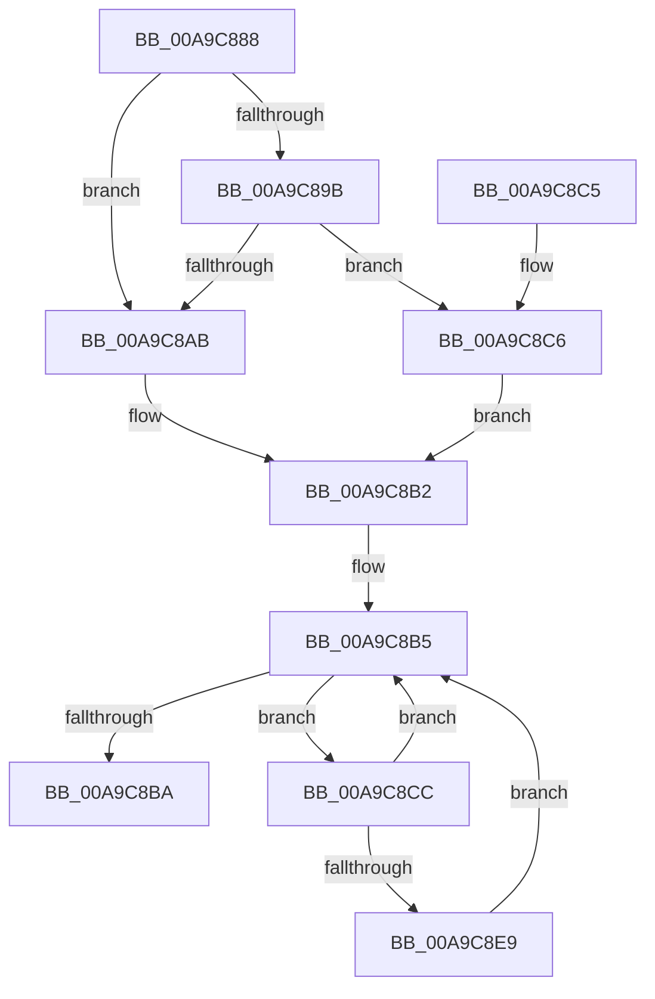

# PipAttemptDependentsStart

- RVA: `0x00A9C888`–`0x00A9C8F0` (길이 `104` bytes)
- VA: `0x0000000140A9C888`
- 실행 섹션: `PAGE`
- PDB 이름 있음: `예`; PDB Function 태그: `아니요`
- unwind 정보 RVA: `0x000ACE78`
- 디코드: `31`개 명령, `104/104` bytes 표시
- 미해석 바이트: `0` (있으면 어셈블리에 `.byte`로 보존)

> 이 문서는 커널 이미지의 기계어와 PDB 기호를 분석해 생성했습니다. 4번과 5번은 함수 원형과 자료형을 바이너리 사용 방식에서 추정한 C 해석이며 원본 소스 복구 결과는 아닙니다.

## 1. Dependencies

- 직접 호출 지점: **2**; 고유 호출 대상: **2**
- 직접 호출자로 확인된 함수: **2**
- RIP 상대 이미지 참조: **1**

### Outgoing calls
- `0x00A9C8D4` → [PiListEntryToDependencyEdge](../../text/4F/PiListEntryToDependencyEdge_function_004F9648.md) (function, `0x004F9648`)
- `0x00A9C8E9` → [PipAttemptDependentStart](../72/PipAttemptDependentStart_function_007279F0.md) (function, `0x007279F0`)

### Direct callers
- [IoResolveDependency](../../text/4C/IoResolveDependency_function_004C4380.md) at `0x004C44CA`
- [PnpStartedDeviceNodeDependencyCheck](../8F/PnpStartedDeviceNodeDependencyCheck_function_008FCF58.md) at `0x008FCF91`

### Static image references
- `0x00A9C8AB` → RVA `0x00F8CE70` (`.data`; read)

## 2. Other-region calls and transfers

- 다른 실행 섹션으로 향하는 call: **1**
  - `0x00A9C8D4` → [PiListEntryToDependencyEdge](../../text/4F/PiListEntryToDependencyEdge_function_004F9648.md) (`PAGE` → `.text`)
- 별도 외부 분기/꼬리 이동을 확인하지 못했습니다.

## 3. Assembly (complete function range)

```asm
00A9C888  48 89 5C 24 08                  mov qword ptr [rsp + 8], rbx
00A9C88D  57                              push rdi
00A9C88E  48 83 EC 20                     sub rsp, 0x20
00A9C892  48 8B 41 20                     mov rax, qword ptr [rcx + 0x20]
00A9C896  48 85 C0                        test rax, rax
00A9C899  74 10                           je 0x140a9c8ab
00A9C89B  48 8B 80 38 01 00 00            mov rax, qword ptr [rax + 0x138]
00A9C8A2  48 8B 58 50                     mov rbx, qword ptr [rax + 0x50]
00A9C8A6  48 85 DB                        test rbx, rbx
00A9C8A9  75 1B                           jne 0x140a9c8c6
00A9C8AB  48 8D 1D BE 05 4F 00            lea rbx, [rip + 0x4f05be]
00A9C8B2  48 8B 3B                        mov rdi, qword ptr [rbx]
00A9C8B5  48 3B FB                        cmp rdi, rbx
00A9C8B8  75 12                           jne 0x140a9c8cc
00A9C8BA  48 8B 5C 24 30                  mov rbx, qword ptr [rsp + 0x30]
00A9C8BF  48 83 C4 20                     add rsp, 0x20
00A9C8C3  5F                              pop rdi
00A9C8C4  C3                              ret
00A9C8C5  CC                              int3
00A9C8C6  48 83 C3 20                     add rbx, 0x20
00A9C8CA  EB E6                           jmp 0x140a9c8b2
00A9C8CC  BA 01 00 00 00                  mov edx, 1
00A9C8D1  48 8B CF                        mov rcx, rdi
00A9C8D4  E8 6F CD A5 FF                  call 0x1404f9648
00A9C8D9  48 8B 3F                        mov rdi, qword ptr [rdi]
00A9C8DC  48 8B 48 28                     mov rcx, qword ptr [rax + 0x28]
00A9C8E0  48 8B 49 30                     mov rcx, qword ptr [rcx + 0x30]
00A9C8E4  48 85 C9                        test rcx, rcx
00A9C8E7  74 CC                           je 0x140a9c8b5
00A9C8E9  E8 02 B1 C8 FF                  call 0x1407279f0
00A9C8EE  EB C5                           jmp 0x140a9c8b5
```

## 4. C-style interpretation (structured pseudocode)

```c
__int64 __fastcall PipAttemptDependentsStart(__int64 a1)
{
    __int64 result;
    __int64 v_rbx;
    __int64 v_rsp;
    unsigned __int64 v_stack_p8;

    v_stack_p8 = v_rbx;
    v_rsp = (v_rsp) - (32);
    if (*(unsigned __int64 *)(a1 + 32) == 0) goto loc_00A9C8AB;
    if (*(unsigned __int64 *)(*(unsigned __int64 *)(*(unsigned __int64 *)(a1 + 32) + 312) + 80) != 0) goto loc_00A9C8C6;
loc_00A9C8AB:
loc_00A9C8B2:
loc_00A9C8B5:
    if ((*(unsigned __int64 *)(v_rip + 5178814)) != (v_rip + 5178814)) goto loc_00A9C8CC;
    v_rsp = (v_rsp) + (32);
    return *(unsigned __int64 *)(*(unsigned __int64 *)(a1 + 32) + 312);
loc_00A9C8C6:
    v_rbx = (v_stack_p8) + (32);
    goto loc_00A9C8B2;
loc_00A9C8CC:
    result = PiListEntryToDependencyEdge(*(unsigned __int64 *)(v_rip + 5178814), 1, a3, a4);
    if (*(unsigned __int64 *)(*(unsigned __int64 *)(result + 40) + 48) == 0) goto loc_00A9C8B5;
    result = PipAttemptDependentStart(*(unsigned __int64 *)(*(unsigned __int64 *)(result + 40) + 48), 1, a3, a4);
    goto loc_00A9C8B5;
}
```

## 5. (Beta) C Style

```c
int64_t PipAttemptDependentsStart(void *Arg1)
{
    uint8_t *arg1 = (uint8_t *)Arg1;

    int64_t result;
    int64_t local_rbx;
    int64_t local_rsp;
    uint64_t v_stack_p8;

    v_stack_p8 = local_rbx;
    local_rsp = (local_rsp) - (32);
    if (*(uint64_t *)(arg1 + 0x20) == 0) goto loc_00A9C8AB;
    if (*(uint64_t *)(*(uint64_t *)(*(uint64_t *)(arg1 + 0x20) + 0x138) + 0x50) != 0) goto loc_00A9C8C6;
loc_00A9C8AB:
loc_00A9C8B2:
loc_00A9C8B5:
    if ((*(uint64_t *)(v_rip + 0x4F05BE)) != (v_rip + 5178814)) goto loc_00A9C8CC;
    local_rsp = (local_rsp) + (32);
    return *(uint64_t *)(*(uint64_t *)(arg1 + 0x20) + 0x138);
loc_00A9C8C6:
    local_rbx = (v_stack_p8) + (32);
    goto loc_00A9C8B2;
loc_00A9C8CC:
    result = PiListEntryToDependencyEdge(*(uint64_t *)(v_rip + 0x4F05BE), 1, a3, a4);
    if (*(uint64_t *)(*(uint64_t *)(result + 0x28) + 0x30) == 0) goto loc_00A9C8B5;
    result = PipAttemptDependentStart(*(uint64_t *)(*(uint64_t *)(result + 0x28) + 0x30), 1, a3, a4);
    goto loc_00A9C8B5;
}
```

### 관측된 메모리 오프셋

구조체 형식이 확인되지 않은 접근은 인자 기준의 오프셋으로만 기록했습니다.

| 기준 인자 | 오프셋 표현 | 폭 (bit) | 접근 |
|---|---:|---:|---|
| `Arg1` | `+ 0x20` | `64` | `R` |

## 6. Execution-region graph

[열기: 2D/3D 그래프와 함수 탐색 컨트롤 패널](../../../control-panel.html?section=page&rva=0x00A9C888&view=graph)

- 2D 그래프는 위에서 아래로 흐르고, 3D 그래프는 빈 공간을 드래그해 회전합니다. Shift+드래그는 이동, 휠은 확대·축소, 함수 노드 선택은 대상 보고서 이동입니다.

### Static fallback


