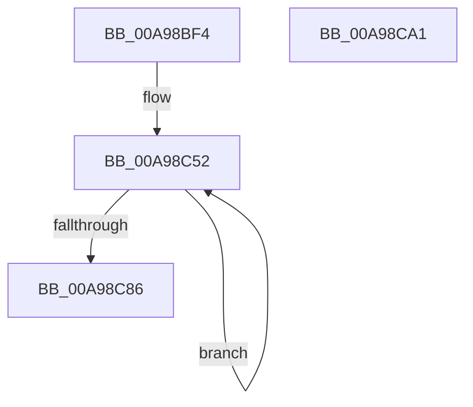

# PnpContainerRaiseDevicesChangeEvent

- RVA: `0x00A98BF4`–`0x00A98CA2` (길이 `174` bytes)
- VA: `0x0000000140A98BF4`
- 실행 섹션: `PAGE`
- PDB 이름 있음: `예`; PDB Function 태그: `아니요`
- unwind 정보 RVA: `0x00091ECC`
- 디코드: `44`개 명령, `174/174` bytes 표시
- 미해석 바이트: `0` (있으면 어셈블리에 `.byte`로 보존)

> 이 문서는 커널 이미지의 기계어와 PDB 기호를 분석해 생성했습니다. 4번과 5번은 함수 원형과 자료형을 바이너리 사용 방식에서 추정한 C 해석이며 원본 소스 복구 결과는 아닙니다.

## 1. Dependencies

- 직접 호출 지점: **2**; 고유 호출 대상: **1**
- 직접 호출자로 확인된 함수: **1**
- RIP 상대 이미지 참조: **1**

### Outgoing calls
- `0x00A98C38` → [guard_dispatch_icall](../../text/6B/guard_dispatch_icall_function_006BAAD0.md) (function, `0x006BAAD0`)
- `0x00A98C77` → [guard_dispatch_icall](../../text/6B/guard_dispatch_icall_function_006BAAD0.md) (function, `0x006BAAD0`)

### Direct callers
- [PnpObjectRaiseDevicesChangeEvent](../AC/PnpObjectRaiseDevicesChangeEvent_function_00AC9888.md) at `0x00AC98EB`

### Static image references
- `0x00A98C40` → RVA `0x0000C458` (`.rdata`; read)

## 2. Other-region calls and transfers

- 다른 실행 섹션으로 향하는 call: **2**
  - `0x00A98C38` → [guard_dispatch_icall](../../text/6B/guard_dispatch_icall_function_006BAAD0.md) (`PAGE` → `.text`)
  - `0x00A98C77` → [guard_dispatch_icall](../../text/6B/guard_dispatch_icall_function_006BAAD0.md) (`PAGE` → `.text`)
- 별도 외부 분기/꼬리 이동을 확인하지 못했습니다.

## 3. Assembly (complete function range)

```asm
00A98BF4  48 8B C4                        mov rax, rsp
00A98BF7  48 89 58 08                     mov qword ptr [rax + 8], rbx
00A98BFB  48 89 68 10                     mov qword ptr [rax + 0x10], rbp
00A98BFF  48 89 70 18                     mov qword ptr [rax + 0x18], rsi
00A98C03  48 89 78 20                     mov qword ptr [rax + 0x20], rdi
00A98C07  41 56                           push r14
00A98C09  48 83 EC 50                     sub rsp, 0x50
00A98C0D  48 83 60 D8 00                  and qword ptr [rax - 0x28], 0
00A98C12  48 8D 40 D8                     lea rax, [rax - 0x28]
00A98C16  49 8B F0                        mov rsi, r8
00A98C19  48 89 44 24 20                  mov qword ptr [rsp + 0x20], rax
00A98C1E  0F 57 C0                        xorps xmm0, xmm0
00A98C21  41 B9 05 00 00 00               mov r9d, 5
00A98C27  F3 0F 7F 40 08                  movdqu xmmword ptr [rax + 8], xmm0
00A98C2C  48 8B C6                        mov rax, rsi
00A98C2F  45 8B C1                        mov r8d, r9d
00A98C32  48 8B EA                        mov rbp, rdx
00A98C35  4C 8B F1                        mov r14, rcx
00A98C38  E8 93 1E C2 FF                  call 0x1406baad0
00A98C3D  0F 57 C0                        xorps xmm0, xmm0
00A98C40  48 8D 1D 11 38 57 FF            lea rbx, [rip - 0xa8c7ef]
00A98C47  F3 0F 7F 44 24 30               movdqu xmmword ptr [rsp + 0x30], xmm0
00A98C4D  BF 03 00 00 00                  mov edi, 3
00A98C52  48 8B 03                        mov rax, qword ptr [rbx]
00A98C55  41 B9 04 00 00 00               mov r9d, 4
00A98C5B  48 89 44 24 40                  mov qword ptr [rsp + 0x40], rax
00A98C60  48 8B D5                        mov rdx, rbp
00A98C63  48 8D 44 24 30                  lea rax, [rsp + 0x30]
00A98C68  49 8B CE                        mov rcx, r14
00A98C6B  48 89 44 24 20                  mov qword ptr [rsp + 0x20], rax
00A98C70  48 8B C6                        mov rax, rsi
00A98C73  45 8D 41 01                     lea r8d, [r9 + 1]
00A98C77  E8 54 1E C2 FF                  call 0x1406baad0
00A98C7C  48 8D 5B 08                     lea rbx, [rbx + 8]
00A98C80  48 83 EF 01                     sub rdi, 1
00A98C84  75 CC                           jne 0x140a98c52
00A98C86  48 8B 5C 24 60                  mov rbx, qword ptr [rsp + 0x60]
00A98C8B  48 8B 6C 24 68                  mov rbp, qword ptr [rsp + 0x68]
00A98C90  48 8B 74 24 70                  mov rsi, qword ptr [rsp + 0x70]
00A98C95  48 8B 7C 24 78                  mov rdi, qword ptr [rsp + 0x78]
00A98C9A  48 83 C4 50                     add rsp, 0x50
00A98C9E  41 5E                           pop r14
00A98CA0  C3                              ret
00A98CA1  CC                              int3
```

## 4. C-style interpretation (structured pseudocode)

```c
__int64 __fastcall PnpContainerRaiseDevicesChangeEvent(__int64 a1, __int64 a2, __int64 a3)
{
    __int64 result;
    __int64 v_rdi;
    __int64 v_rsp;
    unsigned __int64 v_stack_m18;
    unsigned __int64 v_stack_m28;
    unsigned __int64 v_stack_m38;
    unsigned __int64 v_stack_p10;
    unsigned __int64 v_stack_p18;
    unsigned __int64 v_stack_p20;
    unsigned __int64 v_stack_p8;

    *(unsigned __int64 *)(v_rsp + 8) = v_rbx;
    *(unsigned __int64 *)(v_rsp + 16) = v_rbp;
    *(unsigned __int64 *)(v_rsp + 24) = v_rsi;
    *(unsigned __int64 *)(v_rsp + 32) = v_rdi;
    v_rsp = (v_rsp) - (80);
    v_stack_m38 = v_rsp - 40;
    *(unsigned __int64 *)(v_rsp - 40 + 8) = v_xmm0;
    result = guard_dispatch_icall(a1, a2, 5, 5);
    v_stack_m28 = v_xmm0;
loc_00A98C52:
    v_stack_m18 = *(unsigned __int64 *)(v_rip - 11061231);
    v_stack_m38 = v_stack_m28;
    result = guard_dispatch_icall(a1, a2, 4 + 1, 4);
    v_rdi = (3) - (1);
    if (condition_is_not_equal) goto loc_00A98C52;
    v_rsp = (v_rsp) + (80);
    return result;
}
```

## 5. (Beta) C Style

```c
int64_t PnpContainerRaiseDevicesChangeEvent(int64_t Arg1, int64_t Arg2, int64_t Arg3)
{
    int64_t result;
    int64_t local_rdi;
    int64_t local_rsp;
    uint64_t v_stack_m18;
    uint64_t v_stack_m28;
    uint64_t v_stack_m38;
    uint64_t v_stack_p10;
    uint64_t v_stack_p18;
    uint64_t v_stack_p20;
    uint64_t v_stack_p8;

    *(uint64_t *)(local_rsp + 0x8) = local_rbx;
    *(uint64_t *)(local_rsp + 0x10) = local_rbp;
    *(uint64_t *)(local_rsp + 0x18) = local_rsi;
    *(uint64_t *)(local_rsp + 0x20) = local_rdi;
    local_rsp = (local_rsp) - (80);
    v_stack_m38 = local_rsp - 40;
    *(uint64_t *)(local_rsp - 0x28 + 0x8) = v_xmm0;
    result = guard_dispatch_icall(Arg1, Arg2, 5, 5);
    v_stack_m28 = v_xmm0;
loc_00A98C52:
    v_stack_m18 = *(uint64_t *)(v_rip - 0xA8C7EF);
    v_stack_m38 = v_stack_m28;
    result = guard_dispatch_icall(Arg1, Arg2, 4 + 1, 4);
    local_rdi = (3) - (1);
    if (condition_is_not_equal) goto loc_00A98C52;
    local_rsp = (local_rsp) + (80);
    return result;
}
```

## 6. Execution-region graph

[열기: 2D/3D 그래프와 함수 탐색 컨트롤 패널](../../../control-panel.html?section=page&rva=0x00A98BF4&view=graph)

- 2D 그래프는 위에서 아래로 흐르고, 3D 그래프는 빈 공간을 드래그해 회전합니다. Shift+드래그는 이동, 휠은 확대·축소, 함수 노드 선택은 대상 보고서 이동입니다.

### Static fallback


