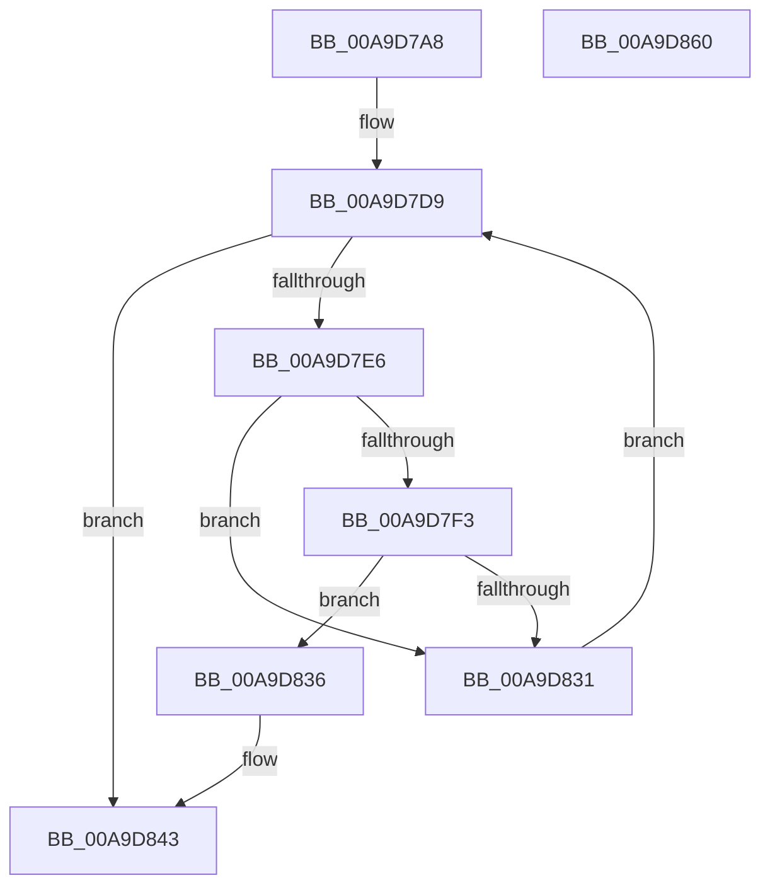

# PnpHandleEnumerateHandlesAgainstDeviceObject

- RVA: `0x00A9D7A8`–`0x00A9D861` (길이 `185` bytes)
- VA: `0x0000000140A9D7A8`
- 실행 섹션: `PAGE`
- PDB 이름 있음: `예`; PDB Function 태그: `아니요`
- unwind 정보 RVA: `0x00060130`
- 디코드: `51`개 명령, `185/185` bytes 표시
- 미해석 바이트: `0` (있으면 어셈블리에 `.byte`로 보존)

> 이 문서는 커널 이미지의 기계어와 PDB 기호를 분석해 생성했습니다. 4번과 5번은 함수 원형과 자료형을 바이너리 사용 방식에서 추정한 C 해석이며 원본 소스 복구 결과는 아닙니다.

## 1. Dependencies

- 직접 호출 지점: **5**; 고유 호출 대상: **5**
- 직접 호출자로 확인된 함수: **1**
- RIP 상대 이미지 참조: **1**

### Outgoing calls
- `0x00A9D7D9` → [PsGetNextProcess](../91/PsGetNextProcess_function_0091C900.md) (function, `0x0091C900`)
- `0x00A9D7E9` → [ObReferenceProcessHandleTable](../89/ObReferenceProcessHandleTable_function_00893B70.md) (function, `0x00893B70`)
- `0x00A9D819` → [ExEnumHandleTable](../91/ExEnumHandleTable_function_0091DB20.md) (function, `0x0091DB20`)
- `0x00A9D828` → [ExReleaseRundownProtection](../../text/34/ExReleaseRundownProtection_function_00349E80.md) (function, `0x00349E80`)
- `0x00A9D83E` → [ObfDereferenceObjectWithTag](../../text/2F/ObfDereferenceObjectWithTag_function_002F78E0.md) (function, `0x002F78E0`)

### Direct callers
- [PnpHandleEnumerateHandlesAgainstPdoStack](../../text/4C/PnpHandleEnumerateHandlesAgainstPdoStack_function_004C8F94.md) at `0x004C8FCD`
- [PnpHandleEnumerateHandlesAgainstPdoStack](../../text/4C/PnpHandleEnumerateHandlesAgainstPdoStack_function_004C8F94.md) at `0x004C9031`

### Static image references
- `0x00A9D805` → RVA `0x0091DE30` (`PnpHandleProcessWalkWorker`; read)

## 2. Other-region calls and transfers

- 다른 실행 섹션으로 향하는 call: **2**
  - `0x00A9D828` → [ExReleaseRundownProtection](../../text/34/ExReleaseRundownProtection_function_00349E80.md) (`PAGE` → `.text`)
  - `0x00A9D83E` → [ObfDereferenceObjectWithTag](../../text/2F/ObfDereferenceObjectWithTag_function_002F78E0.md) (`PAGE` → `.text`)
- 별도 외부 분기/꼬리 이동을 확인하지 못했습니다.

## 3. Assembly (complete function range)

```asm
00A9D7A8  48 8B C4                        mov rax, rsp
00A9D7AB  48 89 58 08                     mov qword ptr [rax + 8], rbx
00A9D7AF  48 89 68 10                     mov qword ptr [rax + 0x10], rbp
00A9D7B3  48 89 70 18                     mov qword ptr [rax + 0x18], rsi
00A9D7B7  48 89 78 20                     mov qword ptr [rax + 0x20], rdi
00A9D7BB  41 56                           push r14
00A9D7BD  48 83 EC 40                     sub rsp, 0x40
00A9D7C1  0F 57 C0                        xorps xmm0, xmm0
00A9D7C4  33 FF                           xor edi, edi
00A9D7C6  4C 8B F1                        mov r14, rcx
00A9D7C9  49 8B F0                        mov rsi, r8
00A9D7CC  0F 11 40 D8                     movups xmmword ptr [rax - 0x28], xmm0
00A9D7D0  33 C9                           xor ecx, ecx
00A9D7D2  48 8B EA                        mov rbp, rdx
00A9D7D5  0F 11 40 E8                     movups xmmword ptr [rax - 0x18], xmm0
00A9D7D9  E8 22 F1 E7 FF                  call 0x14091c900
00A9D7DE  48 8B D8                        mov rbx, rax
00A9D7E1  48 85 C0                        test rax, rax
00A9D7E4  74 5D                           je 0x140a9d843
00A9D7E6  48 8B C8                        mov rcx, rax
00A9D7E9  E8 82 63 DF FF                  call 0x140893b70
00A9D7EE  48 85 C0                        test rax, rax
00A9D7F1  74 3E                           je 0x140a9d831
00A9D7F3  45 33 C9                        xor r9d, r9d
00A9D7F6  4C 89 74 24 20                  mov qword ptr [rsp + 0x20], r14
00A9D7FB  4C 8D 44 24 20                  lea r8, [rsp + 0x20]
00A9D800  48 89 5C 24 28                  mov qword ptr [rsp + 0x28], rbx
00A9D805  48 8D 15 24 06 E8 FF            lea rdx, [rip - 0x17f9dc]
00A9D80C  48 89 6C 24 30                  mov qword ptr [rsp + 0x30], rbp
00A9D811  48 8B C8                        mov rcx, rax
00A9D814  48 89 74 24 38                  mov qword ptr [rsp + 0x38], rsi
00A9D819  E8 02 03 E8 FF                  call 0x14091db20
00A9D81E  48 8D 8B E8 01 00 00            lea rcx, [rbx + 0x1e8]
00A9D825  0F B6 F8                        movzx edi, al
00A9D828  E8 53 C6 8A FF                  call 0x140349e80
00A9D82D  85 FF                           test edi, edi
00A9D82F  75 05                           jne 0x140a9d836
00A9D831  48 8B CB                        mov rcx, rbx
00A9D834  EB A3                           jmp 0x140a9d7d9
00A9D836  BA 50 73 45 6E                  mov edx, 0x6e457350
00A9D83B  48 8B CB                        mov rcx, rbx
00A9D83E  E8 9D A0 85 FF                  call 0x1402f78e0
00A9D843  48 8B 5C 24 50                  mov rbx, qword ptr [rsp + 0x50]
00A9D848  8B C7                           mov eax, edi
00A9D84A  48 8B 7C 24 68                  mov rdi, qword ptr [rsp + 0x68]
00A9D84F  48 8B 6C 24 58                  mov rbp, qword ptr [rsp + 0x58]
00A9D854  48 8B 74 24 60                  mov rsi, qword ptr [rsp + 0x60]
00A9D859  48 83 C4 40                     add rsp, 0x40
00A9D85D  41 5E                           pop r14
00A9D85F  C3                              ret
00A9D860  CC                              int3
```

## 4. C-style interpretation (structured pseudocode)

```c
__int64 __fastcall PnpHandleEnumerateHandlesAgainstDeviceObject(__int64 a1, __int64 a2, __int64 a3, int a4)
{
    __int64 result;
    __int64 v_rdi;
    __int64 v_rsp;
    unsigned __int64 v_stack_m10;
    unsigned __int64 v_stack_m18;
    unsigned __int64 v_stack_m20;
    unsigned __int64 v_stack_m28;
    unsigned __int64 v_stack_p10;
    unsigned __int64 v_stack_p18;
    unsigned __int64 v_stack_p20;
    unsigned __int64 v_stack_p8;

    *(unsigned __int64 *)(v_rsp + 8) = v_rbx;
    *(unsigned __int64 *)(v_rsp + 16) = v_rbp;
    *(unsigned __int64 *)(v_rsp + 24) = v_rsi;
    *(unsigned __int64 *)(v_rsp + 32) = v_rdi;
    v_rsp = (v_rsp) - (64);
    v_rdi = 0;
    *(unsigned __int64 *)(v_rsp - 40) = v_xmm0;
    a1 = 0;
    *(unsigned __int64 *)(v_rsp - 24) = v_xmm0;
loc_00A9D7D9:
    result = PsGetNextProcess(a1, a2, a3, a4);
    if (result == 0) goto loc_00A9D843;
    result = ObReferenceProcessHandleTable(result, a2, a3, a4);
    if (result == 0) goto loc_00A9D831;
    a4 = 0;
    v_stack_m28 = 0;
    v_stack_m20 = result;
    v_stack_m18 = a2;
    v_stack_m10 = a3;
    result = ExEnumHandleTable(result, v_rip - 1571292, v_stack_m28, a4);
    result = ExReleaseRundownProtection(result + 488, v_rip - 1571292, v_stack_m28, a4);
    if ((unsigned int)((unsigned __int8)(result)) != 0) goto loc_00A9D836;
loc_00A9D831:
    goto loc_00A9D7D9;
loc_00A9D836:
    result = ObfDereferenceObjectWithTag(result, (unsigned int)(0x6E457350ULL), v_stack_m28, a4);
loc_00A9D843:
    v_rsp = (v_rsp) + (64);
    return (unsigned int)((unsigned int)((unsigned __int8)(result)));
}
```

## 5. (Beta) C Style

```c
int64_t PnpHandleEnumerateHandlesAgainstDeviceObject(int64_t Arg1, int64_t Arg2, int64_t Arg3, int32_t Arg4)
{
    int64_t result;
    int64_t local_rdi;
    int64_t local_rsp;
    uint64_t v_stack_m10;
    uint64_t v_stack_m18;
    uint64_t v_stack_m20;
    uint64_t v_stack_m28;
    uint64_t v_stack_p10;
    uint64_t v_stack_p18;
    uint64_t v_stack_p20;
    uint64_t v_stack_p8;

    *(uint64_t *)(local_rsp + 0x8) = local_rbx;
    *(uint64_t *)(local_rsp + 0x10) = local_rbp;
    *(uint64_t *)(local_rsp + 0x18) = local_rsi;
    *(uint64_t *)(local_rsp + 0x20) = local_rdi;
    local_rsp = (local_rsp) - (64);
    local_rdi = 0;
    *(uint64_t *)(local_rsp - 0x28) = v_xmm0;
    Arg1 = 0;
    *(uint64_t *)(local_rsp - 0x18) = v_xmm0;
loc_00A9D7D9:
    result = PsGetNextProcess(Arg1, Arg2, Arg3, Arg4);
    if (result == 0) goto loc_00A9D843;
    result = ObReferenceProcessHandleTable(result, Arg2, Arg3, Arg4);
    if (result == 0) goto loc_00A9D831;
    Arg4 = 0;
    v_stack_m28 = 0;
    v_stack_m20 = result;
    v_stack_m18 = Arg2;
    v_stack_m10 = Arg3;
    result = ExEnumHandleTable(result, v_rip - 1571292, v_stack_m28, Arg4);
    result = ExReleaseRundownProtection(result + 488, v_rip - 1571292, v_stack_m28, Arg4);
    if ((uint32_t)((uint8_t)(result)) != 0) goto loc_00A9D836;
loc_00A9D831:
    goto loc_00A9D7D9;
loc_00A9D836:
    result = ObfDereferenceObjectWithTag(result, (uint32_t)(0x6E457350ULL), v_stack_m28, Arg4);
loc_00A9D843:
    local_rsp = (local_rsp) + (64);
    return (uint32_t)((uint32_t)((uint8_t)(result)));
}
```

## 6. Execution-region graph

[열기: 2D/3D 그래프와 함수 탐색 컨트롤 패널](../../../control-panel.html?section=page&rva=0x00A9D7A8&view=graph)

- 2D 그래프는 위에서 아래로 흐르고, 3D 그래프는 빈 공간을 드래그해 회전합니다. Shift+드래그는 이동, 휠은 확대·축소, 함수 노드 선택은 대상 보고서 이동입니다.

### Static fallback


