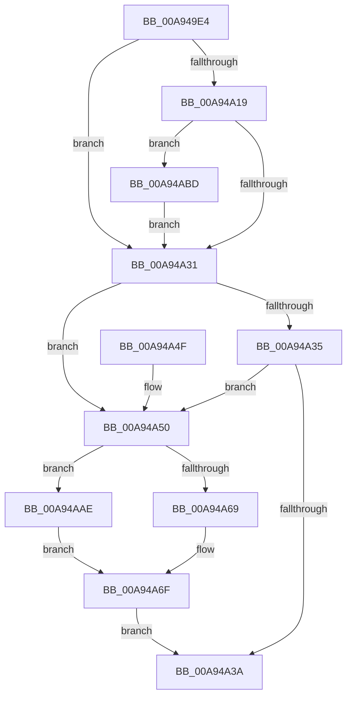

# PnpInitializeSessionId

- RVA: `0x00A949E4`–`0x00A94AD4` (길이 `240` bytes)
- VA: `0x0000000140A949E4`
- 실행 섹션: `PAGE`
- PDB 이름 있음: `예`; PDB Function 태그: `아니요`
- unwind 정보 RVA: `0x000B95FC`
- 디코드: `66`개 명령, `240/240` bytes 표시
- 미해석 바이트: `0` (있으면 어셈블리에 `.byte`로 보존)

> 이 문서는 커널 이미지의 기계어와 PDB 기호를 분석해 생성했습니다. 4번과 5번은 함수 원형과 자료형을 바이너리 사용 방식에서 추정한 C 해석이며 원본 소스 복구 결과는 아닙니다.

## 1. Dependencies

- 직접 호출 지점: **2**; 고유 호출 대상: **2**
- 직접 호출자로 확인된 함수: **1**
- RIP 상대 이미지 참조: **2**

### Outgoing calls
- `0x00A94AA7` → [PnpSetObjectProperty](../8F/PnpSetObjectProperty_function_008F66E8.md) (function, `0x008F66E8`)
- `0x00A94ABD` → [IopGetSessionIdFromPDO](../8F/IopGetSessionIdFromPDO_function_008FFDD8.md) (function, `0x008FFDD8`)

### Direct callers
- [PiProcessNewDeviceNode](../A2/PiProcessNewDeviceNode_function_00A28F20.md) at `0x00A2A23B`

### Static image references
- `0x00A94A86` → RVA `0x00011460` (`.rdata`; read)
- `0x00A94A8D` → RVA `0x00E66398` (`.data`; read)

## 2. Other-region calls and transfers

- 다른 실행 섹션으로 향하는 call: **0**
- 별도 외부 분기/꼬리 이동을 확인하지 못했습니다.

## 3. Assembly (complete function range)

```asm
00A949E4  48 8B C4                        mov rax, rsp
00A949E7  48 89 58 08                     mov qword ptr [rax + 8], rbx
00A949EB  48 89 68 10                     mov qword ptr [rax + 0x10], rbp
00A949EF  48 89 70 20                     mov qword ptr [rax + 0x20], rsi
00A949F3  57                              push rdi
00A949F4  48 83 EC 50                     sub rsp, 0x50
00A949F8  83 CD FF                        or ebp, 0xffffffff
00A949FB  41 8A D8                        mov bl, r8b
00A949FE  89 68 18                        mov dword ptr [rax + 0x18], ebp
00A94A01  48 8B F2                        mov rsi, rdx
00A94A04  48 8B 41 10                     mov rax, qword ptr [rcx + 0x10]
00A94A08  48 8B F9                        mov rdi, rcx
00A94A0B  44 8B CD                        mov r9d, ebp
00A94A0E  44 8B DD                        mov r11d, ebp
00A94A11  44 8B D5                        mov r10d, ebp
00A94A14  48 85 C0                        test rax, rax
00A94A17  74 18                           je 0x140a94a31
00A94A19  48 8B 48 20                     mov rcx, qword ptr [rax + 0x20]
00A94A1D  48 8B 81 38 01 00 00            mov rax, qword ptr [rcx + 0x138]
00A94A24  F7 40 20 00 04 00 00            test dword ptr [rax + 0x20], 0x400
00A94A2B  0F 85 8C 00 00 00               jne 0x140a94abd
00A94A31  84 DB                           test bl, bl
00A94A33  74 1B                           je 0x140a94a50
00A94A35  44 3B CD                        cmp r9d, ebp
00A94A38  75 16                           jne 0x140a94a50
00A94A3A  48 8B 5C 24 60                  mov rbx, qword ptr [rsp + 0x60]
00A94A3F  48 8B 6C 24 68                  mov rbp, qword ptr [rsp + 0x68]
00A94A44  48 8B 74 24 78                  mov rsi, qword ptr [rsp + 0x78]
00A94A49  48 83 C4 50                     add rsp, 0x50
00A94A4D  5F                              pop rdi
00A94A4E  C3                              ret
00A94A4F  CC                              int3
00A94A50  8A C3                           mov al, bl
00A94A52  F6 D8                           neg al
00A94A54  45 1B C0                        sbb r8d, r8d
00A94A57  41 81 E0 00 00 02 00            and r8d, 0x20000
00A94A5E  84 DB                           test bl, bl
00A94A60  45 0F 44 D3                     cmove r10d, r11d
00A94A64  44 3B D5                        cmp r10d, ebp
00A94A67  75 45                           jne 0x140a94aae
00A94A69  33 C0                           xor eax, eax
00A94A6B  33 C9                           xor ecx, ecx
00A94A6D  33 D2                           xor edx, edx
00A94A6F  44 89 44 24 48                  mov dword ptr [rsp + 0x48], r8d
00A94A74  4C 8B CE                        mov r9, rsi
00A94A77  89 44 24 40                     mov dword ptr [rsp + 0x40], eax
00A94A7B  41 B8 01 00 00 00               mov r8d, 1
00A94A81  48 89 4C 24 38                  mov qword ptr [rsp + 0x38], rcx
00A94A86  48 8D 05 D3 C9 57 FF            lea rax, [rip - 0xa8362d]
00A94A8D  48 8B 0D 04 19 3D 00            mov rcx, qword ptr [rip + 0x3d1904]
00A94A94  89 54 24 30                     mov dword ptr [rsp + 0x30], edx
00A94A98  48 8B 57 30                     mov rdx, qword ptr [rdi + 0x30]
00A94A9C  48 89 44 24 28                  mov qword ptr [rsp + 0x28], rax
00A94AA1  48 83 64 24 20 00               and qword ptr [rsp + 0x20], 0
00A94AA7  E8 3C 1C E6 FF                  call 0x1408f66e8
00A94AAC  EB 8C                           jmp 0x140a94a3a
00A94AAE  B8 04 00 00 00                  mov eax, 4
00A94AB3  48 8D 4C 24 70                  lea rcx, [rsp + 0x70]
00A94AB8  8D 50 03                        lea edx, [rax + 3]
00A94ABB  EB B2                           jmp 0x140a94a6f
00A94ABD  E8 16 B3 E6 FF                  call 0x1408ffdd8
00A94AC2  44 8B C8                        mov r9d, eax
00A94AC5  89 44 24 70                     mov dword ptr [rsp + 0x70], eax
00A94AC9  44 8B D8                        mov r11d, eax
00A94ACC  44 8B D0                        mov r10d, eax
00A94ACF  E9 5D FF FF FF                  jmp 0x140a94a31
```

## 4. C-style interpretation (structured pseudocode)

```c
__int64 __fastcall PnpInitializeSessionId(__int64 a1, __int64 a2, int a3)
{
    __int64 result;
    __int64 v_r10;
    __int64 v_rbp;
    __int64 v_rsp;
    unsigned __int64 v_stack_p10;
    unsigned __int64 v_stack_p20;
    unsigned __int64 v_stack_p28;
    unsigned int v_stack_p30;
    unsigned __int64 v_stack_p38;
    unsigned int v_stack_p40;
    unsigned int v_stack_p48;
    unsigned __int64 v_stack_p70;
    unsigned __int64 v_stack_p8;

    *(unsigned __int64 *)(v_rsp + 8) = v_rbx;
    *(unsigned __int64 *)(v_rsp + 16) = v_rbp;
    *(unsigned __int64 *)(v_rsp + 32) = v_rsi;
    v_rsp = (v_rsp) - (80);
    v_rbp = (unsigned int)((v_rbp) | (0xFFFFFFFFULL));
    *(unsigned int *)(v_rsp + 24) = (unsigned int)(v_rbp);
    if (*(unsigned __int64 *)(a1 + 16) == 0) goto loc_00A94A31;
    if (((*(unsigned int *)(*(unsigned __int64 *)(*(unsigned __int64 *)(*(unsigned __int64 *)(a1 + 16) + 32) + 312) + 32)) & (0x400ULL)) != 0) goto loc_00A94ABD;
loc_00A94A31:
    if ((unsigned __int8)((unsigned __int8)(a3)) == 0) goto loc_00A94A50;
    if (((unsigned int)((unsigned int)((unsigned int)(v_rbp)))) != ((unsigned int)(v_rbp))) goto loc_00A94A50;
loc_00A94A3A:
    v_rsp = (v_rsp) + (80);
    return *(unsigned __int64 *)(*(unsigned __int64 *)(*(unsigned __int64 *)(a1 + 16) + 32) + 312);
loc_00A94A50:
    result = (unsigned __int8)(-((unsigned __int8)(v_stack_p8)));
    a3 = (unsigned int)((a3) & (0x20000ULL));
    v_r10 = (unsigned int)((unsigned int)(v_rbp));
    if ((unsigned __int8)(v_stack_p8) == 0) { v_r10 = (unsigned int)((unsigned int)((unsigned int)(v_rbp))); }
    if (((unsigned int)(v_r10)) != ((unsigned int)(v_stack_p10))) goto loc_00A94AAE;
    result = 0;
    a1 = 0;
    a2 = 0;
loc_00A94A6F:
    v_stack_p48 = a3;
    v_stack_p40 = 0;
    v_stack_p38 = 0;
    v_stack_p30 = 0;
    v_stack_p28 = v_rip - 11023917;
    result = PnpSetObjectProperty(*(unsigned __int64 *)(v_rip + 4004100), *(unsigned __int64 *)(a1 + 48), 1, v_stack_p20);
    goto loc_00A94A3A;
loc_00A94AAE:
    goto loc_00A94A6F;
loc_00A94ABD:
    result = IopGetSessionIdFromPDO(v_stack_p70, 4 + 3, 1, v_stack_p20);
    v_stack_p70 = (unsigned int)(result);
    goto loc_00A94A31;
}
```

## 5. (Beta) C Style

```c
int64_t PnpInitializeSessionId(void *Arg1, int64_t Arg2, int32_t Arg3)
{
    uint8_t *arg1 = (uint8_t *)Arg1;

    int64_t result;
    int64_t local_r10;
    int64_t local_rbp;
    int64_t local_rsp;
    uint64_t v_stack_p10;
    uint64_t v_stack_p20;
    uint64_t v_stack_p28;
    uint32_t v_stack_p30;
    uint64_t v_stack_p38;
    uint32_t v_stack_p40;
    uint32_t v_stack_p48;
    uint64_t v_stack_p70;
    uint64_t v_stack_p8;

    *(uint64_t *)(local_rsp + 0x8) = local_rbx;
    *(uint64_t *)(local_rsp + 0x10) = local_rbp;
    *(uint64_t *)(local_rsp + 0x20) = local_rsi;
    local_rsp = (local_rsp) - (80);
    local_rbp = (uint32_t)((local_rbp) | (0xFFFFFFFFULL));
    *(uint32_t *)(local_rsp + 0x18) = (uint32_t)(local_rbp);
    if (*(uint64_t *)(arg1 + 0x10) == 0) goto loc_00A94A31;
    if (((*(uint32_t *)(*(uint64_t *)(*(uint64_t *)(*(uint64_t *)(arg1 + 0x10) + 0x20) + 0x138) + 0x20)) & (0x400ULL)) != 0) goto loc_00A94ABD;
loc_00A94A31:
    if ((uint8_t)((uint8_t)(Arg3)) == 0) goto loc_00A94A50;
    if (((uint32_t)((uint32_t)((uint32_t)(local_rbp)))) != ((uint32_t)(local_rbp))) goto loc_00A94A50;
loc_00A94A3A:
    local_rsp = (local_rsp) + (80);
    return *(uint64_t *)(*(uint64_t *)(*(uint64_t *)(arg1 + 0x10) + 0x20) + 0x138);
loc_00A94A50:
    result = (uint8_t)(-((uint8_t)(v_stack_p8)));
    Arg3 = (uint32_t)((Arg3) & (0x20000ULL));
    local_r10 = (uint32_t)((uint32_t)(local_rbp));
    if ((uint8_t)(v_stack_p8) == 0) { local_r10 = (uint32_t)((uint32_t)((uint32_t)(local_rbp))); }
    if (((uint32_t)(local_r10)) != ((uint32_t)(v_stack_p10))) goto loc_00A94AAE;
    result = 0;
    Arg1 = 0;
    Arg2 = 0;
loc_00A94A6F:
    v_stack_p48 = Arg3;
    v_stack_p40 = 0;
    v_stack_p38 = 0;
    v_stack_p30 = 0;
    v_stack_p28 = v_rip - 11023917;
    result = PnpSetObjectProperty(*(uint64_t *)(v_rip + 0x3D1904), *(uint64_t *)(arg1 + 0x30), 1, v_stack_p20);
    goto loc_00A94A3A;
loc_00A94AAE:
    goto loc_00A94A6F;
loc_00A94ABD:
    result = IopGetSessionIdFromPDO(v_stack_p70, 4 + 3, 1, v_stack_p20);
    v_stack_p70 = (uint32_t)(result);
    goto loc_00A94A31;
}
```

### 관측된 메모리 오프셋

구조체 형식이 확인되지 않은 접근은 인자 기준의 오프셋으로만 기록했습니다.

| 기준 인자 | 오프셋 표현 | 폭 (bit) | 접근 |
|---|---:|---:|---|
| `Arg1` | `+ 0x10` | `64` | `R` |
| `Arg1` | `+ 0x30` | `64` | `R` |

## 6. Execution-region graph

[열기: 2D/3D 그래프와 함수 탐색 컨트롤 패널](../../../control-panel.html?section=page&rva=0x00A949E4&view=graph)

- 2D 그래프는 위에서 아래로 흐르고, 3D 그래프는 빈 공간을 드래그해 회전합니다. Shift+드래그는 이동, 휠은 확대·축소, 함수 노드 선택은 대상 보고서 이동입니다.

### Static fallback


