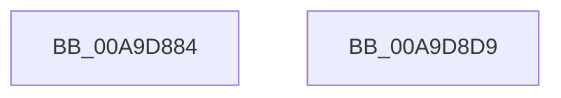

# PnpMapDeviceObjectToDeviceInstance

- RVA: `0x00A9D884`–`0x00A9D8DA` (길이 `86` bytes)
- VA: `0x0000000140A9D884`
- 실행 섹션: `PAGE`
- PDB 이름 있음: `예`; PDB Function 태그: `아니요`
- unwind 정보 RVA: `0x00064C80`
- 디코드: `22`개 명령, `86/86` bytes 표시
- 미해석 바이트: `0` (있으면 어셈블리에 `.byte`로 보존)

> 이 문서는 커널 이미지의 기계어와 PDB 기호를 분석해 생성했습니다. 4번과 5번은 함수 원형과 자료형을 바이너리 사용 방식에서 추정한 C 해석이며 원본 소스 복구 결과는 아닙니다.

## 1. Dependencies

- 직접 호출 지점: **3**; 고유 호출 대상: **3**
- 직접 호출자로 확인된 함수: **5**
- RIP 상대 이미지 참조: **2**

### Outgoing calls
- `0x00A9D89B` → [ExAcquireFastMutex](../../text/20/ExAcquireFastMutex_function_0020E5A0.md) (function, `0x0020E5A0`)
- `0x00A9D8B3` → [RtlInsertElementGenericTableAvl](../../text/3E/RtlInsertElementGenericTableAvl_function_003EE510.md) (function, `0x003EE510`)
- `0x00A9D8CC` → [ExReleaseFastMutex](../../text/25/ExReleaseFastMutex_function_002519C0.md) (function, `0x002519C0`)

### Direct callers
- [IoReportDetectedDevice](../72/IoReportDetectedDevice_function_00725CD0.md) at `0x00726477`
- [PiInitializeDevice](../73/PiInitializeDevice_function_0073EC5C.md) at `0x0073EFB9`
- [PiProcessNewDeviceNode](../A2/PiProcessNewDeviceNode_function_00A28F20.md) at `0x00A29B09`
- [sub_00B420B0](../B4/Unknown_function_00B420B0.md) at `0x00B423B1`
- [IopInitializePlugPlayServices](../../init/C2/IopInitializePlugPlayServices_function_00C2F298.md) at `0x00C2FD6B`

### Static image references
- `0x00A9D88F` → RVA `0x00F8CB40` (`.data`; read)
- `0x00A9D8A8` → RVA `0x00F8CB80` (`.data`; read)

## 2. Other-region calls and transfers

- 다른 실행 섹션으로 향하는 call: **3**
  - `0x00A9D89B` → [ExAcquireFastMutex](../../text/20/ExAcquireFastMutex_function_0020E5A0.md) (`PAGE` → `.text`)
  - `0x00A9D8B3` → [RtlInsertElementGenericTableAvl](../../text/3E/RtlInsertElementGenericTableAvl_function_003EE510.md) (`PAGE` → `.text`)
  - `0x00A9D8CC` → [ExReleaseFastMutex](../../text/25/ExReleaseFastMutex_function_002519C0.md) (`PAGE` → `.text`)
- 별도 외부 분기/꼬리 이동을 확인하지 못했습니다.

## 3. Assembly (complete function range)

```asm
00A9D884  40 53                           push rbx
00A9D886  48 83 EC 30                     sub rsp, 0x30
00A9D88A  48 89 4C 24 20                  mov qword ptr [rsp + 0x20], rcx
00A9D88F  48 8D 0D AA F2 4E 00            lea rcx, [rip + 0x4ef2aa]
00A9D896  48 89 54 24 28                  mov qword ptr [rsp + 0x28], rdx
00A9D89B  E8 00 0D 77 FF                  call 0x14020e5a0
00A9D8A0  45 33 C9                        xor r9d, r9d
00A9D8A3  48 8D 54 24 20                  lea rdx, [rsp + 0x20]
00A9D8A8  48 8D 0D D1 F2 4E 00            lea rcx, [rip + 0x4ef2d1]
00A9D8AF  45 8D 41 10                     lea r8d, [r9 + 0x10]
00A9D8B3  E8 58 0C 95 FF                  call 0x1403ee510
00A9D8B8  48 F7 D8                        neg rax
00A9D8BB  48 8D 0D 7E F2 4E 00            lea rcx, [rip + 0x4ef27e]
00A9D8C2  1B DB                           sbb ebx, ebx
00A9D8C4  F7 D3                           not ebx
00A9D8C6  81 E3 01 00 00 C0               and ebx, 0xc0000001
00A9D8CC  E8 EF 40 7B FF                  call 0x1402519c0
00A9D8D1  8B C3                           mov eax, ebx
00A9D8D3  48 83 C4 30                     add rsp, 0x30
00A9D8D7  5B                              pop rbx
00A9D8D8  C3                              ret
00A9D8D9  CC                              int3
```

## 4. C-style interpretation (structured pseudocode)

```c
__int64 __fastcall PnpMapDeviceObjectToDeviceInstance(__int64 a1, __int64 a2, __int64 a3, int a4)
{
    __int64 result;
    __int64 v_rbx;
    __int64 v_rsp;
    unsigned __int64 v_stack_m10;
    unsigned __int64 v_stack_m18;

    v_rsp = (v_rsp) - (48);
    v_stack_m18 = a1;
    v_stack_m10 = a2;
    result = ExAcquireFastMutex(v_rip + 5173930, a2, a3, a4);
    a4 = 0;
    result = RtlInsertElementGenericTableAvl(v_rip + 5173969, v_stack_m18, a4 + 16, a4);
    result = -(result);
    v_rbx = (unsigned int)(~(v_rbx));
    v_rbx = (unsigned int)((v_rbx) & (0xC0000001ULL));
    result = ExReleaseFastMutex(v_rip + 5173886, v_stack_m18, a4 + 16, a4);
    v_rsp = (v_rsp) + (48);
    return (unsigned int)((unsigned int)(v_rbx));
}
```

## 5. (Beta) C Style

```c
int64_t PnpMapDeviceObjectToDeviceInstance(int64_t Arg1, int64_t Arg2, int64_t Arg3, int32_t Arg4)
{
    int64_t result;
    int64_t local_rbx;
    int64_t local_rsp;
    uint64_t v_stack_m10;
    uint64_t v_stack_m18;

    local_rsp = (local_rsp) - (48);
    v_stack_m18 = Arg1;
    v_stack_m10 = Arg2;
    result = ExAcquireFastMutex(v_rip + 5173930, Arg2, Arg3, Arg4);
    Arg4 = 0;
    result = RtlInsertElementGenericTableAvl(v_rip + 5173969, v_stack_m18, Arg4 + 16, Arg4);
    result = -(result);
    local_rbx = (uint32_t)(~(local_rbx));
    local_rbx = (uint32_t)((local_rbx) & (0xC0000001ULL));
    result = ExReleaseFastMutex(v_rip + 5173886, v_stack_m18, Arg4 + 16, Arg4);
    local_rsp = (local_rsp) + (48);
    return (uint32_t)((uint32_t)(local_rbx));
}
```

## 6. Execution-region graph

[열기: 2D/3D 그래프와 함수 탐색 컨트롤 패널](../../../control-panel.html?section=page&rva=0x00A9D884&view=graph)

- 2D 그래프는 위에서 아래로 흐르고, 3D 그래프는 빈 공간을 드래그해 회전합니다. Shift+드래그는 이동, 휠은 확대·축소, 함수 노드 선택은 대상 보고서 이동입니다.

### Static fallback


