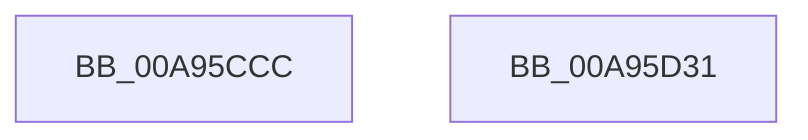

# PnpPowerStateTransitionWatchdogPushRecord

- RVA: `0x00A95CCC`–`0x00A95D32` (길이 `102` bytes)
- VA: `0x0000000140A95CCC`
- 실행 섹션: `PAGE`
- PDB 이름 있음: `예`; PDB Function 태그: `아니요`
- unwind 정보 RVA: `0x0006C9B8`
- 디코드: `23`개 명령, `102/102` bytes 표시
- 미해석 바이트: `0` (있으면 어셈블리에 `.byte`로 보존)

> 이 문서는 커널 이미지의 기계어와 PDB 기호를 분석해 생성했습니다. 4번과 5번은 함수 원형과 자료형을 바이너리 사용 방식에서 추정한 C 해석이며 원본 소스 복구 결과는 아닙니다.

## 1. Dependencies

- 직접 호출 지점: **1**; 고유 호출 대상: **1**
- 직접 호출자로 확인된 함수: **2**
- RIP 상대 이미지 참조: **2**

### Outgoing calls
- `0x00A95D27` → [ZwPowerInformation](../../text/6A/ZwPowerInformation_function_006ADCB0.md) (function, `0x006ADCB0`)

### Direct callers
- [PnpSurpriseFailUnsafeDmaDevices](PnpSurpriseFailUnsafeDmaDevices_function_00A95B90.md) at `0x00A95BB8`
- [PnpSurpriseFailUnsafeDmaDevices](PnpSurpriseFailUnsafeDmaDevices_function_00A95B90.md) at `0x00A95C7E`
- [IoBuildPoDeviceNotifyList](../../pagelk/B7/IoBuildPoDeviceNotifyList_function_00B78B0C.md) at `0x00B790D9`

### Static image references
- `0x00A95CFD` → RVA `0x00FC6AB0` (`ALMOSTRO`; read)
- `0x00A95D08` → RVA `0x005A6430` (`PnpPowerStateTransitionWatchdogCallback`; read)

## 2. Other-region calls and transfers

- 다른 실행 섹션으로 향하는 call: **1**
  - `0x00A95D27` → [ZwPowerInformation](../../text/6A/ZwPowerInformation_function_006ADCB0.md) (`PAGE` → `.text`)
- 별도 외부 분기/꼬리 이동을 확인하지 못했습니다.

## 3. Assembly (complete function range)

```asm
00A95CCC  4C 8B DC                        mov r11, rsp
00A95CCF  48 83 EC 78                     sub rsp, 0x78
00A95CD3  33 C9                           xor ecx, ecx
00A95CD5  49 C7 43 B8 58 00 00 00         mov qword ptr [r11 - 0x48], 0x58
00A95CDD  49 89 4B C0                     mov qword ptr [r11 - 0x40], rcx
00A95CE1  49 8D 53 B8                     lea rdx, [r11 - 0x48]
00A95CE5  89 4C 24 5C                     mov dword ptr [rsp + 0x5c], ecx
00A95CE9  45 33 C9                        xor r9d, r9d
00A95CEC  65 48 8B 04 25 88 01 00 00      mov rax, qword ptr gs:[0x188]
00A95CF5  49 89 43 D0                     mov qword ptr [r11 - 0x30], rax
00A95CF9  44 8D 41 38                     lea r8d, [rcx + 0x38]
00A95CFD  48 8B 05 AC 0D 53 00            mov rax, qword ptr [rip + 0x530dac]
00A95D04  49 89 43 C8                     mov qword ptr [r11 - 0x38], rax
00A95D08  48 8D 05 21 07 B1 FF            lea rax, [rip - 0x4ef8df]
00A95D0F  C7 44 24 58 02 00 00 00         mov dword ptr [rsp + 0x58], 2
00A95D17  49 89 4B D8                     mov qword ptr [r11 - 0x28], rcx
00A95D1B  89 4C 24 20                     mov dword ptr [rsp + 0x20], ecx
00A95D1F  41 8D 49 57                     lea ecx, [r9 + 0x57]
00A95D23  49 89 43 E8                     mov qword ptr [r11 - 0x18], rax
00A95D27  E8 84 7F C1 FF                  call 0x1406adcb0
00A95D2C  48 83 C4 78                     add rsp, 0x78
00A95D30  C3                              ret
00A95D31  CC                              int3
```

## 4. C-style interpretation (structured pseudocode)

```c
__int64 __fastcall PnpPowerStateTransitionWatchdogPushRecord(int a1, __int64 a2, __int64 a3, int a4)
{
    __int64 result;
    __int64 v_rsp;
    unsigned int v_stack_m1C;
    unsigned int v_stack_m20;
    unsigned int v_stack_m58;

    v_rsp = (v_rsp) - (120);
    a1 = 0;
    *(unsigned __int64 *)(v_rsp - 72) = 88;
    *(unsigned __int64 *)(v_rsp - 64) = 0;
    v_stack_m1C = 0;
    a4 = 0;
    *(unsigned __int64 *)(v_rsp - 48) = *(unsigned __int64 *)(gs_base + (0 + 392));
    *(unsigned __int64 *)(v_rsp - 56) = *(unsigned __int64 *)(v_rip + 5442988);
    v_stack_m20 = 2;
    *(unsigned __int64 *)(v_rsp - 40) = 0;
    v_stack_m58 = 0;
    *(unsigned __int64 *)(v_rsp - 24) = v_rip - 5175519;
    result = ZwPowerInformation(a4 + 87, v_rsp - 72, a1 + 56, a4);
    v_rsp = (v_rsp) + (120);
    return result;
}
```

## 5. (Beta) C Style

```c
int64_t PnpPowerStateTransitionWatchdogPushRecord(int32_t Arg1, int64_t Arg2, int64_t Arg3, int32_t Arg4)
{
    int64_t result;
    int64_t local_rsp;
    uint32_t v_stack_m1C;
    uint32_t v_stack_m20;
    uint32_t v_stack_m58;

    local_rsp = (local_rsp) - (120);
    Arg1 = 0;
    *(uint64_t *)(local_rsp - 0x48) = 88;
    *(uint64_t *)(local_rsp - 0x40) = 0;
    v_stack_m1C = 0;
    Arg4 = 0;
    *(uint64_t *)(local_rsp - 0x30) = *(uint64_t *)(gs_base + (0 + 0x188));
    *(uint64_t *)(local_rsp - 0x38) = *(uint64_t *)(v_rip + 0x530DAC);
    v_stack_m20 = 2;
    *(uint64_t *)(local_rsp - 0x28) = 0;
    v_stack_m58 = 0;
    *(uint64_t *)(local_rsp - 0x18) = v_rip - 5175519;
    result = ZwPowerInformation(Arg4 + 87, local_rsp - 72, Arg1 + 56, Arg4);
    local_rsp = (local_rsp) + (120);
    return result;
}
```

## 6. Execution-region graph

[열기: 2D/3D 그래프와 함수 탐색 컨트롤 패널](../../../control-panel.html?section=page&rva=0x00A95CCC&view=graph)

- 2D 그래프는 위에서 아래로 흐르고, 3D 그래프는 빈 공간을 드래그해 회전합니다. Shift+드래그는 이동, 휠은 확대·축소, 함수 노드 선택은 대상 보고서 이동입니다.

### Static fallback


