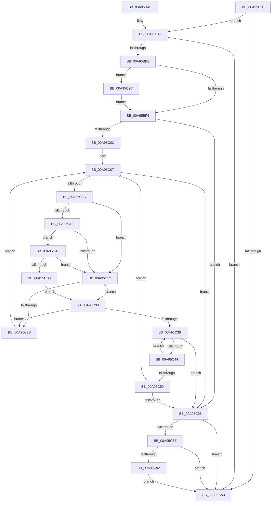

# PnpSurpriseFailUnsafeDmaDevices

- RVA: `0x00A95B90`–`0x00A95CC3` (길이 `307` bytes)
- VA: `0x0000000140A95B90`
- 실행 섹션: `PAGE`
- PDB 이름 있음: `예`; PDB Function 태그: `아니요`
- unwind 정보 RVA: `0x000B9928`
- 디코드: `79`개 명령, `307/307` bytes 표시
- 미해석 바이트: `0` (있으면 어셈블리에 `.byte`로 보존)

> 이 문서는 커널 이미지의 기계어와 PDB 기호를 분석해 생성했습니다. 4번과 5번은 함수 원형과 자료형을 바이너리 사용 방식에서 추정한 C 해석이며 원본 소스 복구 결과는 아닙니다.

## 1. Dependencies

- 직접 호출 지점: **13**; 고유 호출 대상: **10**
- 직접 호출자로 확인된 함수: **1**
- RIP 상대 이미지 참조: **4**

### Outgoing calls
- `0x00A95BAF` → [PiCslIsConsoleLocked](PiCslIsConsoleLocked_function_00A95D38.md) (function, `0x00A95D38`)
- `0x00A95BB8` → [PnpPowerStateTransitionWatchdogPushRecord](PnpPowerStateTransitionWatchdogPushRecord_function_00A95CCC.md) (function, `0x00A95CCC`)
- `0x00A95BD9` → [ExAcquireResourceExclusiveLite](../../text/21/ExAcquireResourceExclusiveLite_function_00214E20.md) (function, `0x00214E20`)
- `0x00A95BE7` → [ExAcquireResourceSharedLite](../../text/21/ExAcquireResourceSharedLite_function_00211BC0.md) (function, `0x00211BC0`)
- `0x00A95C5F` → [ExReleaseResourceLite](../../text/25/ExReleaseResourceLite_function_0025FA10.md) (function, `0x0025FA10`)
- `0x00A95C6B` → [ExReleaseResourceLite](../../text/25/ExReleaseResourceLite_function_0025FA10.md) (function, `0x0025FA10`)
- `0x00A95C70` → [KeLeaveCriticalRegion](../../text/25/KeLeaveCriticalRegion_function_0025D8B0.md) (function, `0x0025D8B0`)
- `0x00A95C7E` → [PnpPowerStateTransitionWatchdogPushRecord](PnpPowerStateTransitionWatchdogPushRecord_function_00A95CCC.md) (function, `0x00A95CCC`)
- `0x00A95C85` → [PnpSynchronizeDeviceEventQueue](../AA/PnpSynchronizeDeviceEventQueue_function_00AA4F60.md) (function, `0x00AA4F60`)
- `0x00A95C92` → [PnpPowerStateTransitionWatchdogPopRecord](../AD/PnpPowerStateTransitionWatchdogPopRecord_function_00AD19E4.md) (function, `0x00AD19E4`)
- `0x00A95C9C` → [PnpPowerStateTransitionWatchdogPopRecord](../AD/PnpPowerStateTransitionWatchdogPopRecord_function_00AD19E4.md) (function, `0x00AD19E4`)
- `0x00A95CA6` → [PiIommuIsDeviceSafeWhileConsoleLocked](../74/PiIommuIsDeviceSafeWhileConsoleLocked_function_00740238.md) (function, `0x00740238`)
- `0x00A95CB6` → [PipDmgEnforceEnumerationPolicy](../73/PipDmgEnforceEnumerationPolicy_function_0073BEB4.md) (function, `0x0073BEB4`)

### Direct callers
- [PopTransitionSystemPowerStateEx](../../pagelk/B7/PopTransitionSystemPowerStateEx_function_00B7E8C0.md) at `0x00B7E9C6`

### Static image references
- `0x00A95B9A` → RVA `0x00F8A9AC` (`.data`; read)
- `0x00A95BD1` → RVA `0x00F8C4E0` (`.data`; read)
- `0x00A95BE0` → RVA `0x00F8C560` (`.data`; read)
- `0x00A95BF4` → RVA `0x00F8C438` (`.data`; read)

## 2. Other-region calls and transfers

- 다른 실행 섹션으로 향하는 call: **5**
  - `0x00A95BD9` → [ExAcquireResourceExclusiveLite](../../text/21/ExAcquireResourceExclusiveLite_function_00214E20.md) (`PAGE` → `.text`)
  - `0x00A95BE7` → [ExAcquireResourceSharedLite](../../text/21/ExAcquireResourceSharedLite_function_00211BC0.md) (`PAGE` → `.text`)
  - `0x00A95C5F` → [ExReleaseResourceLite](../../text/25/ExReleaseResourceLite_function_0025FA10.md) (`PAGE` → `.text`)
  - `0x00A95C6B` → [ExReleaseResourceLite](../../text/25/ExReleaseResourceLite_function_0025FA10.md) (`PAGE` → `.text`)
  - `0x00A95C70` → [KeLeaveCriticalRegion](../../text/25/KeLeaveCriticalRegion_function_0025D8B0.md) (`PAGE` → `.text`)
- 별도 외부 분기/꼬리 이동을 확인하지 못했습니다.

## 3. Assembly (complete function range)

```asm
00A95B90  48 89 5C 24 08                  mov qword ptr [rsp + 8], rbx
00A95B95  57                              push rdi
00A95B96  48 83 EC 20                     sub rsp, 0x20
00A95B9A  83 3D 0B 4E 4F 00 02            cmp dword ptr [rip + 0x4f4e0b], 2
00A95BA1  74 0C                           je 0x140a95baf
00A95BA3  48 8B 5C 24 30                  mov rbx, qword ptr [rsp + 0x30]
00A95BA8  48 83 C4 20                     add rsp, 0x20
00A95BAC  5F                              pop rdi
00A95BAD  C3                              ret
00A95BAE  CC                              int3
00A95BAF  E8 84 01 00 00                  call 0x140a95d38
00A95BB4  84 C0                           test al, al
00A95BB6  74 EB                           je 0x140a95ba3
00A95BB8  E8 0F 01 00 00                  call 0x140a95ccc
00A95BBD  65 48 8B 0C 25 88 01 00 00      mov rcx, qword ptr gs:[0x188]
00A95BC6  B2 01                           mov dl, 1
00A95BC8  8B D8                           mov ebx, eax
00A95BCA  66 FF 89 E4 01 00 00            dec word ptr [rcx + 0x1e4]
00A95BD1  48 8D 0D 08 69 4F 00            lea rcx, [rip + 0x4f6908]
00A95BD8  90                              nop
00A95BD9  E8 42 F2 77 FF                  call 0x140214e20
00A95BDE  B2 01                           mov dl, 1
00A95BE0  48 8D 0D 79 69 4F 00            lea rcx, [rip + 0x4f6979]
00A95BE7  E8 D4 BF 77 FF                  call 0x140211bc0
00A95BEC  85 DB                           test ebx, ebx
00A95BEE  0F 89 A8 00 00 00               jns 0x140a95c9c
00A95BF4  48 8B 1D 3D 68 4F 00            mov rbx, qword ptr [rip + 0x4f683d]
00A95BFB  40 32 FF                        xor dil, dil
00A95BFE  48 85 DB                        test rbx, rbx
00A95C01  74 55                           je 0x140a95c58
00A95C03  48 8B 5B 08                     mov rbx, qword ptr [rbx + 8]
00A95C07  48 85 DB                        test rbx, rbx
00A95C0A  74 4C                           je 0x140a95c58
00A95C0C  48 8B 8B D0 02 00 00            mov rcx, qword ptr [rbx + 0x2d0]
00A95C13  48 85 C9                        test rcx, rcx
00A95C16  74 0A                           je 0x140a95c22
00A95C18  F6 41 10 02                     test byte ptr [rcx + 0x10], 2
00A95C1C  0F 85 84 00 00 00               jne 0x140a95ca6
00A95C22  48 8B 43 08                     mov rax, qword ptr [rbx + 8]
00A95C26  48 85 C0                        test rax, rax
00A95C29  74 05                           je 0x140a95c30
00A95C2B  48 8B D8                        mov rbx, rax
00A95C2E  EB D7                           jmp 0x140a95c07
00A95C30  48 8B 03                        mov rax, qword ptr [rbx]
00A95C33  48 85 C0                        test rax, rax
00A95C36  75 F3                           jne 0x140a95c2b
00A95C38  48 8B 05 F9 67 4F 00            mov rax, qword ptr [rip + 0x4f67f9]
00A95C3F  48 3B D8                        cmp rbx, rax
00A95C42  74 14                           je 0x140a95c58
00A95C44  48 8B 5B 10                     mov rbx, qword ptr [rbx + 0x10]
00A95C48  48 8B 0B                        mov rcx, qword ptr [rbx]
00A95C4B  48 85 C9                        test rcx, rcx
00A95C4E  74 E8                           je 0x140a95c38
00A95C50  48 8B D9                        mov rbx, rcx
00A95C53  48 3B C8                        cmp rcx, rax
00A95C56  75 AF                           jne 0x140a95c07
00A95C58  48 8D 0D 01 69 4F 00            lea rcx, [rip + 0x4f6901]
00A95C5F  E8 AC 9D 7C FF                  call 0x14025fa10
00A95C64  48 8D 0D 75 68 4F 00            lea rcx, [rip + 0x4f6875]
00A95C6B  E8 A0 9D 7C FF                  call 0x14025fa10
00A95C70  E8 3B 7C 7C FF                  call 0x14025d8b0
00A95C75  40 84 FF                        test dil, dil
00A95C78  0F 84 25 FF FF FF               je 0x140a95ba3
00A95C7E  E8 49 00 00 00                  call 0x140a95ccc
00A95C83  8B D8                           mov ebx, eax
00A95C85  E8 D6 F2 00 00                  call 0x140aa4f60
00A95C8A  85 DB                           test ebx, ebx
00A95C8C  0F 88 11 FF FF FF               js 0x140a95ba3
00A95C92  E8 4D BD 03 00                  call 0x140ad19e4
00A95C97  E9 07 FF FF FF                  jmp 0x140a95ba3
00A95C9C  E8 43 BD 03 00                  call 0x140ad19e4
00A95CA1  E9 4E FF FF FF                  jmp 0x140a95bf4
00A95CA6  E8 8D A5 CA FF                  call 0x140740238
00A95CAB  84 C0                           test al, al
00A95CAD  0F 85 6F FF FF FF               jne 0x140a95c22
00A95CB3  48 8B CB                        mov rcx, rbx
00A95CB6  E8 F9 61 CA FF                  call 0x14073beb4
00A95CBB  40 B7 01                        mov dil, 1
00A95CBE  E9 6D FF FF FF                  jmp 0x140a95c30
```

## 4. C-style interpretation (structured pseudocode)

```c
__int64 __fastcall PnpSurpriseFailUnsafeDmaDevices(void)
{
    __int64 result;
    __int64 v_rdi;
    __int64 v_rsp;
    unsigned __int64 v_stack_p8;

    v_stack_p8 = v_rbx;
    v_rsp = (v_rsp) - (32);
    if ((*(unsigned int *)(v_rip + 5197323)) == 2) goto loc_00A95BAF;
loc_00A95BA3:
    v_rsp = (v_rsp) + (32);
    return result;
loc_00A95BAF:
    result = PiCslIsConsoleLocked(a1, a2, a3, a4);
    if ((unsigned __int8)(result) == 0) goto loc_00A95BA3;
    result = PnpPowerStateTransitionWatchdogPushRecord(a1, a2, a3, a4);
    result = ExAcquireResourceExclusiveLite(v_rip + 5204232, 1, a3, a4);
    result = ExAcquireResourceSharedLite(v_rip + 5204345, 1, a3, a4);
    if (!sign_flag) goto loc_00A95C9C;
loc_00A95BF4:
    v_rdi = 0;
    if (*(unsigned __int64 *)(v_rip + 5204029) == 0) goto loc_00A95C58;
loc_00A95C07:
    if (*(unsigned __int64 *)(*(unsigned __int64 *)(v_rip + 5204029) + 8) == 0) goto loc_00A95C58;
    if (*(unsigned __int64 *)(*(unsigned __int64 *)(*(unsigned __int64 *)(v_rip + 5204029) + 8) + 720) == 0) goto loc_00A95C22;
    if (((*(unsigned __int8 *)(*(unsigned __int64 *)(*(unsigned __int64 *)(*(unsigned __int64 *)(v_rip + 5204029) + 8) + 720) + 16)) & (2)) != 0) goto loc_00A95CA6;
loc_00A95C22:
    if (*(unsigned __int64 *)(*(unsigned __int64 *)(*(unsigned __int64 *)(v_rip + 5204029) + 8) + 8) == 0) goto loc_00A95C30;
loc_00A95C2B:
    goto loc_00A95C07;
loc_00A95C30:
    if (*(unsigned __int64 *)(*(unsigned __int64 *)(*(unsigned __int64 *)(*(unsigned __int64 *)(v_rip + 5204029) + 8) + 8)) != 0) goto loc_00A95C2B;
loc_00A95C38:
    if ((*(unsigned __int64 *)(*(unsigned __int64 *)(*(unsigned __int64 *)(v_rip + 5204029) + 8) + 8)) == (*(unsigned __int64 *)(v_rip + 5203961))) goto loc_00A95C58;
    if (*(unsigned __int64 *)(*(unsigned __int64 *)(*(unsigned __int64 *)(*(unsigned __int64 *)(*(unsigned __int64 *)(v_rip + 5204029) + 8) + 8) + 16)) == 0) goto loc_00A95C38;
    if ((*(unsigned __int64 *)(*(unsigned __int64 *)(*(unsigned __int64 *)(*(unsigned __int64 *)(*(unsigned __int64 *)(v_rip + 5204029) + 8) + 8) + 16))) != (*(unsigned __int64 *)(v_rip + 5203961))) goto loc_00A95C07;
loc_00A95C58:
    result = ExReleaseResourceLite(v_rip + 5204225, 1, a3, a4);
    result = ExReleaseResourceLite(v_rip + 5204085, 1, a3, a4);
    result = KeLeaveCriticalRegion(v_rip + 5204085, 1, a3, a4);
    if (0 == 0) goto loc_00A95BA3;
    result = PnpPowerStateTransitionWatchdogPushRecord(v_rip + 5204085, 1, a3, a4);
    result = PnpSynchronizeDeviceEventQueue(v_rip + 5204085, 1, a3, a4);
    if (sign_flag) goto loc_00A95BA3;
    result = PnpPowerStateTransitionWatchdogPopRecord(v_rip + 5204085, 1, a3, a4);
    goto loc_00A95BA3;
loc_00A95C9C:
    result = PnpPowerStateTransitionWatchdogPopRecord(v_rip + 5204085, 1, a3, a4);
    goto loc_00A95BF4;
loc_00A95CA6:
    result = PiIommuIsDeviceSafeWhileConsoleLocked(v_rip + 5204085, 1, a3, a4);
    if ((unsigned __int8)(result) != 0) goto loc_00A95C22;
    result = PipDmgEnforceEnumerationPolicy((unsigned int)((unsigned int)(result)), 1, a3, a4);
    goto loc_00A95C30;
}
```

## 5. (Beta) C Style

```c
void PnpSurpriseFailUnsafeDmaDevices(void)
{
    int64_t result;
    int64_t local_rdi;
    int64_t local_rsp;
    uint64_t v_stack_p8;

    v_stack_p8 = local_rbx;
    local_rsp = (local_rsp) - (32);
    if ((*(uint32_t *)(v_rip + 0x4F4E0B)) == 2) goto loc_00A95BAF;
loc_00A95BA3:
    local_rsp = (local_rsp) + (32);
    return result;
loc_00A95BAF:
    result = PiCslIsConsoleLocked(a1, a2, a3, a4);
    if ((uint8_t)(result) == 0) goto loc_00A95BA3;
    result = PnpPowerStateTransitionWatchdogPushRecord(a1, a2, a3, a4);
    result = ExAcquireResourceExclusiveLite(v_rip + 5204232, 1, a3, a4);
    result = ExAcquireResourceSharedLite(v_rip + 5204345, 1, a3, a4);
    if (!sign_flag) goto loc_00A95C9C;
loc_00A95BF4:
    local_rdi = 0;
    if (*(uint64_t *)(v_rip + 0x4F683D) == 0) goto loc_00A95C58;
loc_00A95C07:
    if (*(uint64_t *)(*(uint64_t *)(v_rip + 0x4F683D) + 0x8) == 0) goto loc_00A95C58;
    if (*(uint64_t *)(*(uint64_t *)(*(uint64_t *)(v_rip + 0x4F683D) + 0x8) + 0x2D0) == 0) goto loc_00A95C22;
    if (((*(uint8_t *)(*(uint64_t *)(*(uint64_t *)(*(uint64_t *)(v_rip + 0x4F683D) + 0x8) + 0x2D0) + 0x10)) & (2)) != 0) goto loc_00A95CA6;
loc_00A95C22:
    if (*(uint64_t *)(*(uint64_t *)(*(uint64_t *)(v_rip + 0x4F683D) + 0x8) + 0x8) == 0) goto loc_00A95C30;
loc_00A95C2B:
    goto loc_00A95C07;
loc_00A95C30:
    if (*(uint64_t *)(*(uint64_t *)(*(uint64_t *)(*(uint64_t *)(v_rip + 0x4F683D) + 0x8) + 0x8)) != 0) goto loc_00A95C2B;
loc_00A95C38:
    if ((*(uint64_t *)(*(uint64_t *)(*(uint64_t *)(v_rip + 0x4F683D) + 0x8) + 0x8)) == (*(uint64_t *)(v_rip + 0x4F67F9))) goto loc_00A95C58;
    if (*(uint64_t *)(*(uint64_t *)(*(uint64_t *)(*(uint64_t *)(*(uint64_t *)(v_rip + 0x4F683D) + 0x8) + 0x8) + 0x10)) == 0) goto loc_00A95C38;
    if ((*(uint64_t *)(*(uint64_t *)(*(uint64_t *)(*(uint64_t *)(*(uint64_t *)(v_rip + 0x4F683D) + 0x8) + 0x8) + 0x10))) != (*(uint64_t *)(v_rip + 0x4F67F9))) goto loc_00A95C07;
loc_00A95C58:
    result = ExReleaseResourceLite(v_rip + 5204225, 1, a3, a4);
    result = ExReleaseResourceLite(v_rip + 5204085, 1, a3, a4);
    result = KeLeaveCriticalRegion(v_rip + 5204085, 1, a3, a4);
    if (0 == 0) goto loc_00A95BA3;
    result = PnpPowerStateTransitionWatchdogPushRecord(v_rip + 5204085, 1, a3, a4);
    result = PnpSynchronizeDeviceEventQueue(v_rip + 5204085, 1, a3, a4);
    if (sign_flag) goto loc_00A95BA3;
    result = PnpPowerStateTransitionWatchdogPopRecord(v_rip + 5204085, 1, a3, a4);
    goto loc_00A95BA3;
loc_00A95C9C:
    result = PnpPowerStateTransitionWatchdogPopRecord(v_rip + 5204085, 1, a3, a4);
    goto loc_00A95BF4;
loc_00A95CA6:
    result = PiIommuIsDeviceSafeWhileConsoleLocked(v_rip + 5204085, 1, a3, a4);
    if ((uint8_t)(result) != 0) goto loc_00A95C22;
    result = PipDmgEnforceEnumerationPolicy((uint32_t)((uint32_t)(result)), 1, a3, a4);
    goto loc_00A95C30;
}
```

## 6. Execution-region graph

[열기: 2D/3D 그래프와 함수 탐색 컨트롤 패널](../../../control-panel.html?section=page&rva=0x00A95B90&view=graph)

- 2D 그래프는 위에서 아래로 흐르고, 3D 그래프는 빈 공간을 드래그해 회전합니다. Shift+드래그는 이동, 휠은 확대·축소, 함수 노드 선택은 대상 보고서 이동입니다.

### Static fallback


