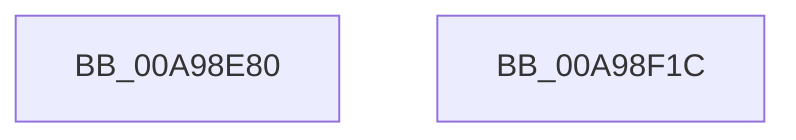

# PopBatteryQueryEstimatedTime

- RVA: `0x00A98E80`–`0x00A98F1D` (길이 `157` bytes)
- VA: `0x0000000140A98E80`
- 실행 섹션: `PAGE`
- PDB 이름 있음: `예`; PDB Function 태그: `아니요`
- unwind 정보 RVA: `0x000BA100`
- 디코드: `38`개 명령, `157/157` bytes 표시
- 미해석 바이트: `0` (있으면 어셈블리에 `.byte`로 보존)

> 이 문서는 커널 이미지의 기계어와 PDB 기호를 분석해 생성했습니다. 4번과 5번은 함수 원형과 자료형을 바이너리 사용 방식에서 추정한 C 해석이며 원본 소스 복구 결과는 아닙니다.

## 1. Dependencies

- 직접 호출 지점: **3**; 고유 호출 대상: **3**
- 직접 호출자로 확인된 함수: **1**
- RIP 상대 이미지 참조: **1**

### Outgoing calls
- `0x00A98EBB` → [IoReuseIrp](../../text/24/IoReuseIrp_function_0024DD70.md) (function, `0x0024DD70`)
- `0x00A98EF1` → [IoSynchronousCallDriver](../../text/48/IoSynchronousCallDriver_function_00484050.md) (function, `0x00484050`)
- `0x00A98F0C` → [_security_check_cookie](../../text/6A/_security_check_cookie_function_006AC640.md) (function, `0x006AC640`)

### Direct callers
- [PopBatteryWorker](../AE/PopBatteryWorker_function_00AE1650.md) at `0x00AE1A9C`
- [PopBatteryWorker](../AE/PopBatteryWorker_function_00AE1650.md) at `0x00AE2055`

### Static image references
- `0x00A98E8A` → RVA `0x00E0A740` (`.data`; read)

## 2. Other-region calls and transfers

- 다른 실행 섹션으로 향하는 call: **3**
  - `0x00A98EBB` → [IoReuseIrp](../../text/24/IoReuseIrp_function_0024DD70.md) (`PAGE` → `.text`)
  - `0x00A98EF1` → [IoSynchronousCallDriver](../../text/48/IoSynchronousCallDriver_function_00484050.md) (`PAGE` → `.text`)
  - `0x00A98F0C` → [_security_check_cookie](../../text/6A/_security_check_cookie_function_006AC640.md) (`PAGE` → `.text`)
- 별도 외부 분기/꼬리 이동을 확인하지 못했습니다.

## 3. Assembly (complete function range)

```asm
00A98E80  48 89 5C 24 10                  mov qword ptr [rsp + 0x10], rbx
00A98E85  57                              push rdi
00A98E86  48 83 EC 40                     sub rsp, 0x40
00A98E8A  48 8B 05 AF 18 37 00            mov rax, qword ptr [rip + 0x3718af]
00A98E91  48 33 C4                        xor rax, rsp
00A98E94  48 89 44 24 30                  mov qword ptr [rsp + 0x30], rax
00A98E99  8B 41 6C                        mov eax, dword ptr [rcx + 0x6c]
00A98E9C  48 8B F9                        mov rdi, rcx
00A98E9F  48 8B 59 38                     mov rbx, qword ptr [rcx + 0x38]
00A98EA3  89 54 24 28                     mov dword ptr [rsp + 0x28], edx
00A98EA7  48 8B CB                        mov rcx, rbx
00A98EAA  BA BB 00 00 C0                  mov edx, 0xc00000bb
00A98EAF  89 44 24 20                     mov dword ptr [rsp + 0x20], eax
00A98EB3  C7 44 24 24 03 00 00 00         mov dword ptr [rsp + 0x24], 3
00A98EBB  E8 B0 4E 7B FF                  call 0x14024dd70
00A98EC0  48 8B 83 B8 00 00 00            mov rax, qword ptr [rbx + 0xb8]
00A98EC7  C6 40 B8 0E                     mov byte ptr [rax - 0x48], 0xe
00A98ECB  C7 40 D0 44 40 29 00            mov dword ptr [rax - 0x30], 0x294044
00A98ED2  C7 40 C8 0C 00 00 00            mov dword ptr [rax - 0x38], 0xc
00A98ED9  C7 40 C0 04 00 00 00            mov dword ptr [rax - 0x40], 4
00A98EE0  48 8D 44 24 20                  lea rax, [rsp + 0x20]
00A98EE5  48 89 43 18                     mov qword ptr [rbx + 0x18], rax
00A98EE9  48 8B 57 38                     mov rdx, qword ptr [rdi + 0x38]
00A98EED  48 8B 4F 30                     mov rcx, qword ptr [rdi + 0x30]
00A98EF1  E8 5A B1 9E FF                  call 0x140484050
00A98EF6  8B 4C 24 20                     mov ecx, dword ptr [rsp + 0x20]
00A98EFA  83 CA FF                        or edx, 0xffffffff
00A98EFD  85 C0                           test eax, eax
00A98EFF  0F 48 CA                        cmovs ecx, edx
00A98F02  8B C1                           mov eax, ecx
00A98F04  48 8B 4C 24 30                  mov rcx, qword ptr [rsp + 0x30]
00A98F09  48 33 CC                        xor rcx, rsp
00A98F0C  E8 2F 37 C1 FF                  call 0x1406ac640
00A98F11  48 8B 5C 24 58                  mov rbx, qword ptr [rsp + 0x58]
00A98F16  48 83 C4 40                     add rsp, 0x40
00A98F1A  5F                              pop rdi
00A98F1B  C3                              ret
00A98F1C  CC                              int3
```

## 4. C-style interpretation (structured pseudocode)

```c
__int64 __fastcall PopBatteryQueryEstimatedTime(__int64 a1, int a2)
{
    __int64 result;
    __int64 v_rsp;
    unsigned __int64 v_stack_m18;
    unsigned int v_stack_m20;
    unsigned int v_stack_m24;
    unsigned int v_stack_m28;
    unsigned __int64 v_stack_p10;

    v_stack_p10 = v_rbx;
    v_rsp = (v_rsp) - (64);
    result = (*(unsigned __int64 *)(v_rip + 3610799)) ^ (v_rsp);
    v_stack_m18 = result;
    v_stack_m20 = a2;
    v_stack_m28 = (unsigned int)((unsigned int)(*(unsigned int *)(a1 + 108)));
    v_stack_m24 = 3;
    result = IoReuseIrp(*(unsigned __int64 *)(a1 + 56), (unsigned int)(0xC00000BBULL), a3, a4);
    *(unsigned __int8 *)(*(unsigned __int64 *)(*(unsigned __int64 *)(a1 + 56) + 184) - 72) = 14;
    *(unsigned int *)(*(unsigned __int64 *)(*(unsigned __int64 *)(a1 + 56) + 184) - 48) = 0x294044ULL;
    *(unsigned int *)(*(unsigned __int64 *)(*(unsigned __int64 *)(a1 + 56) + 184) - 56) = 12;
    *(unsigned int *)(*(unsigned __int64 *)(*(unsigned __int64 *)(a1 + 56) + 184) - 64) = 4;
    *(unsigned __int64 *)(*(unsigned __int64 *)(a1 + 56) + 24) = v_stack_m28;
    result = IoSynchronousCallDriver(*(unsigned __int64 *)(a1 + 48), *(unsigned __int64 *)(a1 + 56), a3, a4);
    a2 = (unsigned int)((*(unsigned __int64 *)(a1 + 56)) | (0xFFFFFFFFULL));
    a1 = (unsigned int)(v_stack_m28);
    if (sign_flag) { a1 = a2; }
    a1 = (v_stack_m18) ^ (v_rsp);
    result = _security_check_cookie(a1, a2, a3, a4);
    v_rsp = (v_rsp) + (64);
    return result;
}
```

## 5. (Beta) C Style

```c
int64_t PopBatteryQueryEstimatedTime(void *Arg1, int32_t Arg2)
{
    uint8_t *arg1 = (uint8_t *)Arg1;

    int64_t result;
    int64_t local_rsp;
    uint64_t v_stack_m18;
    uint32_t v_stack_m20;
    uint32_t v_stack_m24;
    uint32_t v_stack_m28;
    uint64_t v_stack_p10;

    v_stack_p10 = local_rbx;
    local_rsp = (local_rsp) - (64);
    result = (*(uint64_t *)(v_rip + 0x3718AF)) ^ (local_rsp);
    v_stack_m18 = result;
    v_stack_m20 = Arg2;
    v_stack_m28 = (uint32_t)((uint32_t)(*(uint32_t *)(arg1 + 0x6C)));
    v_stack_m24 = 3;
    result = IoReuseIrp(*(uint64_t *)(arg1 + 0x38), (uint32_t)(0xC00000BBULL), a3, a4);
    *(uint8_t *)(*(uint64_t *)(*(uint64_t *)(arg1 + 0x38) + 0xB8) - 0x48) = 14;
    *(uint32_t *)(*(uint64_t *)(*(uint64_t *)(arg1 + 0x38) + 0xB8) - 0x30) = 0x294044ULL;
    *(uint32_t *)(*(uint64_t *)(*(uint64_t *)(arg1 + 0x38) + 0xB8) - 0x38) = 12;
    *(uint32_t *)(*(uint64_t *)(*(uint64_t *)(arg1 + 0x38) + 0xB8) - 0x40) = 4;
    *(uint64_t *)(*(uint64_t *)(arg1 + 0x38) + 0x18) = v_stack_m28;
    result = IoSynchronousCallDriver(*(uint64_t *)(arg1 + 0x30), *(uint64_t *)(arg1 + 0x38), a3, a4);
    Arg2 = (uint32_t)((*(uint64_t *)(arg1 + 0x38)) | (0xFFFFFFFFULL));
    Arg1 = (uint32_t)(v_stack_m28);
    if (sign_flag) { Arg1 = Arg2; }
    Arg1 = (v_stack_m18) ^ (local_rsp);
    result = _security_check_cookie(Arg1, Arg2, a3, a4);
    local_rsp = (local_rsp) + (64);
    return result;
}
```

### 관측된 메모리 오프셋

구조체 형식이 확인되지 않은 접근은 인자 기준의 오프셋으로만 기록했습니다.

| 기준 인자 | 오프셋 표현 | 폭 (bit) | 접근 |
|---|---:|---:|---|
| `Arg1` | `+ 0x30` | `64` | `R` |
| `Arg1` | `+ 0x38` | `64` | `R` |
| `Arg1` | `+ 0x6C` | `32` | `R` |

## 6. Execution-region graph

[열기: 2D/3D 그래프와 함수 탐색 컨트롤 패널](../../../control-panel.html?section=page&rva=0x00A98E80&view=graph)

- 2D 그래프는 위에서 아래로 흐르고, 3D 그래프는 빈 공간을 드래그해 회전합니다. Shift+드래그는 이동, 휠은 확대·축소, 함수 노드 선택은 대상 보고서 이동입니다.

### Static fallback


