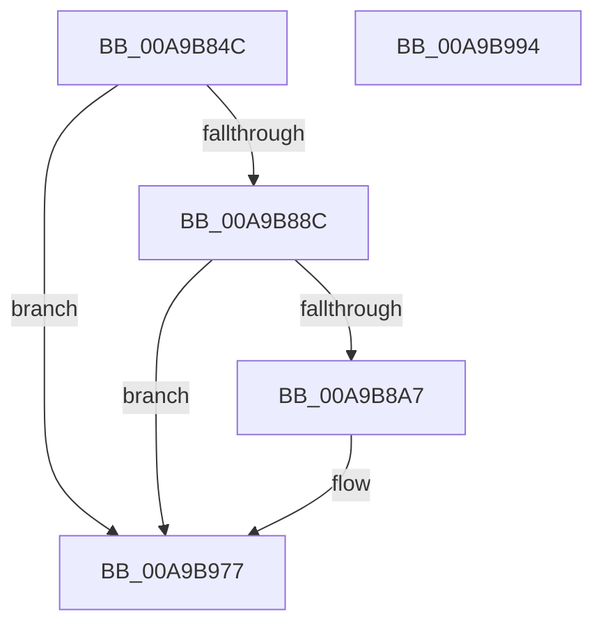

# PopDiagTracePowerTransitionTime

- RVA: `0x00A9B84C`–`0x00A9B995` (길이 `329` bytes)
- VA: `0x0000000140A9B84C`
- 실행 섹션: `PAGE`
- PDB 이름 있음: `예`; PDB Function 태그: `아니요`
- unwind 정보 RVA: `0x000BA42C`
- 디코드: `69`개 명령, `329/329` bytes 표시
- 미해석 바이트: `0` (있으면 어셈블리에 `.byte`로 보존)

> 이 문서는 커널 이미지의 기계어와 PDB 기호를 분석해 생성했습니다. 4번과 5번은 함수 원형과 자료형을 바이너리 사용 방식에서 추정한 C 해석이며 원본 소스 복구 결과는 아닙니다.

## 1. Dependencies

- 직접 호출 지점: **4**; 고유 호출 대상: **4**
- 직접 호출자로 확인된 함수: **1**
- RIP 상대 이미지 참조: **6**

### Outgoing calls
- `0x00A9B89A` → [EtwEventEnabled](../../text/39/EtwEventEnabled_function_00392450.md) (function, `0x00392450`)
- `0x00A9B8C9` → [PopPowerTransitionTimesInMs](../../text/4B/PopPowerTransitionTimesInMs_function_004B5C18.md) (function, `0x004B5C18`)
- `0x00A9B972` → [EtwWrite](../../text/41/EtwWrite_function_0041C720.md) (function, `0x0041C720`)
- `0x00A9B97E` → [_security_check_cookie](../../text/6A/_security_check_cookie_function_006AC640.md) (function, `0x006AC640`)

### Direct callers
- [PopIssueActionRequest](PopIssueActionRequest_function_00A9CE54.md) at `0x00A9D290`

### Static image references
- `0x00A9B85E` → RVA `0x00E0A740` (`.data`; read)
- `0x00A9B86E` → RVA `0x00E67858` (`.data`; read)
- `0x00A9B88C` → RVA `0x00F0B408` (`.data`; read)
- `0x00A9B893` → RVA `0x0001C620` (`.rdata`; read)
- `0x00A9B8F8` → RVA `0x00F0C528` (`.data`; read)
- `0x00A9B926` → RVA `0x00F0C570` (`.data`; read)

## 2. Other-region calls and transfers

- 다른 실행 섹션으로 향하는 call: **4**
  - `0x00A9B89A` → [EtwEventEnabled](../../text/39/EtwEventEnabled_function_00392450.md) (`PAGE` → `.text`)
  - `0x00A9B8C9` → [PopPowerTransitionTimesInMs](../../text/4B/PopPowerTransitionTimesInMs_function_004B5C18.md) (`PAGE` → `.text`)
  - `0x00A9B972` → [EtwWrite](../../text/41/EtwWrite_function_0041C720.md) (`PAGE` → `.text`)
  - `0x00A9B97E` → [_security_check_cookie](../../text/6A/_security_check_cookie_function_006AC640.md) (`PAGE` → `.text`)
- 별도 외부 분기/꼬리 이동을 확인하지 못했습니다.

## 3. Assembly (complete function range)

```asm
00A9B84C  48 89 5C 24 08                  mov qword ptr [rsp + 8], rbx
00A9B851  55                              push rbp
00A9B852  48 8D 6C 24 A9                  lea rbp, [rsp - 0x57]
00A9B857  48 81 EC E0 00 00 00            sub rsp, 0xe0
00A9B85E  48 8B 05 DB EE 36 00            mov rax, qword ptr [rip + 0x36eedb]
00A9B865  48 33 C4                        xor rax, rsp
00A9B868  48 89 45 47                     mov qword ptr [rbp + 0x47], rax
00A9B86C  33 DB                           xor ebx, ebx
00A9B86E  38 1D E4 BF 3C 00               cmp byte ptr [rip + 0x3cbfe4], bl
00A9B874  89 5D B7                        mov dword ptr [rbp - 0x49], ebx
00A9B877  89 5D BB                        mov dword ptr [rbp - 0x45], ebx
00A9B87A  89 5D AF                        mov dword ptr [rbp - 0x51], ebx
00A9B87D  89 5D B3                        mov dword ptr [rbp - 0x4d], ebx
00A9B880  89 5D AB                        mov dword ptr [rbp - 0x55], ebx
00A9B883  89 5D A7                        mov dword ptr [rbp - 0x59], ebx
00A9B886  0F 84 EB 00 00 00               je 0x140a9b977
00A9B88C  48 8B 0D 75 FB 46 00            mov rcx, qword ptr [rip + 0x46fb75]
00A9B893  48 8D 15 86 0D 58 FF            lea rdx, [rip - 0xa7f27a]
00A9B89A  E8 B1 6B 8F FF                  call 0x140392450
00A9B89F  84 C0                           test al, al
00A9B8A1  0F 84 D0 00 00 00               je 0x140a9b977
00A9B8A7  48 8D 45 BB                     lea rax, [rbp - 0x45]
00A9B8AB  48 89 44 24 28                  mov qword ptr [rsp + 0x28], rax
00A9B8B0  4C 8D 4D B3                     lea r9, [rbp - 0x4d]
00A9B8B4  48 8D 45 B7                     lea rax, [rbp - 0x49]
00A9B8B8  4C 8D 45 AF                     lea r8, [rbp - 0x51]
00A9B8BC  48 89 44 24 20                  mov qword ptr [rsp + 0x20], rax
00A9B8C1  48 8D 55 AB                     lea rdx, [rbp - 0x55]
00A9B8C5  48 8D 4D A7                     lea rcx, [rbp - 0x59]
00A9B8C9  E8 4A A3 A1 FF                  call 0x1404b5c18
00A9B8CE  48 8B 0D 33 FB 46 00            mov rcx, qword ptr [rip + 0x46fb33]
00A9B8D5  48 8D 45 A7                     lea rax, [rbp - 0x59]
00A9B8D9  48 89 45 C7                     mov qword ptr [rbp - 0x39], rax
00A9B8DD  44 8D 4B 08                     lea r9d, [rbx + 8]
00A9B8E1  48 8D 45 AB                     lea rax, [rbp - 0x55]
00A9B8E5  48 C7 45 CF 04 00 00 00         mov qword ptr [rbp - 0x31], 4
00A9B8ED  48 89 45 D7                     mov qword ptr [rbp - 0x29], rax
00A9B8F1  48 8D 15 28 0D 58 FF            lea rdx, [rip - 0xa7f2d8]
00A9B8F8  48 8D 05 29 0C 47 00            lea rax, [rip + 0x470c29]
00A9B8FF  48 C7 45 DF 04 00 00 00         mov qword ptr [rbp - 0x21], 4
00A9B907  48 89 45 E7                     mov qword ptr [rbp - 0x19], rax
00A9B90B  45 33 C0                        xor r8d, r8d
00A9B90E  48 8D 45 AF                     lea rax, [rbp - 0x51]
00A9B912  48 C7 45 EF 04 00 00 00         mov qword ptr [rbp - 0x11], 4
00A9B91A  48 89 45 F7                     mov qword ptr [rbp - 9], rax
00A9B91E  48 8D 45 B3                     lea rax, [rbp - 0x4d]
00A9B922  48 89 45 07                     mov qword ptr [rbp + 7], rax
00A9B926  48 8D 05 43 0C 47 00            lea rax, [rip + 0x470c43]
00A9B92D  48 89 45 17                     mov qword ptr [rbp + 0x17], rax
00A9B931  48 8D 45 B7                     lea rax, [rbp - 0x49]
00A9B935  48 89 45 27                     mov qword ptr [rbp + 0x27], rax
00A9B939  48 8D 45 BB                     lea rax, [rbp - 0x45]
00A9B93D  48 89 45 37                     mov qword ptr [rbp + 0x37], rax
00A9B941  48 8D 45 C7                     lea rax, [rbp - 0x39]
00A9B945  48 89 44 24 20                  mov qword ptr [rsp + 0x20], rax
00A9B94A  48 C7 45 FF 04 00 00 00         mov qword ptr [rbp - 1], 4
00A9B952  48 C7 45 0F 04 00 00 00         mov qword ptr [rbp + 0xf], 4
00A9B95A  48 C7 45 1F 04 00 00 00         mov qword ptr [rbp + 0x1f], 4
00A9B962  48 C7 45 2F 04 00 00 00         mov qword ptr [rbp + 0x2f], 4
00A9B96A  48 C7 45 3F 04 00 00 00         mov qword ptr [rbp + 0x3f], 4
00A9B972  E8 A9 0D 98 FF                  call 0x14041c720
00A9B977  48 8B 4D 47                     mov rcx, qword ptr [rbp + 0x47]
00A9B97B  48 33 CC                        xor rcx, rsp
00A9B97E  E8 BD 0C C1 FF                  call 0x1406ac640
00A9B983  48 8B 9C 24 F0 00 00 00         mov rbx, qword ptr [rsp + 0xf0]
00A9B98B  48 81 C4 E0 00 00 00            add rsp, 0xe0
00A9B992  5D                              pop rbp
00A9B993  C3                              ret
00A9B994  CC                              int3
```

## 4. C-style interpretation (structured pseudocode)

```c
__int64 __fastcall PopDiagTracePowerTransitionTime(void)
{
    __int64 result;
    __int64 v_rbx;
    __int64 v_rsp;
    unsigned __int64 v_stack_m18;
    unsigned __int64 v_stack_m20;
    unsigned __int64 v_stack_m28;
    unsigned __int64 v_stack_m30;
    unsigned __int64 v_stack_m38;
    unsigned __int64 v_stack_m40;
    unsigned __int64 v_stack_m48;
    unsigned __int64 v_stack_m50;
    unsigned __int64 v_stack_m58;
    unsigned __int64 v_stack_m5F;
    unsigned __int64 v_stack_m60;
    unsigned __int64 v_stack_m68;
    unsigned __int64 v_stack_m70;
    unsigned __int64 v_stack_m78;
    unsigned __int64 v_stack_m80;
    unsigned __int64 v_stack_m88;
    unsigned __int64 v_stack_m90;
    unsigned __int64 v_stack_m98;
    unsigned int v_stack_mA4;
    unsigned int v_stack_mA8;
    unsigned int v_stack_mAC;
    unsigned int v_stack_mB0;
    unsigned int v_stack_mB4;
    unsigned int v_stack_mB8;
    unsigned __int64 v_stack_mC0;
    unsigned __int64 v_stack_mC8;
    unsigned __int64 v_stack_p8;

    v_stack_p8 = v_rbx;
    v_rsp = (v_rsp) - (224);
    result = (*(unsigned __int64 *)(v_rip + 3600091)) ^ (v_rsp);
    v_stack_m18 = result;
    v_rbx = 0;
    v_stack_mA8 = 0;
    v_stack_mA4 = 0;
    v_stack_mB0 = 0;
    v_stack_mAC = 0;
    v_stack_mB4 = 0;
    v_stack_mB8 = 0;
    if ((*(unsigned __int8 *)(v_rip + 3981284)) == 0) goto loc_00A9B977;
    result = EtwEventEnabled(*(unsigned __int64 *)(v_rip + 4651893), v_rip - 11006586, a3, a4);
    if ((unsigned __int8)(result) != 0) {
        result = v_stack_mA4;
        v_stack_mC0 = result;
        a4 = v_stack_mAC;
        result = v_stack_mA8;
        a3 = v_stack_mB0;
        v_stack_mC8 = result;
        a2 = v_stack_mB4;
        a1 = v_stack_mB8;
        result = PopPowerTransitionTimesInMs(a1, a2, a3, a4);
        a1 = *(unsigned __int64 *)(v_rip + 4651827);
        result = v_stack_mB8;
        v_stack_m98 = result;
        a4 = v_rbx + 8;
        result = v_stack_mB4;
        v_stack_m90 = 4;
        v_stack_m88 = result;
        a2 = v_rip - 11006680;
        result = v_rip + 4656169;
        v_stack_m80 = 4;
        v_stack_m78 = result;
        a3 = 0;
        result = v_stack_mB0;
        v_stack_m70 = 4;
        v_stack_m68 = result;
        result = v_stack_mAC;
        v_stack_m58 = result;
        result = v_rip + 4656195;
        v_stack_m48 = result;
        result = v_stack_mA8;
        v_stack_m38 = result;
        result = v_stack_mA4;
        v_stack_m28 = result;
        result = v_stack_m98;
        v_stack_mC8 = result;
        v_stack_m60 = 4;
        v_stack_m50 = 4;
        v_stack_m40 = 4;
        v_stack_m30 = 4;
        v_stack_m20 = 4;
        result = EtwWrite(a1, a2, a3, a4);
    }
    a1 = (v_stack_m18) ^ (v_rsp);
    result = _security_check_cookie(a1, a2, a3, a4);
    v_rsp = (v_rsp) + (224);
    return result;
}
```

## 5. (Beta) C Style

```c
void PopDiagTracePowerTransitionTime(void)
{
    int64_t result;
    int64_t local_rbx;
    int64_t local_rsp;
    uint64_t v_stack_m18;
    uint64_t v_stack_m20;
    uint64_t v_stack_m28;
    uint64_t v_stack_m30;
    uint64_t v_stack_m38;
    uint64_t v_stack_m40;
    uint64_t v_stack_m48;
    uint64_t v_stack_m50;
    uint64_t v_stack_m58;
    uint64_t v_stack_m5F;
    uint64_t v_stack_m60;
    uint64_t v_stack_m68;
    uint64_t v_stack_m70;
    uint64_t v_stack_m78;
    uint64_t v_stack_m80;
    uint64_t v_stack_m88;
    uint64_t v_stack_m90;
    uint64_t v_stack_m98;
    uint32_t v_stack_mA4;
    uint32_t v_stack_mA8;
    uint32_t v_stack_mAC;
    uint32_t v_stack_mB0;
    uint32_t v_stack_mB4;
    uint32_t v_stack_mB8;
    uint64_t v_stack_mC0;
    uint64_t v_stack_mC8;
    uint64_t v_stack_p8;

    v_stack_p8 = local_rbx;
    local_rsp = (local_rsp) - (224);
    result = (*(uint64_t *)(v_rip + 0x36EEDB)) ^ (local_rsp);
    v_stack_m18 = result;
    local_rbx = 0;
    v_stack_mA8 = 0;
    v_stack_mA4 = 0;
    v_stack_mB0 = 0;
    v_stack_mAC = 0;
    v_stack_mB4 = 0;
    v_stack_mB8 = 0;
    if ((*(uint8_t *)(v_rip + 0x3CBFE4)) == 0) goto loc_00A9B977;
    result = EtwEventEnabled(*(uint64_t *)(v_rip + 0x46FB75), v_rip - 11006586, a3, a4);
    if ((uint8_t)(result) != 0) {
        result = v_stack_mA4;
        v_stack_mC0 = result;
        a4 = v_stack_mAC;
        result = v_stack_mA8;
        a3 = v_stack_mB0;
        v_stack_mC8 = result;
        a2 = v_stack_mB4;
        a1 = v_stack_mB8;
        result = PopPowerTransitionTimesInMs(a1, a2, a3, a4);
        a1 = *(uint64_t *)(v_rip + 0x46FB33);
        result = v_stack_mB8;
        v_stack_m98 = result;
        a4 = local_rbx + 8;
        result = v_stack_mB4;
        v_stack_m90 = 4;
        v_stack_m88 = result;
        a2 = v_rip - 11006680;
        result = v_rip + 4656169;
        v_stack_m80 = 4;
        v_stack_m78 = result;
        a3 = 0;
        result = v_stack_mB0;
        v_stack_m70 = 4;
        v_stack_m68 = result;
        result = v_stack_mAC;
        v_stack_m58 = result;
        result = v_rip + 4656195;
        v_stack_m48 = result;
        result = v_stack_mA8;
        v_stack_m38 = result;
        result = v_stack_mA4;
        v_stack_m28 = result;
        result = v_stack_m98;
        v_stack_mC8 = result;
        v_stack_m60 = 4;
        v_stack_m50 = 4;
        v_stack_m40 = 4;
        v_stack_m30 = 4;
        v_stack_m20 = 4;
        result = EtwWrite(a1, a2, a3, a4);
    }
    a1 = (v_stack_m18) ^ (local_rsp);
    result = _security_check_cookie(a1, a2, a3, a4);
    local_rsp = (local_rsp) + (224);
    return result;
}
```

## 6. Execution-region graph

[열기: 2D/3D 그래프와 함수 탐색 컨트롤 패널](../../../control-panel.html?section=page&rva=0x00A9B84C&view=graph)

- 2D 그래프는 위에서 아래로 흐르고, 3D 그래프는 빈 공간을 드래그해 회전합니다. Shift+드래그는 이동, 휠은 확대·축소, 함수 노드 선택은 대상 보고서 이동입니다.

### Static fallback


