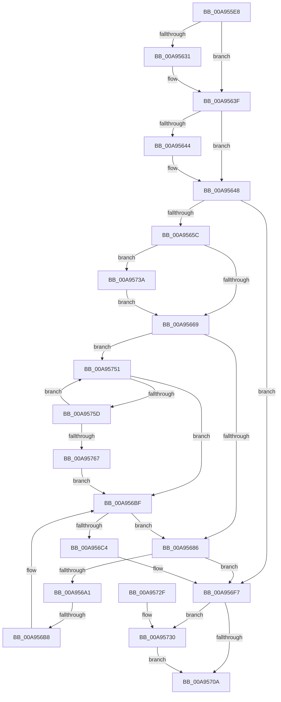

# PopDirectedDripsDiagBroadcastTreeBegin

- RVA: `0x00A955E8`–`0x00A9576C` (길이 `388` bytes)
- VA: `0x0000000140A955E8`
- 실행 섹션: `PAGE`
- PDB 이름 있음: `예`; PDB Function 태그: `예`
- unwind 정보 RVA: `0x000B9830`
- 디코드: `102`개 명령, `388/388` bytes 표시
- 미해석 바이트: `0` (있으면 어셈블리에 `.byte`로 보존)

> 이 문서는 커널 이미지의 기계어와 PDB 기호를 분석해 생성했습니다. 4번과 5번은 함수 원형과 자료형을 바이너리 사용 방식에서 추정한 C 해석이며 원본 소스 복구 결과는 아닙니다.

## 1. Dependencies

- 직접 호출 지점: **7**; 고유 호출 대상: **7**
- 직접 호출자로 확인된 함수: **1**
- RIP 상대 이미지 참조: **7**

### Outgoing calls
- `0x00A95620` → [KeAbPreAcquire](../../text/21/KeAbPreAcquire_function_00210230.md) (function, `0x00210230`)
- `0x00A9563A` → [ExfAcquirePushLockExclusiveEx](../../text/20/ExfAcquirePushLockExclusiveEx_function_0020FC90.md) (function, `0x0020FC90`)
- `0x00A9564B` → [PopDirectedDripsDiagGetOrCreateDeviceDiagnostic](../70/PopDirectedDripsDiagGetOrCreateDeviceDiagnostic_function_00705170.md) (function, `0x00705170`)
- `0x00A95694` → [ExAllocatePool2](../../poolcode/B8/ExAllocatePool2_function_00B820F0.md) (function, `0x00B820F0`)
- `0x00A956C8` → [PopDirectedDripsDiagGetDeviceActiveStamp](../../text/4D/PopDirectedDripsDiagGetDeviceActiveStamp_function_004D5C78.md) (function, `0x004D5C78`)
- `0x00A9570D` → [KeAbPostRelease](../../text/2E/KeAbPostRelease_function_002E1600.md) (function, `0x002E1600`)
- `0x00A95733` → [ExfTryToWakePushLock](../../text/26/ExfTryToWakePushLock_function_00265DD0.md) (function, `0x00265DD0`)

### Direct callers
- [PopDirectedDripsBuildBroadcastTreePartial](../77/PopDirectedDripsBuildBroadcastTreePartial_function_00771B90.md) at `0x00771BD5`

### Static image references
- `0x00A95608` → RVA `0x00F07650` (`.data`; read)
- `0x00A9566F` → RVA `0x00F07420` (`.data`; read)
- `0x00A956A8` → RVA `0x00F07428` (`.data`; read)
- `0x00A956D1` → RVA `0x00F07648` (`.data`; read)
- `0x00A956FB` → RVA `0x00F07650` (`.data`; read/write)
- `0x00A9573A` → RVA `0x00F07644` (`.data`; read)
- `0x00A95746` → RVA `0x00F07644` (`.data`; read/write)

## 2. Other-region calls and transfers

- 다른 실행 섹션으로 향하는 call: **6**
  - `0x00A95620` → [KeAbPreAcquire](../../text/21/KeAbPreAcquire_function_00210230.md) (`PAGE` → `.text`)
  - `0x00A9563A` → [ExfAcquirePushLockExclusiveEx](../../text/20/ExfAcquirePushLockExclusiveEx_function_0020FC90.md) (`PAGE` → `.text`)
  - `0x00A95694` → [ExAllocatePool2](../../poolcode/B8/ExAllocatePool2_function_00B820F0.md) (`PAGE` → `POOLCODE`)
  - `0x00A956C8` → [PopDirectedDripsDiagGetDeviceActiveStamp](../../text/4D/PopDirectedDripsDiagGetDeviceActiveStamp_function_004D5C78.md) (`PAGE` → `.text`)
  - `0x00A9570D` → [KeAbPostRelease](../../text/2E/KeAbPostRelease_function_002E1600.md) (`PAGE` → `.text`)
  - `0x00A95733` → [ExfTryToWakePushLock](../../text/26/ExfTryToWakePushLock_function_00265DD0.md) (`PAGE` → `.text`)
- call이 아닌 외부 분기/꼬리 이동: **1**
  - `0x00A956B2` → [sub_00B47710](../B4/Unknown_function_00B47710.md) (`tail-transfer`)

## 3. Assembly (complete function range)

```asm
00A955E8  48 89 5C 24 08                  mov qword ptr [rsp + 8], rbx
00A955ED  48 89 6C 24 10                  mov qword ptr [rsp + 0x10], rbp
00A955F2  48 89 74 24 18                  mov qword ptr [rsp + 0x18], rsi
00A955F7  57                              push rdi
00A955F8  41 54                           push r12
00A955FA  41 55                           push r13
00A955FC  41 56                           push r14
00A955FE  41 57                           push r15
00A95600  48 83 EC 20                     sub rsp, 0x20
00A95604  49 83 20 00                     and qword ptr [r8], 0
00A95608  4C 8D 25 41 20 47 00            lea r12, [rip + 0x472041]
00A9560F  4D 8B F0                        mov r14, r8
00A95612  44 8B FA                        mov r15d, edx
00A95615  48 8B E9                        mov rbp, rcx
00A95618  45 33 C0                        xor r8d, r8d
00A9561B  49 8B CC                        mov rcx, r12
00A9561E  33 D2                           xor edx, edx
00A95620  E8 0B AC 77 FF                  call 0x140210230
00A95625  F0 49 0F BA 2C 24 00            lock bts qword ptr [r12], 0
00A9562C  48 8B D8                        mov rbx, rax
00A9562F  73 0E                           jae 0x140a9563f
00A95631  4D 8B C4                        mov r8, r12
00A95634  48 8B D0                        mov rdx, rax
00A95637  49 8B CC                        mov rcx, r12
00A9563A  E8 51 A6 77 FF                  call 0x14020fc90
00A9563F  48 85 DB                        test rbx, rbx
00A95642  74 04                           je 0x140a95648
00A95644  C6 43 0A 01                     mov byte ptr [rbx + 0xa], 1
00A95648  48 8B CD                        mov rcx, rbp
00A9564B  E8 20 FB C6 FF                  call 0x140705170
00A95650  48 8B F8                        mov rdi, rax
00A95653  48 85 C0                        test rax, rax
00A95656  0F 84 9B 00 00 00               je 0x140a956f7
00A9565C  83 B8 94 00 00 00 FF            cmp dword ptr [rax + 0x94], -1
00A95663  0F 84 D1 00 00 00               je 0x140a9573a
00A95669  8B B0 94 00 00 00               mov esi, dword ptr [rax + 0x94]
00A9566F  4C 8D 2D AA 1D 47 00            lea r13, [rip + 0x471daa]
00A95676  48 8B 05 A3 1D 47 00            mov rax, qword ptr [rip + 0x471da3]
00A9567D  49 3B C5                        cmp rax, r13
00A95680  0F 85 CB 00 00 00               jne 0x140a95751
00A95686  BA E8 00 00 00                  mov edx, 0xe8
00A9568B  41 B8 50 64 69 67               mov r8d, 0x67696450
00A95691  8D 4A 18                        lea ecx, [rdx + 0x18]
00A95694  E8 57 CA 0E 00                  call 0x140b820f0
00A95699  48 8B D8                        mov rbx, rax
00A9569C  48 85 C0                        test rax, rax
00A9569F  74 56                           je 0x140a956f7
00A956A1  89 70 20                        mov dword ptr [rax + 0x20], esi
00A956A4  48 89 78 10                     mov qword ptr [rax + 0x10], rdi
00A956A8  48 8B 05 79 1D 47 00            mov rax, qword ptr [rip + 0x471d79]
00A956AF  4C 39 28                        cmp qword ptr [rax], r13
00A956B2  0F 84 58 20 0B 00               je 0x140b47710
00A956B8  B9 03 00 00 00                  mov ecx, 3
00A956BD  CD 29                           int 0x29
00A956BF  48 85 DB                        test rbx, rbx
00A956C2  74 C2                           je 0x140a95686
00A956C4  48 8B 4D 50                     mov rcx, qword ptr [rbp + 0x50]
00A956C8  E8 AB 05 A4 FF                  call 0x1404d5c78
00A956CD  48 89 43 30                     mov qword ptr [rbx + 0x30], rax
00A956D1  8B 05 71 1F 47 00               mov eax, dword ptr [rip + 0x471f71]
00A956D7  89 43 24                        mov dword ptr [rbx + 0x24], eax
00A956DA  8B 43 28                        mov eax, dword ptr [rbx + 0x28]
00A956DD  8B C8                           mov ecx, eax
00A956DF  41 33 CF                        xor ecx, r15d
00A956E2  49 89 1E                        mov qword ptr [r14], rbx
00A956E5  83 E1 0F                        and ecx, 0xf
00A956E8  33 C8                           xor ecx, eax
00A956EA  89 4B 28                        mov dword ptr [rbx + 0x28], ecx
00A956ED  81 8F 98 00 00 00 00 00 06 00   or dword ptr [rdi + 0x98], 0x60000
00A956F7  48 83 C8 FF                     or rax, 0xffffffffffffffff
00A956FB  F0 48 0F C1 05 4C 1F 47 00      lock xadd qword ptr [rip + 0x471f4c], rax
00A95704  24 06                           and al, 6
00A95706  3C 02                           cmp al, 2
00A95708  74 26                           je 0x140a95730
00A9570A  49 8B CC                        mov rcx, r12
00A9570D  E8 EE BE 84 FF                  call 0x1402e1600
00A95712  48 8B 5C 24 50                  mov rbx, qword ptr [rsp + 0x50]
00A95717  48 8B 6C 24 58                  mov rbp, qword ptr [rsp + 0x58]
00A9571C  48 8B 74 24 60                  mov rsi, qword ptr [rsp + 0x60]
00A95721  48 83 C4 20                     add rsp, 0x20
00A95725  41 5F                           pop r15
00A95727  41 5E                           pop r14
00A95729  41 5D                           pop r13
00A9572B  41 5C                           pop r12
00A9572D  5F                              pop rdi
00A9572E  C3                              ret
00A9572F  CC                              int3
00A95730  49 8B CC                        mov rcx, r12
00A95733  E8 98 06 7D FF                  call 0x140265dd0
00A95738  EB D0                           jmp 0x140a9570a
00A9573A  8B 0D 04 1F 47 00               mov ecx, dword ptr [rip + 0x471f04]
00A95740  89 88 94 00 00 00               mov dword ptr [rax + 0x94], ecx
00A95746  FF 05 F8 1E 47 00               inc dword ptr [rip + 0x471ef8]
00A9574C  E9 18 FF FF FF                  jmp 0x140a95669
00A95751  48 8B D8                        mov rbx, rax
00A95754  39 70 20                        cmp dword ptr [rax + 0x20], esi
00A95757  0F 84 62 FF FF FF               je 0x140a956bf
00A9575D  48 8B 00                        mov rax, qword ptr [rax]
00A95760  33 DB                           xor ebx, ebx
00A95762  49 3B C5                        cmp rax, r13
00A95765  75 EA                           jne 0x140a95751
00A95767  E9 53 FF FF FF                  jmp 0x140a956bf
```

## 4. C-style interpretation (structured pseudocode)

```c
__int64 __fastcall PopDirectedDripsDiagBroadcastTreeBegin(__int64 a1, int a2, __int64 a3)
{
    __int64 result;
    __int64 v_rbx;
    __int64 v_rsp;
    unsigned __int64 v_stack_p10;
    unsigned __int64 v_stack_p18;
    unsigned __int64 v_stack_p8;

    v_stack_p8 = v_rbx;
    v_stack_p10 = v_rbp;
    v_stack_p18 = v_rsi;
    v_rsp = (v_rsp) - (32);
    a3 = 0;
    a2 = 0;
    result = KeAbPreAcquire(v_rip + 4661313, a2, a3, a4);
    if (!(condition_is_above_or_equal)) {
        a3 = v_rip + 4661313;
        a2 = result;
        a1 = v_rip + 4661313;
        result = ExfAcquirePushLockExclusiveEx(a1, a2, a3, a4);
    }
    if (result != 0) {
        *(unsigned __int8 *)(result + 10) = 1;
    }
    result = PopDirectedDripsDiagGetOrCreateDeviceDiagnostic(a1, a2, a3, a4);
    if (result == 0) goto loc_00A956F7;
    if ((*(unsigned int *)(result + 148)) == -1) goto loc_00A9573A;
loc_00A95669:
    if ((*(unsigned __int64 *)(v_rip + 4660643)) != (v_rip + 4660650)) goto loc_00A95751;
loc_00A95686:
    result = ExAllocatePool2(232 + 24, 232, (unsigned int)(0x67696450ULL), a4);
    if (result == 0) goto loc_00A956F7;
    *(unsigned int *)(result + 32) = (unsigned int)((unsigned int)(*(unsigned int *)(result + 148)));
    *(unsigned __int64 *)(result + 16) = result;
loc_00A956BF:
    if (result == 0) goto loc_00A95686;
    result = PopDirectedDripsDiagGetDeviceActiveStamp(*(unsigned __int64 *)(a1 + 80), 232, (unsigned int)(0x67696450ULL), a4);
    *(unsigned __int64 *)(result + 48) = result;
    *(unsigned int *)(result + 36) = (unsigned int)((unsigned int)(*(unsigned int *)(v_rip + 4661105)));
    a1 = (unsigned int)(((unsigned int)((unsigned int)((unsigned int)(*(unsigned int *)(result + 40))))) ^ ((unsigned int)((unsigned int)(a2))));
    *(unsigned __int64 *)(a3) = result;
    a1 = (unsigned int)((a1) & (15));
    a1 = (unsigned int)((a1) ^ ((unsigned int)((unsigned int)(*(unsigned int *)(result + 40)))));
    *(unsigned int *)(result + 40) = (unsigned int)(a1);
loc_00A956F7:
    result = ((unsigned int)(*(unsigned int *)(result + 40))) | (-1);
    result = (unsigned __int8)((result) & (6));
    if (((unsigned __int8)(result)) == 2) goto loc_00A95730;
loc_00A9570A:
    result = KeAbPostRelease(v_rip + 4661313, 232, (unsigned int)(0x67696450ULL), a4);
    v_rsp = (v_rsp) + (32);
    return result;
loc_00A95730:
    result = ExfTryToWakePushLock(v_rip + 4661313, 232, (unsigned int)(0x67696450ULL), a4);
    goto loc_00A9570A;
loc_00A9573A:
    *(unsigned int *)(result + 148) = (unsigned int)((unsigned int)(*(unsigned int *)(v_rip + 4660996)));
    goto loc_00A95669;
loc_00A95751:
    if ((*(unsigned int *)(result + 32)) == ((unsigned int)(v_stack_p18))) goto loc_00A956BF;
    v_rbx = 0;
    if ((*(unsigned __int64 *)(result)) != (v_rip + 4660650)) goto loc_00A95751;
    goto loc_00A956BF;
}
```

## 5. (Beta) C Style

```c
int64_t PopDirectedDripsDiagBroadcastTreeBegin(void *Arg1, int32_t Arg2, void *Arg3)
{
    uint8_t *arg1 = (uint8_t *)Arg1;
    uint8_t *arg3 = (uint8_t *)Arg3;

    int64_t result;
    int64_t local_rbx;
    int64_t local_rsp;
    uint64_t v_stack_p10;
    uint64_t v_stack_p18;
    uint64_t v_stack_p8;

    v_stack_p8 = local_rbx;
    v_stack_p10 = local_rbp;
    v_stack_p18 = local_rsi;
    local_rsp = (local_rsp) - (32);
    Arg3 = 0;
    Arg2 = 0;
    result = KeAbPreAcquire(v_rip + 4661313, Arg2, Arg3, a4);
    if (!(condition_is_above_or_equal)) {
        Arg3 = v_rip + 4661313;
        Arg2 = result;
        Arg1 = v_rip + 4661313;
        result = ExfAcquirePushLockExclusiveEx(Arg1, Arg2, Arg3, a4);
    }
    if (result != 0) {
        *(uint8_t *)(result + 0xA) = 1;
    }
    result = PopDirectedDripsDiagGetOrCreateDeviceDiagnostic(Arg1, Arg2, Arg3, a4);
    if (result == 0) goto loc_00A956F7;
    if ((*(uint32_t *)(result + 0x94)) == -1) goto loc_00A9573A;
loc_00A95669:
    if ((*(uint64_t *)(v_rip + 0x471DA3)) != (v_rip + 4660650)) goto loc_00A95751;
loc_00A95686:
    result = ExAllocatePool2(232 + 24, 232, (uint32_t)(0x67696450ULL), a4);
    if (result == 0) goto loc_00A956F7;
    *(uint32_t *)(result + 0x20) = (uint32_t)((uint32_t)(*(uint32_t *)(result + 0x94)));
    *(uint64_t *)(result + 0x10) = result;
loc_00A956BF:
    if (result == 0) goto loc_00A95686;
    result = PopDirectedDripsDiagGetDeviceActiveStamp(*(uint64_t *)(arg1 + 0x50), 232, (uint32_t)(0x67696450ULL), a4);
    *(uint64_t *)(result + 0x30) = result;
    *(uint32_t *)(result + 0x24) = (uint32_t)((uint32_t)(*(uint32_t *)(v_rip + 0x471F71)));
    Arg1 = (uint32_t)(((uint32_t)((uint32_t)((uint32_t)(*(uint32_t *)(result + 0x28))))) ^ ((uint32_t)((uint32_t)(Arg2))));
    *(uint64_t *)(arg3) = result;
    Arg1 = (uint32_t)((Arg1) & (15));
    Arg1 = (uint32_t)((Arg1) ^ ((uint32_t)((uint32_t)(*(uint32_t *)(result + 0x28)))));
    *(uint32_t *)(result + 0x28) = (uint32_t)(Arg1);
loc_00A956F7:
    result = ((uint32_t)(*(uint32_t *)(result + 0x28))) | (-1);
    result = (uint8_t)((result) & (6));
    if (((uint8_t)(result)) == 2) goto loc_00A95730;
loc_00A9570A:
    result = KeAbPostRelease(v_rip + 4661313, 232, (uint32_t)(0x67696450ULL), a4);
    local_rsp = (local_rsp) + (32);
    return result;
loc_00A95730:
    result = ExfTryToWakePushLock(v_rip + 4661313, 232, (uint32_t)(0x67696450ULL), a4);
    goto loc_00A9570A;
loc_00A9573A:
    *(uint32_t *)(result + 0x94) = (uint32_t)((uint32_t)(*(uint32_t *)(v_rip + 0x471F04)));
    goto loc_00A95669;
loc_00A95751:
    if ((*(uint32_t *)(result + 0x20)) == ((uint32_t)(v_stack_p18))) goto loc_00A956BF;
    local_rbx = 0;
    if ((*(uint64_t *)(result)) != (v_rip + 4660650)) goto loc_00A95751;
    goto loc_00A956BF;
}
```

### 관측된 메모리 오프셋

구조체 형식이 확인되지 않은 접근은 인자 기준의 오프셋으로만 기록했습니다.

| 기준 인자 | 오프셋 표현 | 폭 (bit) | 접근 |
|---|---:|---:|---|
| `Arg1` | `+ 0x50` | `64` | `R` |
| `Arg3` | `+ 0x0` | `64` | `R/W` |
| `Arg3` | `+ 0x0` | `64` | `W` |

## 6. Execution-region graph

[열기: 2D/3D 그래프와 함수 탐색 컨트롤 패널](../../../control-panel.html?section=page&rva=0x00A955E8&view=graph)

- 2D 그래프는 위에서 아래로 흐르고, 3D 그래프는 빈 공간을 드래그해 회전합니다. Shift+드래그는 이동, 휠은 확대·축소, 함수 노드 선택은 대상 보고서 이동입니다.

### Static fallback


