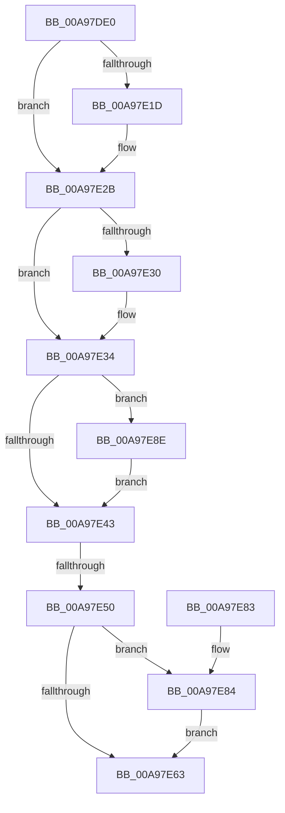

# PopDirectedDripsDiagTraceMarkDevice

- RVA: `0x00A97DE0`–`0x00A97E96` (길이 `182` bytes)
- VA: `0x0000000140A97DE0`
- 실행 섹션: `PAGE`
- PDB 이름 있음: `예`; PDB Function 태그: `예`
- unwind 정보 RVA: `0x000B9F34`
- 디코드: `48`개 명령, `182/182` bytes 표시
- 미해석 바이트: `0` (있으면 어셈블리에 `.byte`로 보존)

> 이 문서는 커널 이미지의 기계어와 PDB 기호를 분석해 생성했습니다. 4번과 5번은 함수 원형과 자료형을 바이너리 사용 방식에서 추정한 C 해석이며 원본 소스 복구 결과는 아닙니다.

## 1. Dependencies

- 직접 호출 지점: **6**; 고유 호출 대상: **6**
- 직접 호출자로 확인된 함수: **1**
- RIP 상대 이미지 참조: **4**

### Outgoing calls
- `0x00A97E0D` → [KeAbPreAcquire](../../text/21/KeAbPreAcquire_function_00210230.md) (function, `0x00210230`)
- `0x00A97E26` → [ExfAcquirePushLockExclusiveEx](../../text/20/ExfAcquirePushLockExclusiveEx_function_0020FC90.md) (function, `0x0020FC90`)
- `0x00A97E39` → [PopDirectedDripsDiagGetOrCreateDeviceDiagnostic](../70/PopDirectedDripsDiagGetOrCreateDeviceDiagnostic_function_00705170.md) (function, `0x00705170`)
- `0x00A97E66` → [KeAbPostRelease](../../text/2E/KeAbPostRelease_function_002E1600.md) (function, `0x002E1600`)
- `0x00A97E73` → [_security_check_cookie](../../text/6A/_security_check_cookie_function_006AC640.md) (function, `0x006AC640`)
- `0x00A97E87` → [ExfTryToWakePushLock](../../text/26/ExfTryToWakePushLock_function_00265DD0.md) (function, `0x00265DD0`)

### Direct callers
- [PopDirectedDripsMarkCandidateDevice](../70/PopDirectedDripsMarkCandidateDevice_function_00705BB4.md) at `0x00705BE8`

### Static image references
- `0x00A97DEA` → RVA `0x00E0A740` (`.data`; read)
- `0x00A97DFE` → RVA `0x00F07650` (`.data`; read)
- `0x00A97E43` → RVA `0x00E67858` (`.data`; read)
- `0x00A97E54` → RVA `0x00F07650` (`.data`; read/write)

## 2. Other-region calls and transfers

- 다른 실행 섹션으로 향하는 call: **5**
  - `0x00A97E0D` → [KeAbPreAcquire](../../text/21/KeAbPreAcquire_function_00210230.md) (`PAGE` → `.text`)
  - `0x00A97E26` → [ExfAcquirePushLockExclusiveEx](../../text/20/ExfAcquirePushLockExclusiveEx_function_0020FC90.md) (`PAGE` → `.text`)
  - `0x00A97E66` → [KeAbPostRelease](../../text/2E/KeAbPostRelease_function_002E1600.md) (`PAGE` → `.text`)
  - `0x00A97E73` → [_security_check_cookie](../../text/6A/_security_check_cookie_function_006AC640.md) (`PAGE` → `.text`)
  - `0x00A97E87` → [ExfTryToWakePushLock](../../text/26/ExfTryToWakePushLock_function_00265DD0.md) (`PAGE` → `.text`)
- call이 아닌 외부 분기/꼬리 이동: **1**
  - `0x00A97E4A` → [sub_00B47E0E](../B4/Unknown_function_00B47E0E.md) (`tail-transfer`)

## 3. Assembly (complete function range)

```asm
00A97DE0  48 89 5C 24 10                  mov qword ptr [rsp + 0x10], rbx
00A97DE5  57                              push rdi
00A97DE6  48 83 EC 60                     sub rsp, 0x60
00A97DEA  48 8B 05 4F 29 37 00            mov rax, qword ptr [rip + 0x37294f]
00A97DF1  48 33 C4                        xor rax, rsp
00A97DF4  48 89 44 24 58                  mov qword ptr [rsp + 0x58], rax
00A97DF9  48 89 4C 24 30                  mov qword ptr [rsp + 0x30], rcx
00A97DFE  48 8D 3D 4B F8 46 00            lea rdi, [rip + 0x46f84b]
00A97E05  48 8B CF                        mov rcx, rdi
00A97E08  45 33 C0                        xor r8d, r8d
00A97E0B  33 D2                           xor edx, edx
00A97E0D  E8 1E 84 77 FF                  call 0x140210230
00A97E12  F0 48 0F BA 2F 00               lock bts qword ptr [rdi], 0
00A97E18  48 8B D8                        mov rbx, rax
00A97E1B  73 0E                           jae 0x140a97e2b
00A97E1D  4C 8B C7                        mov r8, rdi
00A97E20  48 8B D0                        mov rdx, rax
00A97E23  48 8B CF                        mov rcx, rdi
00A97E26  E8 65 7E 77 FF                  call 0x14020fc90
00A97E2B  48 85 DB                        test rbx, rbx
00A97E2E  74 04                           je 0x140a97e34
00A97E30  C6 43 0A 01                     mov byte ptr [rbx + 0xa], 1
00A97E34  48 8B 4C 24 30                  mov rcx, qword ptr [rsp + 0x30]
00A97E39  E8 32 D3 C6 FF                  call 0x140705170
00A97E3E  48 85 C0                        test rax, rax
00A97E41  75 4B                           jne 0x140a97e8e
00A97E43  80 3D 0E FA 3C 00 00            cmp byte ptr [rip + 0x3cfa0e], 0
00A97E4A  0F 85 BE FF 0A 00               jne 0x140b47e0e
00A97E50  48 83 C8 FF                     or rax, 0xffffffffffffffff
00A97E54  F0 48 0F C1 05 F3 F7 46 00      lock xadd qword ptr [rip + 0x46f7f3], rax
00A97E5D  24 06                           and al, 6
00A97E5F  3C 02                           cmp al, 2
00A97E61  74 21                           je 0x140a97e84
00A97E63  48 8B CF                        mov rcx, rdi
00A97E66  E8 95 97 84 FF                  call 0x1402e1600
00A97E6B  48 8B 4C 24 58                  mov rcx, qword ptr [rsp + 0x58]
00A97E70  48 33 CC                        xor rcx, rsp
00A97E73  E8 C8 47 C1 FF                  call 0x1406ac640
00A97E78  48 8B 5C 24 78                  mov rbx, qword ptr [rsp + 0x78]
00A97E7D  48 83 C4 60                     add rsp, 0x60
00A97E81  5F                              pop rdi
00A97E82  C3                              ret
00A97E83  CC                              int3
00A97E84  48 8B CF                        mov rcx, rdi
00A97E87  E8 44 DF 7C FF                  call 0x140265dd0
00A97E8C  EB D5                           jmp 0x140a97e63
00A97E8E  FF 80 90 00 00 00               inc dword ptr [rax + 0x90]
00A97E94  EB AD                           jmp 0x140a97e43
```

## 4. C-style interpretation (structured pseudocode)

```c
__int64 __fastcall PopDirectedDripsDiagTraceMarkDevice(__int64 a1, int a2, int a3)
{
    __int64 result;
    __int64 v_rsp;
    unsigned __int64 v_stack_m10;
    unsigned __int64 v_stack_m38;
    unsigned __int64 v_stack_p10;

    v_stack_p10 = v_rbx;
    v_rsp = (v_rsp) - (96);
    result = (*(unsigned __int64 *)(v_rip + 3615055)) ^ (v_rsp);
    v_stack_m10 = result;
    v_stack_m38 = a1;
    a3 = 0;
    a2 = 0;
    result = KeAbPreAcquire(v_rip + 4651083, a2, a3, a4);
    if (!(condition_is_above_or_equal)) {
        a3 = v_rip + 4651083;
        a2 = result;
        a1 = v_rip + 4651083;
        result = ExfAcquirePushLockExclusiveEx(a1, a2, a3, a4);
    }
    if (result != 0) {
        *(unsigned __int8 *)(result + 10) = 1;
    }
    result = PopDirectedDripsDiagGetOrCreateDeviceDiagnostic(v_stack_m38, a2, a3, a4);
    if (result != 0) goto loc_00A97E8E;
loc_00A97E43:
    result = (result) | (-1);
    result = (unsigned __int8)((result) & (6));
    if (((unsigned __int8)(result)) == 2) goto loc_00A97E84;
loc_00A97E63:
    result = KeAbPostRelease(v_rip + 4651083, a2, a3, a4);
    a1 = (v_stack_m10) ^ (v_rsp);
    result = _security_check_cookie(a1, a2, a3, a4);
    v_rsp = (v_rsp) + (96);
    return result;
loc_00A97E84:
    result = ExfTryToWakePushLock(v_rip + 4651083, a2, a3, a4);
    goto loc_00A97E63;
loc_00A97E8E:
    goto loc_00A97E43;
}
```

## 5. (Beta) C Style

```c
int64_t PopDirectedDripsDiagTraceMarkDevice(int64_t Arg1, int32_t Arg2, int32_t Arg3)
{
    int64_t result;
    int64_t local_rsp;
    uint64_t v_stack_m10;
    uint64_t v_stack_m38;
    uint64_t v_stack_p10;

    v_stack_p10 = local_rbx;
    local_rsp = (local_rsp) - (96);
    result = (*(uint64_t *)(v_rip + 0x37294F)) ^ (local_rsp);
    v_stack_m10 = result;
    v_stack_m38 = Arg1;
    Arg3 = 0;
    Arg2 = 0;
    result = KeAbPreAcquire(v_rip + 4651083, Arg2, Arg3, a4);
    if (!(condition_is_above_or_equal)) {
        Arg3 = v_rip + 4651083;
        Arg2 = result;
        Arg1 = v_rip + 4651083;
        result = ExfAcquirePushLockExclusiveEx(Arg1, Arg2, Arg3, a4);
    }
    if (result != 0) {
        *(uint8_t *)(result + 0xA) = 1;
    }
    result = PopDirectedDripsDiagGetOrCreateDeviceDiagnostic(v_stack_m38, Arg2, Arg3, a4);
    if (result != 0) goto loc_00A97E8E;
loc_00A97E43:
    result = (result) | (-1);
    result = (uint8_t)((result) & (6));
    if (((uint8_t)(result)) == 2) goto loc_00A97E84;
loc_00A97E63:
    result = KeAbPostRelease(v_rip + 4651083, Arg2, Arg3, a4);
    Arg1 = (v_stack_m10) ^ (local_rsp);
    result = _security_check_cookie(Arg1, Arg2, Arg3, a4);
    local_rsp = (local_rsp) + (96);
    return result;
loc_00A97E84:
    result = ExfTryToWakePushLock(v_rip + 4651083, Arg2, Arg3, a4);
    goto loc_00A97E63;
loc_00A97E8E:
    goto loc_00A97E43;
}
```

## 6. Execution-region graph

[열기: 2D/3D 그래프와 함수 탐색 컨트롤 패널](../../../control-panel.html?section=page&rva=0x00A97DE0&view=graph)

- 2D 그래프는 위에서 아래로 흐르고, 3D 그래프는 빈 공간을 드래그해 회전합니다. Shift+드래그는 이동, 휠은 확대·축소, 함수 노드 선택은 대상 보고서 이동입니다.

### Static fallback


