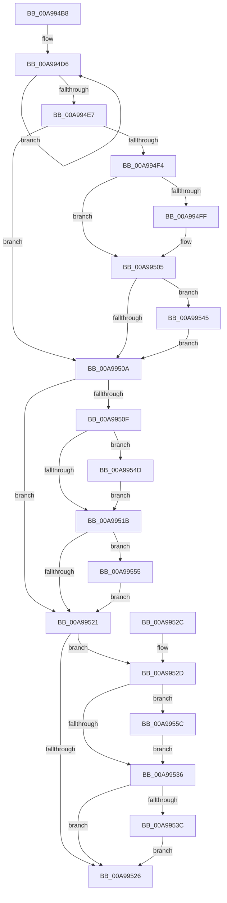

# PopDirectedDripsQueryMitigationStatus

- RVA: `0x00A994B8`–`0x00A99564` (길이 `172` bytes)
- VA: `0x0000000140A994B8`
- 실행 섹션: `PAGE`
- PDB 이름 있음: `예`; PDB Function 태그: `아니요`
- unwind 정보 RVA: `0x0008CDB0`
- 디코드: `55`개 명령, `172/172` bytes 표시
- 미해석 바이트: `0` (있으면 어셈블리에 `.byte`로 보존)

> 이 문서는 커널 이미지의 기계어와 PDB 기호를 분석해 생성했습니다. 4번과 5번은 함수 원형과 자료형을 바이너리 사용 방식에서 추정한 C 해석이며 원본 소스 복구 결과는 아닙니다.

## 1. Dependencies

- 직접 호출 지점: **0**; 고유 호출 대상: **0**
- 직접 호출자로 확인된 함수: **2**
- RIP 상대 이미지 참조: **2**

### Outgoing calls
- 직접 디코드된 call 명령이 없습니다.

### Direct callers
- [PopDirectedDripsUmQueryCapabilities](../77/PopDirectedDripsUmQueryCapabilities_function_00771830.md) at `0x0077187C`
- [sub_00B4309E](../B4/Unknown_function_00B4309E.md) at `0x00B430DE`

### Static image references
- `0x00A994BD` → RVA `0x00F0EAF0` (`.data`; read)
- `0x00A994C6` → RVA `0x00F0EAC0` (`.data`; read)

## 2. Other-region calls and transfers

- 다른 실행 섹션으로 향하는 call: **0**
- 별도 외부 분기/꼬리 이동을 확인하지 못했습니다.

## 3. Assembly (complete function range)

```asm
00A994B8  48 89 5C 24 08                  mov qword ptr [rsp + 8], rbx
00A994BD  8B 1D 2D 56 47 00               mov ebx, dword ptr [rip + 0x47562d]
00A994C3  4C 8B D9                        mov r11, rcx
00A994C6  0F 0D 0D F3 55 47 00            prefetchw byte ptr [rip + 0x4755f3]
00A994CD  8B 05 ED 55 47 00               mov eax, dword ptr [rip + 0x4755ed]
00A994D3  45 33 D2                        xor r10d, r10d
00A994D6  44 8B C8                        mov r9d, eax
00A994D9  45 0B CA                        or r9d, r10d
00A994DC  F0 44 0F B1 0D DB 55 47 00      lock cmpxchg dword ptr [rip + 0x4755db], r9d
00A994E5  75 EF                           jne 0x140a994d6
00A994E7  8B C8                           mov ecx, eax
00A994E9  41 B9 01 00 00 00               mov r9d, 1
00A994EF  4D 85 DB                        test r11, r11
00A994F2  74 16                           je 0x140a9950a
00A994F4  45 89 13                        mov dword ptr [r11], r10d
00A994F7  41 8B C2                        mov eax, r10d
00A994FA  41 84 D9                        test r9b, bl
00A994FD  74 06                           je 0x140a99505
00A994FF  45 89 0B                        mov dword ptr [r11], r9d
00A99502  41 8B C1                        mov eax, r9d
00A99505  F6 C3 02                        test bl, 2
00A99508  75 3B                           jne 0x140a99545
00A9950A  48 85 D2                        test rdx, rdx
00A9950D  74 12                           je 0x140a99521
00A9950F  44 89 12                        mov dword ptr [rdx], r10d
00A99512  41 8B C2                        mov eax, r10d
00A99515  0F BA E1 0C                     bt ecx, 0xc
00A99519  72 32                           jb 0x140a9954d
00A9951B  0F BA E1 0D                     bt ecx, 0xd
00A9951F  72 34                           jb 0x140a99555
00A99521  4D 85 C0                        test r8, r8
00A99524  75 07                           jne 0x140a9952d
00A99526  48 8B 5C 24 08                  mov rbx, qword ptr [rsp + 8]
00A9952B  C3                              ret
00A9952C  CC                              int3
00A9952D  45 89 10                        mov dword ptr [r8], r10d
00A99530  0F BA E1 0A                     bt ecx, 0xa
00A99534  72 26                           jb 0x140a9955c
00A99536  0F BA E1 0B                     bt ecx, 0xb
00A9953A  73 EA                           jae 0x140a99526
00A9953C  41 83 CA 02                     or r10d, 2
00A99540  45 89 10                        mov dword ptr [r8], r10d
00A99543  EB E1                           jmp 0x140a99526
00A99545  83 C8 02                        or eax, 2
00A99548  41 89 03                        mov dword ptr [r11], eax
00A9954B  EB BD                           jmp 0x140a9950a
00A9954D  44 89 0A                        mov dword ptr [rdx], r9d
00A99550  41 8B C1                        mov eax, r9d
00A99553  EB C6                           jmp 0x140a9951b
00A99555  83 C8 02                        or eax, 2
00A99558  89 02                           mov dword ptr [rdx], eax
00A9955A  EB C5                           jmp 0x140a99521
00A9955C  45 89 08                        mov dword ptr [r8], r9d
00A9955F  45 8B D1                        mov r10d, r9d
00A99562  EB D2                           jmp 0x140a99536
```

## 4. C-style interpretation (structured pseudocode)

```c
__int64 __fastcall PopDirectedDripsQueryMitigationStatus(__int64 a1, __int64 a2, __int64 a3)
{
    __int64 result;
    __int64 v_r10;
    unsigned __int64 v_stack_p8;

    v_stack_p8 = v_rbx;
    v_r10 = 0;
loc_00A994D6:
    a4 = (unsigned int)(((unsigned int)((unsigned int)((unsigned int)(*(unsigned int *)(v_rip + 4675053))))) | (0));
    if (condition_is_not_equal) goto loc_00A994D6;
    if (a1 == 0) goto loc_00A9950A;
    *(unsigned int *)(a1) = 0;
    result = 0;
    if (((1) & ((unsigned __int8)((unsigned int)(*(unsigned int *)(v_rip + 4675117))))) != 0) {
        *(unsigned int *)(a1) = 1;
        result = 1;
    }
    if ((((unsigned __int8)((unsigned int)(*(unsigned int *)(v_rip + 4675117)))) & (2)) != 0) goto loc_00A99545;
loc_00A9950A:
    if (a2 == 0) goto loc_00A99521;
    *(unsigned int *)(a2) = 0;
    if (condition_is_below) goto loc_00A9954D;
loc_00A9951B:
    if (condition_is_below) goto loc_00A99555;
loc_00A99521:
    if (a3 != 0) goto loc_00A9952D;
loc_00A99526:
    return 0;
loc_00A9952D:
    *(unsigned int *)(a3) = 0;
    if (condition_is_below) goto loc_00A9955C;
loc_00A99536:
    if (condition_is_above_or_equal) goto loc_00A99526;
    v_r10 = (unsigned int)((v_r10) | (2));
    *(unsigned int *)(a3) = (unsigned int)(v_r10);
    goto loc_00A99526;
loc_00A99545:
    result = (unsigned int)((0) | (2));
    *(unsigned int *)(a1) = (unsigned int)(result);
    goto loc_00A9950A;
loc_00A9954D:
    *(unsigned int *)(a2) = 1;
    goto loc_00A9951B;
loc_00A99555:
    result = (unsigned int)((1) | (2));
    *(unsigned int *)(a2) = (unsigned int)(result);
    goto loc_00A99521;
loc_00A9955C:
    *(unsigned int *)(a3) = 1;
    goto loc_00A99536;
}
```

## 5. (Beta) C Style

```c
int64_t PopDirectedDripsQueryMitigationStatus(int64_t Arg1, int64_t Arg2, int64_t Arg3)
{
    int64_t result;
    int64_t local_r10;
    uint64_t v_stack_p8;

    v_stack_p8 = local_rbx;
    local_r10 = 0;
loc_00A994D6:
    a4 = (uint32_t)(((uint32_t)((uint32_t)((uint32_t)(*(uint32_t *)(v_rip + 0x4755ED))))) | (0));
    if (condition_is_not_equal) goto loc_00A994D6;
    if (Arg1 == 0) goto loc_00A9950A;
    *(uint32_t *)(Arg1) = 0;
    result = 0;
    if (((1) & ((uint8_t)((uint32_t)(*(uint32_t *)(v_rip + 0x47562D))))) != 0) {
        *(uint32_t *)(Arg1) = 1;
        result = 1;
    }
    if ((((uint8_t)((uint32_t)(*(uint32_t *)(v_rip + 0x47562D)))) & (2)) != 0) goto loc_00A99545;
loc_00A9950A:
    if (Arg2 == 0) goto loc_00A99521;
    *(uint32_t *)(Arg2) = 0;
    if (condition_is_below) goto loc_00A9954D;
loc_00A9951B:
    if (condition_is_below) goto loc_00A99555;
loc_00A99521:
    if (Arg3 != 0) goto loc_00A9952D;
loc_00A99526:
    return 0;
loc_00A9952D:
    *(uint32_t *)(Arg3) = 0;
    if (condition_is_below) goto loc_00A9955C;
loc_00A99536:
    if (condition_is_above_or_equal) goto loc_00A99526;
    local_r10 = (uint32_t)((local_r10) | (2));
    *(uint32_t *)(Arg3) = (uint32_t)(local_r10);
    goto loc_00A99526;
loc_00A99545:
    result = (uint32_t)((0) | (2));
    *(uint32_t *)(Arg1) = (uint32_t)(result);
    goto loc_00A9950A;
loc_00A9954D:
    *(uint32_t *)(Arg2) = 1;
    goto loc_00A9951B;
loc_00A99555:
    result = (uint32_t)((1) | (2));
    *(uint32_t *)(Arg2) = (uint32_t)(result);
    goto loc_00A99521;
loc_00A9955C:
    *(uint32_t *)(Arg3) = 1;
    goto loc_00A99536;
}
```

## 6. Execution-region graph

[열기: 2D/3D 그래프와 함수 탐색 컨트롤 패널](../../../control-panel.html?section=page&rva=0x00A994B8&view=graph)

- 2D 그래프는 위에서 아래로 흐르고, 3D 그래프는 빈 공간을 드래그해 회전합니다. Shift+드래그는 이동, 휠은 확대·축소, 함수 노드 선택은 대상 보고서 이동입니다.

### Static fallback


