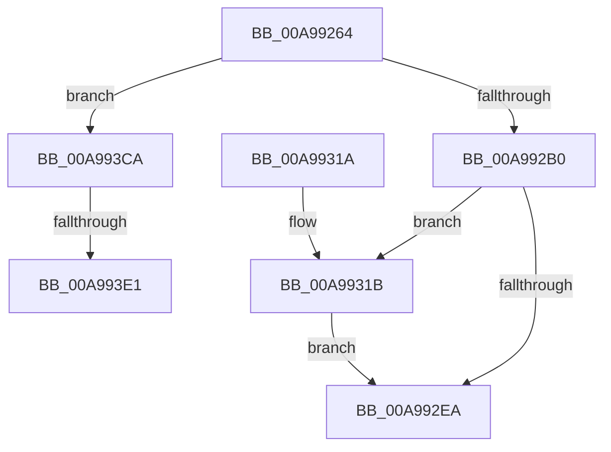

# PopEstimateChargeTime

- RVA: `0x00A99264`–`0x00A993EA` (길이 `390` bytes)
- VA: `0x0000000140A99264`
- 실행 섹션: `PAGE`
- PDB 이름 있음: `예`; PDB Function 태그: `예`
- unwind 정보 RVA: `0x000BA150`
- 디코드: `95`개 명령, `390/390` bytes 표시
- 미해석 바이트: `0` (있으면 어셈블리에 `.byte`로 보존)

> 이 문서는 커널 이미지의 기계어와 PDB 기호를 분석해 생성했습니다. 4번과 5번은 함수 원형과 자료형을 바이너리 사용 방식에서 추정한 C 해석이며 원본 소스 복구 결과는 아닙니다.

## 1. Dependencies

- 직접 호출 지점: **4**; 고유 호출 대상: **4**
- 직접 호출자로 확인된 함수: **1**
- RIP 상대 이미지 참조: **6**

### Outgoing calls
- `0x00A992A3` → [PopBatteryEstimatesSpoiled](PopBatteryEstimatesSpoiled_function_00A993F0.md) (function, `0x00A993F0`)
- `0x00A992DC` → [DbgPrintEx](../../text/35/DbgPrintEx_function_00359290.md) (function, `0x00359290`)
- `0x00A992F4` → [_security_check_cookie](../../text/6A/_security_check_cookie_function_006AC640.md) (function, `0x006AC640`)
- `0x00A993C0` → [tlgWriteTransfer_EtwWriteTransfer](../../text/42/tlgWriteTransfer_EtwWriteTransfer_function_004260E0.md) (function, `0x004260E0`)

### Direct callers
- [PopBatteryWorker](../AE/PopBatteryWorker_function_00AE1650.md) at `0x00AE2085`

### Static image references
- `0x00A99287` → RVA `0x00E0A740` (`.data`; read)
- `0x00A992B2` → RVA `0x00E678B8` (`.data`; read)
- `0x00A992B9` → RVA `0x00B02BA0` (` ?? ::NNGAKEGL::`string'`; read)
- `0x00A992E1` → RVA `0x00E07748` (`.data`; read)
- `0x00A99327` → RVA `0x0004D7C8` (`.rdata`; read)
- `0x00A993CA` → RVA `0x00F0C050` (`.data`; read)

## 2. Other-region calls and transfers

- 다른 실행 섹션으로 향하는 call: **3**
  - `0x00A992DC` → [DbgPrintEx](../../text/35/DbgPrintEx_function_00359290.md) (`PAGE` → `.text`)
  - `0x00A992F4` → [_security_check_cookie](../../text/6A/_security_check_cookie_function_006AC640.md) (`PAGE` → `.text`)
  - `0x00A993C0` → [tlgWriteTransfer_EtwWriteTransfer](../../text/42/tlgWriteTransfer_EtwWriteTransfer_function_004260E0.md) (`PAGE` → `.text`)
- call이 아닌 외부 분기/꼬리 이동: **2**
  - `0x00A993DB` → [sub_00B4807E + 0x36](../B4/Unknown_function_00B4807E.md) (`tail-transfer`)
  - `0x00A993E5` → [sub_00B4807E](../B4/Unknown_function_00B4807E.md) (`tail-transfer`)

## 3. Assembly (complete function range)

```asm
00A99264  48 8B C4                        mov rax, rsp
00A99267  48 89 58 08                     mov qword ptr [rax + 8], rbx
00A9926B  48 89 70 10                     mov qword ptr [rax + 0x10], rsi
00A9926F  48 89 78 18                     mov qword ptr [rax + 0x18], rdi
00A99273  4C 89 60 20                     mov qword ptr [rax + 0x20], r12
00A99277  55                              push rbp
00A99278  41 56                           push r14
00A9927A  41 57                           push r15
00A9927C  48 8D 68 A1                     lea rbp, [rax - 0x5f]
00A99280  48 81 EC 00 01 00 00            sub rsp, 0x100
00A99287  48 8B 05 B2 14 37 00            mov rax, qword ptr [rip + 0x3714b2]
00A9928E  48 33 C4                        xor rax, rsp
00A99291  48 89 45 37                     mov qword ptr [rbp + 0x37], rax
00A99295  49 83 CF FF                     or r15, 0xffffffffffffffff
00A99299  45 33 F6                        xor r14d, r14d
00A9929C  4D 8B E7                        mov r12, r15
00A9929F  33 F6                           xor esi, esi
00A992A1  33 FF                           xor edi, edi
00A992A3  E8 48 01 00 00                  call 0x140a993f0
00A992A8  84 C0                           test al, al
00A992AA  0F 84 1A 01 00 00               je 0x140a993ca
00A992B0  B3 53                           mov bl, 0x53
00A992B2  48 8B 05 FF E5 3C 00            mov rax, qword ptr [rip + 0x3ce5ff]
00A992B9  4C 8D 05 E0 98 06 00            lea r8, [rip + 0x698e0]
00A992C0  4C 89 7C 24 30                  mov qword ptr [rsp + 0x30], r15
00A992C5  4C 8B CE                        mov r9, rsi
00A992C8  48 89 44 24 28                  mov qword ptr [rsp + 0x28], rax
00A992CD  BA 03 00 00 00                  mov edx, 3
00A992D2  B9 92 00 00 00                  mov ecx, 0x92
00A992D7  4C 89 74 24 20                  mov qword ptr [rsp + 0x20], r14
00A992DC  E8 AF FF 8B FF                  call 0x140359290
00A992E1  83 3D 60 E4 36 00 05            cmp dword ptr [rip + 0x36e460], 5
00A992E8  77 31                           ja 0x140a9931b
00A992EA  49 8B C7                        mov rax, r15
00A992ED  48 8B 4D 37                     mov rcx, qword ptr [rbp + 0x37]
00A992F1  48 33 CC                        xor rcx, rsp
00A992F4  E8 47 33 C1 FF                  call 0x1406ac640
00A992F9  4C 8D 9C 24 00 01 00 00         lea r11, [rsp + 0x100]
00A99301  49 8B 5B 20                     mov rbx, qword ptr [r11 + 0x20]
00A99305  49 8B 73 28                     mov rsi, qword ptr [r11 + 0x28]
00A99309  49 8B 7B 30                     mov rdi, qword ptr [r11 + 0x30]
00A9930D  4D 8B 63 38                     mov r12, qword ptr [r11 + 0x38]
00A99311  49 8B E3                        mov rsp, r11
00A99314  41 5F                           pop r15
00A99316  41 5E                           pop r14
00A99318  5D                              pop rbp
00A99319  C3                              ret
00A9931A  CC                              int3
00A9931B  83 65 E3 00                     and dword ptr [rbp - 0x1d], 0
00A9931F  48 8D 45 8F                     lea rax, [rbp - 0x71]
00A99323  83 65 F3 00                     and dword ptr [rbp - 0xd], 0
00A99327  48 8D 15 9A 44 5B FF            lea rdx, [rip - 0xa4bb66]
00A9932E  83 65 03 00                     and dword ptr [rbp + 3], 0
00A99332  B9 08 00 00 00                  mov ecx, 8
00A99337  83 65 13 00                     and dword ptr [rbp + 0x13], 0
00A9933B  45 33 C9                        xor r9d, r9d
00A9933E  83 65 23 00                     and dword ptr [rbp + 0x23], 0
00A99342  45 33 C0                        xor r8d, r8d
00A99345  83 65 33 00                     and dword ptr [rbp + 0x33], 0
00A99349  48 89 45 D7                     mov qword ptr [rbp - 0x29], rax
00A9934D  48 8D 45 97                     lea rax, [rbp - 0x69]
00A99351  48 89 45 E7                     mov qword ptr [rbp - 0x19], rax
00A99355  48 8B 05 5C E5 3C 00            mov rax, qword ptr [rip + 0x3ce55c]
00A9935C  48 89 45 9F                     mov qword ptr [rbp - 0x61], rax
00A99360  48 8D 45 9F                     lea rax, [rbp - 0x61]
00A99364  48 89 45 F7                     mov qword ptr [rbp - 9], rax
00A99368  48 8D 45 87                     lea rax, [rbp - 0x79]
00A9936C  48 89 45 07                     mov qword ptr [rbp + 7], rax
00A99370  48 8D 45 A7                     lea rax, [rbp - 0x59]
00A99374  48 89 45 17                     mov qword ptr [rbp + 0x17], rax
00A99378  48 8D 45 8B                     lea rax, [rbp - 0x75]
00A9937C  48 89 45 27                     mov qword ptr [rbp + 0x27], rax
00A99380  48 8D 45 B7                     lea rax, [rbp - 0x49]
00A99384  48 89 44 24 28                  mov qword ptr [rsp + 0x28], rax
00A99389  89 4C 24 20                     mov dword ptr [rsp + 0x20], ecx
00A9938D  89 4D DF                        mov dword ptr [rbp - 0x21], ecx
00A99390  89 4D EF                        mov dword ptr [rbp - 0x11], ecx
00A99393  89 4D FF                        mov dword ptr [rbp - 1], ecx
00A99396  89 4D 1F                        mov dword ptr [rbp + 0x1f], ecx
00A99399  48 8D 0D A8 E3 36 00            lea rcx, [rip + 0x36e3a8]
00A993A0  4C 89 75 8F                     mov qword ptr [rbp - 0x71], r14
00A993A4  4C 89 65 97                     mov qword ptr [rbp - 0x69], r12
00A993A8  88 5D 87                        mov byte ptr [rbp - 0x79], bl
00A993AB  C7 45 0F 01 00 00 00            mov dword ptr [rbp + 0xf], 1
00A993B2  48 89 75 A7                     mov qword ptr [rbp - 0x59], rsi
00A993B6  89 7D 8B                        mov dword ptr [rbp - 0x75], edi
00A993B9  C7 45 2F 04 00 00 00            mov dword ptr [rbp + 0x2f], 4
00A993C0  E8 1B CD 98 FF                  call 0x1404260e0
00A993C5  E9 20 FF FF FF                  jmp 0x140a992ea
00A993CA  48 8B 0D 7F 2C 47 00            mov rcx, qword ptr [rip + 0x472c7f]
00A993D1  4C 8D 0D 78 2C 47 00            lea r9, [rip + 0x472c78]
00A993D8  49 3B C9                        cmp rcx, r9
00A993DB  0F 84 D3 EC 0A 00               je 0x140b480b4
00A993E1  41 83 C8 FF                     or r8d, 0xffffffff
00A993E5  E9 94 EC 0A 00                  jmp 0x140b4807e
```

## 4. C-style interpretation (structured pseudocode)

```c
__int64 __fastcall PopEstimateChargeTime(void)
{
    __int64 result;
    __int64 v_r14;
    __int64 v_r15;
    __int64 v_rdi;
    __int64 v_rsi;
    __int64 v_rsp;
    unsigned __int64 v_stack_m18;
    unsigned __int64 v_stack_mD8;
    unsigned int v_stack_mE0;
    unsigned __int64 v_stack_mE8;
    unsigned __int64 v_stack_mF0;
    unsigned __int64 v_stack_mF8;

    *(unsigned __int64 *)(v_rsp + 8) = v_rbx;
    *(unsigned __int64 *)(v_rsp + 16) = v_rsi;
    *(unsigned __int64 *)(v_rsp + 24) = v_rdi;
    *(unsigned __int64 *)(v_rsp + 32) = v_r12;
    v_rsp = (v_rsp) - (256);
    result = (*(unsigned __int64 *)(v_rip + 3609778)) ^ (v_rsp);
    *(unsigned __int64 *)(v_rsp - 95 + 55) = result;
    v_r15 = (v_r15) | (-1);
    v_r14 = 0;
    v_rsi = 0;
    v_rdi = 0;
    result = PopBatteryEstimatesSpoiled(a1, a2, a3, a4);
    if ((unsigned __int8)(result) == 0) goto loc_00A993CA;
    v_stack_mE8 = v_r15;
    v_stack_mF0 = *(unsigned __int64 *)(v_rip + 3991039);
    v_stack_mF8 = 0;
    result = DbgPrintEx(146, 3, v_rip + 432352, 0);
    if ((*(unsigned int *)(v_rip + 3597408)) > 5) goto loc_00A9931B;
loc_00A992EA:
    a1 = (*(unsigned __int64 *)(v_rsp - 95 + 55)) ^ (v_rsp);
    result = _security_check_cookie(a1, 3, v_rip + 432352, 0);
    return result;
loc_00A9931B:
    a4 = 0;
    a3 = 0;
    *(unsigned __int64 *)(v_rsp - 95 - 41) = v_rsp - 95 - 113;
    *(unsigned __int64 *)(v_rsp - 95 - 25) = v_rsp - 95 - 105;
    *(unsigned __int64 *)(v_rsp - 95 - 97) = *(unsigned __int64 *)(v_rip + 3990876);
    *(unsigned __int64 *)(v_rsp - 95 - 9) = v_rsp - 95 - 97;
    *(unsigned __int64 *)(v_rsp - 95 + 7) = v_rsp - 95 - 121;
    *(unsigned __int64 *)(v_rsp - 95 + 23) = v_rsp - 95 - 89;
    *(unsigned __int64 *)(v_rsp - 95 + 39) = v_rsp - 95 - 117;
    v_stack_mD8 = v_rsp - 95 - 73;
    v_stack_mE0 = 8;
    *(unsigned int *)(v_rsp - 95 - 33) = 8;
    *(unsigned int *)(v_rsp - 95 - 17) = 8;
    *(unsigned int *)(v_rsp - 95 - 1) = 8;
    *(unsigned int *)(v_rsp - 95 + 31) = 8;
    *(unsigned __int64 *)(v_rsp - 95 - 113) = 0;
    *(unsigned __int64 *)(v_rsp - 95 - 105) = *(unsigned __int64 *)(v_stack_m18 + 56);
    *(unsigned __int8 *)(v_rsp - 95 - 121) = (unsigned __int8)(*(unsigned __int64 *)(v_stack_m18 + 32));
    *(unsigned int *)(v_rsp - 95 + 15) = 1;
    *(unsigned __int64 *)(v_rsp - 95 - 89) = *(unsigned __int64 *)(v_stack_m18 + 40);
    *(unsigned int *)(v_rsp - 95 - 117) = (unsigned int)(*(unsigned __int64 *)(v_stack_m18 + 48));
    *(unsigned int *)(v_rsp - 95 + 47) = 4;
    result = tlgWriteTransfer_EtwWriteTransfer(v_rip + 3597224, v_rip - 10795878, a3, a4);
    goto loc_00A992EA;
loc_00A993CA:
    a3 = (unsigned int)((a3) | (0xFFFFFFFFULL));
}
```

## 5. (Beta) C Style

```c
void PopEstimateChargeTime(void)
{
    int64_t result;
    int64_t local_r14;
    int64_t local_r15;
    int64_t local_rdi;
    int64_t local_rsi;
    int64_t local_rsp;
    uint64_t v_stack_m18;
    uint64_t v_stack_mD8;
    uint32_t v_stack_mE0;
    uint64_t v_stack_mE8;
    uint64_t v_stack_mF0;
    uint64_t v_stack_mF8;

    *(uint64_t *)(local_rsp + 0x8) = local_rbx;
    *(uint64_t *)(local_rsp + 0x10) = local_rsi;
    *(uint64_t *)(local_rsp + 0x18) = local_rdi;
    *(uint64_t *)(local_rsp + 0x20) = local_r12;
    local_rsp = (local_rsp) - (256);
    result = (*(uint64_t *)(v_rip + 0x3714B2)) ^ (local_rsp);
    *(uint64_t *)(local_rsp - 0x5F + 0x37) = result;
    local_r15 = (local_r15) | (-1);
    local_r14 = 0;
    local_rsi = 0;
    local_rdi = 0;
    result = PopBatteryEstimatesSpoiled(a1, a2, a3, a4);
    if ((uint8_t)(result) == 0) goto loc_00A993CA;
    v_stack_mE8 = local_r15;
    v_stack_mF0 = *(uint64_t *)(v_rip + 0x3CE5FF);
    v_stack_mF8 = 0;
    result = DbgPrintEx(146, 3, v_rip + 432352, 0);
    if ((*(uint32_t *)(v_rip + 0x36E460)) > 5) goto loc_00A9931B;
loc_00A992EA:
    a1 = (*(uint64_t *)(local_rsp - 0x5F + 0x37)) ^ (local_rsp);
    result = _security_check_cookie(a1, 3, v_rip + 432352, 0);
    return result;
loc_00A9931B:
    a4 = 0;
    a3 = 0;
    *(uint64_t *)(local_rsp - 0x5F - 0x29) = local_rsp - 95 - 113;
    *(uint64_t *)(local_rsp - 0x5F - 0x19) = local_rsp - 95 - 105;
    *(uint64_t *)(local_rsp - 0x5F - 0x61) = *(uint64_t *)(v_rip + 0x3CE55C);
    *(uint64_t *)(local_rsp - 0x5F - 0x9) = local_rsp - 95 - 97;
    *(uint64_t *)(local_rsp - 0x5F + 0x7) = local_rsp - 95 - 121;
    *(uint64_t *)(local_rsp - 0x5F + 0x17) = local_rsp - 95 - 89;
    *(uint64_t *)(local_rsp - 0x5F + 0x27) = local_rsp - 95 - 117;
    v_stack_mD8 = local_rsp - 95 - 73;
    v_stack_mE0 = 8;
    *(uint32_t *)(local_rsp - 0x5F - 0x21) = 8;
    *(uint32_t *)(local_rsp - 0x5F - 0x11) = 8;
    *(uint32_t *)(local_rsp - 0x5F - 0x1) = 8;
    *(uint32_t *)(local_rsp - 0x5F + 0x1F) = 8;
    *(uint64_t *)(local_rsp - 0x5F - 0x71) = 0;
    *(uint64_t *)(local_rsp - 0x5F - 0x69) = *(uint64_t *)(v_stack_m18 + 0x38);
    *(uint8_t *)(local_rsp - 0x5F - 0x79) = (uint8_t)(*(uint64_t *)(v_stack_m18 + 0x20));
    *(uint32_t *)(local_rsp - 0x5F + 0xF) = 1;
    *(uint64_t *)(local_rsp - 0x5F - 0x59) = *(uint64_t *)(v_stack_m18 + 0x28);
    *(uint32_t *)(local_rsp - 0x5F - 0x75) = (uint32_t)(*(uint64_t *)(v_stack_m18 + 0x30));
    *(uint32_t *)(local_rsp - 0x5F + 0x2F) = 4;
    result = tlgWriteTransfer_EtwWriteTransfer(v_rip + 3597224, v_rip - 10795878, a3, a4);
    goto loc_00A992EA;
loc_00A993CA:
    a3 = (uint32_t)((a3) | (0xFFFFFFFFULL));
}
```

## 6. Execution-region graph

[열기: 2D/3D 그래프와 함수 탐색 컨트롤 패널](../../../control-panel.html?section=page&rva=0x00A99264&view=graph)

- 2D 그래프는 위에서 아래로 흐르고, 3D 그래프는 빈 공간을 드래그해 회전합니다. Shift+드래그는 이동, 휠은 확대·축소, 함수 노드 선택은 대상 보고서 이동입니다.

### Static fallback


