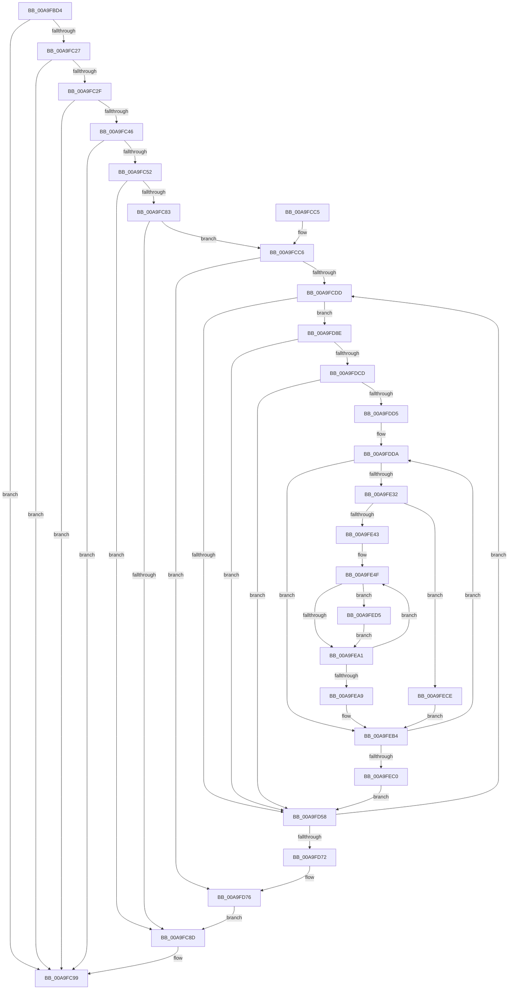

# PopEtEnergyTrackerQueryDxgProcessEnergyValues

- RVA: `0x00A9FBD4`–`0x00A9FEDB` (길이 `775` bytes)
- VA: `0x0000000140A9FBD4`
- 실행 섹션: `PAGE`
- PDB 이름 있음: `예`; PDB Function 태그: `아니요`
- unwind 정보 RVA: `0x000BAA7C`
- 디코드: `181`개 명령, `775/775` bytes 표시
- 미해석 바이트: `0` (있으면 어셈블리에 `.byte`로 보존)

> 이 문서는 커널 이미지의 기계어와 PDB 기호를 분석해 생성했습니다. 4번과 5번은 함수 원형과 자료형을 바이너리 사용 방식에서 추정한 C 해석이며 원본 소스 복구 결과는 아닙니다.

## 1. Dependencies

- 직접 호출 지점: **12**; 고유 호출 대상: **7**
- 직접 호출자로 확인된 함수: **1**
- RIP 상대 이미지 참조: **3**

### Outgoing calls
- `0x00A9FC49` → [PsAcquireProcessExitSynchronization](../8A/PsAcquireProcessExitSynchronization_function_008A5BF0.md) (function, `0x008A5BF0`)
- `0x00A9FC7A` → [ObOpenObjectByPointer](../8B/ObOpenObjectByPointer_function_008B7420.md) (function, `0x008B7420`)
- `0x00A9FC94` → [ExReleaseRundownProtection](../../text/34/ExReleaseRundownProtection_function_00349E80.md) (function, `0x00349E80`)
- `0x00A9FCA5` → [_security_check_cookie](../../text/6A/_security_check_cookie_function_006AC640.md) (function, `0x006AC640`)
- `0x00A9FCEC` → [memset](../../text/6C/memset_function_006C6C40.md) (function, `0x006C6C40`)
- `0x00A9FD4F` → [guard_dispatch_icall](../../text/6B/guard_dispatch_icall_function_006BAAD0.md) (function, `0x006BAAD0`)
- `0x00A9FD7B` → [ObCloseHandle](../8A/ObCloseHandle_function_008A1870.md) (function, `0x008A1870`)
- `0x00A9FDC4` → [guard_dispatch_icall](../../text/6B/guard_dispatch_icall_function_006BAAD0.md) (function, `0x006BAAD0`)
- `0x00A9FDE9` → [memset](../../text/6C/memset_function_006C6C40.md) (function, `0x006C6C40`)
- `0x00A9FE25` → [guard_dispatch_icall](../../text/6B/guard_dispatch_icall_function_006BAAD0.md) (function, `0x006BAAD0`)
- `0x00A9FE5B` → [memset](../../text/6C/memset_function_006C6C40.md) (function, `0x006C6C40`)
- `0x00A9FE98` → [guard_dispatch_icall](../../text/6B/guard_dispatch_icall_function_006BAAD0.md) (function, `0x006BAAD0`)

### Direct callers
- [PopEtProcessEnumSnapshotCallback](../91/PopEtProcessEnumSnapshotCallback_function_0091CCA0.md) at `0x0091CD40`

### Static image references
- `0x00A9FBF3` → RVA `0x00E0A740` (`.data`; read)
- `0x00A9FC04` → RVA `0x00E67A30` (`.data`; read)
- `0x00A9FC65` → RVA `0x00FC6A98` (`ALMOSTRO`; read)

## 2. Other-region calls and transfers

- 다른 실행 섹션으로 향하는 call: **9**
  - `0x00A9FC94` → [ExReleaseRundownProtection](../../text/34/ExReleaseRundownProtection_function_00349E80.md) (`PAGE` → `.text`)
  - `0x00A9FCA5` → [_security_check_cookie](../../text/6A/_security_check_cookie_function_006AC640.md) (`PAGE` → `.text`)
  - `0x00A9FCEC` → [memset](../../text/6C/memset_function_006C6C40.md) (`PAGE` → `.text`)
  - `0x00A9FD4F` → [guard_dispatch_icall](../../text/6B/guard_dispatch_icall_function_006BAAD0.md) (`PAGE` → `.text`)
  - `0x00A9FDC4` → [guard_dispatch_icall](../../text/6B/guard_dispatch_icall_function_006BAAD0.md) (`PAGE` → `.text`)
  - `0x00A9FDE9` → [memset](../../text/6C/memset_function_006C6C40.md) (`PAGE` → `.text`)
  - `0x00A9FE25` → [guard_dispatch_icall](../../text/6B/guard_dispatch_icall_function_006BAAD0.md) (`PAGE` → `.text`)
  - `0x00A9FE5B` → [memset](../../text/6C/memset_function_006C6C40.md) (`PAGE` → `.text`)
  - `0x00A9FE98` → [guard_dispatch_icall](../../text/6B/guard_dispatch_icall_function_006BAAD0.md) (`PAGE` → `.text`)
- 별도 외부 분기/꼬리 이동을 확인하지 못했습니다.

## 3. Assembly (complete function range)

```asm
00A9FBD4  48 89 5C 24 20                  mov qword ptr [rsp + 0x20], rbx
00A9FBD9  55                              push rbp
00A9FBDA  56                              push rsi
00A9FBDB  57                              push rdi
00A9FBDC  41 54                           push r12
00A9FBDE  41 55                           push r13
00A9FBE0  41 56                           push r14
00A9FBE2  41 57                           push r15
00A9FBE4  48 8D AC 24 B0 F6 FF FF         lea rbp, [rsp - 0x950]
00A9FBEC  48 81 EC 50 0A 00 00            sub rsp, 0xa50
00A9FBF3  48 8B 05 46 AB 36 00            mov rax, qword ptr [rip + 0x36ab46]
00A9FBFA  48 33 C4                        xor rax, rsp
00A9FBFD  48 89 85 40 09 00 00            mov qword ptr [rbp + 0x940], rax
00A9FC04  48 8B 05 25 7E 3C 00            mov rax, qword ptr [rip + 0x3c7e25]
00A9FC0B  33 DB                           xor ebx, ebx
00A9FC0D  4C 89 45 A0                     mov qword ptr [rbp - 0x60], r8
00A9FC11  48 8B F2                        mov rsi, rdx
00A9FC14  48 89 55 98                     mov qword ptr [rbp - 0x68], rdx
00A9FC18  4C 8B E9                        mov r13, rcx
00A9FC1B  48 89 4D 90                     mov qword ptr [rbp - 0x70], rcx
00A9FC1F  39 98 48 04 00 00               cmp dword ptr [rax + 0x448], ebx
00A9FC25  7C 72                           jl 0x140a9fc99
00A9FC27  39 99 88 02 00 00               cmp dword ptr [rcx + 0x288], ebx
00A9FC2D  74 6A                           je 0x140a9fc99
00A9FC2F  8B 82 F4 01 00 00               mov eax, dword ptr [rdx + 0x1f4]
00A9FC35  25 08 00 00 04                  and eax, 0x4000008
00A9FC3A  48 89 5C 24 48                  mov qword ptr [rsp + 0x48], rbx
00A9FC3F  3D 00 00 00 04                  cmp eax, 0x4000000
00A9FC44  75 53                           jne 0x140a9fc99
00A9FC46  48 8B CA                        mov rcx, rdx
00A9FC49  E8 A2 5F E0 FF                  call 0x1408a5bf0
00A9FC4E  85 C0                           test eax, eax
00A9FC50  78 47                           js 0x140a9fc99
00A9FC52  48 8D 44 24 48                  lea rax, [rsp + 0x48]
00A9FC57  41 B9 00 04 00 00               mov r9d, 0x400
00A9FC5D  48 89 44 24 30                  mov qword ptr [rsp + 0x30], rax
00A9FC62  45 33 C0                        xor r8d, r8d
00A9FC65  48 8B 05 2C 6E 52 00            mov rax, qword ptr [rip + 0x526e2c]
00A9FC6C  33 D2                           xor edx, edx
00A9FC6E  88 5C 24 28                     mov byte ptr [rsp + 0x28], bl
00A9FC72  48 8B CE                        mov rcx, rsi
00A9FC75  48 89 44 24 20                  mov qword ptr [rsp + 0x20], rax
00A9FC7A  E8 A1 77 E1 FF                  call 0x1408b7420
00A9FC7F  85 C0                           test eax, eax
00A9FC81  78 0A                           js 0x140a9fc8d
00A9FC83  48 8B 7C 24 48                  mov rdi, qword ptr [rsp + 0x48]
00A9FC88  48 85 FF                        test rdi, rdi
00A9FC8B  75 39                           jne 0x140a9fcc6
00A9FC8D  48 8D 8E E8 01 00 00            lea rcx, [rsi + 0x1e8]
00A9FC94  E8 E7 A1 8A FF                  call 0x140349e80
00A9FC99  8A C3                           mov al, bl
00A9FC9B  48 8B 8D 40 09 00 00            mov rcx, qword ptr [rbp + 0x940]
00A9FCA2  48 33 CC                        xor rcx, rsp
00A9FCA5  E8 96 C9 C0 FF                  call 0x1406ac640
00A9FCAA  48 8B 9C 24 A8 0A 00 00         mov rbx, qword ptr [rsp + 0xaa8]
00A9FCB2  48 81 C4 50 0A 00 00            add rsp, 0xa50
00A9FCB9  41 5F                           pop r15
00A9FCBB  41 5E                           pop r14
00A9FCBD  41 5D                           pop r13
00A9FCBF  41 5C                           pop r12
00A9FCC1  5F                              pop rdi
00A9FCC2  5E                              pop rsi
00A9FCC3  5D                              pop rbp
00A9FCC4  C3                              ret
00A9FCC5  CC                              int3
00A9FCC6  4C 8B E3                        mov r12, rbx
00A9FCC9  44 8B FB                        mov r15d, ebx
00A9FCCC  89 5C 24 50                     mov dword ptr [rsp + 0x50], ebx
00A9FCD0  41 39 9D 88 02 00 00            cmp dword ptr [r13 + 0x288], ebx
00A9FCD7  0F 86 99 00 00 00               jbe 0x140a9fd76
00A9FCDD  33 D2                           xor edx, edx
00A9FCDF  48 8D 8D 10 06 00 00            lea rcx, [rbp + 0x610]
00A9FCE6  41 B8 28 03 00 00               mov r8d, 0x328
00A9FCEC  E8 4F 6F C2 FF                  call 0x1406c6c40
00A9FCF1  48 8B 05 38 7D 3C 00            mov rax, qword ptr [rip + 0x3c7d38]
00A9FCF8  48 8D 8D 10 06 00 00            lea rcx, [rbp + 0x610]
00A9FCFF  0F 57 C0                        xorps xmm0, xmm0
00A9FD02  48 8B B0 40 04 00 00            mov rsi, qword ptr [rax + 0x440]
00A9FD09  33 C0                           xor eax, eax
00A9FD0B  48 89 45 88                     mov qword ptr [rbp - 0x78], rax
00A9FD0F  0F 11 44 24 78                  movups xmmword ptr [rsp + 0x78], xmm0
00A9FD14  89 5C 24 40                     mov dword ptr [rsp + 0x40], ebx
00A9FD18  41 8B C7                        mov eax, r15d
00A9FD1B  48 89 74 24 70                  mov qword ptr [rsp + 0x70], rsi
00A9FD20  4C 8D 34 80                     lea r14, [rax + rax*4]
00A9FD24  49 8B 85 90 02 00 00            mov rax, qword ptr [r13 + 0x290]
00A9FD2B  48 89 44 24 58                  mov qword ptr [rsp + 0x58], rax
00A9FD30  4C 89 74 24 68                  mov qword ptr [rsp + 0x68], r14
00A9FD35  4A 8B 44 B0 04                  mov rax, qword ptr [rax + r14*4 + 4]
00A9FD3A  48 89 85 14 06 00 00            mov qword ptr [rbp + 0x614], rax
00A9FD41  48 89 BD 20 06 00 00            mov qword ptr [rbp + 0x620], rdi
00A9FD48  48 8B 86 68 02 00 00            mov rax, qword ptr [rsi + 0x268]
00A9FD4F  E8 7C AD C1 FF                  call 0x1406baad0
00A9FD54  85 C0                           test eax, eax
00A9FD56  79 36                           jns 0x140a9fd8e
00A9FD58  48 8B 7C 24 48                  mov rdi, qword ptr [rsp + 0x48]
00A9FD5D  41 FF C7                        inc r15d
00A9FD60  44 89 7C 24 50                  mov dword ptr [rsp + 0x50], r15d
00A9FD65  45 3B BD 88 02 00 00            cmp r15d, dword ptr [r13 + 0x288]
00A9FD6C  0F 82 6B FF FF FF               jb 0x140a9fcdd
00A9FD72  48 8B 75 98                     mov rsi, qword ptr [rbp - 0x68]
00A9FD76  B2 01                           mov dl, 1
00A9FD78  48 8B CF                        mov rcx, rdi
00A9FD7B  E8 F0 1A E0 FF                  call 0x1408a1870
00A9FD80  48 8B 45 A0                     mov rax, qword ptr [rbp - 0x60]
00A9FD84  B3 01                           mov bl, 1
00A9FD86  4C 89 20                        mov qword ptr [rax], r12
00A9FD89  E9 FF FE FF FF                  jmp 0x140a9fc8d
00A9FD8E  48 8B 44 24 58                  mov rax, qword ptr [rsp + 0x58]
00A9FD93  48 8D 4C 24 78                  lea rcx, [rsp + 0x78]
00A9FD98  45 33 C0                        xor r8d, r8d
00A9FD9B  33 D2                           xor edx, edx
00A9FD9D  42 8B 04 B0                     mov eax, dword ptr [rax + r14*4]
00A9FDA1  89 44 24 78                     mov dword ptr [rsp + 0x78], eax
00A9FDA5  48 8D 44 24 40                  lea rax, [rsp + 0x40]
00A9FDAA  48 89 45 80                     mov qword ptr [rbp - 0x80], rax
00A9FDAE  C7 44 24 7C 1E 00 00 00         mov dword ptr [rsp + 0x7c], 0x1e
00A9FDB6  C7 45 88 04 00 00 00            mov dword ptr [rbp - 0x78], 4
00A9FDBD  48 8B 86 58 01 00 00            mov rax, qword ptr [rsi + 0x158]
00A9FDC4  E8 07 AD C1 FF                  call 0x1406baad0
00A9FDC9  85 C0                           test eax, eax
00A9FDCB  78 8B                           js 0x140a9fd58
00A9FDCD  8B FB                           mov edi, ebx
00A9FDCF  39 5C 24 40                     cmp dword ptr [rsp + 0x40], ebx
00A9FDD3  76 83                           jbe 0x140a9fd58
00A9FDD5  4C 8B 7C 24 58                  mov r15, qword ptr [rsp + 0x58]
00A9FDDA  33 D2                           xor edx, edx
00A9FDDC  48 8D 8D E0 02 00 00            lea rcx, [rbp + 0x2e0]
00A9FDE3  41 B8 28 03 00 00               mov r8d, 0x328
00A9FDE9  E8 52 6E C2 FF                  call 0x1406c6c40
00A9FDEE  4B 8B 44 B7 04                  mov rax, qword ptr [r15 + r14*4 + 4]
00A9FDF3  48 8D 8D E0 02 00 00            lea rcx, [rbp + 0x2e0]
00A9FDFA  48 89 85 E4 02 00 00            mov qword ptr [rbp + 0x2e4], rax
00A9FE01  48 8B 44 24 48                  mov rax, qword ptr [rsp + 0x48]
00A9FE06  48 89 85 F0 02 00 00            mov qword ptr [rbp + 0x2f0], rax
00A9FE0D  48 8B 86 68 02 00 00            mov rax, qword ptr [rsi + 0x268]
00A9FE14  C7 85 E0 02 00 00 0B 00 00 00   mov dword ptr [rbp + 0x2e0], 0xb
00A9FE1E  66 89 BD 00 06 00 00            mov word ptr [rbp + 0x600], di
00A9FE25  E8 A6 AC C1 FF                  call 0x1406baad0
00A9FE2A  85 C0                           test eax, eax
00A9FE2C  0F 88 82 00 00 00               js 0x140a9feb4
00A9FE32  8B 85 FC 02 00 00               mov eax, dword ptr [rbp + 0x2fc]
00A9FE38  44 8B F3                        mov r14d, ebx
00A9FE3B  85 C0                           test eax, eax
00A9FE3D  0F 84 8B 00 00 00               je 0x140a9fece
00A9FE43  4C 8B 6C 24 70                  mov r13, qword ptr [rsp + 0x70]
00A9FE48  8B F0                           mov esi, eax
00A9FE4A  4C 8B 7C 24 68                  mov r15, qword ptr [rsp + 0x68]
00A9FE4F  33 D2                           xor edx, edx
00A9FE51  48 8D 4D B0                     lea rcx, [rbp - 0x50]
00A9FE55  41 B8 28 03 00 00               mov r8d, 0x328
00A9FE5B  E8 E0 6D C2 FF                  call 0x1406c6c40
00A9FE60  48 8B 4C 24 58                  mov rcx, qword ptr [rsp + 0x58]
00A9FE65  C7 45 B0 13 00 00 00            mov dword ptr [rbp - 0x50], 0x13
00A9FE6C  66 89 BD D0 02 00 00            mov word ptr [rbp + 0x2d0], di
00A9FE73  66 44 89 B5 D2 02 00 00         mov word ptr [rbp + 0x2d2], r14w
00A9FE7B  4A 8B 44 B9 04                  mov rax, qword ptr [rcx + r15*4 + 4]
00A9FE80  48 8D 4D B0                     lea rcx, [rbp - 0x50]
00A9FE84  48 89 45 B4                     mov qword ptr [rbp - 0x4c], rax
00A9FE88  48 8B 44 24 48                  mov rax, qword ptr [rsp + 0x48]
00A9FE8D  48 89 45 C0                     mov qword ptr [rbp - 0x40], rax
00A9FE91  49 8B 85 68 02 00 00            mov rax, qword ptr [r13 + 0x268]
00A9FE98  E8 33 AC C1 FF                  call 0x1406baad0
00A9FE9D  85 C0                           test eax, eax
00A9FE9F  79 34                           jns 0x140a9fed5
00A9FEA1  41 FF C6                        inc r14d
00A9FEA4  44 3B F6                        cmp r14d, esi
00A9FEA7  72 A6                           jb 0x140a9fe4f
00A9FEA9  4D 8B F7                        mov r14, r15
00A9FEAC  49 8B F5                        mov rsi, r13
00A9FEAF  4C 8B 7C 24 58                  mov r15, qword ptr [rsp + 0x58]
00A9FEB4  FF C7                           inc edi
00A9FEB6  3B 7C 24 40                     cmp edi, dword ptr [rsp + 0x40]
00A9FEBA  0F 82 1A FF FF FF               jb 0x140a9fdda
00A9FEC0  44 8B 7C 24 50                  mov r15d, dword ptr [rsp + 0x50]
00A9FEC5  4C 8B 6D 90                     mov r13, qword ptr [rbp - 0x70]
00A9FEC9  E9 8A FE FF FF                  jmp 0x140a9fd58
00A9FECE  4C 8B 74 24 68                  mov r14, qword ptr [rsp + 0x68]
00A9FED3  EB DF                           jmp 0x140a9feb4
00A9FED5  4C 03 65 C8                     add r12, qword ptr [rbp - 0x38]
00A9FED9  EB C6                           jmp 0x140a9fea1
```

## 4. C-style interpretation (structured pseudocode)

```c
__int64 __fastcall PopEtEnergyTrackerQueryDxgProcessEnergyValues(__int64 a1, __int64 a2, __int64 a3)
{
    __int64 result;
    __int64 v_r12;
    __int64 v_r14;
    __int64 v_r15;
    __int64 v_rbx;
    __int64 v_rdi;
    __int64 v_rsp;
    unsigned __int64 v_stack_m368;
    unsigned __int64 v_stack_m374;
    unsigned __int64 v_stack_m378;
    unsigned __int16 v_stack_m388;
    unsigned __int64 v_stack_m48;
    unsigned int v_stack_m68C;
    unsigned __int64 v_stack_m698;
    unsigned __int64 v_stack_m6A4;
    unsigned __int64 v_stack_m6A8;
    unsigned __int16 v_stack_m6B6;
    unsigned __int16 v_stack_m6B8;
    unsigned __int64 v_stack_m988;
    unsigned __int64 v_stack_m9C0;
    unsigned __int64 v_stack_m9C8;
    unsigned __int64 v_stack_m9D4;
    unsigned __int64 v_stack_m9D8;
    unsigned __int64 v_stack_m9E8;
    unsigned __int64 v_stack_m9F0;
    unsigned __int64 v_stack_m9F8;
    unsigned __int64 v_stack_mA00;
    unsigned __int64 v_stack_mA08;
    unsigned __int64 v_stack_mA40;
    unsigned __int64 v_stack_mA58;
    unsigned __int8 v_stack_mA60;
    unsigned __int64 v_stack_mA68;
    unsigned __int64 v_stack_p20;
    unsigned int v_stack_p40;
    unsigned __int64 v_stack_p48;
    unsigned int v_stack_p50;
    unsigned __int64 v_stack_p58;
    unsigned __int64 v_stack_p68;
    unsigned __int64 v_stack_p70;
    unsigned __int64 v_stack_p78;
    unsigned int v_stack_p7C;

    v_stack_p20 = v_rbx;
    v_rsp = (v_rsp) - (0xA50ULL);
    result = (*(unsigned __int64 *)(v_rip + 3582790)) ^ (v_rsp);
    v_stack_m48 = result;
    v_rbx = 0;
    v_stack_m9E8 = a3;
    v_stack_m9F0 = a2;
    v_stack_m9F8 = a1;
    if ((*(unsigned int *)(*(unsigned __int64 *)(v_rip + 3964453) + 1096)) < 0) goto loc_00A9FC99;
    if ((*(unsigned int *)(a1 + 648)) == 0) goto loc_00A9FC99;
    result = (unsigned int)(((unsigned int)(*(unsigned int *)(a2 + 500))) & (0x4000008ULL));
    v_stack_mA40 = 0;
    if (((unsigned int)(result)) != 0x4000000ULL) goto loc_00A9FC99;
    result = PsAcquireProcessExitSynchronization(a2, a2, a3, a4);
    if (sign_flag) goto loc_00A9FC99;
    v_stack_mA58 = v_stack_mA40;
    a3 = 0;
    a2 = 0;
    v_stack_mA60 = 0;
    v_stack_mA68 = *(unsigned __int64 *)(v_rip + 5402156);
    result = ObOpenObjectByPointer(0, a2, a3, (unsigned int)(0x400ULL));
    if (sign_flag) goto loc_00A9FC8D;
    if (v_stack_mA40 != 0) goto loc_00A9FCC6;
loc_00A9FC8D:
    result = ExReleaseRundownProtection(a2 + 488, a2, a3, (unsigned int)(0x400ULL));
loc_00A9FC99:
    a1 = (v_stack_m48) ^ (v_rsp);
    result = _security_check_cookie(a1, a2, a3, (unsigned int)(0x400ULL));
    v_rsp = (v_rsp) + (0xA50ULL);
    return result;
loc_00A9FCC6:
    v_stack_p50 = (unsigned int)(v_stack_p20);
    if ((*(unsigned int *)(a1 + 648)) <= ((unsigned int)(v_stack_p20))) goto loc_00A9FD76;
loc_00A9FCDD:
    a2 = 0;
    result = memset(v_stack_m378, a2, 808, (unsigned int)(0x400ULL));
    result = 0;
    v_stack_mA00 = 0;
    v_stack_p78 = v_xmm0;
    v_stack_p40 = (unsigned int)(v_stack_p20);
    v_stack_p70 = *(unsigned __int64 *)(*(unsigned __int64 *)(v_rip + 3964216) + 1088);
    v_stack_p58 = *(unsigned __int64 *)(a1 + 656);
    v_stack_p68 = (unsigned int)((unsigned int)((unsigned int)((unsigned int)(v_stack_p20)))) + (unsigned int)((unsigned int)((unsigned int)((unsigned int)(v_stack_p20)))) * 4;
    v_stack_m374 = *(unsigned __int64 *)(*(unsigned __int64 *)(a1 + 656) + (unsigned int)((unsigned int)((unsigned int)((unsigned int)(v_stack_p20)))) + (unsigned int)((unsigned int)((unsigned int)((unsigned int)(v_stack_p20)))) * 4 * 4 + 4);
    v_stack_m368 = v_stack_mA40;
    result = guard_dispatch_icall(v_stack_m378, a2, 808, (unsigned int)(0x400ULL));
    if (!sign_flag) goto loc_00A9FD8E;
loc_00A9FD58:
    v_r15 = (unsigned int)(((unsigned int)((unsigned int)(v_stack_p20))) + 1);
    v_stack_p50 = (unsigned int)(v_r15);
    if (((unsigned int)(v_r15)) < (*(unsigned int *)(a1 + 648))) goto loc_00A9FCDD;
loc_00A9FD76:
    result = ObCloseHandle(v_stack_p48, 1, 808, (unsigned int)(0x400ULL));
    *(unsigned __int64 *)(v_stack_m9E8) = v_stack_p20;
    goto loc_00A9FC8D;
loc_00A9FD8E:
    a3 = 0;
    a2 = 0;
    v_stack_p78 = (unsigned int)((unsigned int)(*(unsigned int *)(v_stack_p58 + (unsigned int)((unsigned int)((unsigned int)((unsigned int)(v_stack_p20)))) + (unsigned int)((unsigned int)((unsigned int)((unsigned int)(v_stack_p20)))) * 4 * 4)));
    v_stack_mA08 = v_stack_p40;
    v_stack_p7C = 30;
    v_stack_mA00 = 4;
    result = guard_dispatch_icall(v_stack_p78, a2, a3, (unsigned int)(0x400ULL));
    if (sign_flag) goto loc_00A9FD58;
    if (v_stack_p40 <= 1) goto loc_00A9FD58;
loc_00A9FDDA:
    a2 = 0;
    result = memset(v_stack_m6A8, a2, 808, (unsigned int)(0x400ULL));
    v_stack_m6A4 = *(unsigned __int64 *)(v_stack_p58 + (unsigned int)((unsigned int)((unsigned int)((unsigned int)(v_stack_p20)))) + (unsigned int)((unsigned int)((unsigned int)((unsigned int)(v_stack_p20)))) * 4 * 4 + 4);
    v_stack_m698 = v_stack_p48;
    v_stack_m6A8 = 11;
    v_stack_m388 = 1;
    result = guard_dispatch_icall(v_stack_m6A8, a2, 808, (unsigned int)(0x400ULL));
    if (sign_flag) goto loc_00A9FEB4;
    if ((unsigned int)((unsigned int)(v_stack_m68C)) == 0) goto loc_00A9FECE;
loc_00A9FE4F:
    a2 = 0;
    result = memset(v_stack_m9D8, a2, 808, (unsigned int)(0x400ULL));
    v_stack_m9D8 = 19;
    v_stack_m6B8 = 1;
    v_stack_m6B6 = 1;
    v_stack_m9D4 = *(unsigned __int64 *)(v_stack_p58 + v_stack_p68 * 4 + 4);
    v_stack_m9C8 = v_stack_p48;
    result = guard_dispatch_icall(v_stack_m9D8, a2, 808, (unsigned int)(0x400ULL));
    if (!sign_flag) goto loc_00A9FED5;
loc_00A9FEA1:
    v_r14 = (unsigned int)((1) + 1);
    if (((unsigned int)(v_r14)) < ((unsigned int)((unsigned int)((unsigned int)((unsigned int)(v_stack_m68C)))))) goto loc_00A9FE4F;
loc_00A9FEB4:
    v_rdi = (unsigned int)((1) + 1);
    if (((unsigned int)(v_rdi)) < v_stack_p40) goto loc_00A9FDDA;
    goto loc_00A9FD58;
loc_00A9FECE:
    goto loc_00A9FEB4;
loc_00A9FED5:
    v_r12 = (v_stack_p20) + (v_stack_m9C0);
    goto loc_00A9FEA1;
}
```

## 5. (Beta) C Style

```c
int64_t PopEtEnergyTrackerQueryDxgProcessEnergyValues(void *Arg1, void *Arg2, int64_t Arg3)
{
    uint8_t *arg1 = (uint8_t *)Arg1;
    uint8_t *arg2 = (uint8_t *)Arg2;

    int64_t result;
    int64_t local_r12;
    int64_t local_r14;
    int64_t local_r15;
    int64_t local_rbx;
    int64_t local_rdi;
    int64_t local_rsp;
    uint64_t v_stack_m368;
    uint64_t v_stack_m374;
    uint64_t v_stack_m378;
    uint16_t v_stack_m388;
    uint64_t v_stack_m48;
    uint32_t v_stack_m68C;
    uint64_t v_stack_m698;
    uint64_t v_stack_m6A4;
    uint64_t v_stack_m6A8;
    uint16_t v_stack_m6B6;
    uint16_t v_stack_m6B8;
    uint64_t v_stack_m988;
    uint64_t v_stack_m9C0;
    uint64_t v_stack_m9C8;
    uint64_t v_stack_m9D4;
    uint64_t v_stack_m9D8;
    uint64_t v_stack_m9E8;
    uint64_t v_stack_m9F0;
    uint64_t v_stack_m9F8;
    uint64_t v_stack_mA00;
    uint64_t v_stack_mA08;
    uint64_t v_stack_mA40;
    uint64_t v_stack_mA58;
    uint8_t v_stack_mA60;
    uint64_t v_stack_mA68;
    uint64_t v_stack_p20;
    uint32_t v_stack_p40;
    uint64_t v_stack_p48;
    uint32_t v_stack_p50;
    uint64_t v_stack_p58;
    uint64_t v_stack_p68;
    uint64_t v_stack_p70;
    uint64_t v_stack_p78;
    uint32_t v_stack_p7C;

    v_stack_p20 = local_rbx;
    local_rsp = (local_rsp) - (0xA50ULL);
    result = (*(uint64_t *)(v_rip + 0x36AB46)) ^ (local_rsp);
    v_stack_m48 = result;
    local_rbx = 0;
    v_stack_m9E8 = Arg3;
    v_stack_m9F0 = Arg2;
    v_stack_m9F8 = Arg1;
    if ((*(uint32_t *)(*(uint64_t *)(v_rip + 0x3C7E25) + 0x448)) < 0) goto loc_00A9FC99;
    if ((*(uint32_t *)(arg1 + 0x288)) == 0) goto loc_00A9FC99;
    result = (uint32_t)(((uint32_t)(*(uint32_t *)(arg2 + 0x1F4))) & (0x4000008ULL));
    v_stack_mA40 = 0;
    if (((uint32_t)(result)) != 0x4000000ULL) goto loc_00A9FC99;
    result = PsAcquireProcessExitSynchronization(Arg2, Arg2, Arg3, a4);
    if (sign_flag) goto loc_00A9FC99;
    v_stack_mA58 = v_stack_mA40;
    Arg3 = 0;
    Arg2 = 0;
    v_stack_mA60 = 0;
    v_stack_mA68 = *(uint64_t *)(v_rip + 0x526E2C);
    result = ObOpenObjectByPointer(0, Arg2, Arg3, (uint32_t)(0x400ULL));
    if (sign_flag) goto loc_00A9FC8D;
    if (v_stack_mA40 != 0) goto loc_00A9FCC6;
loc_00A9FC8D:
    result = ExReleaseRundownProtection(Arg2 + 488, Arg2, Arg3, (uint32_t)(0x400ULL));
loc_00A9FC99:
    Arg1 = (v_stack_m48) ^ (local_rsp);
    result = _security_check_cookie(Arg1, Arg2, Arg3, (uint32_t)(0x400ULL));
    local_rsp = (local_rsp) + (0xA50ULL);
    return result;
loc_00A9FCC6:
    v_stack_p50 = (uint32_t)(v_stack_p20);
    if ((*(uint32_t *)(arg1 + 0x288)) <= ((uint32_t)(v_stack_p20))) goto loc_00A9FD76;
loc_00A9FCDD:
    Arg2 = 0;
    result = memset(v_stack_m378, Arg2, 808, (uint32_t)(0x400ULL));
    result = 0;
    v_stack_mA00 = 0;
    v_stack_p78 = v_xmm0;
    v_stack_p40 = (uint32_t)(v_stack_p20);
    v_stack_p70 = *(uint64_t *)(*(uint64_t *)(v_rip + 0x3C7D38) + 0x440);
    v_stack_p58 = *(uint64_t *)(arg1 + 0x290);
    v_stack_p68 = (uint32_t)((uint32_t)((uint32_t)((uint32_t)(v_stack_p20)))) + (uint32_t)((uint32_t)((uint32_t)((uint32_t)(v_stack_p20)))) * 4;
    v_stack_m374 = *(uint64_t *)(*(uint64_t *)(arg1 + 0x290) + (uint32_t)((uint32_t)((uint32_t)((uint32_t)(v_stack_p20)))) + (uint32_t)((uint32_t)((uint32_t)((uint32_t)(v_stack_p20)))) * 4 * 4 + 0x4);
    v_stack_m368 = v_stack_mA40;
    result = guard_dispatch_icall(v_stack_m378, Arg2, 808, (uint32_t)(0x400ULL));
    if (!sign_flag) goto loc_00A9FD8E;
loc_00A9FD58:
    local_r15 = (uint32_t)(((uint32_t)((uint32_t)(v_stack_p20))) + 1);
    v_stack_p50 = (uint32_t)(local_r15);
    if (((uint32_t)(local_r15)) < (*(uint32_t *)(arg1 + 0x288))) goto loc_00A9FCDD;
loc_00A9FD76:
    result = ObCloseHandle(v_stack_p48, 1, 808, (uint32_t)(0x400ULL));
    *(uint64_t *)(v_stack_m9E8) = v_stack_p20;
    goto loc_00A9FC8D;
loc_00A9FD8E:
    Arg3 = 0;
    Arg2 = 0;
    v_stack_p78 = (uint32_t)((uint32_t)(*(uint32_t *)(v_stack_p58 + (uint32_t)((uint32_t)((uint32_t)((uint32_t)(v_stack_p20)))) + (uint32_t)((uint32_t)((uint32_t)((uint32_t)(v_stack_p20)))) * 4 * 4)));
    v_stack_mA08 = v_stack_p40;
    v_stack_p7C = 30;
    v_stack_mA00 = 4;
    result = guard_dispatch_icall(v_stack_p78, Arg2, Arg3, (uint32_t)(0x400ULL));
    if (sign_flag) goto loc_00A9FD58;
    if (v_stack_p40 <= 1) goto loc_00A9FD58;
loc_00A9FDDA:
    Arg2 = 0;
    result = memset(v_stack_m6A8, Arg2, 808, (uint32_t)(0x400ULL));
    v_stack_m6A4 = *(uint64_t *)(v_stack_p58 + (uint32_t)((uint32_t)((uint32_t)((uint32_t)(v_stack_p20)))) + (uint32_t)((uint32_t)((uint32_t)((uint32_t)(v_stack_p20)))) * 4 * 4 + 0x4);
    v_stack_m698 = v_stack_p48;
    v_stack_m6A8 = 11;
    v_stack_m388 = 1;
    result = guard_dispatch_icall(v_stack_m6A8, Arg2, 808, (uint32_t)(0x400ULL));
    if (sign_flag) goto loc_00A9FEB4;
    if ((uint32_t)((uint32_t)(v_stack_m68C)) == 0) goto loc_00A9FECE;
loc_00A9FE4F:
    Arg2 = 0;
    result = memset(v_stack_m9D8, Arg2, 808, (uint32_t)(0x400ULL));
    v_stack_m9D8 = 19;
    v_stack_m6B8 = 1;
    v_stack_m6B6 = 1;
    v_stack_m9D4 = *(uint64_t *)(v_stack_p58 + v_stack_p68 * 4 + 0x4);
    v_stack_m9C8 = v_stack_p48;
    result = guard_dispatch_icall(v_stack_m9D8, Arg2, 808, (uint32_t)(0x400ULL));
    if (!sign_flag) goto loc_00A9FED5;
loc_00A9FEA1:
    local_r14 = (uint32_t)((1) + 1);
    if (((uint32_t)(local_r14)) < ((uint32_t)((uint32_t)((uint32_t)((uint32_t)(v_stack_m68C)))))) goto loc_00A9FE4F;
loc_00A9FEB4:
    local_rdi = (uint32_t)((1) + 1);
    if (((uint32_t)(local_rdi)) < v_stack_p40) goto loc_00A9FDDA;
    goto loc_00A9FD58;
loc_00A9FECE:
    goto loc_00A9FEB4;
loc_00A9FED5:
    local_r12 = (v_stack_p20) + (v_stack_m9C0);
    goto loc_00A9FEA1;
}
```

### 관측된 메모리 오프셋

구조체 형식이 확인되지 않은 접근은 인자 기준의 오프셋으로만 기록했습니다.

| 기준 인자 | 오프셋 표현 | 폭 (bit) | 접근 |
|---|---:|---:|---|
| `Arg1` | `+ 0x288` | `32` | `R` |
| `Arg2` | `+ 0x1F4` | `32` | `R` |

## 6. Execution-region graph

[열기: 2D/3D 그래프와 함수 탐색 컨트롤 패널](../../../control-panel.html?section=page&rva=0x00A9FBD4&view=graph)

- 2D 그래프는 위에서 아래로 흐르고, 3D 그래프는 빈 공간을 드래그해 회전합니다. Shift+드래그는 이동, 휠은 확대·축소, 함수 노드 선택은 대상 보고서 이동입니다.

### Static fallback


