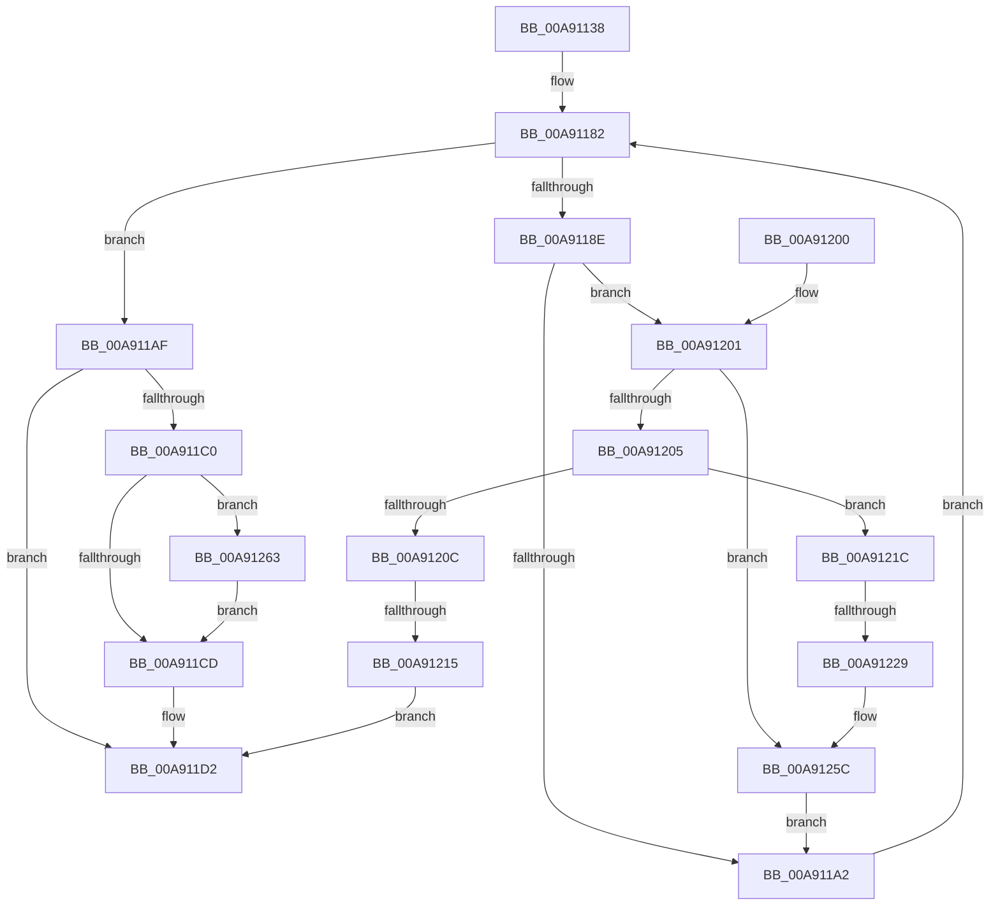

# PopFanReadFanNoiseInfo

- RVA: `0x00A91138`–`0x00A912BA` (길이 `386` bytes)
- VA: `0x0000000140A91138`
- 실행 섹션: `PAGE`
- PDB 이름 있음: `예`; PDB Function 태그: `예`
- unwind 정보 RVA: `0x000B907C`
- 디코드: `95`개 명령, `386/386` bytes 표시
- 미해석 바이트: `0` (있으면 어셈블리에 `.byte`로 보존)

> 이 문서는 커널 이미지의 기계어와 PDB 기호를 분석해 생성했습니다. 4번과 5번은 함수 원형과 자료형을 바이너리 사용 방식에서 추정한 C 해석이며 원본 소스 복구 결과는 아닙니다.

## 1. Dependencies

- 직접 호출 지점: **8**; 고유 호출 대상: **7**
- 직접 호출자로 확인된 함수: **1**
- RIP 상대 이미지 참조: **5**

### Outgoing calls
- `0x00A91176` → [PopAcquireRwLockShared](../../text/2D/PopAcquireRwLockShared_function_002D9A40.md) (function, `0x002D9A40`)
- `0x00A91198` → [PopAcquireRwLockExclusive](../../text/43/PopAcquireRwLockExclusive_function_00430B44.md) (function, `0x00430B44`)
- `0x00A911A5` → [PopReleaseRwLock](../../text/2D/PopReleaseRwLock_function_002DFBBC.md) (function, `0x002DFBBC`)
- `0x00A911B6` → [PopReleaseRwLock](../../text/2D/PopReleaseRwLock_function_002DFBBC.md) (function, `0x002DFBBC`)
- `0x00A911DF` → [_security_check_cookie](../../text/6A/_security_check_cookie_function_006AC640.md) (function, `0x006AC640`)
- `0x00A91238` → [PopFanUpdateStatistics](../AA/PopFanUpdateStatistics_function_00AAC23C.md) (function, `0x00AAC23C`)
- `0x00A91257` → [memcpy](../../text/6C/memcpy_function_006C6840.md) (function, `0x006C6840`)
- `0x00A912B0` → [tlgWriteTransfer_EtwWriteTransfer](../../text/42/tlgWriteTransfer_EtwWriteTransfer_function_004260E0.md) (function, `0x004260E0`)

### Direct callers
- [PopPowerInformationInternal](../A8/PopPowerInformationInternal_function_00A8B7C0.md) at `0x00A8CFE2`

### Static image references
- `0x00A91151` → RVA `0x00E0A740` (`.data`; read)
- `0x00A91167` → RVA `0x00F0C900` (`.data`; read)
- `0x00A9117B` → RVA `0x00F0CE90` (`.data`; read)
- `0x00A911C0` → RVA `0x00E07748` (`.data`; read)
- `0x00A9127B` → RVA `0x0004E34F` (`.rdata`; read)

## 2. Other-region calls and transfers

- 다른 실행 섹션으로 향하는 call: **7**
  - `0x00A91176` → [PopAcquireRwLockShared](../../text/2D/PopAcquireRwLockShared_function_002D9A40.md) (`PAGE` → `.text`)
  - `0x00A91198` → [PopAcquireRwLockExclusive](../../text/43/PopAcquireRwLockExclusive_function_00430B44.md) (`PAGE` → `.text`)
  - `0x00A911A5` → [PopReleaseRwLock](../../text/2D/PopReleaseRwLock_function_002DFBBC.md) (`PAGE` → `.text`)
  - `0x00A911B6` → [PopReleaseRwLock](../../text/2D/PopReleaseRwLock_function_002DFBBC.md) (`PAGE` → `.text`)
  - `0x00A911DF` → [_security_check_cookie](../../text/6A/_security_check_cookie_function_006AC640.md) (`PAGE` → `.text`)
  - `0x00A91257` → [memcpy](../../text/6C/memcpy_function_006C6840.md) (`PAGE` → `.text`)
  - `0x00A912B0` → [tlgWriteTransfer_EtwWriteTransfer](../../text/42/tlgWriteTransfer_EtwWriteTransfer_function_004260E0.md) (`PAGE` → `.text`)
- call이 아닌 외부 분기/꼬리 이동: **2**
  - `0x00A9120F` → [sub_00B46B28](../B4/Unknown_function_00B46B28.md) (`tail-transfer`)
  - `0x00A91223` → [sub_00B46B28 + 0x58](../B4/Unknown_function_00B46B28.md) (`tail-transfer`)

## 3. Assembly (complete function range)

```asm
00A91138  48 89 5C 24 08                  mov qword ptr [rsp + 8], rbx
00A9113D  48 89 6C 24 18                  mov qword ptr [rsp + 0x18], rbp
00A91142  56                              push rsi
00A91143  57                              push rdi
00A91144  41 54                           push r12
00A91146  41 56                           push r14
00A91148  41 57                           push r15
00A9114A  48 81 EC 90 00 00 00            sub rsp, 0x90
00A91151  48 8B 05 E8 95 37 00            mov rax, qword ptr [rip + 0x3795e8]
00A91158  48 33 C4                        xor rax, rsp
00A9115B  48 89 84 24 80 00 00 00         mov qword ptr [rsp + 0x80], rax
00A91163  8B E9                           mov ebp, ecx
00A91165  33 DB                           xor ebx, ebx
00A91167  48 8D 0D 92 B7 47 00            lea rcx, [rip + 0x47b792]
00A9116E  8B F3                           mov esi, ebx
00A91170  45 8B E0                        mov r12d, r8d
00A91173  4C 8B F2                        mov r14, rdx
00A91176  E8 C5 88 84 FF                  call 0x1402d9a40
00A9117B  48 8B 3D 0E BD 47 00            mov rdi, qword ptr [rip + 0x47bd0e]
00A91182  48 8D 05 07 BD 47 00            lea rax, [rip + 0x47bd07]
00A91189  48 3B F8                        cmp rdi, rax
00A9118C  74 21                           je 0x140a911af
00A9118E  4C 8D BF 90 01 00 00            lea r15, [rdi + 0x190]
00A91195  49 8B CF                        mov rcx, r15
00A91198  E8 A7 F9 99 FF                  call 0x140430b44
00A9119D  38 5F 58                        cmp byte ptr [rdi + 0x58], bl
00A911A0  75 5F                           jne 0x140a91201
00A911A2  49 8B CF                        mov rcx, r15
00A911A5  E8 12 EA 84 FF                  call 0x1402dfbbc
00A911AA  48 8B 3F                        mov rdi, qword ptr [rdi]
00A911AD  EB D3                           jmp 0x140a91182
00A911AF  48 8D 0D 4A B7 47 00            lea rcx, [rip + 0x47b74a]
00A911B6  E8 01 EA 84 FF                  call 0x1402dfbbc
00A911BB  83 FE 01                        cmp esi, 1
00A911BE  74 12                           je 0x140a911d2
00A911C0  83 3D 81 65 37 00 02            cmp dword ptr [rip + 0x376581], 2
00A911C7  0F 87 96 00 00 00               ja 0x140a91263
00A911CD  BB 01 00 00 C0                  mov ebx, 0xc0000001
00A911D2  8B C3                           mov eax, ebx
00A911D4  48 8B 8C 24 80 00 00 00         mov rcx, qword ptr [rsp + 0x80]
00A911DC  48 33 CC                        xor rcx, rsp
00A911DF  E8 5C B4 C1 FF                  call 0x1406ac640
00A911E4  4C 8D 9C 24 90 00 00 00         lea r11, [rsp + 0x90]
00A911EC  49 8B 5B 30                     mov rbx, qword ptr [r11 + 0x30]
00A911F0  49 8B 6B 40                     mov rbp, qword ptr [r11 + 0x40]
00A911F4  49 8B E3                        mov rsp, r11
00A911F7  41 5F                           pop r15
00A911F9  41 5E                           pop r14
00A911FB  41 5C                           pop r12
00A911FD  5F                              pop rdi
00A911FE  5E                              pop rsi
00A911FF  C3                              ret
00A91200  CC                              int3
00A91201  85 F6                           test esi, esi
00A91203  75 57                           jne 0x140a9125c
00A91205  8B CD                           mov ecx, ebp
00A91207  83 E9 54                        sub ecx, 0x54
00A9120A  74 10                           je 0x140a9121c
00A9120C  83 F9 01                        cmp ecx, 1
00A9120F  0F 84 13 59 0B 00               je 0x140b46b28
00A91215  BB BB 00 00 C0                  mov ebx, 0xc00000bb
00A9121A  EB B6                           jmp 0x140a911d2
00A9121C  41 81 FC A0 00 00 00            cmp r12d, 0xa0
00A91223  0F 85 57 59 0B 00               jne 0x140b46b80
00A91229  8B 87 80 00 00 00               mov eax, dword ptr [rdi + 0x80]
00A9122F  48 8B CF                        mov rcx, rdi
00A91232  83 C0 02                        add eax, 2
00A91235  41 89 06                        mov dword ptr [r14], eax
00A91238  E8 FF AF 01 00                  call 0x140aac23c
00A9123D  44 8B 87 80 00 00 00            mov r8d, dword ptr [rdi + 0x80]
00A91244  48 8D 97 D8 00 00 00            lea rdx, [rdi + 0xd8]
00A9124B  41 83 C0 02                     add r8d, 2
00A9124F  49 8D 4E 08                     lea rcx, [r14 + 8]
00A91253  49 C1 E0 03                     shl r8, 3
00A91257  E8 E4 55 C3 FF                  call 0x1406c6840
00A9125C  FF C6                           inc esi
00A9125E  E9 3F FF FF FF                  jmp 0x140a911a2
00A91263  B9 04 00 00 00                  mov ecx, 4
00A91268  89 6C 24 30                     mov dword ptr [rsp + 0x30], ebp
00A9126C  48 8D 44 24 30                  lea rax, [rsp + 0x30]
00A91271  48 89 4C 24 68                  mov qword ptr [rsp + 0x68], rcx
00A91276  48 89 44 24 60                  mov qword ptr [rsp + 0x60], rax
00A9127B  48 8D 15 CD D0 5B FF            lea rdx, [rip - 0xa42f33]
00A91282  48 8D 44 24 34                  lea rax, [rsp + 0x34]
00A91287  48 89 4C 24 78                  mov qword ptr [rsp + 0x78], rcx
00A9128C  48 89 44 24 70                  mov qword ptr [rsp + 0x70], rax
00A91291  45 33 C9                        xor r9d, r9d
00A91294  48 8D 44 24 40                  lea rax, [rsp + 0x40]
00A91299  89 74 24 34                     mov dword ptr [rsp + 0x34], esi
00A9129D  48 89 44 24 28                  mov qword ptr [rsp + 0x28], rax
00A912A2  45 33 C0                        xor r8d, r8d
00A912A5  89 4C 24 20                     mov dword ptr [rsp + 0x20], ecx
00A912A9  48 8D 0D 98 64 37 00            lea rcx, [rip + 0x376498]
00A912B0  E8 2B 4E 99 FF                  call 0x1404260e0
00A912B5  E9 13 FF FF FF                  jmp 0x140a911cd
```

## 4. C-style interpretation (structured pseudocode)

```c
__int64 __fastcall PopFanReadFanNoiseInfo(int a1, __int64 a2, int a3, int a4)
{
    __int64 result;
    __int64 v_rbx;
    __int64 v_rsi;
    __int64 v_rsp;
    unsigned __int64 v_stack_m18;
    unsigned __int64 v_stack_m20;
    unsigned __int64 v_stack_m28;
    unsigned __int64 v_stack_m30;
    unsigned __int64 v_stack_m38;
    unsigned __int64 v_stack_m50;
    unsigned __int64 v_stack_m5C;
    unsigned int v_stack_m60;
    unsigned __int64 v_stack_m68;
    unsigned int v_stack_m70;
    unsigned __int64 v_stack_p18;
    unsigned __int64 v_stack_p8;

    v_stack_p8 = v_rbx;
    v_stack_p18 = v_rbp;
    v_rsp = (v_rsp) - (144);
    result = (*(unsigned __int64 *)(v_rip + 3642856)) ^ (v_rsp);
    v_stack_m38 = result;
    v_rbx = 0;
    result = PopAcquireRwLockShared(v_rip + 4700050, a2, a3, a4);
loc_00A91182:
    if ((*(unsigned __int64 *)(v_rip + 4701454)) == (v_rip + 4701447)) goto loc_00A911AF;
    result = PopAcquireRwLockExclusive(*(unsigned __int64 *)(v_rip + 4701454) + 400, a2, a3, a4);
    if ((*(unsigned __int8 *)(*(unsigned __int64 *)(v_rip + 4701454) + 88)) != 0) goto loc_00A91201;
loc_00A911A2:
    result = PopReleaseRwLock(*(unsigned __int64 *)(v_rip + 4701454) + 400, a2, a3, a4);
    goto loc_00A91182;
loc_00A911AF:
    result = PopReleaseRwLock(v_rip + 4699978, a2, a3, a4);
    if (0 == 1) goto loc_00A911D2;
    if ((*(unsigned int *)(v_rip + 3630465)) > 2) goto loc_00A91263;
loc_00A911CD:
loc_00A911D2:
    a1 = (v_stack_m38) ^ (v_rsp);
    result = _security_check_cookie(a1, a2, a3, a4);
    return result;
loc_00A91201:
    if (0 != 0) goto loc_00A9125C;
    a1 = (unsigned int)(((unsigned int)((unsigned int)(*(unsigned __int64 *)(v_stack_m28 + 64)))) - (84));
    if (condition_is_equal) goto loc_00A9121C;
    goto loc_00A911D2;
loc_00A9121C:
    result = (unsigned int)(((unsigned int)(*(unsigned int *)(*(unsigned __int64 *)(*(unsigned __int64 *)(v_rip + 4701454)) + 128))) + (2));
    *(unsigned int *)(a2) = (unsigned int)(result);
    result = PopFanUpdateStatistics(*(unsigned __int64 *)(*(unsigned __int64 *)(v_rip + 4701454)), a2, a3, a4);
    a3 = (unsigned int)(((unsigned int)(*(unsigned int *)(*(unsigned __int64 *)(*(unsigned __int64 *)(v_rip + 4701454)) + 128))) + (2));
    a3 = (a3) << (3);
    result = memcpy(a2 + 8, *(unsigned __int64 *)(*(unsigned __int64 *)(v_rip + 4701454)) + 216, a3, a4);
loc_00A9125C:
    v_rsi = (unsigned int)((0) + 1);
    goto loc_00A911A2;
loc_00A91263:
    v_stack_m60 = (unsigned int)(*(unsigned __int64 *)(v_stack_m28 + 64));
    v_stack_m28 = 4;
    v_stack_m30 = v_stack_m60;
    v_stack_m18 = 4;
    v_stack_m20 = v_stack_m5C;
    a4 = 0;
    v_stack_m5C = (unsigned int)(v_rsi);
    v_stack_m68 = v_stack_m50;
    a3 = 0;
    v_stack_m70 = 4;
    result = tlgWriteTransfer_EtwWriteTransfer(v_rip + 3630232, v_rip - 10759987, a3, a4);
    goto loc_00A911CD;
}
```

## 5. (Beta) C Style

```c
int64_t PopFanReadFanNoiseInfo(int32_t Arg1, void *Arg2, int32_t Arg3, int32_t Arg4)
{
    uint8_t *arg2 = (uint8_t *)Arg2;

    int64_t result;
    int64_t local_rbx;
    int64_t local_rsi;
    int64_t local_rsp;
    uint64_t v_stack_m18;
    uint64_t v_stack_m20;
    uint64_t v_stack_m28;
    uint64_t v_stack_m30;
    uint64_t v_stack_m38;
    uint64_t v_stack_m50;
    uint64_t v_stack_m5C;
    uint32_t v_stack_m60;
    uint64_t v_stack_m68;
    uint32_t v_stack_m70;
    uint64_t v_stack_p18;
    uint64_t v_stack_p8;

    v_stack_p8 = local_rbx;
    v_stack_p18 = local_rbp;
    local_rsp = (local_rsp) - (144);
    result = (*(uint64_t *)(v_rip + 0x3795E8)) ^ (local_rsp);
    v_stack_m38 = result;
    local_rbx = 0;
    result = PopAcquireRwLockShared(v_rip + 4700050, Arg2, Arg3, Arg4);
loc_00A91182:
    if ((*(uint64_t *)(v_rip + 0x47BD0E)) == (v_rip + 4701447)) goto loc_00A911AF;
    result = PopAcquireRwLockExclusive(*(uint64_t *)(v_rip + 0x47BD0E) + 400, Arg2, Arg3, Arg4);
    if ((*(uint8_t *)(*(uint64_t *)(v_rip + 0x47BD0E) + 0x58)) != 0) goto loc_00A91201;
loc_00A911A2:
    result = PopReleaseRwLock(*(uint64_t *)(v_rip + 0x47BD0E) + 400, Arg2, Arg3, Arg4);
    goto loc_00A91182;
loc_00A911AF:
    result = PopReleaseRwLock(v_rip + 4699978, Arg2, Arg3, Arg4);
    if (0 == 1) goto loc_00A911D2;
    if ((*(uint32_t *)(v_rip + 0x376581)) > 2) goto loc_00A91263;
loc_00A911CD:
loc_00A911D2:
    Arg1 = (v_stack_m38) ^ (local_rsp);
    result = _security_check_cookie(Arg1, Arg2, Arg3, Arg4);
    return result;
loc_00A91201:
    if (0 != 0) goto loc_00A9125C;
    Arg1 = (uint32_t)(((uint32_t)((uint32_t)(*(uint64_t *)(v_stack_m28 + 0x40)))) - (84));
    if (condition_is_equal) goto loc_00A9121C;
    goto loc_00A911D2;
loc_00A9121C:
    result = (uint32_t)(((uint32_t)(*(uint32_t *)(*(uint64_t *)(*(uint64_t *)(v_rip + 0x47BD0E)) + 0x80))) + (2));
    *(uint32_t *)(arg2) = (uint32_t)(result);
    result = PopFanUpdateStatistics(*(uint64_t *)(*(uint64_t *)(v_rip + 0x47BD0E)), Arg2, Arg3, Arg4);
    Arg3 = (uint32_t)(((uint32_t)(*(uint32_t *)(*(uint64_t *)(*(uint64_t *)(v_rip + 0x47BD0E)) + 0x80))) + (2));
    Arg3 = (Arg3) << (3);
    result = memcpy(Arg2 + 8, *(uint64_t *)(*(uint64_t *)(v_rip + 0x47BD0E)) + 216, Arg3, Arg4);
loc_00A9125C:
    local_rsi = (uint32_t)((0) + 1);
    goto loc_00A911A2;
loc_00A91263:
    v_stack_m60 = (uint32_t)(*(uint64_t *)(v_stack_m28 + 0x40));
    v_stack_m28 = 4;
    v_stack_m30 = v_stack_m60;
    v_stack_m18 = 4;
    v_stack_m20 = v_stack_m5C;
    Arg4 = 0;
    v_stack_m5C = (uint32_t)(local_rsi);
    v_stack_m68 = v_stack_m50;
    Arg3 = 0;
    v_stack_m70 = 4;
    result = tlgWriteTransfer_EtwWriteTransfer(v_rip + 3630232, v_rip - 10759987, Arg3, Arg4);
    goto loc_00A911CD;
}
```

### 관측된 메모리 오프셋

구조체 형식이 확인되지 않은 접근은 인자 기준의 오프셋으로만 기록했습니다.

| 기준 인자 | 오프셋 표현 | 폭 (bit) | 접근 |
|---|---:|---:|---|
| `Arg2` | `+ 0x0` | `32` | `W` |
| `Arg2` | `+ 0x8` | `64` | `R` |

## 6. Execution-region graph

[열기: 2D/3D 그래프와 함수 탐색 컨트롤 패널](../../../control-panel.html?section=page&rva=0x00A91138&view=graph)

- 2D 그래프는 위에서 아래로 흐르고, 3D 그래프는 빈 공간을 드래그해 회전합니다. Shift+드래그는 이동, 휠은 확대·축소, 함수 노드 선택은 대상 보고서 이동입니다.

### Static fallback


