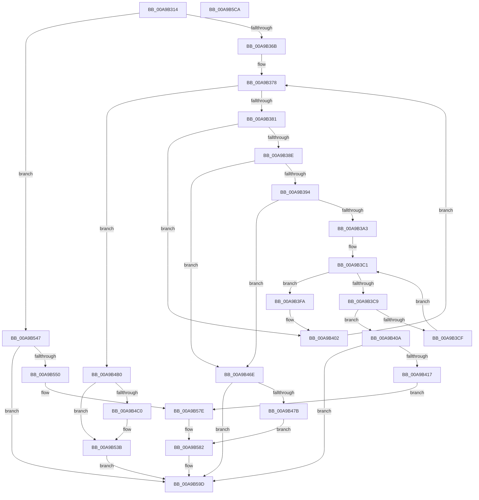

# PopFanSetupRpmBuckets

- RVA: `0x00A9B314`–`0x00A9B5CB` (길이 `695` bytes)
- VA: `0x0000000140A9B314`
- 실행 섹션: `PAGE`
- PDB 이름 있음: `예`; PDB Function 태그: `아니요`
- unwind 정보 RVA: `0x000BA3A4`
- 디코드: `170`개 명령, `695/695` bytes 표시
- 미해석 바이트: `0` (있으면 어셈블리에 `.byte`로 보존)

> 이 문서는 커널 이미지의 기계어와 PDB 기호를 분석해 생성했습니다. 4번과 5번은 함수 원형과 자료형을 바이너리 사용 방식에서 추정한 C 해석이며 원본 소스 복구 결과는 아닙니다.

## 1. Dependencies

- 직접 호출 지점: **4**; 고유 호출 대상: **3**
- 직접 호출자로 확인된 함수: **1**
- RIP 상대 이미지 참조: **6**

### Outgoing calls
- `0x00A9B536` → [tlgWriteTransfer_EtwWriteTransfer](../../text/42/tlgWriteTransfer_EtwWriteTransfer_function_004260E0.md) (function, `0x004260E0`)
- `0x00A9B540` → [PopFanSetNoiseImpact](../76/PopFanSetNoiseImpact_function_0076921C.md) (function, `0x0076921C`)
- `0x00A9B598` → [tlgWriteTransfer_EtwWriteTransfer](../../text/42/tlgWriteTransfer_EtwWriteTransfer_function_004260E0.md) (function, `0x004260E0`)
- `0x00A9B5A4` → [_security_check_cookie](../../text/6A/_security_check_cookie_function_006AC640.md) (function, `0x006AC640`)

### Direct callers
- [PopFanWorker](PopFanWorker_function_00A9B050.md) at `0x00A9B1D1`

### Static image references
- `0x00A9B337` → RVA `0x00E0A740` (`.data`; read)
- `0x00A9B40A` → RVA `0x00E07748` (`.data`; read)
- `0x00A9B423` → RVA `0x0004E6DD` (`.rdata`; read)
- `0x00A9B48B` → RVA `0x0004E698` (`.rdata`; read)
- `0x00A9B4CC` → RVA `0x0004E475` (`.rdata`; read)
- `0x00A9B55B` → RVA `0x0004E777` (`.rdata`; read)

## 2. Other-region calls and transfers

- 다른 실행 섹션으로 향하는 call: **3**
  - `0x00A9B536` → [tlgWriteTransfer_EtwWriteTransfer](../../text/42/tlgWriteTransfer_EtwWriteTransfer_function_004260E0.md) (`PAGE` → `.text`)
  - `0x00A9B598` → [tlgWriteTransfer_EtwWriteTransfer](../../text/42/tlgWriteTransfer_EtwWriteTransfer_function_004260E0.md) (`PAGE` → `.text`)
  - `0x00A9B5A4` → [_security_check_cookie](../../text/6A/_security_check_cookie_function_006AC640.md) (`PAGE` → `.text`)
- 별도 외부 분기/꼬리 이동을 확인하지 못했습니다.

## 3. Assembly (complete function range)

```asm
00A9B314  48 8B C4                        mov rax, rsp
00A9B317  48 89 58 10                     mov qword ptr [rax + 0x10], rbx
00A9B31B  48 89 70 18                     mov qword ptr [rax + 0x18], rsi
00A9B31F  48 89 78 20                     mov qword ptr [rax + 0x20], rdi
00A9B323  55                              push rbp
00A9B324  41 54                           push r12
00A9B326  41 55                           push r13
00A9B328  41 56                           push r14
00A9B32A  41 57                           push r15
00A9B32C  48 8D 68 A1                     lea rbp, [rax - 0x5f]
00A9B330  48 81 EC C0 00 00 00            sub rsp, 0xc0
00A9B337  48 8B 05 02 F4 36 00            mov rax, qword ptr [rip + 0x36f402]
00A9B33E  48 33 C4                        xor rax, rsp
00A9B341  48 89 45 27                     mov qword ptr [rbp + 0x27], rax
00A9B345  8B 71 6C                        mov esi, dword ptr [rcx + 0x6c]
00A9B348  B8 05 00 00 00                  mov eax, 5
00A9B34D  45 33 C0                        xor r8d, r8d
00A9B350  C7 45 AF 02 00 00 00            mov dword ptr [rbp - 0x51], 2
00A9B357  89 45 B3                        mov dword ptr [rbp - 0x4d], eax
00A9B35A  48 8B D9                        mov rbx, rcx
00A9B35D  89 45 B7                        mov dword ptr [rbp - 0x49], eax
00A9B360  89 45 BB                        mov dword ptr [rbp - 0x45], eax
00A9B363  85 F6                           test esi, esi
00A9B365  0F 84 DC 01 00 00               je 0x140a9b547
00A9B36B  45 8B F0                        mov r14d, r8d
00A9B36E  44 8D 48 FF                     lea r9d, [rax - 1]
00A9B372  41 8B F8                        mov edi, r8d
00A9B375  45 8B D8                        mov r11d, r8d
00A9B378  45 3B D9                        cmp r11d, r9d
00A9B37B  0F 83 2F 01 00 00               jae 0x140a9b4b0
00A9B381  45 8B FB                        mov r15d, r11d
00A9B384  46 8B 54 BB 70                  mov r10d, dword ptr [rbx + r15*4 + 0x70]
00A9B389  44 3B D7                        cmp r10d, edi
00A9B38C  74 74                           je 0x140a9b402
00A9B38E  0F 86 DA 00 00 00               jbe 0x140a9b46e
00A9B394  33 D2                           xor edx, edx
00A9B396  41 8B C2                        mov eax, r10d
00A9B399  F7 F6                           div esi
00A9B39B  85 D2                           test edx, edx
00A9B39D  0F 85 CB 00 00 00               jne 0x140a9b46e
00A9B3A3  42 8B 4C BD AF                  mov ecx, dword ptr [rbp + r15*4 - 0x51]
00A9B3A8  44 2B D7                        sub r10d, edi
00A9B3AB  33 D2                           xor edx, edx
00A9B3AD  41 8B C2                        mov eax, r10d
00A9B3B0  F7 F6                           div esi
00A9B3B2  45 8B E8                        mov r13d, r8d
00A9B3B5  3B C1                           cmp eax, ecx
00A9B3B7  44 8B E0                        mov r12d, eax
00A9B3BA  41 8B C2                        mov eax, r10d
00A9B3BD  44 0F 43 E1                     cmovae r12d, ecx
00A9B3C1  89 45 A7                        mov dword ptr [rbp - 0x59], eax
00A9B3C4  45 3B EC                        cmp r13d, r12d
00A9B3C7  73 31                           jae 0x140a9b3fa
00A9B3C9  41 83 FE 11                     cmp r14d, 0x11
00A9B3CD  73 3B                           jae 0x140a9b40a
00A9B3CF  33 D2                           xor edx, edx
00A9B3D1  41 8B CE                        mov ecx, r14d
00A9B3D4  41 F7 F4                        div r12d
00A9B3D7  33 D2                           xor edx, edx
00A9B3D9  41 FF C6                        inc r14d
00A9B3DC  44 8B C0                        mov r8d, eax
00A9B3DF  F7 F6                           div esi
00A9B3E1  8B 45 A7                        mov eax, dword ptr [rbp - 0x59]
00A9B3E4  44 2B C2                        sub r8d, edx
00A9B3E7  41 03 C2                        add eax, r10d
00A9B3EA  44 03 C7                        add r8d, edi
00A9B3ED  44 89 84 8B 84 00 00 00         mov dword ptr [rbx + rcx*4 + 0x84], r8d
00A9B3F5  41 FF C5                        inc r13d
00A9B3F8  EB C7                           jmp 0x140a9b3c1
00A9B3FA  42 8B 7C BB 70                  mov edi, dword ptr [rbx + r15*4 + 0x70]
00A9B3FF  45 33 C0                        xor r8d, r8d
00A9B402  41 FF C3                        inc r11d
00A9B405  E9 6E FF FF FF                  jmp 0x140a9b378
00A9B40A  83 3D 37 C3 36 00 02            cmp dword ptr [rip + 0x36c337], 2
00A9B411  0F 86 86 01 00 00               jbe 0x140a9b59d
00A9B417  48 8D 45 AF                     lea rax, [rbp - 0x51]
00A9B41B  44 89 75 A7                     mov dword ptr [rbp - 0x59], r14d
00A9B41F  48 89 45 E7                     mov qword ptr [rbp - 0x19], rax
00A9B423  48 8D 15 B3 32 5B FF            lea rdx, [rip - 0xa4cd4d]
00A9B42A  48 8D 45 A7                     lea rax, [rbp - 0x59]
00A9B42E  48 C7 45 0F 10 00 00 00         mov qword ptr [rbp + 0xf], 0x10
00A9B436  48 89 45 F7                     mov qword ptr [rbp - 9], rax
00A9B43A  45 33 C0                        xor r8d, r8d
00A9B43D  48 8D 43 70                     lea rax, [rbx + 0x70]
00A9B441  48 C7 45 1F 44 00 00 00         mov qword ptr [rbp + 0x1f], 0x44
00A9B449  48 89 45 07                     mov qword ptr [rbp + 7], rax
00A9B44D  48 8D 83 84 00 00 00            lea rax, [rbx + 0x84]
00A9B454  48 89 45 17                     mov qword ptr [rbp + 0x17], rax
00A9B458  48 8D 45 C7                     lea rax, [rbp - 0x39]
00A9B45C  48 89 44 24 28                  mov qword ptr [rsp + 0x28], rax
00A9B461  C7 44 24 20 06 00 00 00         mov dword ptr [rsp + 0x20], 6
00A9B469  E9 10 01 00 00                  jmp 0x140a9b57e
00A9B46E  83 3D D3 C2 36 00 02            cmp dword ptr [rip + 0x36c2d3], 2
00A9B475  0F 86 22 01 00 00               jbe 0x140a9b59d
00A9B47B  48 8D 45 AF                     lea rax, [rbp - 0x51]
00A9B47F  48 C7 45 FF 10 00 00 00         mov qword ptr [rbp - 1], 0x10
00A9B487  48 89 45 E7                     mov qword ptr [rbp - 0x19], rax
00A9B48B  48 8D 15 06 32 5B FF            lea rdx, [rip - 0xa4cdfa]
00A9B492  48 8D 43 70                     lea rax, [rbx + 0x70]
00A9B496  45 33 C0                        xor r8d, r8d
00A9B499  48 89 45 F7                     mov qword ptr [rbp - 9], rax
00A9B49D  48 8D 45 C7                     lea rax, [rbp - 0x39]
00A9B4A1  48 89 44 24 28                  mov qword ptr [rsp + 0x28], rax
00A9B4A6  44 89 4C 24 20                  mov dword ptr [rsp + 0x20], r9d
00A9B4AB  E9 D2 00 00 00                  jmp 0x140a9b582
00A9B4B0  44 89 B3 80 00 00 00            mov dword ptr [rbx + 0x80], r14d
00A9B4B7  44 39 0D 8A C2 36 00            cmp dword ptr [rip + 0x36c28a], r9d
00A9B4BE  76 7B                           jbe 0x140a9b53b
00A9B4C0  41 0F B7 CE                     movzx ecx, r14w
00A9B4C4  48 8D 45 AF                     lea rax, [rbp - 0x51]
00A9B4C8  48 89 45 E7                     mov qword ptr [rbp - 0x19], rax
00A9B4CC  48 8D 15 A2 2F 5B FF            lea rdx, [rip - 0xa4d05e]
00A9B4D3  66 89 4D A7                     mov word ptr [rbp - 0x59], cx
00A9B4D7  48 8D 43 70                     lea rax, [rbx + 0x70]
00A9B4DB  48 89 45 F7                     mov qword ptr [rbp - 9], rax
00A9B4DF  45 33 C9                        xor r9d, r9d
00A9B4E2  C1 E1 02                        shl ecx, 2
00A9B4E5  48 8D 45 A7                     lea rax, [rbp - 0x59]
00A9B4E9  48 89 45 07                     mov qword ptr [rbp + 7], rax
00A9B4ED  48 8D 83 84 00 00 00            lea rax, [rbx + 0x84]
00A9B4F4  48 89 45 17                     mov qword ptr [rbp + 0x17], rax
00A9B4F8  48 8D 45 C7                     lea rax, [rbp - 0x39]
00A9B4FC  89 4D 1F                        mov dword ptr [rbp + 0x1f], ecx
00A9B4FF  48 8D 0D 42 C2 36 00            lea rcx, [rip + 0x36c242]
00A9B506  44 89 45 23                     mov dword ptr [rbp + 0x23], r8d
00A9B50A  45 33 C0                        xor r8d, r8d
00A9B50D  48 89 44 24 28                  mov qword ptr [rsp + 0x28], rax
00A9B512  C7 44 24 20 06 00 00 00         mov dword ptr [rsp + 0x20], 6
00A9B51A  48 89 5D AF                     mov qword ptr [rbp - 0x51], rbx
00A9B51E  48 C7 45 EF 08 00 00 00         mov qword ptr [rbp - 0x11], 8
00A9B526  48 C7 45 FF 10 00 00 00         mov qword ptr [rbp - 1], 0x10
00A9B52E  48 C7 45 0F 02 00 00 00         mov qword ptr [rbp + 0xf], 2
00A9B536  E8 A5 AB 98 FF                  call 0x1404260e0
00A9B53B  B2 01                           mov dl, 1
00A9B53D  48 8B CB                        mov rcx, rbx
00A9B540  E8 D7 DC CC FF                  call 0x14076921c
00A9B545  EB 56                           jmp 0x140a9b59d
00A9B547  83 3D FA C1 36 00 02            cmp dword ptr [rip + 0x36c1fa], 2
00A9B54E  76 4D                           jbe 0x140a9b59d
00A9B550  48 8D 45 AF                     lea rax, [rbp - 0x51]
00A9B554  89 75 A7                        mov dword ptr [rbp - 0x59], esi
00A9B557  48 89 45 E7                     mov qword ptr [rbp - 0x19], rax
00A9B55B  48 8D 15 15 32 5B FF            lea rdx, [rip - 0xa4cdeb]
00A9B562  48 8D 45 A7                     lea rax, [rbp - 0x59]
00A9B566  41 B9 04 00 00 00               mov r9d, 4
00A9B56C  48 89 45 F7                     mov qword ptr [rbp - 9], rax
00A9B570  48 8D 45 C7                     lea rax, [rbp - 0x39]
00A9B574  48 89 44 24 28                  mov qword ptr [rsp + 0x28], rax
00A9B579  44 89 4C 24 20                  mov dword ptr [rsp + 0x20], r9d
00A9B57E  4C 89 4D FF                     mov qword ptr [rbp - 1], r9
00A9B582  45 33 C9                        xor r9d, r9d
00A9B585  48 89 5D AF                     mov qword ptr [rbp - 0x51], rbx
00A9B589  48 8D 0D B8 C1 36 00            lea rcx, [rip + 0x36c1b8]
00A9B590  48 C7 45 EF 08 00 00 00         mov qword ptr [rbp - 0x11], 8
00A9B598  E8 43 AB 98 FF                  call 0x1404260e0
00A9B59D  48 8B 4D 27                     mov rcx, qword ptr [rbp + 0x27]
00A9B5A1  48 33 CC                        xor rcx, rsp
00A9B5A4  E8 97 10 C1 FF                  call 0x1406ac640
00A9B5A9  4C 8D 9C 24 C0 00 00 00         lea r11, [rsp + 0xc0]
00A9B5B1  49 8B 5B 38                     mov rbx, qword ptr [r11 + 0x38]
00A9B5B5  49 8B 73 40                     mov rsi, qword ptr [r11 + 0x40]
00A9B5B9  49 8B 7B 48                     mov rdi, qword ptr [r11 + 0x48]
00A9B5BD  49 8B E3                        mov rsp, r11
00A9B5C0  41 5F                           pop r15
00A9B5C2  41 5E                           pop r14
00A9B5C4  41 5D                           pop r13
00A9B5C6  41 5C                           pop r12
00A9B5C8  5D                              pop rbp
00A9B5C9  C3                              ret
00A9B5CA  CC                              int3
```

## 4. C-style interpretation (structured pseudocode)

```c
__int64 __fastcall PopFanSetupRpmBuckets(__int64 a1, int a2, int a3)
{
    __int64 result;
    __int64 v_r10;
    __int64 v_r11;
    __int64 v_r12;
    __int64 v_r13;
    __int64 v_r14;
    __int64 v_rsp;
    unsigned __int64 v_stack_m28;
    unsigned __int64 v_stack_mC0;
    unsigned int v_stack_mC8;

    *(unsigned __int64 *)(v_rsp + 16) = v_rbx;
    *(unsigned __int64 *)(v_rsp + 24) = v_rsi;
    *(unsigned __int64 *)(v_rsp + 32) = v_rdi;
    v_rsp = (v_rsp) - (192);
    result = (*(unsigned __int64 *)(v_rip + 3601410)) ^ (v_rsp);
    *(unsigned __int64 *)(v_rsp - 95 + 39) = result;
    a3 = 0;
    *(unsigned int *)(v_rsp - 95 - 81) = 2;
    *(unsigned int *)(v_rsp - 95 - 77) = 5;
    *(unsigned int *)(v_rsp - 95 - 73) = 5;
    *(unsigned int *)(v_rsp - 95 - 69) = 5;
    if ((unsigned int)((unsigned int)(*(unsigned int *)(a1 + 108))) == 0) goto loc_00A9B547;
loc_00A9B378:
    if (0 >= ((unsigned int)(5 - 1))) goto loc_00A9B4B0;
    if (((unsigned int)((unsigned int)(*(unsigned int *)(a1 + 0 * 4 + 112)))) == 0) goto loc_00A9B402;
    if (((unsigned int)((unsigned int)(*(unsigned int *)(a1 + 0 * 4 + 112)))) <= 0) goto loc_00A9B46E;
    a2 = 0;
    if (0 != 0) goto loc_00A9B46E;
    v_r10 = (unsigned int)(((unsigned int)(*(unsigned int *)(a1 + 0 * 4 + 112))) - (0));
    a2 = 0;
    v_r12 = (unsigned int)((unsigned int)((unsigned int)((unsigned int)(v_r10))));
    if (((unsigned int)((unsigned int)((unsigned int)(v_r10)))) >= ((unsigned int)((unsigned int)(*(unsigned int *)(v_rsp - 95 + 0 * 4 - 81))))) { v_r12 = (unsigned int)((unsigned int)(*(unsigned int *)(v_rsp - 95 + 0 * 4 - 81))); }
loc_00A9B3C1:
    *(unsigned int *)(v_rsp - 95 - 89) = (unsigned int)((unsigned int)((unsigned int)(v_r10)));
    if (0 >= ((unsigned int)(v_r12))) goto loc_00A9B3FA;
    if (0 >= 17) goto loc_00A9B40A;
    a2 = 0;
    a2 = 0;
    v_r14 = (unsigned int)((0) + 1);
    a3 = (unsigned int)(((unsigned int)((unsigned int)((unsigned int)((unsigned int)(v_r10))))) - (0));
    result = (unsigned int)(((unsigned int)(*(unsigned int *)(v_rsp - 95 - 89))) + ((unsigned int)(v_r10)));
    a3 = (unsigned int)((a3) + (0));
    *(unsigned int *)(a1 + 0 * 4 + 132) = a3;
    v_r13 = (unsigned int)((0) + 1);
    goto loc_00A9B3C1;
loc_00A9B3FA:
    a3 = 0;
loc_00A9B402:
    v_r11 = (unsigned int)((0) + 1);
    goto loc_00A9B378;
loc_00A9B40A:
    if ((*(unsigned int *)(v_rip + 3588919)) <= 2) goto loc_00A9B59D;
    *(unsigned int *)(v_rsp - 95 - 89) = (unsigned int)(v_r14);
    *(unsigned __int64 *)(v_rsp - 95 - 25) = v_rsp - 95 - 81;
    *(unsigned __int64 *)(v_rsp - 95 + 15) = 16;
    *(unsigned __int64 *)(v_rsp - 95 - 9) = v_rsp - 95 - 89;
    a3 = 0;
    *(unsigned __int64 *)(v_rsp - 95 + 31) = 68;
    *(unsigned __int64 *)(v_rsp - 95 + 7) = a1 + 112;
    *(unsigned __int64 *)(v_rsp - 95 + 23) = a1 + 132;
    v_stack_mC0 = v_rsp - 95 - 57;
    v_stack_mC8 = 6;
    goto loc_00A9B57E;
loc_00A9B46E:
    if ((*(unsigned int *)(v_rip + 3588819)) <= 2) goto loc_00A9B59D;
    *(unsigned __int64 *)(v_rsp - 95 - 1) = 16;
    *(unsigned __int64 *)(v_rsp - 95 - 25) = v_rsp - 95 - 81;
    a3 = 0;
    *(unsigned __int64 *)(v_rsp - 95 - 9) = a1 + 112;
    v_stack_mC0 = v_rsp - 95 - 57;
    v_stack_mC8 = (unsigned int)(5 - 1);
    goto loc_00A9B582;
loc_00A9B4B0:
    *(unsigned int *)(a1 + 128) = (unsigned int)(v_r14);
    result = v_rsp - 95 - 57;
    if ((*(unsigned int *)(v_rip + 3588746)) >= = ((unsigned int)(5 - 1))) {
        a1 = (unsigned __int16)(v_r14);
        result = v_rsp - 95 - 81;
        *(unsigned __int64 *)(v_rsp - 95 - 25) = result;
        a2 = v_rip - 10801246;
        *(unsigned __int16 *)(v_rsp - 95 - 89) = (unsigned __int16)(a1);
        result = a1 + 112;
        *(unsigned __int64 *)(v_rsp - 95 - 9) = result;
        a4 = 0;
        a1 = (unsigned int)((a1) << (2));
        result = v_rsp - 95 - 89;
        *(unsigned __int64 *)(v_rsp - 95 + 7) = result;
        result = a1 + 132;
        *(unsigned __int64 *)(v_rsp - 95 + 23) = result;
        result = v_rsp - 95 - 57;
        *(unsigned int *)(v_rsp - 95 + 31) = (unsigned int)(a1);
        a1 = v_rip + 3588674;
        *(unsigned int *)(v_rsp - 95 + 35) = 0;
        a3 = 0;
        v_stack_mC0 = result;
        v_stack_mC8 = 6;
        *(unsigned __int64 *)(v_rsp - 95 - 81) = a1;
        *(unsigned __int64 *)(v_rsp - 95 - 17) = 8;
        *(unsigned __int64 *)(v_rsp - 95 - 1) = 16;
        *(unsigned __int64 *)(v_rsp - 95 + 15) = 2;
        result = tlgWriteTransfer_EtwWriteTransfer(a1, a2, a3, a4);
    }
    result = PopFanSetNoiseImpact(a1, 1, a3, a4);
    goto loc_00A9B59D;
loc_00A9B547:
    if ((*(unsigned int *)(v_rip + 3588602)) <= 2) goto loc_00A9B59D;
    *(unsigned int *)(v_rsp - 95 - 89) = (unsigned int)((unsigned int)(*(unsigned int *)(a1 + 108)));
    *(unsigned __int64 *)(v_rsp - 95 - 25) = v_rsp - 95 - 81;
    *(unsigned __int64 *)(v_rsp - 95 - 9) = v_rsp - 95 - 89;
    v_stack_mC0 = v_rsp - 95 - 57;
    v_stack_mC8 = 4;
loc_00A9B57E:
    *(unsigned __int64 *)(v_rsp - 95 - 1) = 4;
loc_00A9B582:
    a4 = 0;
    *(unsigned __int64 *)(v_rsp - 95 - 81) = a1;
    *(unsigned __int64 *)(v_rsp - 95 - 17) = 8;
    result = tlgWriteTransfer_EtwWriteTransfer(v_rip + 3588536, v_rip - 10800619, a3, a4);
loc_00A9B59D:
    a1 = (*(unsigned __int64 *)(v_rsp - 95 + 39)) ^ (v_rsp);
    result = _security_check_cookie(a1, v_rip - 10800619, a3, a4);
    return result;
}
```

## 5. (Beta) C Style

```c
int64_t PopFanSetupRpmBuckets(void *Arg1, int32_t Arg2, int32_t Arg3)
{
    uint8_t *arg1 = (uint8_t *)Arg1;

    int64_t result;
    int64_t local_r10;
    int64_t local_r11;
    int64_t local_r12;
    int64_t local_r13;
    int64_t local_r14;
    int64_t local_rsp;
    uint64_t v_stack_m28;
    uint64_t v_stack_mC0;
    uint32_t v_stack_mC8;

    *(uint64_t *)(local_rsp + 0x10) = local_rbx;
    *(uint64_t *)(local_rsp + 0x18) = local_rsi;
    *(uint64_t *)(local_rsp + 0x20) = local_rdi;
    local_rsp = (local_rsp) - (192);
    result = (*(uint64_t *)(v_rip + 0x36F402)) ^ (local_rsp);
    *(uint64_t *)(local_rsp - 0x5F + 0x27) = result;
    Arg3 = 0;
    *(uint32_t *)(local_rsp - 0x5F - 0x51) = 2;
    *(uint32_t *)(local_rsp - 0x5F - 0x4D) = 5;
    *(uint32_t *)(local_rsp - 0x5F - 0x49) = 5;
    *(uint32_t *)(local_rsp - 0x5F - 0x45) = 5;
    if ((uint32_t)((uint32_t)(*(uint32_t *)(arg1 + 0x6C))) == 0) goto loc_00A9B547;
loc_00A9B378:
    if (0 >= ((uint32_t)(5 - 1))) goto loc_00A9B4B0;
    if (((uint32_t)((uint32_t)(*(uint32_t *)(arg1 + 0x0 * 4 + 0x70)))) == 0) goto loc_00A9B402;
    if (((uint32_t)((uint32_t)(*(uint32_t *)(arg1 + 0x0 * 4 + 0x70)))) <= 0) goto loc_00A9B46E;
    Arg2 = 0;
    if (0 != 0) goto loc_00A9B46E;
    local_r10 = (uint32_t)(((uint32_t)(*(uint32_t *)(arg1 + 0x0 * 4 + 0x70))) - (0));
    Arg2 = 0;
    local_r12 = (uint32_t)((uint32_t)((uint32_t)((uint32_t)(local_r10))));
    if (((uint32_t)((uint32_t)((uint32_t)(local_r10)))) >= ((uint32_t)((uint32_t)(*(uint32_t *)(local_rsp - 0x5F + 0x0 * 4 - 0x51))))) { local_r12 = (uint32_t)((uint32_t)(*(uint32_t *)(local_rsp - 0x5F + 0x0 * 4 - 0x51))); }
loc_00A9B3C1:
    *(uint32_t *)(local_rsp - 0x5F - 0x59) = (uint32_t)((uint32_t)((uint32_t)(local_r10)));
    if (0 >= ((uint32_t)(local_r12))) goto loc_00A9B3FA;
    if (0 >= 17) goto loc_00A9B40A;
    Arg2 = 0;
    Arg2 = 0;
    local_r14 = (uint32_t)((0) + 1);
    Arg3 = (uint32_t)(((uint32_t)((uint32_t)((uint32_t)((uint32_t)(local_r10))))) - (0));
    result = (uint32_t)(((uint32_t)(*(uint32_t *)(local_rsp - 0x5F - 0x59))) + ((uint32_t)(local_r10)));
    Arg3 = (uint32_t)((Arg3) + (0));
    *(uint32_t *)(arg1 + 0x0 * 4 + 0x84) = Arg3;
    local_r13 = (uint32_t)((0) + 1);
    goto loc_00A9B3C1;
loc_00A9B3FA:
    Arg3 = 0;
loc_00A9B402:
    local_r11 = (uint32_t)((0) + 1);
    goto loc_00A9B378;
loc_00A9B40A:
    if ((*(uint32_t *)(v_rip + 0x36C337)) <= 2) goto loc_00A9B59D;
    *(uint32_t *)(local_rsp - 0x5F - 0x59) = (uint32_t)(local_r14);
    *(uint64_t *)(local_rsp - 0x5F - 0x19) = local_rsp - 95 - 81;
    *(uint64_t *)(local_rsp - 0x5F + 0xF) = 16;
    *(uint64_t *)(local_rsp - 0x5F - 0x9) = local_rsp - 95 - 89;
    Arg3 = 0;
    *(uint64_t *)(local_rsp - 0x5F + 0x1F) = 68;
    *(void **)(local_rsp - 0x5F + 0x7) = Arg1 + 112;
    *(void **)(local_rsp - 0x5F + 0x17) = Arg1 + 132;
    v_stack_mC0 = local_rsp - 95 - 57;
    v_stack_mC8 = 6;
    goto loc_00A9B57E;
loc_00A9B46E:
    if ((*(uint32_t *)(v_rip + 0x36C2D3)) <= 2) goto loc_00A9B59D;
    *(uint64_t *)(local_rsp - 0x5F - 0x1) = 16;
    *(uint64_t *)(local_rsp - 0x5F - 0x19) = local_rsp - 95 - 81;
    Arg3 = 0;
    *(void **)(local_rsp - 0x5F - 0x9) = Arg1 + 112;
    v_stack_mC0 = local_rsp - 95 - 57;
    v_stack_mC8 = (uint32_t)(5 - 1);
    goto loc_00A9B582;
loc_00A9B4B0:
    *(uint32_t *)(arg1 + 0x80) = (uint32_t)(local_r14);
    result = local_rsp - 95 - 57;
    if ((*(uint32_t *)(v_rip + 0x36C28A)) >= = ((uint32_t)(5 - 1))) {
        Arg1 = (uint16_t)(local_r14);
        result = local_rsp - 95 - 81;
        *(uint64_t *)(local_rsp - 0x5F - 0x19) = result;
        Arg2 = v_rip - 10801246;
        *(uint16_t *)(local_rsp - 0x5F - 0x59) = (uint16_t)(Arg1);
        result = Arg1 + 112;
        *(uint64_t *)(local_rsp - 0x5F - 0x9) = result;
        a4 = 0;
        Arg1 = (uint32_t)((Arg1) << (2));
        result = local_rsp - 95 - 89;
        *(uint64_t *)(local_rsp - 0x5F + 0x7) = result;
        result = Arg1 + 132;
        *(uint64_t *)(local_rsp - 0x5F + 0x17) = result;
        result = local_rsp - 95 - 57;
        *(uint32_t *)(local_rsp - 0x5F + 0x1F) = (uint32_t)(Arg1);
        Arg1 = v_rip + 3588674;
        *(uint32_t *)(local_rsp - 0x5F + 0x23) = 0;
        Arg3 = 0;
        v_stack_mC0 = result;
        v_stack_mC8 = 6;
        *(void **)(local_rsp - 0x5F - 0x51) = Arg1;
        *(uint64_t *)(local_rsp - 0x5F - 0x11) = 8;
        *(uint64_t *)(local_rsp - 0x5F - 0x1) = 16;
        *(uint64_t *)(local_rsp - 0x5F + 0xF) = 2;
        result = tlgWriteTransfer_EtwWriteTransfer(Arg1, Arg2, Arg3, a4);
    }
    result = PopFanSetNoiseImpact(Arg1, 1, Arg3, a4);
    goto loc_00A9B59D;
loc_00A9B547:
    if ((*(uint32_t *)(v_rip + 0x36C1FA)) <= 2) goto loc_00A9B59D;
    *(uint32_t *)(local_rsp - 0x5F - 0x59) = (uint32_t)((uint32_t)(*(uint32_t *)(arg1 + 0x6C)));
    *(uint64_t *)(local_rsp - 0x5F - 0x19) = local_rsp - 95 - 81;
    *(uint64_t *)(local_rsp - 0x5F - 0x9) = local_rsp - 95 - 89;
    v_stack_mC0 = local_rsp - 95 - 57;
    v_stack_mC8 = 4;
loc_00A9B57E:
    *(uint64_t *)(local_rsp - 0x5F - 0x1) = 4;
loc_00A9B582:
    a4 = 0;
    *(void **)(local_rsp - 0x5F - 0x51) = Arg1;
    *(uint64_t *)(local_rsp - 0x5F - 0x11) = 8;
    result = tlgWriteTransfer_EtwWriteTransfer(v_rip + 3588536, v_rip - 10800619, Arg3, a4);
loc_00A9B59D:
    Arg1 = (*(uint64_t *)(local_rsp - 0x5F + 0x27)) ^ (local_rsp);
    result = _security_check_cookie(Arg1, v_rip - 10800619, Arg3, a4);
    return result;
}
```

### 관측된 메모리 오프셋

구조체 형식이 확인되지 않은 접근은 인자 기준의 오프셋으로만 기록했습니다.

| 기준 인자 | 오프셋 표현 | 폭 (bit) | 접근 |
|---|---:|---:|---|
| `Arg1` | `+ 0x6C` | `32` | `R` |
| `Arg1` | `+ 0x70` | `64` | `R` |
| `Arg1` | `+ 0x70 + r15*4` | `32` | `R` |
| `Arg1` | `+ 0x80` | `32` | `W` |
| `Arg1` | `+ 0x84` | `64` | `R` |
| `Arg1` | `+ 0x84 + rcx*4` | `32` | `W` |

## 6. Execution-region graph

[열기: 2D/3D 그래프와 함수 탐색 컨트롤 패널](../../../control-panel.html?section=page&rva=0x00A9B314&view=graph)

- 2D 그래프는 위에서 아래로 흐르고, 3D 그래프는 빈 공간을 드래그해 회전합니다. Shift+드래그는 이동, 휠은 확대·축소, 함수 노드 선택은 대상 보고서 이동입니다.

### Static fallback


