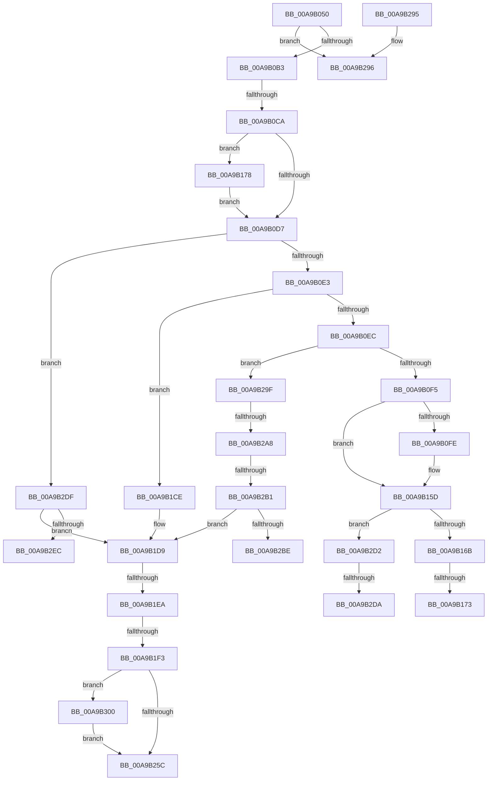

# PopFanWorker

- RVA: `0x00A9B050`–`0x00A9B30D` (길이 `701` bytes)
- VA: `0x0000000140A9B050`
- 실행 섹션: `PAGE`
- PDB 이름 있음: `예`; PDB Function 태그: `예`
- unwind 정보 RVA: `0x000BA368`
- 디코드: `161`개 명령, `701/701` bytes 표시
- 미해석 바이트: `0` (있으면 어셈블리에 `.byte`로 보존)

> 이 문서는 커널 이미지의 기계어와 PDB 기호를 분석해 생성했습니다. 4번과 5번은 함수 원형과 자료형을 바이너리 사용 방식에서 추정한 C 해석이며 원본 소스 복구 결과는 아닙니다.

## 1. Dependencies

- 직접 호출 지점: **9**; 고유 호출 대상: **8**
- 직접 호출자로 확인된 함수: **0**
- RIP 상대 이미지 참조: **7**

### Outgoing calls
- `0x00A9B0A2` → [PopAcquireRwLockExclusive](../../text/43/PopAcquireRwLockExclusive_function_00430B44.md) (function, `0x00430B44`)
- `0x00A9B158` → [tlgWriteTransfer_EtwWriteTransfer](../../text/42/tlgWriteTransfer_EtwWriteTransfer_function_004260E0.md) (function, `0x004260E0`)
- `0x00A9B1BD` → [tlgWriteTransfer_EtwWriteTransfer](../../text/42/tlgWriteTransfer_EtwWriteTransfer_function_004260E0.md) (function, `0x004260E0`)
- `0x00A9B1D1` → [PopFanSetupRpmBuckets](PopFanSetupRpmBuckets_function_00A9B314.md) (function, `0x00A9B314`)
- `0x00A9B1FF` → [IoReuseIrp](../../text/24/IoReuseIrp_function_0024DD70.md) (function, `0x0024DD70`)
- `0x00A9B24E` → [IofCallDriver](../../text/29/IofCallDriver_function_0029B4B0.md) (function, `0x0029B4B0`)
- `0x00A9B263` → [PopReleaseRwLock](../../text/2D/PopReleaseRwLock_function_002DFBBC.md) (function, `0x002DFBBC`)
- `0x00A9B26F` → [_security_check_cookie](../../text/6A/_security_check_cookie_function_006AC640.md) (function, `0x006AC640`)
- `0x00A9B303` → [PopFanUpdateRunningState](../AD/PopFanUpdateRunningState_function_00AD2440.md) (function, `0x00AD2440`)

### Direct callers
- 이 함수 시작 RVA로 연결되는 직접 call은 확인되지 않았습니다. 간접 호출은 완전히 역산할 수 없습니다.

### Static image references
- `0x00A9B073` → RVA `0x00E0A740` (`.data`; read)
- `0x00A9B0BB` → RVA `0x00E07748` (`.data`; read)
- `0x00A9B10A` → RVA `0x0004E850` (`.rdata`; read)
- `0x00A9B184` → RVA `0x0004E7C1` (`.rdata`; read)
- `0x00A9B230` → RVA `0x004D2330` (`PopFanIrpComplete`; read)
- `0x00A9B2C6` → RVA `0x0004E62E` (`.rdata`; read)
- `0x00A9B2F4` → RVA `0x0004E7FF` (`.rdata`; read)

## 2. Other-region calls and transfers

- 다른 실행 섹션으로 향하는 call: **7**
  - `0x00A9B0A2` → [PopAcquireRwLockExclusive](../../text/43/PopAcquireRwLockExclusive_function_00430B44.md) (`PAGE` → `.text`)
  - `0x00A9B158` → [tlgWriteTransfer_EtwWriteTransfer](../../text/42/tlgWriteTransfer_EtwWriteTransfer_function_004260E0.md) (`PAGE` → `.text`)
  - `0x00A9B1BD` → [tlgWriteTransfer_EtwWriteTransfer](../../text/42/tlgWriteTransfer_EtwWriteTransfer_function_004260E0.md) (`PAGE` → `.text`)
  - `0x00A9B1FF` → [IoReuseIrp](../../text/24/IoReuseIrp_function_0024DD70.md) (`PAGE` → `.text`)
  - `0x00A9B24E` → [IofCallDriver](../../text/29/IofCallDriver_function_0029B4B0.md) (`PAGE` → `.text`)
  - `0x00A9B263` → [PopReleaseRwLock](../../text/2D/PopReleaseRwLock_function_002DFBBC.md) (`PAGE` → `.text`)
  - `0x00A9B26F` → [_security_check_cookie](../../text/6A/_security_check_cookie_function_006AC640.md) (`PAGE` → `.text`)
- call이 아닌 외부 분기/꼬리 이동: **12**
  - `0x00A9B0C4` → [sub_00B48194 + 0x10B](../B4/Unknown_function_00B48194.md) (`tail-transfer`)
  - `0x00A9B16D` → [sub_00B48194 + 0xE7](../B4/Unknown_function_00B48194.md) (`tail-transfer`)
  - `0x00A9B173` → [sub_00B48194 + 0xF0](../B4/Unknown_function_00B48194.md) (`tail-transfer`)
  - `0x00A9B1E4` → [sub_00B48194 + 0x202](../B4/Unknown_function_00B48194.md) (`tail-transfer`)
  - `0x00A9B1ED` → [sub_00B48194 + 0x259](../B4/Unknown_function_00B48194.md) (`tail-transfer`)
  - `0x00A9B29A` → [sub_00B48194](../B4/Unknown_function_00B48194.md) (`tail-transfer`)
  - `0x00A9B2A2` → [sub_00B48194 + 0x6F](../B4/Unknown_function_00B48194.md) (`tail-transfer`)
  - `0x00A9B2AB` → [sub_00B48194 + 0x22](../B4/Unknown_function_00B48194.md) (`tail-transfer`)
  - `0x00A9B2CD` → [sub_00B48194 + 0x3E](../B4/Unknown_function_00B48194.md) (`tail-transfer`)
  - `0x00A9B2D4` → [sub_00B48194 + 0xF0](../B4/Unknown_function_00B48194.md) (`tail-transfer`)
  - `0x00A9B2DA` → [sub_00B48194 + 0xE7](../B4/Unknown_function_00B48194.md) (`tail-transfer`)
  - `0x00A9B2FB` → [sub_00B48194 + 0x3E](../B4/Unknown_function_00B48194.md) (`tail-transfer`)

## 3. Assembly (complete function range)

```asm
00A9B050  48 8B C4                        mov rax, rsp
00A9B053  48 89 58 10                     mov qword ptr [rax + 0x10], rbx
00A9B057  48 89 70 18                     mov qword ptr [rax + 0x18], rsi
00A9B05B  48 89 78 20                     mov qword ptr [rax + 0x20], rdi
00A9B05F  55                              push rbp
00A9B060  41 54                           push r12
00A9B062  41 55                           push r13
00A9B064  41 56                           push r14
00A9B066  41 57                           push r15
00A9B068  48 8D 68 A1                     lea rbp, [rax - 0x5f]
00A9B06C  48 81 EC B0 00 00 00            sub rsp, 0xb0
00A9B073  48 8B 05 C6 F6 36 00            mov rax, qword ptr [rip + 0x36f6c6]
00A9B07A  48 33 C4                        xor rax, rsp
00A9B07D  48 89 45 27                     mov qword ptr [rbp + 0x27], rax
00A9B081  48 8B 41 30                     mov rax, qword ptr [rcx + 0x30]
00A9B085  33 DB                           xor ebx, ebx
00A9B087  4C 8B 69 38                     mov r13, qword ptr [rcx + 0x38]
00A9B08B  48 8B F9                        mov rdi, rcx
00A9B08E  48 81 C1 90 01 00 00            add rcx, 0x190
00A9B095  48 89 45 CF                     mov qword ptr [rbp - 0x31], rax
00A9B099  40 8A F3                        mov sil, bl
00A9B09C  44 8A FB                        mov r15b, bl
00A9B09F  44 8A E3                        mov r12b, bl
00A9B0A2  E8 9D 5A 99 FF                  call 0x140430b44
00A9B0A7  38 9F B8 01 00 00               cmp byte ptr [rdi + 0x1b8], bl
00A9B0AD  0F 85 E3 01 00 00               jne 0x140a9b296
00A9B0B3  41 8B 45 30                     mov eax, dword ptr [r13 + 0x30]
00A9B0B7  44 8D 73 04                     lea r14d, [rbx + 4]
00A9B0BB  4C 8D 15 86 C6 36 00            lea r10, [rip + 0x36c686]
00A9B0C2  85 C0                           test eax, eax
00A9B0C4  0F 88 D5 D1 0A 00               js 0x140b4829f
00A9B0CA  83 3D 77 C6 36 00 05            cmp dword ptr [rip + 0x36c677], 5
00A9B0D1  0F 87 A1 00 00 00               ja 0x140a9b178
00A9B0D7  0F B6 4F 40                     movzx ecx, byte ptr [rdi + 0x40]
00A9B0DB  85 C9                           test ecx, ecx
00A9B0DD  0F 84 FC 01 00 00               je 0x140a9b2df
00A9B0E3  83 E9 01                        sub ecx, 1
00A9B0E6  0F 84 E2 00 00 00               je 0x140a9b1ce
00A9B0EC  83 E9 01                        sub ecx, 1
00A9B0EF  0F 85 AA 01 00 00               jne 0x140a9b29f
00A9B0F5  83 3D 4C C6 36 00 05            cmp dword ptr [rip + 0x36c64c], 5
00A9B0FC  76 5F                           jbe 0x140a9b15d
00A9B0FE  48 8D 45 BF                     lea rax, [rbp - 0x41]
00A9B102  48 89 7D BF                     mov qword ptr [rbp - 0x41], rdi
00A9B106  48 89 45 F7                     mov qword ptr [rbp - 9], rax
00A9B10A  48 8D 15 3F 37 5B FF            lea rdx, [rip - 0xa4c8c1]
00A9B111  0F B6 47 48                     movzx eax, byte ptr [rdi + 0x48]
00A9B115  45 33 C9                        xor r9d, r9d
00A9B118  89 45 B7                        mov dword ptr [rbp - 0x49], eax
00A9B11B  45 33 C0                        xor r8d, r8d
00A9B11E  48 8D 45 B7                     lea rax, [rbp - 0x49]
00A9B122  48 C7 45 FF 08 00 00 00         mov qword ptr [rbp - 1], 8
00A9B12A  48 89 45 07                     mov qword ptr [rbp + 7], rax
00A9B12E  49 8B CA                        mov rcx, r10
00A9B131  8B 47 4C                        mov eax, dword ptr [rdi + 0x4c]
00A9B134  89 45 C7                        mov dword ptr [rbp - 0x39], eax
00A9B137  48 8D 45 C7                     lea rax, [rbp - 0x39]
00A9B13B  48 89 45 17                     mov qword ptr [rbp + 0x17], rax
00A9B13F  48 8D 45 D7                     lea rax, [rbp - 0x29]
00A9B143  48 89 44 24 28                  mov qword ptr [rsp + 0x28], rax
00A9B148  C7 44 24 20 05 00 00 00         mov dword ptr [rsp + 0x20], 5
00A9B150  4C 89 75 0F                     mov qword ptr [rbp + 0xf], r14
00A9B154  4C 89 75 1F                     mov qword ptr [rbp + 0x1f], r14
00A9B158  E8 83 AF 98 FF                  call 0x1404260e0
00A9B15D  8A 47 48                        mov al, byte ptr [rdi + 0x48]
00A9B160  8A C8                           mov cl, al
00A9B162  38 5F 50                        cmp byte ptr [rdi + 0x50], bl
00A9B165  0F 84 67 01 00 00               je 0x140a9b2d2
00A9B16B  84 C0                           test al, al
00A9B16D  0F 84 08 D1 0A 00               je 0x140b4827b
00A9B173  E9 0C D1 0A 00                  jmp 0x140b48284
00A9B178  48 8D 45 B7                     lea rax, [rbp - 0x49]
00A9B17C  48 89 7D B7                     mov qword ptr [rbp - 0x49], rdi
00A9B180  48 89 45 F7                     mov qword ptr [rbp - 9], rax
00A9B184  48 8D 15 36 36 5B FF            lea rdx, [rip - 0xa4c9ca]
00A9B18B  0F B6 47 40                     movzx eax, byte ptr [rdi + 0x40]
00A9B18F  45 33 C9                        xor r9d, r9d
00A9B192  89 45 C7                        mov dword ptr [rbp - 0x39], eax
00A9B195  45 33 C0                        xor r8d, r8d
00A9B198  48 8D 45 C7                     lea rax, [rbp - 0x39]
00A9B19C  48 C7 45 FF 08 00 00 00         mov qword ptr [rbp - 1], 8
00A9B1A4  48 89 45 07                     mov qword ptr [rbp + 7], rax
00A9B1A8  49 8B CA                        mov rcx, r10
00A9B1AB  48 8D 45 D7                     lea rax, [rbp - 0x29]
00A9B1AF  4C 89 75 0F                     mov qword ptr [rbp + 0xf], r14
00A9B1B3  48 89 44 24 28                  mov qword ptr [rsp + 0x28], rax
00A9B1B8  44 89 74 24 20                  mov dword ptr [rsp + 0x20], r14d
00A9B1BD  E8 1E AF 98 FF                  call 0x1404260e0
00A9B1C2  4C 8D 15 7F C5 36 00            lea r10, [rip + 0x36c57f]
00A9B1C9  E9 09 FF FF FF                  jmp 0x140a9b0d7
00A9B1CE  48 8B CF                        mov rcx, rdi
00A9B1D1  E8 3E 01 00 00                  call 0x140a9b314
00A9B1D6  40 B6 02                        mov sil, 2
00A9B1D9  83 3D 68 C5 36 00 05            cmp dword ptr [rip + 0x36c568], 5
00A9B1E0  40 0F B6 DE                     movzx ebx, sil
00A9B1E4  0F 87 AC D1 0A 00               ja 0x140b48396
00A9B1EA  83 EB 01                        sub ebx, 1
00A9B1ED  0F 85 FA D1 0A 00               jne 0x140b483ed
00A9B1F3  48 8B 5F 38                     mov rbx, qword ptr [rdi + 0x38]
00A9B1F7  BA BB 00 00 C0                  mov edx, 0xc00000bb
00A9B1FC  48 8B CB                        mov rcx, rbx
00A9B1FF  E8 6C 2B 7B FF                  call 0x14024dd70
00A9B204  48 8B 83 B8 00 00 00            mov rax, qword ptr [rbx + 0xb8]
00A9B20B  C6 40 B8 0F                     mov byte ptr [rax - 0x48], 0xf
00A9B20F  83 60 C8 00                     and dword ptr [rax - 0x38], 0
00A9B213  C7 40 D0 44 42 29 00            mov dword ptr [rax - 0x30], 0x294244
00A9B21A  C7 40 C0 14 00 00 00            mov dword ptr [rax - 0x40], 0x14
00A9B221  48 8D 47 6C                     lea rax, [rdi + 0x6c]
00A9B225  48 89 43 18                     mov qword ptr [rbx + 0x18], rax
00A9B229  49 8B 85 B8 00 00 00            mov rax, qword ptr [r13 + 0xb8]
00A9B230  48 8D 0D F9 70 A3 FF            lea rcx, [rip - 0x5c8f07]
00A9B237  49 8B D5                        mov rdx, r13
00A9B23A  48 89 48 F0                     mov qword ptr [rax - 0x10], rcx
00A9B23E  48 8B 4D CF                     mov rcx, qword ptr [rbp - 0x31]
00A9B242  48 89 78 F8                     mov qword ptr [rax - 8], rdi
00A9B246  C6 40 BB E0                     mov byte ptr [rax - 0x45], 0xe0
00A9B24A  40 88 77 40                     mov byte ptr [rdi + 0x40], sil
00A9B24E  E8 5D 02 80 FF                  call 0x14029b4b0
00A9B253  45 84 E4                        test r12b, r12b
00A9B256  0F 85 A4 00 00 00               jne 0x140a9b300
00A9B25C  48 8D 8F 90 01 00 00            lea rcx, [rdi + 0x190]
00A9B263  E8 54 49 84 FF                  call 0x1402dfbbc
00A9B268  48 8B 4D 27                     mov rcx, qword ptr [rbp + 0x27]
00A9B26C  48 33 CC                        xor rcx, rsp
00A9B26F  E8 CC 13 C1 FF                  call 0x1406ac640
00A9B274  4C 8D 9C 24 B0 00 00 00         lea r11, [rsp + 0xb0]
00A9B27C  49 8B 5B 38                     mov rbx, qword ptr [r11 + 0x38]
00A9B280  49 8B 73 40                     mov rsi, qword ptr [r11 + 0x40]
00A9B284  49 8B 7B 48                     mov rdi, qword ptr [r11 + 0x48]
00A9B288  49 8B E3                        mov rsp, r11
00A9B28B  41 5F                           pop r15
00A9B28D  41 5E                           pop r14
00A9B28F  41 5D                           pop r13
00A9B291  41 5C                           pop r12
00A9B293  5D                              pop rbp
00A9B294  C3                              ret
00A9B295  CC                              int3
00A9B296  C6 47 40 04                     mov byte ptr [rdi + 0x40], 4
00A9B29A  E9 F5 CE 0A 00                  jmp 0x140b48194
00A9B29F  83 E9 01                        sub ecx, 1
00A9B2A2  0F 84 5B CF 0A 00               je 0x140b48203
00A9B2A8  83 F9 01                        cmp ecx, 1
00A9B2AB  0F 84 05 CF 0A 00               je 0x140b481b6
00A9B2B1  83 3D 90 C4 36 00 02            cmp dword ptr [rip + 0x36c490], 2
00A9B2B8  0F 86 1B FF FF FF               jbe 0x140a9b1d9
00A9B2BE  48 89 7D B7                     mov qword ptr [rbp - 0x49], rdi
00A9B2C2  48 8D 45 B7                     lea rax, [rbp - 0x49]
00A9B2C6  48 8D 15 61 33 5B FF            lea rdx, [rip - 0xa4cc9f]
00A9B2CD  E9 00 CF 0A 00                  jmp 0x140b481d2
00A9B2D2  84 C0                           test al, al
00A9B2D4  0F 84 AA CF 0A 00               je 0x140b48284
00A9B2DA  E9 9C CF 0A 00                  jmp 0x140b4827b
00A9B2DF  83 3D 62 C4 36 00 02            cmp dword ptr [rip + 0x36c462], 2
00A9B2E6  0F 86 ED FE FF FF               jbe 0x140a9b1d9
00A9B2EC  48 89 7D BF                     mov qword ptr [rbp - 0x41], rdi
00A9B2F0  48 8D 45 BF                     lea rax, [rbp - 0x41]
00A9B2F4  48 8D 15 04 35 5B FF            lea rdx, [rip - 0xa4cafc]
00A9B2FB  E9 D2 CE 0A 00                  jmp 0x140b481d2
00A9B300  41 8A CF                        mov cl, r15b
00A9B303  E8 38 71 03 00                  call 0x140ad2440
00A9B308  E9 4F FF FF FF                  jmp 0x140a9b25c
```

## 4. C-style interpretation (structured pseudocode)

```c
__int64 __fastcall PopFanWorker(__int64 a1, __int64 a2, int a3, int a4)
{
    __int64 result;
    __int64 v_rbx;
    __int64 v_rsp;
    unsigned __int64 v_stack_m28;
    unsigned __int64 v_stack_mB0;
    unsigned int v_stack_mB8;

    *(unsigned __int64 *)(v_rsp + 16) = v_rbx;
    *(unsigned __int64 *)(v_rsp + 24) = v_rsi;
    *(unsigned __int64 *)(v_rsp + 32) = v_rdi;
    v_rsp = (v_rsp) - (176);
    result = (*(unsigned __int64 *)(v_rip + 3602118)) ^ (v_rsp);
    *(unsigned __int64 *)(v_rsp - 95 + 39) = result;
    v_rbx = 0;
    a1 = (a1) + (400);
    *(unsigned __int64 *)(v_rsp - 95 - 49) = *(unsigned __int64 *)(a1 + 48);
    result = PopAcquireRwLockExclusive(a1, a2, a3, a4);
    if ((*(unsigned __int8 *)(a1 + 440)) != 0) goto loc_00A9B296;
    if ((*(unsigned int *)(v_rip + 3589751)) > 5) goto loc_00A9B178;
loc_00A9B0D7:
    if ((unsigned int)(*(unsigned __int8 *)(a1 + 64)) == 0) goto loc_00A9B2DF;
    a1 = (unsigned int)((*(unsigned __int8 *)(a1 + 64)) - (1));
    if (condition_is_equal) goto loc_00A9B1CE;
    a1 = (unsigned int)((a1) - (1));
    if (condition_is_not_equal) goto loc_00A9B29F;
    result = (unsigned int)(*(unsigned int *)(*(unsigned __int64 *)(a1 + 56) + 48));
    if ((*(unsigned int *)(v_rip + 3589708)) >= = 5) {
        result = v_rsp - 95 - 65;
        *(unsigned __int64 *)(v_rsp - 95 - 65) = a1;
        *(unsigned __int64 *)(v_rsp - 95 - 9) = result;
        a2 = v_rip - 10799297;
        result = *(unsigned __int8 *)(a1 + 72);
        a4 = 0;
        *(unsigned int *)(v_rsp - 95 - 73) = (unsigned int)(result);
        a3 = 0;
        result = v_rsp - 95 - 73;
        *(unsigned __int64 *)(v_rsp - 95 - 1) = 8;
        *(unsigned __int64 *)(v_rsp - 95 + 7) = result;
        a1 = v_rip + 3589766;
        result = *(unsigned int *)(a1 + 76);
        *(unsigned int *)(v_rsp - 95 - 57) = (unsigned int)(result);
        result = v_rsp - 95 - 57;
        *(unsigned __int64 *)(v_rsp - 95 + 23) = result;
        result = v_rsp - 95 - 41;
        v_stack_mB0 = result;
        v_stack_mB8 = 5;
        *(unsigned __int64 *)(v_rsp - 95 + 15) = v_rbx + 4;
        *(unsigned __int64 *)(v_rsp - 95 + 31) = v_rbx + 4;
        result = tlgWriteTransfer_EtwWriteTransfer(a1, a2, a3, a4);
    }
    if ((*(unsigned __int8 *)(a1 + 80)) == 0) goto loc_00A9B2D2;
loc_00A9B178:
    *(unsigned __int64 *)(v_rsp - 95 - 73) = a1;
    *(unsigned __int64 *)(v_rsp - 95 - 9) = v_rsp - 95 - 73;
    a4 = 0;
    *(unsigned int *)(v_rsp - 95 - 57) = (unsigned int)(*(unsigned __int8 *)(a1 + 64));
    a3 = 0;
    *(unsigned __int64 *)(v_rsp - 95 - 1) = 8;
    *(unsigned __int64 *)(v_rsp - 95 + 7) = v_rsp - 95 - 57;
    *(unsigned __int64 *)(v_rsp - 95 + 15) = v_rbx + 4;
    v_stack_mB0 = v_rsp - 95 - 41;
    v_stack_mB8 = (unsigned int)(v_rbx + 4);
    result = tlgWriteTransfer_EtwWriteTransfer(v_rip + 3589766, v_rip - 10799562, a3, a4);
    goto loc_00A9B0D7;
loc_00A9B1CE:
    result = PopFanSetupRpmBuckets(a1, v_rip - 10799562, a3, a4);
loc_00A9B1D9:
    v_rbx = (unsigned int)((2) - (1));
    result = IoReuseIrp(*(unsigned __int64 *)(a1 + 56), (unsigned int)(0xC00000BBULL), a3, a4);
    *(unsigned __int8 *)(*(unsigned __int64 *)(*(unsigned __int64 *)(a1 + 56) + 184) - 72) = 15;
    *(unsigned int *)(*(unsigned __int64 *)(*(unsigned __int64 *)(a1 + 56) + 184) - 48) = 0x294244ULL;
    *(unsigned int *)(*(unsigned __int64 *)(*(unsigned __int64 *)(a1 + 56) + 184) - 64) = 20;
    *(unsigned __int64 *)(*(unsigned __int64 *)(a1 + 56) + 24) = a1 + 108;
    *(unsigned __int64 *)(*(unsigned __int64 *)(*(unsigned __int64 *)(a1 + 56) + 184) - 16) = v_rip - 6065927;
    *(unsigned __int64 *)(*(unsigned __int64 *)(*(unsigned __int64 *)(a1 + 56) + 184) - 8) = a1;
    *(unsigned __int8 *)(*(unsigned __int64 *)(*(unsigned __int64 *)(a1 + 56) + 184) - 69) = 224;
    *(unsigned __int8 *)(a1 + 64) = 2;
    result = IofCallDriver(*(unsigned __int64 *)(v_rsp - 95 - 49), *(unsigned __int64 *)(a1 + 56), a3, a4);
    if (0 != 0) goto loc_00A9B300;
loc_00A9B25C:
    result = PopReleaseRwLock(a1 + 400, *(unsigned __int64 *)(a1 + 56), a3, a4);
    a1 = (*(unsigned __int64 *)(v_rsp - 95 + 39)) ^ (v_rsp);
    result = _security_check_cookie(a1, *(unsigned __int64 *)(a1 + 56), a3, a4);
    return result;
loc_00A9B296:
    *(unsigned __int8 *)(*(unsigned __int64 *)(v_stack_m28 + 72) + 64) = 4;
loc_00A9B29F:
    a1 = (unsigned int)((a1) - (1));
    if ((*(unsigned int *)(v_rip + 3589264)) <= 2) goto loc_00A9B1D9;
    *(unsigned __int64 *)(v_rsp - 95 - 73) = *(unsigned __int64 *)(v_stack_m28 + 72);
loc_00A9B2D2:
loc_00A9B2DF:
    if ((*(unsigned int *)(v_rip + 3589218)) <= 2) goto loc_00A9B1D9;
    *(unsigned __int64 *)(v_rsp - 95 - 65) = *(unsigned __int64 *)(v_stack_m28 + 72);
loc_00A9B300:
    result = PopFanUpdateRunningState(0, v_rip - 10799868, a3, a4);
    goto loc_00A9B25C;
}
```

## 5. (Beta) C Style

```c
int64_t PopFanWorker(void *Arg1, int64_t Arg2, int32_t Arg3, int32_t Arg4)
{
    uint8_t *arg1 = (uint8_t *)Arg1;

    int64_t result;
    int64_t local_rbx;
    int64_t local_rsp;
    uint64_t v_stack_m28;
    uint64_t v_stack_mB0;
    uint32_t v_stack_mB8;

    *(uint64_t *)(local_rsp + 0x10) = local_rbx;
    *(uint64_t *)(local_rsp + 0x18) = local_rsi;
    *(uint64_t *)(local_rsp + 0x20) = local_rdi;
    local_rsp = (local_rsp) - (176);
    result = (*(uint64_t *)(v_rip + 0x36F6C6)) ^ (local_rsp);
    *(uint64_t *)(local_rsp - 0x5F + 0x27) = result;
    local_rbx = 0;
    Arg1 = (Arg1) + (400);
    *(uint64_t *)(local_rsp - 0x5F - 0x31) = *(uint64_t *)(arg1 + 0x30);
    result = PopAcquireRwLockExclusive(Arg1, Arg2, Arg3, Arg4);
    if ((*(uint8_t *)(arg1 + 0x1B8)) != 0) goto loc_00A9B296;
    if ((*(uint32_t *)(v_rip + 0x36C677)) > 5) goto loc_00A9B178;
loc_00A9B0D7:
    if ((uint32_t)(*(uint8_t *)(arg1 + 0x40)) == 0) goto loc_00A9B2DF;
    Arg1 = (uint32_t)((*(uint8_t *)(arg1 + 0x40)) - (1));
    if (condition_is_equal) goto loc_00A9B1CE;
    Arg1 = (uint32_t)((Arg1) - (1));
    if (condition_is_not_equal) goto loc_00A9B29F;
    result = (uint32_t)(*(uint32_t *)(*(uint64_t *)(arg1 + 0x38) + 0x30));
    if ((*(uint32_t *)(v_rip + 0x36C64C)) >= = 5) {
        result = local_rsp - 95 - 65;
        *(void **)(local_rsp - 0x5F - 0x41) = Arg1;
        *(uint64_t *)(local_rsp - 0x5F - 0x9) = result;
        Arg2 = v_rip - 10799297;
        result = *(uint8_t *)(arg1 + 0x48);
        Arg4 = 0;
        *(uint32_t *)(local_rsp - 0x5F - 0x49) = (uint32_t)(result);
        Arg3 = 0;
        result = local_rsp - 95 - 73;
        *(uint64_t *)(local_rsp - 0x5F - 0x1) = 8;
        *(uint64_t *)(local_rsp - 0x5F + 0x7) = result;
        Arg1 = v_rip + 3589766;
        result = *(uint32_t *)(arg1 + 0x4C);
        *(uint32_t *)(local_rsp - 0x5F - 0x39) = (uint32_t)(result);
        result = local_rsp - 95 - 57;
        *(uint64_t *)(local_rsp - 0x5F + 0x17) = result;
        result = local_rsp - 95 - 41;
        v_stack_mB0 = result;
        v_stack_mB8 = 5;
        *(uint64_t *)(local_rsp - 0x5F + 0xF) = local_rbx + 4;
        *(uint64_t *)(local_rsp - 0x5F + 0x1F) = local_rbx + 4;
        result = tlgWriteTransfer_EtwWriteTransfer(Arg1, Arg2, Arg3, Arg4);
    }
    if ((*(uint8_t *)(arg1 + 0x50)) == 0) goto loc_00A9B2D2;
loc_00A9B178:
    *(void **)(local_rsp - 0x5F - 0x49) = Arg1;
    *(uint64_t *)(local_rsp - 0x5F - 0x9) = local_rsp - 95 - 73;
    Arg4 = 0;
    *(uint32_t *)(local_rsp - 0x5F - 0x39) = (uint32_t)(*(uint8_t *)(arg1 + 0x40));
    Arg3 = 0;
    *(uint64_t *)(local_rsp - 0x5F - 0x1) = 8;
    *(uint64_t *)(local_rsp - 0x5F + 0x7) = local_rsp - 95 - 57;
    *(uint64_t *)(local_rsp - 0x5F + 0xF) = local_rbx + 4;
    v_stack_mB0 = local_rsp - 95 - 41;
    v_stack_mB8 = (uint32_t)(local_rbx + 4);
    result = tlgWriteTransfer_EtwWriteTransfer(v_rip + 3589766, v_rip - 10799562, Arg3, Arg4);
    goto loc_00A9B0D7;
loc_00A9B1CE:
    result = PopFanSetupRpmBuckets(Arg1, v_rip - 10799562, Arg3, Arg4);
loc_00A9B1D9:
    local_rbx = (uint32_t)((2) - (1));
    result = IoReuseIrp(*(uint64_t *)(arg1 + 0x38), (uint32_t)(0xC00000BBULL), Arg3, Arg4);
    *(uint8_t *)(*(uint64_t *)(*(uint64_t *)(arg1 + 0x38) + 0xB8) - 0x48) = 15;
    *(uint32_t *)(*(uint64_t *)(*(uint64_t *)(arg1 + 0x38) + 0xB8) - 0x30) = 0x294244ULL;
    *(uint32_t *)(*(uint64_t *)(*(uint64_t *)(arg1 + 0x38) + 0xB8) - 0x40) = 20;
    *(void **)(*(uint64_t *)(arg1 + 0x38) + 0x18) = Arg1 + 108;
    *(uint64_t *)(*(uint64_t *)(*(uint64_t *)(arg1 + 0x38) + 0xB8) - 0x10) = v_rip - 6065927;
    *(void **)(*(uint64_t *)(*(uint64_t *)(arg1 + 0x38) + 0xB8) - 0x8) = Arg1;
    *(uint8_t *)(*(uint64_t *)(*(uint64_t *)(arg1 + 0x38) + 0xB8) - 0x45) = 224;
    *(uint8_t *)(arg1 + 0x40) = 2;
    result = IofCallDriver(*(uint64_t *)(local_rsp - 0x5F - 0x31), *(uint64_t *)(arg1 + 0x38), Arg3, Arg4);
    if (0 != 0) goto loc_00A9B300;
loc_00A9B25C:
    result = PopReleaseRwLock(Arg1 + 400, *(uint64_t *)(arg1 + 0x38), Arg3, Arg4);
    Arg1 = (*(uint64_t *)(local_rsp - 0x5F + 0x27)) ^ (local_rsp);
    result = _security_check_cookie(Arg1, *(uint64_t *)(arg1 + 0x38), Arg3, Arg4);
    return result;
loc_00A9B296:
    *(uint8_t *)(*(uint64_t *)(v_stack_m28 + 0x48) + 0x40) = 4;
loc_00A9B29F:
    Arg1 = (uint32_t)((Arg1) - (1));
    if ((*(uint32_t *)(v_rip + 0x36C490)) <= 2) goto loc_00A9B1D9;
    *(uint64_t *)(local_rsp - 0x5F - 0x49) = *(uint64_t *)(v_stack_m28 + 0x48);
loc_00A9B2D2:
loc_00A9B2DF:
    if ((*(uint32_t *)(v_rip + 0x36C462)) <= 2) goto loc_00A9B1D9;
    *(uint64_t *)(local_rsp - 0x5F - 0x41) = *(uint64_t *)(v_stack_m28 + 0x48);
loc_00A9B300:
    result = PopFanUpdateRunningState(0, v_rip - 10799868, Arg3, Arg4);
    goto loc_00A9B25C;
}
```

### 관측된 메모리 오프셋

구조체 형식이 확인되지 않은 접근은 인자 기준의 오프셋으로만 기록했습니다.

| 기준 인자 | 오프셋 표현 | 폭 (bit) | 접근 |
|---|---:|---:|---|
| `Arg1` | `+ 0x30` | `64` | `R` |
| `Arg1` | `+ 0x38` | `64` | `R` |
| `Arg1` | `+ 0x40` | `8` | `R` |
| `Arg1` | `+ 0x40` | `8` | `W` |
| `Arg1` | `+ 0x48` | `8` | `R` |
| `Arg1` | `+ 0x4C` | `32` | `R` |
| `Arg1` | `+ 0x50` | `8` | `R` |
| `Arg1` | `+ 0x6C` | `64` | `R` |
| `Arg1` | `+ 0x190` | `64` | `R` |
| `Arg1` | `+ 0x1B8` | `8` | `R` |

## 6. Execution-region graph

[열기: 2D/3D 그래프와 함수 탐색 컨트롤 패널](../../../control-panel.html?section=page&rva=0x00A9B050&view=graph)

- 2D 그래프는 위에서 아래로 흐르고, 3D 그래프는 빈 공간을 드래그해 회전합니다. Shift+드래그는 이동, 휠은 확대·축소, 함수 노드 선택은 대상 보고서 이동입니다.

### Static fallback


