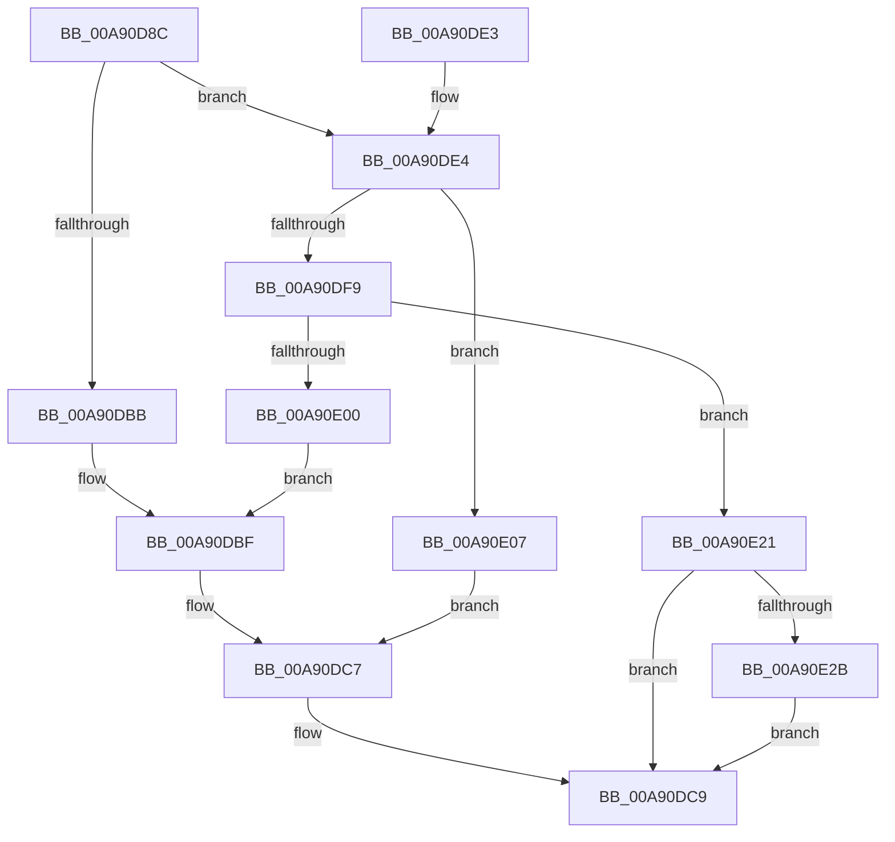

# PopFxFindDeviceAndAllocateUniqueId

- RVA: `0x00A90D8C`–`0x00A90E37` (길이 `171` bytes)
- VA: `0x0000000140A90D8C`
- 실행 섹션: `PAGE`
- PDB 이름 있음: `예`; PDB Function 태그: `아니요`
- unwind 정보 RVA: `0x000B8FA4`
- 디코드: `46`개 명령, `171/171` bytes 표시
- 미해석 바이트: `0` (있으면 어셈블리에 `.byte`로 보존)

> 이 문서는 커널 이미지의 기계어와 PDB 기호를 분석해 생성했습니다. 4번과 5번은 함수 원형과 자료형을 바이너리 사용 방식에서 추정한 C 해석이며 원본 소스 복구 결과는 아닙니다.

## 1. Dependencies

- 직접 호출 지점: **3**; 고유 호출 대상: **3**
- 직접 호출자로 확인된 함수: **1**
- RIP 상대 이미지 참조: **0**

### Outgoing calls
- `0x00A90DB2` → [PopFxQueryBiosDeviceName](../../text/4B/PopFxQueryBiosDeviceName_function_004B035C.md) (function, `0x004B035C`)
- `0x00A90DEE` → [PopFxFindAcpiDeviceByUniqueId](../../text/4C/PopFxFindAcpiDeviceByUniqueId_function_004C5C30.md) (function, `0x004C5C30`)
- `0x00A90E30` → [ExFreePoolWithTag](../../poolcode/B8/ExFreePoolWithTag_function_00B82870.md) (function, `0x00B82870`)

### Direct callers
- [PoFxPrepareDevice](../../text/49/PoFxPrepareDevice_function_00499F0C.md) at `0x00499F7E`

### Static image references
- 디코드된 RIP-relative 메모리 참조가 없습니다.

## 2. Other-region calls and transfers

- 다른 실행 섹션으로 향하는 call: **3**
  - `0x00A90DB2` → [PopFxQueryBiosDeviceName](../../text/4B/PopFxQueryBiosDeviceName_function_004B035C.md) (`PAGE` → `.text`)
  - `0x00A90DEE` → [PopFxFindAcpiDeviceByUniqueId](../../text/4C/PopFxFindAcpiDeviceByUniqueId_function_004C5C30.md) (`PAGE` → `.text`)
  - `0x00A90E30` → [ExFreePoolWithTag](../../poolcode/B8/ExFreePoolWithTag_function_00B82870.md) (`PAGE` → `POOLCODE`)
- 별도 외부 분기/꼬리 이동을 확인하지 못했습니다.

## 3. Assembly (complete function range)

```asm
00A90D8C  48 8B C4                        mov rax, rsp
00A90D8F  48 89 58 08                     mov qword ptr [rax + 8], rbx
00A90D93  48 89 70 18                     mov qword ptr [rax + 0x18], rsi
00A90D97  57                              push rdi
00A90D98  48 83 EC 30                     sub rsp, 0x30
00A90D9C  48 83 60 10 00                  and qword ptr [rax + 0x10], 0
00A90DA1  48 8B F2                        mov rsi, rdx
00A90DA4  0F 57 C0                        xorps xmm0, xmm0
00A90DA7  48 8D 50 E8                     lea rdx, [rax - 0x18]
00A90DAB  0F 11 40 E8                     movups xmmword ptr [rax - 0x18], xmm0
00A90DAF  48 8B F9                        mov rdi, rcx
00A90DB2  E8 A5 F5 A1 FF                  call 0x1404b035c
00A90DB7  85 C0                           test eax, eax
00A90DB9  79 29                           jns 0x140a90de4
00A90DBB  0F 10 47 28                     movups xmm0, xmmword ptr [rdi + 0x28]
00A90DBF  F3 0F 7F 87 80 00 00 00         movdqu xmmword ptr [rdi + 0x80], xmm0
00A90DC7  33 DB                           xor ebx, ebx
00A90DC9  48 8B 44 24 48                  mov rax, qword ptr [rsp + 0x48]
00A90DCE  48 89 06                        mov qword ptr [rsi], rax
00A90DD1  8B C3                           mov eax, ebx
00A90DD3  48 8B 5C 24 40                  mov rbx, qword ptr [rsp + 0x40]
00A90DD8  48 8B 74 24 50                  mov rsi, qword ptr [rsp + 0x50]
00A90DDD  48 83 C4 30                     add rsp, 0x30
00A90DE1  5F                              pop rdi
00A90DE2  C3                              ret
00A90DE3  CC                              int3
00A90DE4  48 8D 54 24 48                  lea rdx, [rsp + 0x48]
00A90DE9  48 8D 4C 24 20                  lea rcx, [rsp + 0x20]
00A90DEE  E8 3D 4E A3 FF                  call 0x1404c5c30
00A90DF3  8B D8                           mov ebx, eax
00A90DF5  85 C0                           test eax, eax
00A90DF7  79 0E                           jns 0x140a90e07
00A90DF9  3D 56 00 00 C0                  cmp eax, 0xc0000056
00A90DFE  74 21                           je 0x140a90e21
00A90E00  0F 10 44 24 20                  movups xmm0, xmmword ptr [rsp + 0x20]
00A90E05  EB B8                           jmp 0x140a90dbf
00A90E07  0F 10 44 24 20                  movups xmm0, xmmword ptr [rsp + 0x20]
00A90E0C  F3 0F 7F 87 80 00 00 00         movdqu xmmword ptr [rdi + 0x80], xmm0
00A90E14  F0 81 8F 28 01 00 00 00 20 00 00  lock or dword ptr [rdi + 0x128], 0x2000
00A90E1F  EB A6                           jmp 0x140a90dc7
00A90E21  48 8B 4C 24 28                  mov rcx, qword ptr [rsp + 0x28]
00A90E26  48 85 C9                        test rcx, rcx
00A90E29  74 9E                           je 0x140a90dc9
00A90E2B  BA 50 46 58 4D                  mov edx, 0x4d584650
00A90E30  E8 3B 1A 0F 00                  call 0x140b82870
00A90E35  EB 92                           jmp 0x140a90dc9
```

## 4. C-style interpretation (structured pseudocode)

```c
__int64 __fastcall PopFxFindDeviceAndAllocateUniqueId(__int64 a1, __int64 a2)
{
    __int64 result;
    __int64 v_rbx;
    __int64 v_rsp;
    unsigned __int64 v_stack_p10;
    unsigned __int64 v_stack_p18;
    unsigned __int64 v_stack_p20;
    unsigned __int64 v_stack_p28;
    unsigned __int64 v_stack_p48;
    unsigned __int64 v_stack_p8;

    *(unsigned __int64 *)(v_rsp + 8) = v_rbx;
    *(unsigned __int64 *)(v_rsp + 24) = v_rsi;
    v_rsp = (v_rsp) - (48);
    *(unsigned __int64 *)(v_rsp - 24) = v_xmm0;
    result = PopFxQueryBiosDeviceName(a1, v_rsp - 24, a3, a4);
    if (!sign_flag) goto loc_00A90DE4;
loc_00A90DBF:
    *(unsigned __int64 *)(a1 + 128) = v_xmm0;
loc_00A90DC7:
    v_rbx = 0;
loc_00A90DC9:
    *(unsigned __int64 *)(a2) = v_stack_p10;
    v_rsp = (v_rsp) + (48);
    return 0;
loc_00A90DE4:
    result = PopFxFindAcpiDeviceByUniqueId(v_stack_p20, v_stack_p48, a3, a4);
    if (!sign_flag) goto loc_00A90E07;
    if (((unsigned int)(result)) == 0xC0000056ULL) goto loc_00A90E21;
    goto loc_00A90DBF;
loc_00A90E07:
    *(unsigned __int64 *)(a1 + 128) = v_xmm0;
    goto loc_00A90DC7;
loc_00A90E21:
    if (v_stack_p28 == 0) goto loc_00A90DC9;
    result = ExFreePoolWithTag(v_stack_p28, (unsigned int)(0x4D584650ULL), a3, a4);
    goto loc_00A90DC9;
}
```

## 5. (Beta) C Style

```c
int64_t PopFxFindDeviceAndAllocateUniqueId(void *Arg1, void *Arg2)
{
    uint8_t *arg1 = (uint8_t *)Arg1;
    uint8_t *arg2 = (uint8_t *)Arg2;

    int64_t result;
    int64_t local_rbx;
    int64_t local_rsp;
    uint64_t v_stack_p10;
    uint64_t v_stack_p18;
    uint64_t v_stack_p20;
    uint64_t v_stack_p28;
    uint64_t v_stack_p48;
    uint64_t v_stack_p8;

    *(uint64_t *)(local_rsp + 0x8) = local_rbx;
    *(uint64_t *)(local_rsp + 0x18) = local_rsi;
    local_rsp = (local_rsp) - (48);
    *(uint64_t *)(local_rsp - 0x18) = v_xmm0;
    result = PopFxQueryBiosDeviceName(Arg1, local_rsp - 24, a3, a4);
    if (!sign_flag) goto loc_00A90DE4;
loc_00A90DBF:
    *(uint64_t *)(arg1 + 0x80) = v_xmm0;
loc_00A90DC7:
    local_rbx = 0;
loc_00A90DC9:
    *(uint64_t *)(arg2) = v_stack_p10;
    local_rsp = (local_rsp) + (48);
    return 0;
loc_00A90DE4:
    result = PopFxFindAcpiDeviceByUniqueId(v_stack_p20, v_stack_p48, a3, a4);
    if (!sign_flag) goto loc_00A90E07;
    if (((uint32_t)(result)) == 0xC0000056ULL) goto loc_00A90E21;
    goto loc_00A90DBF;
loc_00A90E07:
    *(uint64_t *)(arg1 + 0x80) = v_xmm0;
    goto loc_00A90DC7;
loc_00A90E21:
    if (v_stack_p28 == 0) goto loc_00A90DC9;
    result = ExFreePoolWithTag(v_stack_p28, (uint32_t)(0x4D584650ULL), a3, a4);
    goto loc_00A90DC9;
}
```

### 관측된 메모리 오프셋

구조체 형식이 확인되지 않은 접근은 인자 기준의 오프셋으로만 기록했습니다.

| 기준 인자 | 오프셋 표현 | 폭 (bit) | 접근 |
|---|---:|---:|---|
| `Arg1` | `+ 0x28` | `128` | `R` |
| `Arg1` | `+ 0x80` | `128` | `W` |
| `Arg1` | `+ 0x128` | `32` | `R/W` |
| `Arg2` | `+ 0x0` | `64` | `W` |

## 6. Execution-region graph

[열기: 2D/3D 그래프와 함수 탐색 컨트롤 패널](../../../control-panel.html?section=page&rva=0x00A90D8C&view=graph)

- 2D 그래프는 위에서 아래로 흐르고, 3D 그래프는 빈 공간을 드래그해 회전합니다. Shift+드래그는 이동, 휠은 확대·축소, 함수 노드 선택은 대상 보고서 이동입니다.

### Static fallback


