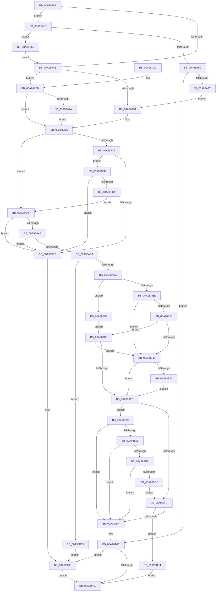

# PopGenerateDeviceFriendlyName

- RVA: `0x00A98968`–`0x00A98BEC` (길이 `644` bytes)
- VA: `0x0000000140A98968`
- 실행 섹션: `PAGE`
- PDB 이름 있음: `예`; PDB Function 태그: `아니요`
- unwind 정보 RVA: `0x000BA084`
- 디코드: `178`개 명령, `644/644` bytes 표시
- 미해석 바이트: `0` (있으면 어셈블리에 `.byte`로 보존)

> 이 문서는 커널 이미지의 기계어와 PDB 기호를 분석해 생성했습니다. 4번과 5번은 함수 원형과 자료형을 바이너리 사용 방식에서 추정한 C 해석이며 원본 소스 복구 결과는 아닙니다.

## 1. Dependencies

- 직접 호출 지점: **10**; 고유 호출 대상: **5**
- 직접 호출자로 확인된 함수: **3**
- RIP 상대 이미지 참조: **4**

### Outgoing calls
- `0x00A989DE` → [RtlUnicodeStringCat](../../text/3E/RtlUnicodeStringCat_function_003E6030.md) (function, `0x003E6030`)
- `0x00A98A07` → [ExFreePoolWithTag](../../poolcode/B8/ExFreePoolWithTag_function_00B82870.md) (function, `0x00B82870`)
- `0x00A98A7A` → [IoGetDeviceProperty](../8F/IoGetDeviceProperty_function_008FA720.md) (function, `0x008FA720`)
- `0x00A98AC7` → [ExAllocatePool2](../../poolcode/B8/ExAllocatePool2_function_00B820F0.md) (function, `0x00B820F0`)
- `0x00A98B05` → [IoGetDeviceProperty](../8F/IoGetDeviceProperty_function_008FA720.md) (function, `0x008FA720`)
- `0x00A98B29` → [RtlUnicodeStringCatString](../../text/41/RtlUnicodeStringCatString_function_0041CD30.md) (function, `0x0041CD30`)
- `0x00A98B4A` → [RtlUnicodeStringCatString](../../text/41/RtlUnicodeStringCatString_function_0041CD30.md) (function, `0x0041CD30`)
- `0x00A98BA9` → [RtlUnicodeStringCatString](../../text/41/RtlUnicodeStringCatString_function_0041CD30.md) (function, `0x0041CD30`)
- `0x00A98BBF` → [RtlUnicodeStringCat](../../text/3E/RtlUnicodeStringCat_function_003E6030.md) (function, `0x003E6030`)
- `0x00A98BD8` → [RtlUnicodeStringCatString](../../text/41/RtlUnicodeStringCatString_function_0041CD30.md) (function, `0x0041CD30`)

### Direct callers
- [PopFxRegisterDevice](../75/PopFxRegisterDevice_function_00759B80.md) at `0x00759D1C`
- [PopDirectedDripsDiagCreateDeviceDescription](../77/PopDirectedDripsDiagCreateDeviceDescription_function_00770FB4.md) at `0x00770FDF`
- [PopIdleWakeGenerateInterruptDescriptionString](PopIdleWakeGenerateInterruptDescriptionString_function_00A98748.md) at `0x00A98839`

### Static image references
- `0x00A98B18` → RVA `0x00B01BC0` (` ?? ::NNGAKEGL::`string'`; read)
- `0x00A98B40` → RVA `0x00B01BB0` (` ?? ::NNGAKEGL::`string'`; read)
- `0x00A98B9F` → RVA `0x00B01BA0` (` ?? ::NNGAKEGL::`string'`; read)
- `0x00A98BCE` → RVA `0x00B01B90` (` ?? ::NNGAKEGL::`string'`; read)

## 2. Other-region calls and transfers

- 다른 실행 섹션으로 향하는 call: **8**
  - `0x00A989DE` → [RtlUnicodeStringCat](../../text/3E/RtlUnicodeStringCat_function_003E6030.md) (`PAGE` → `.text`)
  - `0x00A98A07` → [ExFreePoolWithTag](../../poolcode/B8/ExFreePoolWithTag_function_00B82870.md) (`PAGE` → `POOLCODE`)
  - `0x00A98AC7` → [ExAllocatePool2](../../poolcode/B8/ExAllocatePool2_function_00B820F0.md) (`PAGE` → `POOLCODE`)
  - `0x00A98B29` → [RtlUnicodeStringCatString](../../text/41/RtlUnicodeStringCatString_function_0041CD30.md) (`PAGE` → `.text`)
  - `0x00A98B4A` → [RtlUnicodeStringCatString](../../text/41/RtlUnicodeStringCatString_function_0041CD30.md) (`PAGE` → `.text`)
  - `0x00A98BA9` → [RtlUnicodeStringCatString](../../text/41/RtlUnicodeStringCatString_function_0041CD30.md) (`PAGE` → `.text`)
  - `0x00A98BBF` → [RtlUnicodeStringCat](../../text/3E/RtlUnicodeStringCat_function_003E6030.md) (`PAGE` → `.text`)
  - `0x00A98BD8` → [RtlUnicodeStringCatString](../../text/41/RtlUnicodeStringCatString_function_0041CD30.md) (`PAGE` → `.text`)
- 별도 외부 분기/꼬리 이동을 확인하지 못했습니다.

## 3. Assembly (complete function range)

```asm
00A98968  48 89 5C 24 18                  mov qword ptr [rsp + 0x18], rbx
00A9896D  55                              push rbp
00A9896E  56                              push rsi
00A9896F  57                              push rdi
00A98970  41 54                           push r12
00A98972  41 55                           push r13
00A98974  41 56                           push r14
00A98976  41 57                           push r15
00A98978  48 83 EC 30                     sub rsp, 0x30
00A9897C  8B F2                           mov esi, edx
00A9897E  33 ED                           xor ebp, ebp
00A98980  44 8B E6                        mov r12d, esi
00A98983  0F 57 C0                        xorps xmm0, xmm0
00A98986  41 83 E4 02                     and r12d, 2
00A9898A  8B D5                           mov edx, ebp
00A9898C  89 54 24 78                     mov dword ptr [rsp + 0x78], edx
00A98990  49 8B F8                        mov rdi, r8
00A98993  4C 8B F9                        mov r15, rcx
00A98996  41 0F 11 00                     movups xmmword ptr [r8], xmm0
00A9899A  4C 8B 69 20                     mov r13, qword ptr [rcx + 0x20]
00A9899E  40 80 E6 01                     and sil, 1
00A989A2  0F 85 BF 00 00 00               jne 0x140a98a67
00A989A8  4D 8D B7 80 00 00 00            lea r14, [r15 + 0x80]
00A989AF  40 84 F6                        test sil, sil
00A989B2  75 79                           jne 0x140a98a2d
00A989B4  41 0F B7 1E                     movzx ebx, word ptr [r14]
00A989B8  8B C5                           mov eax, ebp
00A989BA  45 85 E4                        test r12d, r12d
00A989BD  0F 84 E3 00 00 00               je 0x140a98aa6
00A989C3  85 C0                           test eax, eax
00A989C5  0F 89 94 01 00 00               jns 0x140a98b5f
00A989CB  BB 95 00 00 C0                  mov ebx, 0xc0000095
00A989D0  0F 57 C0                        xorps xmm0, xmm0
00A989D3  0F 11 07                        movups xmmword ptr [rdi], xmm0
00A989D6  EB 3A                           jmp 0x140a98a12
00A989D8  49 8B D6                        mov rdx, r14
00A989DB  48 8B CF                        mov rcx, rdi
00A989DE  E8 4D D6 94 FF                  call 0x1403e6030
00A989E3  8B D8                           mov ebx, eax
00A989E5  40 84 F6                        test sil, sil
00A989E8  0F 85 4A 01 00 00               jne 0x140a98b38
00A989EE  45 85 E4                        test r12d, r12d
00A989F1  0F 85 A0 01 00 00               jne 0x140a98b97
00A989F7  85 DB                           test ebx, ebx
00A989F9  0F 89 E5 01 00 00               jns 0x140a98be4
00A989FF  BA 50 46 58 4D                  mov edx, 0x4d584650
00A98A04  48 8B CD                        mov rcx, rbp
00A98A07  E8 64 9E 0E 00                  call 0x140b82870
00A98A0C  33 ED                           xor ebp, ebp
00A98A0E  85 DB                           test ebx, ebx
00A98A10  78 BE                           js 0x140a989d0
00A98A12  8B C3                           mov eax, ebx
00A98A14  48 8B 9C 24 80 00 00 00         mov rbx, qword ptr [rsp + 0x80]
00A98A1C  48 83 C4 30                     add rsp, 0x30
00A98A20  41 5F                           pop r15
00A98A22  41 5E                           pop r14
00A98A24  41 5D                           pop r13
00A98A26  41 5C                           pop r12
00A98A28  5F                              pop rdi
00A98A29  5E                              pop rsi
00A98A2A  5D                              pop rbp
00A98A2B  C3                              ret
00A98A2C  CC                              int3
00A98A2D  41 0F B7 0E                     movzx ecx, word ptr [r14]
00A98A31  83 CB FF                        or ebx, 0xffffffff
00A98A34  03 CA                           add ecx, edx
00A98A36  3B CA                           cmp ecx, edx
00A98A38  0F 43 D9                        cmovae ebx, ecx
00A98A3B  1B C0                           sbb eax, eax
00A98A3D  25 95 00 00 C0                  and eax, 0xc0000095
00A98A42  3B CA                           cmp ecx, edx
00A98A44  0F 82 70 FF FF FF               jb 0x140a989ba
00A98A4A  83 C8 FF                        or eax, 0xffffffff
00A98A4D  8D 4B 08                        lea ecx, [rbx + 8]
00A98A50  3B CB                           cmp ecx, ebx
00A98A52  8B D3                           mov edx, ebx
00A98A54  0F 43 C1                        cmovae eax, ecx
00A98A57  3B CA                           cmp ecx, edx
00A98A59  8B D8                           mov ebx, eax
00A98A5B  1B C0                           sbb eax, eax
00A98A5D  25 95 00 00 C0                  and eax, 0xc0000095
00A98A62  E9 53 FF FF FF                  jmp 0x140a989ba
00A98A67  48 8D 44 24 78                  lea rax, [rsp + 0x78]
00A98A6C  45 33 C9                        xor r9d, r9d
00A98A6F  45 33 C0                        xor r8d, r8d
00A98A72  48 89 44 24 20                  mov qword ptr [rsp + 0x20], rax
00A98A77  49 8B CD                        mov rcx, r13
00A98A7A  E8 A1 1C E6 FF                  call 0x1408fa720
00A98A7F  8B D8                           mov ebx, eax
00A98A81  3D 23 00 00 C0                  cmp eax, 0xc0000023
00A98A86  0F 84 CA 00 00 00               je 0x140a98b56
00A98A8C  3D 34 00 00 C0                  cmp eax, 0xc0000034
00A98A91  0F 85 77 FF FF FF               jne 0x140a98a0e
00A98A97  40 8A F5                        mov sil, bpl
00A98A9A  4D 8D B7 80 00 00 00            lea r14, [r15 + 0x80]
00A98AA1  E9 0E FF FF FF                  jmp 0x140a989b4
00A98AA6  85 C0                           test eax, eax
00A98AA8  0F 88 1D FF FF FF               js 0x140a989cb
00A98AAE  81 FB FF FF 00 00               cmp ebx, 0xffff
00A98AB4  0F 83 11 FF FF FF               jae 0x140a989cb
00A98ABA  8B D3                           mov edx, ebx
00A98ABC  B9 00 01 00 00                  mov ecx, 0x100
00A98AC1  41 B8 50 46 58 4D               mov r8d, 0x4d584650
00A98AC7  E8 24 96 0E 00                  call 0x140b820f0
00A98ACC  48 8B E8                        mov rbp, rax
00A98ACF  33 C0                           xor eax, eax
00A98AD1  48 85 ED                        test rbp, rbp
00A98AD4  0F 84 AB 00 00 00               je 0x140a98b85
00A98ADA  48 89 6F 08                     mov qword ptr [rdi + 8], rbp
00A98ADE  66 89 07                        mov word ptr [rdi], ax
00A98AE1  66 89 5F 02                     mov word ptr [rdi + 2], bx
00A98AE5  40 84 F6                        test sil, sil
00A98AE8  0F 84 A1 00 00 00               je 0x140a98b8f
00A98AEE  44 8B 44 24 78                  mov r8d, dword ptr [rsp + 0x78]
00A98AF3  48 8D 44 24 78                  lea rax, [rsp + 0x78]
00A98AF8  4C 8B CD                        mov r9, rbp
00A98AFB  48 89 44 24 20                  mov qword ptr [rsp + 0x20], rax
00A98B00  33 D2                           xor edx, edx
00A98B02  49 8B CD                        mov rcx, r13
00A98B05  E8 16 1C E6 FF                  call 0x1408fa720
00A98B0A  45 33 ED                        xor r13d, r13d
00A98B0D  8B D8                           mov ebx, eax
00A98B0F  85 C0                           test eax, eax
00A98B11  78 25                           js 0x140a98b38
00A98B13  0F B7 44 24 78                  movzx eax, word ptr [rsp + 0x78]
00A98B18  48 8D 15 A1 90 06 00            lea rdx, [rip + 0x690a1]
00A98B1F  66 83 E8 02                     sub ax, 2
00A98B23  48 8B CF                        mov rcx, rdi
00A98B26  66 89 07                        mov word ptr [rdi], ax
00A98B29  E8 02 42 98 FF                  call 0x14041cd30
00A98B2E  8B D8                           mov ebx, eax
00A98B30  85 C0                           test eax, eax
00A98B32  0F 89 A0 FE FF FF               jns 0x140a989d8
00A98B38  85 DB                           test ebx, ebx
00A98B3A  0F 88 AE FE FF FF               js 0x140a989ee
00A98B40  48 8D 15 69 90 06 00            lea rdx, [rip + 0x69069]
00A98B47  48 8B CF                        mov rcx, rdi
00A98B4A  E8 E1 41 98 FF                  call 0x14041cd30
00A98B4F  8B D8                           mov ebx, eax
00A98B51  E9 98 FE FF FF                  jmp 0x140a989ee
00A98B56  8B 54 24 78                     mov edx, dword ptr [rsp + 0x78]
00A98B5A  E9 49 FE FF FF                  jmp 0x140a989a8
00A98B5F  8D 53 08                        lea edx, [rbx + 8]
00A98B62  3B D3                           cmp edx, ebx
00A98B64  0F 82 61 FE FF FF               jb 0x140a989cb
00A98B6A  41 0F B7 4F 38                  movzx ecx, word ptr [r15 + 0x38]
00A98B6F  83 CB FF                        or ebx, 0xffffffff
00A98B72  03 CA                           add ecx, edx
00A98B74  3B CA                           cmp ecx, edx
00A98B76  0F 43 D9                        cmovae ebx, ecx
00A98B79  1B C0                           sbb eax, eax
00A98B7B  25 95 00 00 C0                  and eax, 0xc0000095
00A98B80  E9 21 FF FF FF                  jmp 0x140a98aa6
00A98B85  BB 9A 00 00 C0                  mov ebx, 0xc000009a
00A98B8A  E9 41 FE FF FF                  jmp 0x140a989d0
00A98B8F  45 33 ED                        xor r13d, r13d
00A98B92  E9 41 FE FF FF                  jmp 0x140a989d8
00A98B97  85 DB                           test ebx, ebx
00A98B99  0F 88 60 FE FF FF               js 0x140a989ff
00A98B9F  48 8D 15 FA 8F 06 00            lea rdx, [rip + 0x68ffa]
00A98BA6  48 8B CF                        mov rcx, rdi
00A98BA9  E8 82 41 98 FF                  call 0x14041cd30
00A98BAE  8B D8                           mov ebx, eax
00A98BB0  85 C0                           test eax, eax
00A98BB2  0F 88 47 FE FF FF               js 0x140a989ff
00A98BB8  49 8D 57 38                     lea rdx, [r15 + 0x38]
00A98BBC  48 8B CF                        mov rcx, rdi
00A98BBF  E8 6C D4 94 FF                  call 0x1403e6030
00A98BC4  8B D8                           mov ebx, eax
00A98BC6  85 C0                           test eax, eax
00A98BC8  0F 88 31 FE FF FF               js 0x140a989ff
00A98BCE  48 8D 15 BB 8F 06 00            lea rdx, [rip + 0x68fbb]
00A98BD5  48 8B CF                        mov rcx, rdi
00A98BD8  E8 53 41 98 FF                  call 0x14041cd30
00A98BDD  8B D8                           mov ebx, eax
00A98BDF  E9 13 FE FF FF                  jmp 0x140a989f7
00A98BE4  41 8B DD                        mov ebx, r13d
00A98BE7  E9 26 FE FF FF                  jmp 0x140a98a12
```

## 4. C-style interpretation (structured pseudocode)

```c
__int64 __fastcall PopGenerateDeviceFriendlyName(__int64 a1, int a2, __int64 a3, int a4)
{
    __int64 result;
    __int64 v_r12;
    __int64 v_r13;
    __int64 v_rbp;
    __int64 v_rbx;
    __int64 v_rsi;
    __int64 v_rsp;
    unsigned int v_stack_p10;
    unsigned __int64 v_stack_p18;
    unsigned __int64 v_stack_p20;
    unsigned __int64 v_stack_p78;

    v_stack_p18 = v_rbx;
    v_rsp = (v_rsp) - (48);
    v_rbp = 0;
    v_r12 = (unsigned int)(((unsigned int)((unsigned int)((unsigned int)(a2)))) & (2));
    v_stack_p10 = 0;
    *(unsigned __int64 *)(a3) = v_xmm0;
    v_rsi = (unsigned __int8)(((unsigned int)(a2)) & (1));
    if (condition_is_not_equal) goto loc_00A98A67;
loc_00A989A8:
    if ((unsigned __int8)(v_rsi) != 0) goto loc_00A98A2D;
loc_00A989B4:
loc_00A989BA:
    if ((unsigned int)(v_r12) == 0) goto loc_00A98AA6;
    if (!sign_flag) goto loc_00A98B5F;
loc_00A989CB:
loc_00A989D0:
    *(unsigned __int64 *)(a3) = v_xmm0;
    goto loc_00A98A12;
loc_00A989D8:
    result = RtlUnicodeStringCat(a3, a1 + 128, a3, a4);
    if ((unsigned __int8)(v_rsi) != 0) goto loc_00A98B38;
loc_00A989EE:
    if ((unsigned int)(v_r12) != 0) goto loc_00A98B97;
loc_00A989F7:
    if (!sign_flag) goto loc_00A98BE4;
loc_00A989FF:
    result = ExFreePoolWithTag(0, (unsigned int)(0x4D584650ULL), a3, a4);
    v_rbp = 0;
loc_00A98A0E:
    if (sign_flag) goto loc_00A989D0;
loc_00A98A12:
    v_rsp = (v_rsp) + (48);
    return (unsigned int)((unsigned int)((unsigned int)((unsigned int)(result))));
loc_00A98A2D:
    v_rbx = (unsigned int)((v_stack_p18) | (0xFFFFFFFFULL));
    a1 = (unsigned int)((*(unsigned __int16 *)(a1 + 128)) + ((unsigned int)((unsigned int)(0x4D584650ULL))));
    if (((unsigned int)(a1)) >= ((unsigned int)((unsigned int)(0x4D584650ULL)))) { v_rbx = (unsigned int)(a1); }
    result = (unsigned int)(((unsigned int)((unsigned int)((unsigned int)((unsigned int)(result))))) & (0xC0000095ULL));
    if (((unsigned int)(a1)) < ((unsigned int)((unsigned int)(0x4D584650ULL)))) goto loc_00A989BA;
    result = (unsigned int)((result) | (0xFFFFFFFFULL));
    if (((unsigned int)(v_rbx + 8)) >= ((unsigned int)(v_rbx))) { result = (unsigned int)(v_rbx + 8); }
    result = (unsigned int)((result) & (0xC0000095ULL));
    goto loc_00A989BA;
loc_00A98A67:
    a4 = 0;
    a3 = 0;
    v_stack_p20 = v_stack_p78;
    result = IoGetDeviceProperty(*(unsigned __int64 *)(a1 + 32), (unsigned int)((unsigned int)(v_rbx)), a3, a4);
    if (((unsigned int)(result)) == 0xC0000023ULL) goto loc_00A98B56;
    if (((unsigned int)(result)) != 0xC0000034ULL) goto loc_00A98A0E;
    goto loc_00A989B4;
loc_00A98AA6:
    if (sign_flag) goto loc_00A989CB;
    if (((unsigned int)((unsigned int)((unsigned int)(result)))) >= 0xFFFFULL) goto loc_00A989CB;
    result = ExAllocatePool2(256, (unsigned int)((unsigned int)((unsigned int)((unsigned int)(result)))), (unsigned int)(0x4D584650ULL), a4);
    result = 0;
    if (0 == 0) goto loc_00A98B85;
    *(unsigned __int64 *)(a3 + 8) = 0;
    *(unsigned __int16 *)(a3) = 0;
    *(unsigned __int16 *)(a3 + 2) = (unsigned __int16)((unsigned int)((unsigned int)(result)));
    if (0 == 0) goto loc_00A98B8F;
    v_stack_p20 = v_stack_p78;
    a2 = 0;
    result = IoGetDeviceProperty(*(unsigned __int64 *)(a1 + 32), a2, (unsigned int)(v_stack_p78), 0);
    v_r13 = 0;
    if (sign_flag) goto loc_00A98B38;
    result = (unsigned __int16)((v_stack_p78) - (2));
    *(unsigned __int16 *)(a3) = (unsigned __int16)(result);
    result = RtlUnicodeStringCatString(0, v_rip + 430241, (unsigned int)(v_stack_p78), 0);
    if (!sign_flag) goto loc_00A989D8;
loc_00A98B38:
    if (sign_flag) goto loc_00A989EE;
    result = RtlUnicodeStringCatString(0, v_rip + 430185, (unsigned int)(v_stack_p78), 0);
    goto loc_00A989EE;
loc_00A98B56:
    goto loc_00A989A8;
loc_00A98B5F:
    if (((unsigned int)((unsigned int)((unsigned int)(result)) + 8)) < ((unsigned int)((unsigned int)((unsigned int)(result))))) goto loc_00A989CB;
    v_rbx = (unsigned int)(((unsigned int)((unsigned int)(result))) | (0xFFFFFFFFULL));
    a1 = (unsigned int)((*(unsigned __int16 *)(a1 + 56)) + ((unsigned int)((unsigned int)((unsigned int)(result)) + 8)));
    if (((unsigned int)(a1)) >= ((unsigned int)((unsigned int)((unsigned int)(result)) + 8))) { v_rbx = (unsigned int)(a1); }
    result = (unsigned int)((result) & (0xC0000095ULL));
    goto loc_00A98AA6;
loc_00A98B85:
    goto loc_00A989D0;
loc_00A98B8F:
    v_r13 = 0;
    goto loc_00A989D8;
loc_00A98B97:
    if (sign_flag) goto loc_00A989FF;
    result = RtlUnicodeStringCatString(0, v_rip + 430074, (unsigned int)(v_stack_p78), 0);
    if (sign_flag) goto loc_00A989FF;
    result = RtlUnicodeStringCat(0, a1 + 56, (unsigned int)(v_stack_p78), 0);
    if (sign_flag) goto loc_00A989FF;
    result = RtlUnicodeStringCatString(0, v_rip + 430011, (unsigned int)(v_stack_p78), 0);
    goto loc_00A989F7;
loc_00A98BE4:
    goto loc_00A98A12;
}
```

## 5. (Beta) C Style

```c
int64_t PopGenerateDeviceFriendlyName(void *Arg1, int32_t Arg2, void *Arg3, int32_t Arg4)
{
    uint8_t *arg1 = (uint8_t *)Arg1;
    uint8_t *arg3 = (uint8_t *)Arg3;

    int64_t result;
    int64_t local_r12;
    int64_t local_r13;
    int64_t local_rbp;
    int64_t local_rbx;
    int64_t local_rsi;
    int64_t local_rsp;
    uint32_t v_stack_p10;
    uint64_t v_stack_p18;
    uint64_t v_stack_p20;
    uint64_t v_stack_p78;

    v_stack_p18 = local_rbx;
    local_rsp = (local_rsp) - (48);
    local_rbp = 0;
    local_r12 = (uint32_t)(((uint32_t)((uint32_t)((uint32_t)(Arg2)))) & (2));
    v_stack_p10 = 0;
    *(uint64_t *)(arg3) = v_xmm0;
    local_rsi = (uint8_t)(((uint32_t)(Arg2)) & (1));
    if (condition_is_not_equal) goto loc_00A98A67;
loc_00A989A8:
    if ((uint8_t)(local_rsi) != 0) goto loc_00A98A2D;
loc_00A989B4:
loc_00A989BA:
    if ((uint32_t)(local_r12) == 0) goto loc_00A98AA6;
    if (!sign_flag) goto loc_00A98B5F;
loc_00A989CB:
loc_00A989D0:
    *(uint64_t *)(arg3) = v_xmm0;
    goto loc_00A98A12;
loc_00A989D8:
    result = RtlUnicodeStringCat(Arg3, Arg1 + 128, Arg3, Arg4);
    if ((uint8_t)(local_rsi) != 0) goto loc_00A98B38;
loc_00A989EE:
    if ((uint32_t)(local_r12) != 0) goto loc_00A98B97;
loc_00A989F7:
    if (!sign_flag) goto loc_00A98BE4;
loc_00A989FF:
    result = ExFreePoolWithTag(0, (uint32_t)(0x4D584650ULL), Arg3, Arg4);
    local_rbp = 0;
loc_00A98A0E:
    if (sign_flag) goto loc_00A989D0;
loc_00A98A12:
    local_rsp = (local_rsp) + (48);
    return (uint32_t)((uint32_t)((uint32_t)((uint32_t)(result))));
loc_00A98A2D:
    local_rbx = (uint32_t)((v_stack_p18) | (0xFFFFFFFFULL));
    Arg1 = (uint32_t)((*(uint16_t *)(arg1 + 0x80)) + ((uint32_t)((uint32_t)(0x4D584650ULL))));
    if (((uint32_t)(Arg1)) >= ((uint32_t)((uint32_t)(0x4D584650ULL)))) { local_rbx = (uint32_t)(Arg1); }
    result = (uint32_t)(((uint32_t)((uint32_t)((uint32_t)((uint32_t)(result))))) & (0xC0000095ULL));
    if (((uint32_t)(Arg1)) < ((uint32_t)((uint32_t)(0x4D584650ULL)))) goto loc_00A989BA;
    result = (uint32_t)((result) | (0xFFFFFFFFULL));
    if (((uint32_t)(local_rbx + 8)) >= ((uint32_t)(local_rbx))) { result = (uint32_t)(local_rbx + 8); }
    result = (uint32_t)((result) & (0xC0000095ULL));
    goto loc_00A989BA;
loc_00A98A67:
    Arg4 = 0;
    Arg3 = 0;
    v_stack_p20 = v_stack_p78;
    result = IoGetDeviceProperty(*(uint64_t *)(arg1 + 0x20), (uint32_t)((uint32_t)(local_rbx)), Arg3, Arg4);
    if (((uint32_t)(result)) == 0xC0000023ULL) goto loc_00A98B56;
    if (((uint32_t)(result)) != 0xC0000034ULL) goto loc_00A98A0E;
    goto loc_00A989B4;
loc_00A98AA6:
    if (sign_flag) goto loc_00A989CB;
    if (((uint32_t)((uint32_t)((uint32_t)(result)))) >= 0xFFFFULL) goto loc_00A989CB;
    result = ExAllocatePool2(256, (uint32_t)((uint32_t)((uint32_t)((uint32_t)(result)))), (uint32_t)(0x4D584650ULL), Arg4);
    result = 0;
    if (0 == 0) goto loc_00A98B85;
    *(uint64_t *)(arg3 + 0x8) = 0;
    *(uint16_t *)(arg3) = 0;
    *(uint16_t *)(arg3 + 0x2) = (uint16_t)((uint32_t)((uint32_t)(result)));
    if (0 == 0) goto loc_00A98B8F;
    v_stack_p20 = v_stack_p78;
    Arg2 = 0;
    result = IoGetDeviceProperty(*(uint64_t *)(arg1 + 0x20), Arg2, (uint32_t)(v_stack_p78), 0);
    local_r13 = 0;
    if (sign_flag) goto loc_00A98B38;
    result = (uint16_t)((v_stack_p78) - (2));
    *(uint16_t *)(arg3) = (uint16_t)(result);
    result = RtlUnicodeStringCatString(0, v_rip + 430241, (uint32_t)(v_stack_p78), 0);
    if (!sign_flag) goto loc_00A989D8;
loc_00A98B38:
    if (sign_flag) goto loc_00A989EE;
    result = RtlUnicodeStringCatString(0, v_rip + 430185, (uint32_t)(v_stack_p78), 0);
    goto loc_00A989EE;
loc_00A98B56:
    goto loc_00A989A8;
loc_00A98B5F:
    if (((uint32_t)((uint32_t)((uint32_t)(result)) + 8)) < ((uint32_t)((uint32_t)((uint32_t)(result))))) goto loc_00A989CB;
    local_rbx = (uint32_t)(((uint32_t)((uint32_t)(result))) | (0xFFFFFFFFULL));
    Arg1 = (uint32_t)((*(uint16_t *)(arg1 + 0x38)) + ((uint32_t)((uint32_t)((uint32_t)(result)) + 8)));
    if (((uint32_t)(Arg1)) >= ((uint32_t)((uint32_t)((uint32_t)(result)) + 8))) { local_rbx = (uint32_t)(Arg1); }
    result = (uint32_t)((result) & (0xC0000095ULL));
    goto loc_00A98AA6;
loc_00A98B85:
    goto loc_00A989D0;
loc_00A98B8F:
    local_r13 = 0;
    goto loc_00A989D8;
loc_00A98B97:
    if (sign_flag) goto loc_00A989FF;
    result = RtlUnicodeStringCatString(0, v_rip + 430074, (uint32_t)(v_stack_p78), 0);
    if (sign_flag) goto loc_00A989FF;
    result = RtlUnicodeStringCat(0, Arg1 + 56, (uint32_t)(v_stack_p78), 0);
    if (sign_flag) goto loc_00A989FF;
    result = RtlUnicodeStringCatString(0, v_rip + 430011, (uint32_t)(v_stack_p78), 0);
    goto loc_00A989F7;
loc_00A98BE4:
    goto loc_00A98A12;
}
```

### 관측된 메모리 오프셋

구조체 형식이 확인되지 않은 접근은 인자 기준의 오프셋으로만 기록했습니다.

| 기준 인자 | 오프셋 표현 | 폭 (bit) | 접근 |
|---|---:|---:|---|
| `Arg1` | `+ 0x0` | `16` | `R` |
| `Arg1` | `+ 0x20` | `64` | `R` |
| `Arg1` | `+ 0x38` | `16` | `R` |
| `Arg1` | `+ 0x38` | `64` | `R` |
| `Arg1` | `+ 0x80` | `64` | `R` |
| `Arg3` | `+ 0x0` | `16` | `W` |
| `Arg3` | `+ 0x0` | `128` | `R` |
| `Arg3` | `+ 0x2` | `16` | `W` |
| `Arg3` | `+ 0x8` | `64` | `W` |

## 6. Execution-region graph

[열기: 2D/3D 그래프와 함수 탐색 컨트롤 패널](../../../control-panel.html?section=page&rva=0x00A98968&view=graph)

- 2D 그래프는 위에서 아래로 흐르고, 3D 그래프는 빈 공간을 드래그해 회전합니다. Shift+드래그는 이동, 휠은 확대·축소, 함수 노드 선택은 대상 보고서 이동입니다.

### Static fallback


