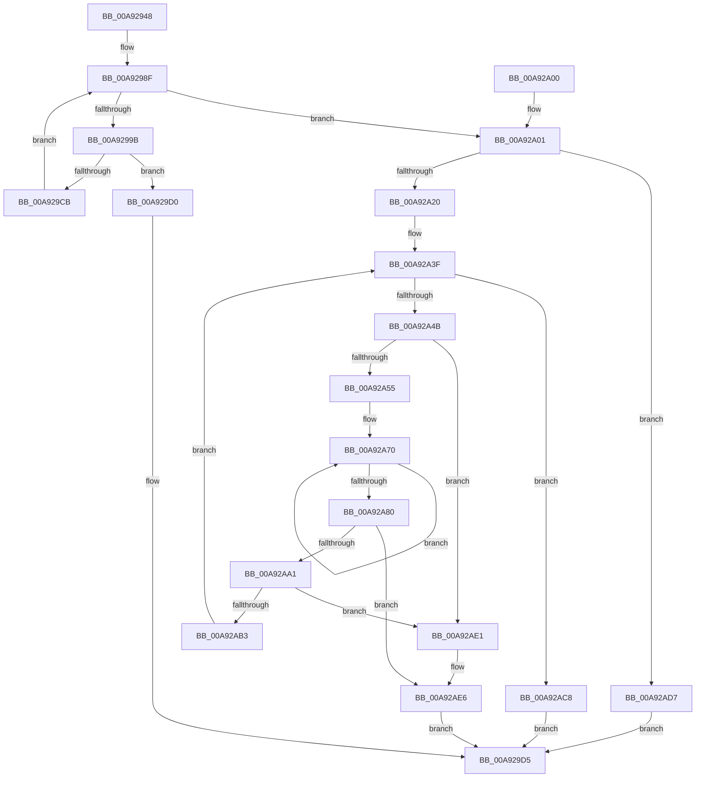

# PopGetPowerRequestListInfo

- RVA: `0x00A92948`–`0x00A92AF8` (길이 `432` bytes)
- VA: `0x0000000140A92948`
- 실행 섹션: `PAGE`
- PDB 이름 있음: `예`; PDB Function 태그: `아니요`
- unwind 정보 RVA: `0x000B944C`
- 디코드: `110`개 명령, `432/432` bytes 표시
- 미해석 바이트: `0` (있으면 어셈블리에 `.byte`로 보존)

> 이 문서는 커널 이미지의 기계어와 PDB 기호를 분석해 생성했습니다. 4번과 5번은 함수 원형과 자료형을 바이너리 사용 방식에서 추정한 C 해석이며 원본 소스 복구 결과는 아닙니다.

## 1. Dependencies

- 직접 호출 지점: **6**; 고유 호출 대상: **5**
- 직접 호출자로 확인된 함수: **1**
- RIP 상대 이미지 참조: **3**

### Outgoing calls
- `0x00A92971` → [PopAcquireRwLockShared](../../text/2D/PopAcquireRwLockShared_function_002D9A40.md) (function, `0x002D9A40`)
- `0x00A929AC` → [PoStoreDiagnosticContext](../../text/23/PoStoreDiagnosticContext_function_0023009C.md) (function, `0x0023009C`)
- `0x00A929DC` → [PopReleaseRwLock](../../text/2D/PopReleaseRwLock_function_002DFBBC.md) (function, `0x002DFBBC`)
- `0x00A92A0F` → [ExAllocatePool2](../../poolcode/B8/ExAllocatePool2_function_00B820F0.md) (function, `0x00B820F0`)
- `0x00A92A96` → [PoStoreDiagnosticContext](../../text/23/PoStoreDiagnosticContext_function_0023009C.md) (function, `0x0023009C`)
- `0x00A92AEE` → [ExFreePoolWithTag](../../poolcode/B8/ExFreePoolWithTag_function_00B82870.md) (function, `0x00B82870`)

### Direct callers
- [NtPowerInformation](../95/NtPowerInformation_function_00955D80.md) at `0x009571A5`

### Static image references
- `0x00A9296A` → RVA `0x00F0ED20` (`.data`; read)
- `0x00A92976` → RVA `0x00F0ED50` (`.data`; read)
- `0x00A9297C` → RVA `0x00F0ED40` (`.data`; read)

## 2. Other-region calls and transfers

- 다른 실행 섹션으로 향하는 call: **6**
  - `0x00A92971` → [PopAcquireRwLockShared](../../text/2D/PopAcquireRwLockShared_function_002D9A40.md) (`PAGE` → `.text`)
  - `0x00A929AC` → [PoStoreDiagnosticContext](../../text/23/PoStoreDiagnosticContext_function_0023009C.md) (`PAGE` → `.text`)
  - `0x00A929DC` → [PopReleaseRwLock](../../text/2D/PopReleaseRwLock_function_002DFBBC.md) (`PAGE` → `.text`)
  - `0x00A92A0F` → [ExAllocatePool2](../../poolcode/B8/ExAllocatePool2_function_00B820F0.md) (`PAGE` → `POOLCODE`)
  - `0x00A92A96` → [PoStoreDiagnosticContext](../../text/23/PoStoreDiagnosticContext_function_0023009C.md) (`PAGE` → `.text`)
  - `0x00A92AEE` → [ExFreePoolWithTag](../../poolcode/B8/ExFreePoolWithTag_function_00B82870.md) (`PAGE` → `POOLCODE`)
- 별도 외부 분기/꼬리 이동을 확인하지 못했습니다.

## 3. Assembly (complete function range)

```asm
00A92948  48 89 5C 24 08                  mov qword ptr [rsp + 8], rbx
00A9294D  48 89 6C 24 10                  mov qword ptr [rsp + 0x10], rbp
00A92952  48 89 74 24 20                  mov qword ptr [rsp + 0x20], rsi
00A92957  57                              push rdi
00A92958  41 54                           push r12
00A9295A  41 55                           push r13
00A9295C  41 56                           push r14
00A9295E  41 57                           push r15
00A92960  48 83 EC 20                     sub rsp, 0x20
00A92964  4C 8B E9                        mov r13, rcx
00A92967  4C 8B E2                        mov r12, rdx
00A9296A  48 8D 0D AF C3 47 00            lea rcx, [rip + 0x47c3af]
00A92971  E8 CA 70 84 FF                  call 0x1402d9a40
00A92976  8B 05 D4 C3 47 00               mov eax, dword ptr [rip + 0x47c3d4]
00A9297C  48 8B 1D BD C3 47 00            mov rbx, qword ptr [rip + 0x47c3bd]
00A92983  48 8D 3C C5 0F 00 00 00         lea rdi, [rax*8 + 0xf]
00A9298B  48 83 E7 F8                     and rdi, 0xfffffffffffffff8
00A9298F  48 8D 05 AA C3 47 00            lea rax, [rip + 0x47c3aa]
00A92996  48 3B D8                        cmp rbx, rax
00A92999  74 66                           je 0x140a92a01
00A9299B  48 8B 4B 60                     mov rcx, qword ptr [rbx + 0x60]
00A9299F  4C 8D 44 24 60                  lea r8, [rsp + 0x60]
00A929A4  48 83 64 24 60 00               and qword ptr [rsp + 0x60], 0
00A929AA  33 D2                           xor edx, edx
00A929AC  E8 EB D6 79 FF                  call 0x14023009c
00A929B1  48 8B 44 24 60                  mov rax, qword ptr [rsp + 0x60]
00A929B6  48 83 C0 27                     add rax, 0x27
00A929BA  48 03 F8                        add rdi, rax
00A929BD  B8 FF FF FF FF                  mov eax, 0xffffffff
00A929C2  48 83 E7 F8                     and rdi, 0xfffffffffffffff8
00A929C6  48 3B F8                        cmp rdi, rax
00A929C9  77 05                           ja 0x140a929d0
00A929CB  48 8B 1B                        mov rbx, qword ptr [rbx]
00A929CE  EB BF                           jmp 0x140a9298f
00A929D0  BB 23 00 00 C0                  mov ebx, 0xc0000023
00A929D5  48 8D 0D 44 C3 47 00            lea rcx, [rip + 0x47c344]
00A929DC  E8 DB D1 84 FF                  call 0x1402dfbbc
00A929E1  48 8B 6C 24 58                  mov rbp, qword ptr [rsp + 0x58]
00A929E6  8B C3                           mov eax, ebx
00A929E8  48 8B 5C 24 50                  mov rbx, qword ptr [rsp + 0x50]
00A929ED  48 8B 74 24 68                  mov rsi, qword ptr [rsp + 0x68]
00A929F2  48 83 C4 20                     add rsp, 0x20
00A929F6  41 5F                           pop r15
00A929F8  41 5E                           pop r14
00A929FA  41 5D                           pop r13
00A929FC  41 5C                           pop r12
00A929FE  5F                              pop rdi
00A929FF  C3                              ret
00A92A00  CC                              int3
00A92A01  41 B8 4D 65 6D 20               mov r8d, 0x206d654d
00A92A07  48 8B D7                        mov rdx, rdi
00A92A0A  B9 00 01 00 00                  mov ecx, 0x100
00A92A0F  E8 DC F6 0E 00                  call 0x140b820f0
00A92A14  48 8B F0                        mov rsi, rax
00A92A17  48 85 C0                        test rax, rax
00A92A1A  0F 84 B7 00 00 00               je 0x140a92ad7
00A92A20  4C 8D 78 08                     lea r15, [rax + 8]
00A92A24  8B 05 26 C3 47 00               mov eax, dword ptr [rip + 0x47c326]
00A92A2A  48 89 06                        mov qword ptr [rsi], rax
00A92A2D  4C 8B 35 0C C3 47 00            mov r14, qword ptr [rip + 0x47c30c]
00A92A34  48 8D 2C C5 08 00 00 00         lea rbp, [rax*8 + 8]
00A92A3C  48 2B FD                        sub rdi, rbp
00A92A3F  48 8D 05 FA C2 47 00            lea rax, [rip + 0x47c2fa]
00A92A46  4C 3B F0                        cmp r14, rax
00A92A49  74 7D                           je 0x140a92ac8
00A92A4B  48 83 FF 48                     cmp rdi, 0x48
00A92A4F  0F 82 8C 00 00 00               jb 0x140a92ae1
00A92A55  41 8B 46 14                     mov eax, dword ptr [r14 + 0x14]
00A92A59  4C 8D 04 2E                     lea r8, [rsi + rbp]
00A92A5D  49 8B D6                        mov rdx, r14
00A92A60  41 89 00                        mov dword ptr [r8], eax
00A92A63  49 8D 48 04                     lea rcx, [r8 + 4]
00A92A67  49 2B D0                        sub rdx, r8
00A92A6A  41 B9 06 00 00 00               mov r9d, 6
00A92A70  8B 44 0A 24                     mov eax, dword ptr [rdx + rcx + 0x24]
00A92A74  89 01                           mov dword ptr [rcx], eax
00A92A76  48 8D 49 04                     lea rcx, [rcx + 4]
00A92A7A  49 83 E9 01                     sub r9, 1
00A92A7E  75 F0                           jne 0x140a92a70
00A92A80  49 8B 4E 60                     mov rcx, qword ptr [r14 + 0x60]
00A92A84  48 8D 47 E0                     lea rax, [rdi - 0x20]
00A92A88  49 8D 50 20                     lea rdx, [r8 + 0x20]
00A92A8C  48 89 44 24 60                  mov qword ptr [rsp + 0x60], rax
00A92A91  4C 8D 44 24 60                  lea r8, [rsp + 0x60]
00A92A96  E8 01 D6 79 FF                  call 0x14023009c
00A92A9B  8B D8                           mov ebx, eax
00A92A9D  85 C0                           test eax, eax
00A92A9F  78 45                           js 0x140a92ae6
00A92AA1  48 8B 44 24 60                  mov rax, qword ptr [rsp + 0x60]
00A92AA6  48 83 C0 27                     add rax, 0x27
00A92AAA  48 83 E0 F8                     and rax, 0xfffffffffffffff8
00A92AAE  48 3B F8                        cmp rdi, rax
00A92AB1  72 2E                           jb 0x140a92ae1
00A92AB3  49 89 2F                        mov qword ptr [r15], rbp
00A92AB6  48 2B F8                        sub rdi, rax
00A92AB9  4D 8B 36                        mov r14, qword ptr [r14]
00A92ABC  48 03 E8                        add rbp, rax
00A92ABF  49 83 C7 08                     add r15, 8
00A92AC3  E9 77 FF FF FF                  jmp 0x140a92a3f
00A92AC8  49 89 75 00                     mov qword ptr [r13], rsi
00A92ACC  33 DB                           xor ebx, ebx
00A92ACE  41 89 2C 24                     mov dword ptr [r12], ebp
00A92AD2  E9 FE FE FF FF                  jmp 0x140a929d5
00A92AD7  BB 9A 00 00 C0                  mov ebx, 0xc000009a
00A92ADC  E9 F4 FE FF FF                  jmp 0x140a929d5
00A92AE1  BB 23 00 00 C0                  mov ebx, 0xc0000023
00A92AE6  BA 4D 65 6D 20                  mov edx, 0x206d654d
00A92AEB  48 8B CE                        mov rcx, rsi
00A92AEE  E8 7D FD 0E 00                  call 0x140b82870
00A92AF3  E9 DD FE FF FF                  jmp 0x140a929d5
```

## 4. C-style interpretation (structured pseudocode)

```c
__int64 __fastcall PopGetPowerRequestListInfo(__int64 a1, __int64 a2)
{
    __int64 result;
    __int64 v_r15;
    __int64 v_rbp;
    __int64 v_rbx;
    __int64 v_rdi;
    __int64 v_rsp;
    unsigned __int64 v_stack_p10;
    unsigned __int64 v_stack_p18;
    unsigned __int64 v_stack_p20;
    unsigned __int64 v_stack_p60;
    unsigned __int64 v_stack_p8;

    v_stack_p8 = v_rbx;
    v_stack_p10 = v_rbp;
    v_stack_p20 = v_rsi;
    v_rsp = (v_rsp) - (32);
    result = PopAcquireRwLockShared(v_rip + 4703151, a2, a3, a4);
    v_rdi = ((unsigned int)(*(unsigned int *)(v_rip + 4703188)) * 8 + 15) & (-8);
loc_00A9298F:
    if ((*(unsigned __int64 *)(v_rip + 4703165)) == (v_rip + 4703146)) goto loc_00A92A01;
    a2 = 0;
    result = PoStoreDiagnosticContext(*(unsigned __int64 *)(*(unsigned __int64 *)(v_rip + 4703165) + 96), a2, v_stack_p18, a4);
    result = (v_stack_p18) + (39);
    v_rdi = (v_rdi) + (result);
    v_rdi = (v_rdi) & (-8);
    if (v_rdi > ((unsigned int)(0xFFFFFFFFULL))) goto loc_00A929D0;
    goto loc_00A9298F;
loc_00A929D0:
loc_00A929D5:
    result = PopReleaseRwLock(v_rip + 4703044, a2, v_stack_p18, a4);
    v_rsp = (v_rsp) + (32);
    return (unsigned int)((unsigned int)((unsigned int)(0xC0000023ULL)));
loc_00A92A01:
    result = ExAllocatePool2(256, v_rdi, (unsigned int)(0x206D654DULL), a4);
    if (result == 0) goto loc_00A92AD7;
    *(unsigned __int64 *)(result) = (unsigned int)(*(unsigned int *)(v_rip + 4703014));
    v_rdi = (v_rdi) - ((unsigned int)(*(unsigned int *)(v_rip + 4703014)) * 8 + 8);
loc_00A92A3F:
    if ((*(unsigned __int64 *)(v_rip + 4702988)) == (v_rip + 4702970)) goto loc_00A92AC8;
    if (v_rdi < 72) goto loc_00A92AE1;
    *(unsigned int *)(result + (unsigned int)(*(unsigned int *)(v_rip + 4703014)) * 8 + 8 * 1) = (unsigned int)((unsigned int)(*(unsigned int *)(*(unsigned __int64 *)(v_rip + 4702988) + 20)));
    a2 = (*(unsigned __int64 *)(v_rip + 4702988)) - (result + (unsigned int)(*(unsigned int *)(v_rip + 4703014)) * 8 + 8 * 1);
loc_00A92A70:
    *(unsigned int *)(result + (unsigned int)(*(unsigned int *)(v_rip + 4703014)) * 8 + 8 * 1 + 4) = (unsigned int)((unsigned int)(*(unsigned int *)(a2 + result + (unsigned int)(*(unsigned int *)(v_rip + 4703014)) * 8 + 8 * 1 + 4 * 1 + 36)));
    a4 = (6) - (1);
    if (condition_is_not_equal) goto loc_00A92A70;
    v_stack_p60 = v_rdi - 32;
    result = PoStoreDiagnosticContext(*(unsigned __int64 *)(*(unsigned __int64 *)(v_rip + 4702988) + 96), result + (unsigned int)(*(unsigned int *)(v_rip + 4703014)) * 8 + 8 * 1 + 32, v_stack_p60, a4);
    if (sign_flag) goto loc_00A92AE6;
    result = (v_stack_p60) + (39);
    result = (result) & (-8);
    if (v_rdi < result) goto loc_00A92AE1;
    *(unsigned __int64 *)(result + 8) = (unsigned int)(*(unsigned int *)(v_rip + 4703014)) * 8 + 8;
    v_rdi = (v_rdi) - (result);
    v_rbp = ((unsigned int)(*(unsigned int *)(v_rip + 4703014)) * 8 + 8) + (result);
    v_r15 = (result + 8) + (8);
    goto loc_00A92A3F;
loc_00A92AC8:
    *(unsigned __int64 *)(a1) = result;
    v_rbx = 0;
    *(unsigned int *)(a2) = (unsigned int)(v_rbp);
    goto loc_00A929D5;
loc_00A92AD7:
    goto loc_00A929D5;
loc_00A92AE1:
loc_00A92AE6:
    result = ExFreePoolWithTag(result, (unsigned int)(0x206D654DULL), v_stack_p60, a4);
    goto loc_00A929D5;
}
```

## 5. (Beta) C Style

```c
int64_t PopGetPowerRequestListInfo(void *Arg1, void *Arg2)
{
    uint8_t *arg1 = (uint8_t *)Arg1;
    uint8_t *arg2 = (uint8_t *)Arg2;

    int64_t result;
    int64_t local_r15;
    int64_t local_rbp;
    int64_t local_rbx;
    int64_t local_rdi;
    int64_t local_rsp;
    uint64_t v_stack_p10;
    uint64_t v_stack_p18;
    uint64_t v_stack_p20;
    uint64_t v_stack_p60;
    uint64_t v_stack_p8;

    v_stack_p8 = local_rbx;
    v_stack_p10 = local_rbp;
    v_stack_p20 = local_rsi;
    local_rsp = (local_rsp) - (32);
    result = PopAcquireRwLockShared(v_rip + 4703151, Arg2, a3, a4);
    local_rdi = ((uint32_t)(*(uint32_t *)(v_rip + 0x47C3D4)) * 8 + 15) & (-8);
loc_00A9298F:
    if ((*(uint64_t *)(v_rip + 0x47C3BD)) == (v_rip + 4703146)) goto loc_00A92A01;
    Arg2 = 0;
    result = PoStoreDiagnosticContext(*(uint64_t *)(*(uint64_t *)(v_rip + 0x47C3BD) + 0x60), Arg2, v_stack_p18, a4);
    result = (v_stack_p18) + (39);
    local_rdi = (local_rdi) + (result);
    local_rdi = (local_rdi) & (-8);
    if (local_rdi > ((uint32_t)(0xFFFFFFFFULL))) goto loc_00A929D0;
    goto loc_00A9298F;
loc_00A929D0:
loc_00A929D5:
    result = PopReleaseRwLock(v_rip + 4703044, Arg2, v_stack_p18, a4);
    local_rsp = (local_rsp) + (32);
    return (uint32_t)((uint32_t)((uint32_t)(0xC0000023ULL)));
loc_00A92A01:
    result = ExAllocatePool2(256, local_rdi, (uint32_t)(0x206D654DULL), a4);
    if (result == 0) goto loc_00A92AD7;
    *(uint64_t *)(result) = (uint32_t)(*(uint32_t *)(v_rip + 0x47C326));
    local_rdi = (local_rdi) - ((uint32_t)(*(uint32_t *)(v_rip + 0x47C326)) * 8 + 8);
loc_00A92A3F:
    if ((*(uint64_t *)(v_rip + 0x47C30C)) == (v_rip + 4702970)) goto loc_00A92AC8;
    if (local_rdi < 72) goto loc_00A92AE1;
    *(uint32_t *)(result + (uint32_t)(*(uint32_t *)(v_rip + 0x47C326)) * 8 + 0x8 * 1) = (uint32_t)((uint32_t)(*(uint32_t *)(*(uint64_t *)(v_rip + 0x47C30C) + 0x14)));
    Arg2 = (*(uint64_t *)(v_rip + 0x47C30C)) - (result + (uint32_t)(*(uint32_t *)(v_rip + 0x47C326)) * 8 + 8 * 1);
loc_00A92A70:
    *(uint32_t *)(result + (uint32_t)(*(uint32_t *)(v_rip + 0x47C326)) * 8 + 0x8 * 1 + 0x4) = (uint32_t)((uint32_t)(*(uint32_t *)(arg2 + result + (uint32_t)(*(uint32_t *)(v_rip + 0x47C326)) * 8 + 0x8 * 1 + 0x4 * 1 + 0x24)));
    a4 = (6) - (1);
    if (condition_is_not_equal) goto loc_00A92A70;
    v_stack_p60 = local_rdi - 32;
    result = PoStoreDiagnosticContext(*(uint64_t *)(*(uint64_t *)(v_rip + 0x47C30C) + 0x60), result + (uint32_t)(*(uint32_t *)(v_rip + 0x47C326)) * 8 + 8 * 1 + 32, v_stack_p60, a4);
    if (sign_flag) goto loc_00A92AE6;
    result = (v_stack_p60) + (39);
    result = (result) & (-8);
    if (local_rdi < result) goto loc_00A92AE1;
    *(uint64_t *)(result + 0x8) = (uint32_t)(*(uint32_t *)(v_rip + 0x47C326)) * 8 + 8;
    local_rdi = (local_rdi) - (result);
    local_rbp = ((uint32_t)(*(uint32_t *)(v_rip + 0x47C326)) * 8 + 8) + (result);
    local_r15 = (result + 8) + (8);
    goto loc_00A92A3F;
loc_00A92AC8:
    *(uint64_t *)(arg1) = result;
    local_rbx = 0;
    *(uint32_t *)(arg2) = (uint32_t)(local_rbp);
    goto loc_00A929D5;
loc_00A92AD7:
    goto loc_00A929D5;
loc_00A92AE1:
loc_00A92AE6:
    result = ExFreePoolWithTag(result, (uint32_t)(0x206D654DULL), v_stack_p60, a4);
    goto loc_00A929D5;
}
```

### 관측된 메모리 오프셋

구조체 형식이 확인되지 않은 접근은 인자 기준의 오프셋으로만 기록했습니다.

| 기준 인자 | 오프셋 표현 | 폭 (bit) | 접근 |
|---|---:|---:|---|
| `Arg1` | `+ 0x0` | `64` | `W` |
| `Arg2` | `+ 0x0` | `32` | `W` |

## 6. Execution-region graph

[열기: 2D/3D 그래프와 함수 탐색 컨트롤 패널](../../../control-panel.html?section=page&rva=0x00A92948&view=graph)

- 2D 그래프는 위에서 아래로 흐르고, 3D 그래프는 빈 공간을 드래그해 회전합니다. Shift+드래그는 이동, 휠은 확대·축소, 함수 노드 선택은 대상 보고서 이동입니다.

### Static fallback


