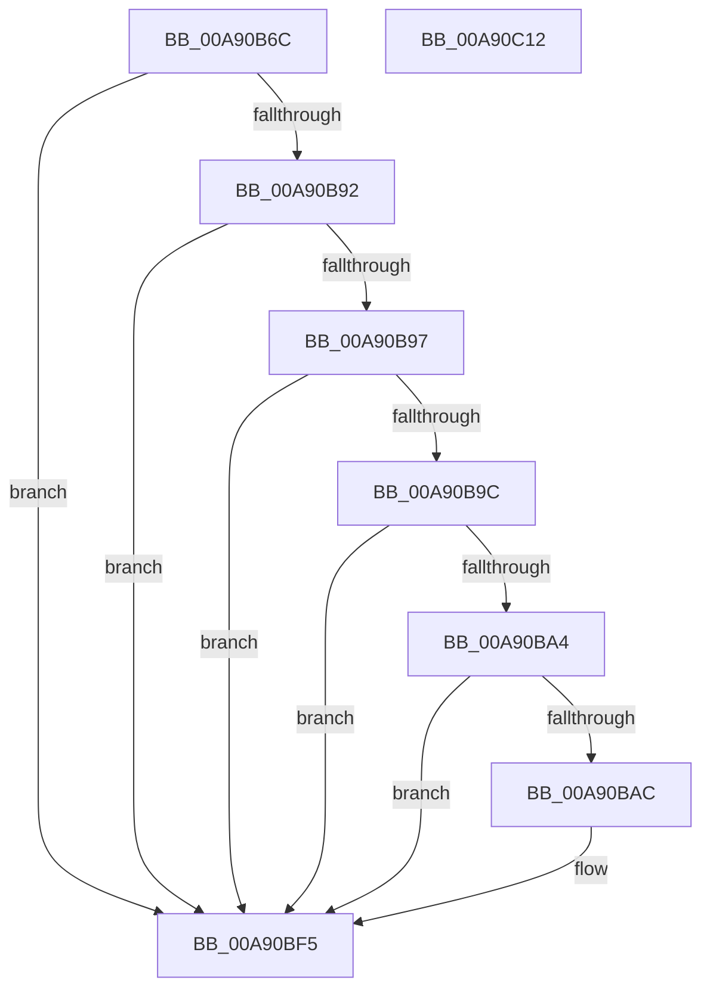

# PopHeteroCapabilityDeepCopy

- RVA: `0x00A90B6C`–`0x00A90C13` (길이 `167` bytes)
- VA: `0x0000000140A90B6C`
- 실행 섹션: `PAGE`
- PDB 이름 있음: `예`; PDB Function 태그: `아니요`
- unwind 정보 RVA: `0x0005E6B4`
- 디코드: `49`개 명령, `167/167` bytes 표시
- 미해석 바이트: `0` (있으면 어셈블리에 `.byte`로 보존)

> 이 문서는 커널 이미지의 기계어와 PDB 기호를 분석해 생성했습니다. 4번과 5번은 함수 원형과 자료형을 바이너리 사용 방식에서 추정한 C 해석이며 원본 소스 복구 결과는 아닙니다.

## 1. Dependencies

- 직접 호출 지점: **3**; 고유 호출 대상: **1**
- 직접 호출자로 확인된 함수: **2**
- RIP 상대 이미지 참조: **0**

### Outgoing calls
- `0x00A90BB7` → [memcpy](../../text/6C/memcpy_function_006C6840.md) (function, `0x006C6840`)
- `0x00A90BCA` → [memcpy](../../text/6C/memcpy_function_006C6840.md) (function, `0x006C6840`)
- `0x00A90BF0` → [memcpy](../../text/6C/memcpy_function_006C6840.md) (function, `0x006C6840`)

### Direct callers
- [PopInitializeHeteroProcessors](../A5/PopInitializeHeteroProcessors_function_00A53570.md) at `0x00A5384D`
- [PopIsSimulatedArchitecturalHeteroPresent](../AD/PopIsSimulatedArchitecturalHeteroPresent_function_00AD2FA8.md) at `0x00AD2FDB`

### Static image references
- 디코드된 RIP-relative 메모리 참조가 없습니다.

## 2. Other-region calls and transfers

- 다른 실행 섹션으로 향하는 call: **3**
  - `0x00A90BB7` → [memcpy](../../text/6C/memcpy_function_006C6840.md) (`PAGE` → `.text`)
  - `0x00A90BCA` → [memcpy](../../text/6C/memcpy_function_006C6840.md) (`PAGE` → `.text`)
  - `0x00A90BF0` → [memcpy](../../text/6C/memcpy_function_006C6840.md) (`PAGE` → `.text`)
- 별도 외부 분기/꼬리 이동을 확인하지 못했습니다.

## 3. Assembly (complete function range)

```asm
00A90B6C  48 8B C4                        mov rax, rsp
00A90B6F  48 89 58 08                     mov qword ptr [rax + 8], rbx
00A90B73  48 89 68 10                     mov qword ptr [rax + 0x10], rbp
00A90B77  48 89 70 18                     mov qword ptr [rax + 0x18], rsi
00A90B7B  48 89 78 20                     mov qword ptr [rax + 0x20], rdi
00A90B7F  41 56                           push r14
00A90B81  48 83 EC 20                     sub rsp, 0x20
00A90B85  33 F6                           xor esi, esi
00A90B87  48 8B FA                        mov rdi, rdx
00A90B8A  48 8B D9                        mov rbx, rcx
00A90B8D  48 85 D2                        test rdx, rdx
00A90B90  74 63                           je 0x140a90bf5
00A90B92  48 85 C9                        test rcx, rcx
00A90B95  74 5E                           je 0x140a90bf5
00A90B97  48 3B D1                        cmp rdx, rcx
00A90B9A  74 59                           je 0x140a90bf5
00A90B9C  44 8B 32                        mov r14d, dword ptr [rdx]
00A90B9F  44 3B 31                        cmp r14d, dword ptr [rcx]
00A90BA2  75 51                           jne 0x140a90bf5
00A90BA4  8B 6A 04                        mov ebp, dword ptr [rdx + 4]
00A90BA7  3B 69 04                        cmp ebp, dword ptr [rcx + 4]
00A90BAA  75 49                           jne 0x140a90bf5
00A90BAC  48 8B 52 08                     mov rdx, qword ptr [rdx + 8]
00A90BB0  45 8B C6                        mov r8d, r14d
00A90BB3  48 8B 49 08                     mov rcx, qword ptr [rcx + 8]
00A90BB7  E8 84 5C C3 FF                  call 0x1406c6840
00A90BBC  48 8B 57 10                     mov rdx, qword ptr [rdi + 0x10]
00A90BC0  44 8B C5                        mov r8d, ebp
00A90BC3  48 8B 4B 10                     mov rcx, qword ptr [rbx + 0x10]
00A90BC7  4D 03 C0                        add r8, r8
00A90BCA  E8 71 5C C3 FF                  call 0x1406c6840
00A90BCF  42 8D 34 B5 02 00 00 00         lea esi, [r14*4 + 2]
00A90BD7  0F AF F5                        imul esi, ebp
00A90BDA  48 8D 57 18                     lea rdx, [rdi + 0x18]
00A90BDE  41 0F AF EE                     imul ebp, r14d
00A90BE2  48 8D 4B 18                     lea rcx, [rbx + 0x18]
00A90BE6  41 03 F6                        add esi, r14d
00A90BE9  44 8B C5                        mov r8d, ebp
00A90BEC  49 C1 E0 02                     shl r8, 2
00A90BF0  E8 4B 5C C3 FF                  call 0x1406c6840
00A90BF5  48 8B 5C 24 30                  mov rbx, qword ptr [rsp + 0x30]
00A90BFA  8B C6                           mov eax, esi
00A90BFC  48 8B 74 24 40                  mov rsi, qword ptr [rsp + 0x40]
00A90C01  48 8B 6C 24 38                  mov rbp, qword ptr [rsp + 0x38]
00A90C06  48 8B 7C 24 48                  mov rdi, qword ptr [rsp + 0x48]
00A90C0B  48 83 C4 20                     add rsp, 0x20
00A90C0F  41 5E                           pop r14
00A90C11  C3                              ret
00A90C12  CC                              int3
```

## 4. C-style interpretation (structured pseudocode)

```c
__int64 __fastcall PopHeteroCapabilityDeepCopy(__int64 a1, __int64 a2)
{
    __int64 result;
    __int64 v_rbp;
    __int64 v_rsi;
    __int64 v_rsp;
    unsigned __int64 v_stack_p10;
    unsigned __int64 v_stack_p18;
    unsigned __int64 v_stack_p20;
    unsigned __int64 v_stack_p8;

    *(unsigned __int64 *)(v_rsp + 8) = v_rbx;
    *(unsigned __int64 *)(v_rsp + 16) = v_rbp;
    *(unsigned __int64 *)(v_rsp + 24) = v_rsi;
    *(unsigned __int64 *)(v_rsp + 32) = v_rdi;
    v_rsp = (v_rsp) - (32);
    v_rsi = 0;
    if (a2 == 0) goto loc_00A90BF5;
    if (a1 == 0) goto loc_00A90BF5;
    if (a2 == a1) goto loc_00A90BF5;
    if (((unsigned int)((unsigned int)(*(unsigned int *)(a2)))) != (*(unsigned int *)(a1))) goto loc_00A90BF5;
    result = v_rsp;
    v_rbp = (unsigned int)(*(unsigned int *)(a2 + 4));
    if (((unsigned int)((unsigned int)(*(unsigned int *)(a2 + 4)))) == (*(unsigned int *)(a1 + 4))) {
        a2 = *(unsigned __int64 *)(a2 + 8);
        a3 = (unsigned int)((unsigned int)(*(unsigned int *)(a2)));
        a1 = *(unsigned __int64 *)(a1 + 8);
        result = memcpy(a1, a2, a3, a4);
        a2 = *(unsigned __int64 *)(a2 + 16);
        a3 = (unsigned int)((unsigned int)(*(unsigned int *)(a2 + 4)));
        a1 = *(unsigned __int64 *)(a1 + 16);
        a3 = (a3) + (a3);
        result = memcpy(a1, a2, a3, a4);
        v_rsi = (unsigned int)(*(unsigned int *)(a2)) * 4 + 2;
        v_rsi = (unsigned int)((v_rsi) * ((unsigned int)((unsigned int)(*(unsigned int *)(a2 + 4)))));
        a2 = a2 + 24;
        v_rbp = (unsigned int)(((unsigned int)(*(unsigned int *)(a2 + 4))) * ((unsigned int)((unsigned int)(*(unsigned int *)(a2)))));
        a1 = a1 + 24;
        v_rsi = (unsigned int)((v_rsi) + ((unsigned int)((unsigned int)(*(unsigned int *)(a2)))));
        a3 = (unsigned int)(v_rbp);
        a3 = (a3) << (2);
        result = memcpy(a1, a2, a3, a4);
    }
    v_rsp = (v_rsp) + (32);
    return (unsigned int)((unsigned int)(v_rsi));
}
```

## 5. (Beta) C Style

```c
int64_t PopHeteroCapabilityDeepCopy(void *Arg1, void *Arg2)
{
    uint8_t *arg1 = (uint8_t *)Arg1;
    uint8_t *arg2 = (uint8_t *)Arg2;

    int64_t result;
    int64_t local_rbp;
    int64_t local_rsi;
    int64_t local_rsp;
    uint64_t v_stack_p10;
    uint64_t v_stack_p18;
    uint64_t v_stack_p20;
    uint64_t v_stack_p8;

    *(uint64_t *)(local_rsp + 0x8) = local_rbx;
    *(uint64_t *)(local_rsp + 0x10) = local_rbp;
    *(uint64_t *)(local_rsp + 0x18) = local_rsi;
    *(uint64_t *)(local_rsp + 0x20) = local_rdi;
    local_rsp = (local_rsp) - (32);
    local_rsi = 0;
    if (Arg2 == NULL) goto loc_00A90BF5;
    if (Arg1 == NULL) goto loc_00A90BF5;
    if (Arg2 == Arg1) goto loc_00A90BF5;
    if (((uint32_t)((uint32_t)(*(uint32_t *)(arg2)))) != (*(uint32_t *)(arg1))) goto loc_00A90BF5;
    result = local_rsp;
    local_rbp = (uint32_t)(*(uint32_t *)(arg2 + 0x4));
    if (((uint32_t)((uint32_t)(*(uint32_t *)(arg2 + 0x4)))) == (*(uint32_t *)(arg1 + 0x4))) {
        Arg2 = *(uint64_t *)(arg2 + 0x8);
        a3 = (uint32_t)((uint32_t)(*(uint32_t *)(arg2)));
        Arg1 = *(uint64_t *)(arg1 + 0x8);
        result = memcpy(Arg1, Arg2, a3, a4);
        Arg2 = *(uint64_t *)(arg2 + 0x10);
        a3 = (uint32_t)((uint32_t)(*(uint32_t *)(arg2 + 0x4)));
        Arg1 = *(uint64_t *)(arg1 + 0x10);
        a3 = (a3) + (a3);
        result = memcpy(Arg1, Arg2, a3, a4);
        local_rsi = (uint32_t)(*(uint32_t *)(arg2)) * 4 + 2;
        local_rsi = (uint32_t)((local_rsi) * ((uint32_t)((uint32_t)(*(uint32_t *)(arg2 + 0x4)))));
        Arg2 = Arg2 + 24;
        local_rbp = (uint32_t)(((uint32_t)(*(uint32_t *)(arg2 + 0x4))) * ((uint32_t)((uint32_t)(*(uint32_t *)(arg2)))));
        Arg1 = Arg1 + 24;
        local_rsi = (uint32_t)((local_rsi) + ((uint32_t)((uint32_t)(*(uint32_t *)(arg2)))));
        a3 = (uint32_t)(local_rbp);
        a3 = (a3) << (2);
        result = memcpy(Arg1, Arg2, a3, a4);
    }
    local_rsp = (local_rsp) + (32);
    return (uint32_t)((uint32_t)(local_rsi));
}
```

### 관측된 메모리 오프셋

구조체 형식이 확인되지 않은 접근은 인자 기준의 오프셋으로만 기록했습니다.

| 기준 인자 | 오프셋 표현 | 폭 (bit) | 접근 |
|---|---:|---:|---|
| `Arg1` | `+ 0x10` | `64` | `R` |
| `Arg1` | `+ 0x18` | `64` | `R` |
| `Arg2` | `+ 0x10` | `64` | `R` |
| `Arg2` | `+ 0x18` | `64` | `R` |

## 6. Execution-region graph

[열기: 2D/3D 그래프와 함수 탐색 컨트롤 패널](../../../control-panel.html?section=page&rva=0x00A90B6C&view=graph)

- 2D 그래프는 위에서 아래로 흐르고, 3D 그래프는 빈 공간을 드래그해 회전합니다. Shift+드래그는 이동, 휠은 확대·축소, 함수 노드 선택은 대상 보고서 이동입니다.

### Static fallback


