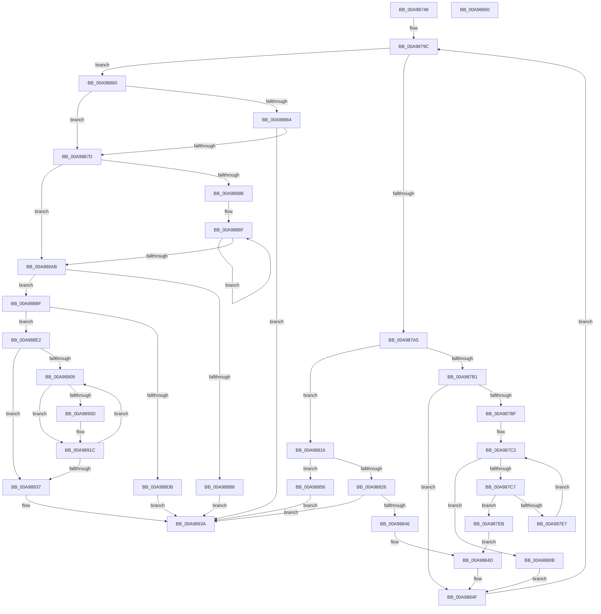

# PopIdleWakeGenerateInterruptDescriptionString

- RVA: `0x00A98748`–`0x00A98961` (길이 `537` bytes)
- VA: `0x0000000140A98748`
- 실행 섹션: `PAGE`
- PDB 이름 있음: `예`; PDB Function 태그: `아니요`
- unwind 정보 RVA: `0x000BA060`
- 디코드: `151`개 명령, `537/537` bytes 표시
- 미해석 바이트: `0` (있으면 어셈블리에 `.byte`로 보존)

> 이 문서는 커널 이미지의 기계어와 PDB 기호를 분석해 생성했습니다. 4번과 5번은 함수 원형과 자료형을 바이너리 사용 방식에서 추정한 C 해석이며 원본 소스 복구 결과는 아닙니다.

## 1. Dependencies

- 직접 호출 지점: **8**; 고유 호출 대상: **8**
- 직접 호출자로 확인된 함수: **1**
- RIP 상대 이미지 참조: **5**

### Outgoing calls
- `0x00A987FD` → [RtlInitUnicodeString](../../text/42/RtlInitUnicodeString_function_0042A780.md) (function, `0x0042A780`)
- `0x00A98839` → [PopGenerateDeviceFriendlyName](PopGenerateDeviceFriendlyName_function_00A98968.md) (function, `0x00A98968`)
- `0x00A98870` → [MmEnumerateSystemImages](../../text/4F/MmEnumerateSystemImages_function_004FC7B0.md) (function, `0x004FC7B0`)
- `0x00A988CD` → [ExAllocatePool2](../../poolcode/B8/ExAllocatePool2_function_00B820F0.md) (function, `0x00B820F0`)
- `0x00A988FC` → [RtlUnicodeStringCopyString](../../text/47/RtlUnicodeStringCopyString_function_00471270.md) (function, `0x00471270`)
- `0x00A98917` → [RtlUnicodeStringCatString](../../text/41/RtlUnicodeStringCatString_function_0041CD30.md) (function, `0x0041CD30`)
- `0x00A9892C` → [RtlUnicodeStringCat](../../text/3E/RtlUnicodeStringCat_function_003E6030.md) (function, `0x003E6030`)
- `0x00A98942` → [_security_check_cookie](../../text/6A/_security_check_cookie_function_006AC640.md) (function, `0x006AC640`)

### Direct callers
- [PopIdleWakeGenerateDescriptionString](../AB/PopIdleWakeGenerateDescriptionString_function_00ABD584.md) at `0x00ABD773`

### Static image references
- `0x00A9875F` → RVA `0x00E0A740` (`.data`; read)
- `0x00A987C9` → RVA `0x00008730` (`.rdata`; read)
- `0x00A98869` → RVA `0x00AAB880` (`PopIdleWakeSystemImageCallback`; read)
- `0x00A988EA` → RVA `0x00B02FA0` (` ?? ::NNGAKEGL::`string'`; read)
- `0x00A9890D` → RVA `0x00B03020` (` ?? ::NNGAKEGL::`string'`; read)

## 2. Other-region calls and transfers

- 다른 실행 섹션으로 향하는 call: **7**
  - `0x00A987FD` → [RtlInitUnicodeString](../../text/42/RtlInitUnicodeString_function_0042A780.md) (`PAGE` → `.text`)
  - `0x00A98870` → [MmEnumerateSystemImages](../../text/4F/MmEnumerateSystemImages_function_004FC7B0.md) (`PAGE` → `.text`)
  - `0x00A988CD` → [ExAllocatePool2](../../poolcode/B8/ExAllocatePool2_function_00B820F0.md) (`PAGE` → `POOLCODE`)
  - `0x00A988FC` → [RtlUnicodeStringCopyString](../../text/47/RtlUnicodeStringCopyString_function_00471270.md) (`PAGE` → `.text`)
  - `0x00A98917` → [RtlUnicodeStringCatString](../../text/41/RtlUnicodeStringCatString_function_0041CD30.md) (`PAGE` → `.text`)
  - `0x00A9892C` → [RtlUnicodeStringCat](../../text/3E/RtlUnicodeStringCat_function_003E6030.md) (`PAGE` → `.text`)
  - `0x00A98942` → [_security_check_cookie](../../text/6A/_security_check_cookie_function_006AC640.md) (`PAGE` → `.text`)
- 별도 외부 분기/꼬리 이동을 확인하지 못했습니다.

## 3. Assembly (complete function range)

```asm
00A98748  4C 8B DC                        mov r11, rsp
00A9874B  49 89 5B 18                     mov qword ptr [r11 + 0x18], rbx
00A9874F  49 89 6B 20                     mov qword ptr [r11 + 0x20], rbp
00A98753  56                              push rsi
00A98754  57                              push rdi
00A98755  41 54                           push r12
00A98757  41 56                           push r14
00A98759  41 57                           push r15
00A9875B  48 83 EC 60                     sub rsp, 0x60
00A9875F  48 8B 05 DA 1F 37 00            mov rax, qword ptr [rip + 0x371fda]
00A98766  48 33 C4                        xor rax, rsp
00A98769  48 89 44 24 50                  mov qword ptr [rsp + 0x50], rax
00A9876E  45 33 E4                        xor r12d, r12d
00A98771  48 8D 9A 10 03 00 00            lea rbx, [rdx + 0x310]
00A98778  0F 57 C0                        xorps xmm0, xmm0
00A9877B  4D 89 63 A8                     mov qword ptr [r11 - 0x58], r12
00A9877F  F3 0F 7F 44 24 38               movdqu xmmword ptr [rsp + 0x38], xmm0
00A98785  49 89 5B C0                     mov qword ptr [r11 - 0x40], rbx
00A98789  48 8D B2 00 03 00 00            lea rsi, [rdx + 0x300]
00A98790  4C 8B FA                        mov r15, rdx
00A98793  4C 8B F1                        mov r14, rcx
00A98796  41 8B EC                        mov ebp, r12d
00A98799  41 8B FC                        mov edi, r12d
00A9879C  83 FF 03                        cmp edi, 3
00A9879F  0F 83 BB 00 00 00               jae 0x140a98860
00A987A5  8B C7                           mov eax, edi
00A987A7  49 8B 4C C6 20                  mov rcx, qword ptr [r14 + rax*8 + 0x20]
00A987AC  48 85 C9                        test rcx, rcx
00A987AF  75 65                           jne 0x140a98816
00A987B1  49 8B 54 C6 08                  mov rdx, qword ptr [r14 + rax*8 + 8]
00A987B6  48 85 D2                        test rdx, rdx
00A987B9  0F 84 90 00 00 00               je 0x140a9884f
00A987BF  41 8B CC                        mov ecx, r12d
00A987C2  83 F9 04                        cmp ecx, 4
00A987C5  73 44                           jae 0x140a9880b
00A987C7  8B C1                           mov eax, ecx
00A987C9  4C 8D 05 60 FF 56 FF            lea r8, [rip - 0xa900a0]
00A987D0  48 03 C0                        add rax, rax
00A987D3  41 0F 10 04 C0                  movups xmm0, xmmword ptr [r8 + rax*8]
00A987D8  66 48 0F 7E C0                  movq rax, xmm0
00A987DD  0F 11 44 24 20                  movups xmmword ptr [rsp + 0x20], xmm0
00A987E2  48 3B D0                        cmp rdx, rax
00A987E5  74 04                           je 0x140a987eb
00A987E7  FF C1                           inc ecx
00A987E9  EB D7                           jmp 0x140a987c2
00A987EB  8B 0B                           mov ecx, dword ptr [rbx]
00A987ED  48 8B 54 24 28                  mov rdx, qword ptr [rsp + 0x28]
00A987F2  48 C1 E1 04                     shl rcx, 4
00A987F6  48 83 C1 08                     add rcx, 8
00A987FA  48 03 CB                        add rcx, rbx
00A987FD  E8 7E 1F 99 FF                  call 0x14042a780
00A98802  8B 03                           mov eax, dword ptr [rbx]
00A98804  44 88 64 18 38                  mov byte ptr [rax + rbx + 0x38], r12b
00A98809  EB 42                           jmp 0x140a9884d
00A9880B  8B C5                           mov eax, ebp
00A9880D  FF C5                           inc ebp
00A9880F  48 89 54 C4 30                  mov qword ptr [rsp + rax*8 + 0x30], rdx
00A98814  EB 39                           jmp 0x140a9884f
00A98816  48 8B 81 38 01 00 00            mov rax, qword ptr [rcx + 0x138]
00A9881D  48 8B 48 28                     mov rcx, qword ptr [rax + 0x28]
00A98821  48 85 C9                        test rcx, rcx
00A98824  74 30                           je 0x140a98856
00A98826  44 8B 03                        mov r8d, dword ptr [rbx]
00A98829  BA 03 00 00 00                  mov edx, 3
00A9882E  49 C1 E0 04                     shl r8, 4
00A98832  49 83 C0 08                     add r8, 8
00A98836  4C 03 C3                        add r8, rbx
00A98839  E8 2A 01 00 00                  call 0x140a98968
00A9883E  85 C0                           test eax, eax
00A98840  0F 88 F4 00 00 00               js 0x140a9893a
00A98846  8B 03                           mov eax, dword ptr [rbx]
00A98848  C6 44 18 38 01                  mov byte ptr [rax + rbx + 0x38], 1
00A9884D  FF 03                           inc dword ptr [rbx]
00A9884F  FF C7                           inc edi
00A98851  E9 46 FF FF FF                  jmp 0x140a9879c
00A98856  B8 0D 00 00 C0                  mov eax, 0xc000000d
00A9885B  E9 DA 00 00 00                  jmp 0x140a9893a
00A98860  85 ED                           test ebp, ebp
00A98862  74 19                           je 0x140a9887d
00A98864  48 8D 54 24 30                  lea rdx, [rsp + 0x30]
00A98869  48 8D 0D 10 30 01 00            lea rcx, [rip + 0x13010]
00A98870  E8 3B 3F A6 FF                  call 0x1404fc7b0
00A98875  85 C0                           test eax, eax
00A98877  0F 88 BD 00 00 00               js 0x140a9893a
00A9887D  44 8B 03                        mov r8d, dword ptr [rbx]
00A98880  49 8B FC                        mov rdi, r12
00A98883  41 8B D4                        mov edx, r12d
00A98886  45 85 C0                        test r8d, r8d
00A98889  74 20                           je 0x140a988ab
00A9888B  4C 8D 4B 08                     lea r9, [rbx + 8]
00A9888F  85 D2                           test edx, edx
00A98891  48 8D 4F 04                     lea rcx, [rdi + 4]
00A98895  48 0F 44 CF                     cmove rcx, rdi
00A98899  41 0F B7 39                     movzx edi, word ptr [r9]
00A9889D  48 03 F9                        add rdi, rcx
00A988A0  4D 8D 49 10                     lea r9, [r9 + 0x10]
00A988A4  FF C2                           inc edx
00A988A6  41 3B D0                        cmp edx, r8d
00A988A9  72 E4                           jb 0x140a9888f
00A988AB  48 83 C7 18                     add rdi, 0x18
00A988AF  48 81 FF FF FF 00 00            cmp rdi, 0xffff
00A988B6  76 07                           jbe 0x140a988bf
00A988B8  B8 05 00 00 80                  mov eax, 0x80000005
00A988BD  EB 7B                           jmp 0x140a9893a
00A988BF  41 B8 50 64 69 67               mov r8d, 0x67696450
00A988C5  48 8B D7                        mov rdx, rdi
00A988C8  B9 00 01 00 00                  mov ecx, 0x100
00A988CD  E8 1E 98 0E 00                  call 0x140b820f0
00A988D2  48 89 46 08                     mov qword ptr [rsi + 8], rax
00A988D6  48 85 C0                        test rax, rax
00A988D9  75 07                           jne 0x140a988e2
00A988DB  B8 9A 00 00 C0                  mov eax, 0xc000009a
00A988E0  EB 58                           jmp 0x140a9893a
00A988E2  41 C6 87 F8 02 00 00 01         mov byte ptr [r15 + 0x2f8], 1
00A988EA  48 8D 15 AF A6 06 00            lea rdx, [rip + 0x6a6af]
00A988F1  48 8B CE                        mov rcx, rsi
00A988F4  66 44 89 26                     mov word ptr [rsi], r12w
00A988F8  66 89 7E 02                     mov word ptr [rsi + 2], di
00A988FC  E8 6F 89 9D FF                  call 0x140471270
00A98901  41 8B FC                        mov edi, r12d
00A98904  44 39 23                        cmp dword ptr [rbx], r12d
00A98907  76 2E                           jbe 0x140a98937
00A98909  85 FF                           test edi, edi
00A9890B  74 0F                           je 0x140a9891c
00A9890D  48 8D 15 0C A7 06 00            lea rdx, [rip + 0x6a70c]
00A98914  48 8B CE                        mov rcx, rsi
00A98917  E8 14 44 98 FF                  call 0x14041cd30
00A9891C  8B D7                           mov edx, edi
00A9891E  48 8B CE                        mov rcx, rsi
00A98921  48 C1 E2 04                     shl rdx, 4
00A98925  48 83 C2 08                     add rdx, 8
00A98929  48 03 D3                        add rdx, rbx
00A9892C  E8 FF D6 94 FF                  call 0x1403e6030
00A98931  FF C7                           inc edi
00A98933  3B 3B                           cmp edi, dword ptr [rbx]
00A98935  72 D2                           jb 0x140a98909
00A98937  41 8B C4                        mov eax, r12d
00A9893A  48 8B 4C 24 50                  mov rcx, qword ptr [rsp + 0x50]
00A9893F  48 33 CC                        xor rcx, rsp
00A98942  E8 F9 3C C1 FF                  call 0x1406ac640
00A98947  4C 8D 5C 24 60                  lea r11, [rsp + 0x60]
00A9894C  49 8B 5B 40                     mov rbx, qword ptr [r11 + 0x40]
00A98950  49 8B 6B 48                     mov rbp, qword ptr [r11 + 0x48]
00A98954  49 8B E3                        mov rsp, r11
00A98957  41 5F                           pop r15
00A98959  41 5E                           pop r14
00A9895B  41 5C                           pop r12
00A9895D  5F                              pop rdi
00A9895E  5E                              pop rsi
00A9895F  C3                              ret
00A98960  CC                              int3
```

## 4. C-style interpretation (structured pseudocode)

```c
__int64 __fastcall PopIdleWakeGenerateInterruptDescriptionString(__int64 a1, __int64 a2)
{
    __int64 result;
    __int64 v_r12;
    __int64 v_rbp;
    __int64 v_rdi;
    __int64 v_rsp;
    unsigned __int64 v_stack_m28;
    unsigned __int64 v_stack_m38;
    unsigned __int64 v_stack_m50;
    unsigned __int64 v_stack_m58;
    unsigned __int64 v_stack_m60;
    unsigned __int64 v_stack_m68;

    *(unsigned __int64 *)(v_rsp + 24) = v_rbx;
    *(unsigned __int64 *)(v_rsp + 32) = v_rbp;
    v_rsp = (v_rsp) - (96);
    result = (*(unsigned __int64 *)(v_rip + 3612634)) ^ (v_rsp);
    v_stack_m38 = result;
    v_r12 = 0;
    *(unsigned __int64 *)(v_rsp - 88) = 0;
    v_stack_m50 = v_xmm0;
    *(unsigned __int64 *)(v_rsp - 64) = a2 + 784;
loc_00A9879C:
    if (0 >= 3) goto loc_00A98860;
    if (*(unsigned __int64 *)(a1 + 0 * 8 + 32) != 0) goto loc_00A98816;
    if (*(unsigned __int64 *)(a1 + 0 * 8 + 8) == 0) goto loc_00A9884F;
loc_00A987C2:
    if (0 >= 4) goto loc_00A9880B;
    result = (0) + (0);
    v_stack_m68 = v_xmm0;
    if ((*(unsigned __int64 *)(a1 + 0 * 8 + 8)) == result) goto loc_00A987EB;
    a1 = (unsigned int)((0) + 1);
    goto loc_00A987C2;
loc_00A987EB:
    a1 = ((unsigned int)(*(unsigned int *)(a2 + 784))) << (4);
    a1 = (a1) + (8);
    a1 = (a1) + (a2 + 784);
    result = RtlInitUnicodeString(a1, v_stack_m60, v_rip - 11075744, a4);
    *(unsigned __int8 *)((unsigned int)(*(unsigned int *)(a2 + 784)) + a2 + 784 * 1 + 56) = 0;
    goto loc_00A9884D;
loc_00A9880B:
    v_rbp = (unsigned int)((0) + 1);
    *(unsigned __int64 *)(v_rsp + 0 * 8 + 48) = v_stack_m60;
    goto loc_00A9884F;
loc_00A98816:
    if (*(unsigned __int64 *)(*(unsigned __int64 *)(a1 + 312) + 40) == 0) goto loc_00A98856;
    a3 = ((unsigned int)(*(unsigned int *)(a2 + 784))) << (4);
    a3 = (a3) + (8);
    a3 = (a3) + (a2 + 784);
    result = PopGenerateDeviceFriendlyName(*(unsigned __int64 *)(*(unsigned __int64 *)(a1 + 312) + 40), 3, a3, a4);
    if (sign_flag) goto loc_00A9893A;
    *(unsigned __int8 *)((unsigned int)(*(unsigned int *)(a2 + 784)) + a2 + 784 * 1 + 56) = 1;
loc_00A9884D:
loc_00A9884F:
    v_rdi = (unsigned int)((0) + 1);
    goto loc_00A9879C;
loc_00A98856:
    goto loc_00A9893A;
loc_00A98860:
    if ((unsigned int)(v_rbp) == 0) goto loc_00A9887D;
    result = MmEnumerateSystemImages(v_rip + 77840, v_stack_m58, a3, a4);
    if (sign_flag) goto loc_00A9893A;
loc_00A9887D:
    if ((unsigned int)((unsigned int)(*(unsigned int *)(a2 + 784))) == 0) goto loc_00A988AB;
loc_00A9888F:
    a1 = 0 + 4;
    if (0 == 0) { a1 = 0; }
    v_rdi = (*(unsigned __int16 *)(a2 + 784 + 8)) + (a1);
    a2 = (unsigned int)((0) + 1);
    if (((unsigned int)(a2)) < ((unsigned int)((unsigned int)(*(unsigned int *)(a2 + 784))))) goto loc_00A9888F;
loc_00A988AB:
    v_rdi = (v_rdi) + (24);
    if (v_rdi <= 0xFFFFULL) goto loc_00A988BF;
    goto loc_00A9893A;
loc_00A988BF:
    result = ExAllocatePool2(256, v_rdi, (unsigned int)(0x67696450ULL), a2 + 784 + 8 + 16);
    *(unsigned __int64 *)(a2 + 768 + 8) = result;
    if (result != 0) goto loc_00A988E2;
    goto loc_00A9893A;
loc_00A988E2:
    *(unsigned __int8 *)(a2 + 760) = 1;
    *(unsigned __int16 *)(a2 + 768) = 0;
    *(unsigned __int16 *)(a2 + 768 + 2) = (unsigned __int16)(v_rdi);
    result = RtlUnicodeStringCopyString(a2 + 768, v_rip + 435887, (unsigned int)(0x67696450ULL), a2 + 784 + 8 + 16);
    if ((*(unsigned int *)(a2 + 784)) <= 0) goto loc_00A98937;
loc_00A98909:
    if (0 != 0) {
        a2 = v_rip + 435980;
        a1 = a2 + 768;
        result = RtlUnicodeStringCatString(a1, a2, (unsigned int)(0x67696450ULL), a2 + 784 + 8 + 16);
    }
    a2 = (0) << (4);
    a2 = (a2) + (8);
    a2 = (a2) + (a2 + 784);
    result = RtlUnicodeStringCat(a2 + 768, a2, (unsigned int)(0x67696450ULL), a2 + 784 + 8 + 16);
    v_rdi = (unsigned int)((0) + 1);
    if (((unsigned int)(v_rdi)) < (*(unsigned int *)(a2 + 784))) goto loc_00A98909;
loc_00A98937:
loc_00A9893A:
    a1 = (v_stack_m38) ^ (v_rsp);
    result = _security_check_cookie(a1, a2, (unsigned int)(0x67696450ULL), a2 + 784 + 8 + 16);
    return result;
}
```

## 5. (Beta) C Style

```c
int64_t PopIdleWakeGenerateInterruptDescriptionString(void *Arg1, void *Arg2)
{
    uint8_t *arg1 = (uint8_t *)Arg1;
    uint8_t *arg2 = (uint8_t *)Arg2;

    int64_t result;
    int64_t local_r12;
    int64_t local_rbp;
    int64_t local_rdi;
    int64_t local_rsp;
    uint64_t v_stack_m28;
    uint64_t v_stack_m38;
    uint64_t v_stack_m50;
    uint64_t v_stack_m58;
    uint64_t v_stack_m60;
    uint64_t v_stack_m68;

    *(uint64_t *)(local_rsp + 0x18) = local_rbx;
    *(uint64_t *)(local_rsp + 0x20) = local_rbp;
    local_rsp = (local_rsp) - (96);
    result = (*(uint64_t *)(v_rip + 0x371FDA)) ^ (local_rsp);
    v_stack_m38 = result;
    local_r12 = 0;
    *(uint64_t *)(local_rsp - 0x58) = 0;
    v_stack_m50 = v_xmm0;
    *(void **)(local_rsp - 0x40) = Arg2 + 784;
loc_00A9879C:
    if (0 >= 3) goto loc_00A98860;
    if (*(uint64_t *)(arg1 + 0x0 * 8 + 0x20) != 0) goto loc_00A98816;
    if (*(uint64_t *)(arg1 + 0x0 * 8 + 0x8) == 0) goto loc_00A9884F;
loc_00A987C2:
    if (0 >= 4) goto loc_00A9880B;
    result = (0) + (0);
    v_stack_m68 = v_xmm0;
    if ((*(uint64_t *)(arg1 + 0x0 * 8 + 0x8)) == result) goto loc_00A987EB;
    Arg1 = (uint32_t)((0) + 1);
    goto loc_00A987C2;
loc_00A987EB:
    Arg1 = ((uint32_t)(*(uint32_t *)(arg2 + 0x310))) << (4);
    Arg1 = (Arg1) + (8);
    Arg1 = (Arg1) + (Arg2 + 784);
    result = RtlInitUnicodeString(Arg1, v_stack_m60, v_rip - 11075744, a4);
    *(uint8_t *)((uint32_t)(*(uint32_t *)(arg2 + 0x310)) + arg2 + 0x310 * 1 + 0x38) = 0;
    goto loc_00A9884D;
loc_00A9880B:
    local_rbp = (uint32_t)((0) + 1);
    *(uint64_t *)(local_rsp + 0x0 * 8 + 0x30) = v_stack_m60;
    goto loc_00A9884F;
loc_00A98816:
    if (*(uint64_t *)(*(uint64_t *)(arg1 + 0x138) + 0x28) == 0) goto loc_00A98856;
    a3 = ((uint32_t)(*(uint32_t *)(arg2 + 0x310))) << (4);
    a3 = (a3) + (8);
    a3 = (a3) + (Arg2 + 784);
    result = PopGenerateDeviceFriendlyName(*(uint64_t *)(*(uint64_t *)(arg1 + 0x138) + 0x28), 3, a3, a4);
    if (sign_flag) goto loc_00A9893A;
    *(uint8_t *)((uint32_t)(*(uint32_t *)(arg2 + 0x310)) + arg2 + 0x310 * 1 + 0x38) = 1;
loc_00A9884D:
loc_00A9884F:
    local_rdi = (uint32_t)((0) + 1);
    goto loc_00A9879C;
loc_00A98856:
    goto loc_00A9893A;
loc_00A98860:
    if ((uint32_t)(local_rbp) == 0) goto loc_00A9887D;
    result = MmEnumerateSystemImages(v_rip + 77840, v_stack_m58, a3, a4);
    if (sign_flag) goto loc_00A9893A;
loc_00A9887D:
    if ((uint32_t)((uint32_t)(*(uint32_t *)(arg2 + 0x310))) == 0) goto loc_00A988AB;
loc_00A9888F:
    Arg1 = 0 + 4;
    if (0 == 0) { Arg1 = 0; }
    local_rdi = (*(uint16_t *)(arg2 + 0x310 + 0x8)) + (Arg1);
    Arg2 = (uint32_t)((0) + 1);
    if (((uint32_t)(Arg2)) < ((uint32_t)((uint32_t)(*(uint32_t *)(arg2 + 0x310))))) goto loc_00A9888F;
loc_00A988AB:
    local_rdi = (local_rdi) + (24);
    if (local_rdi <= 0xFFFFULL) goto loc_00A988BF;
    goto loc_00A9893A;
loc_00A988BF:
    result = ExAllocatePool2(256, local_rdi, (uint32_t)(0x67696450ULL), Arg2 + 784 + 8 + 16);
    *(uint64_t *)(arg2 + 0x300 + 0x8) = result;
    if (result != 0) goto loc_00A988E2;
    goto loc_00A9893A;
loc_00A988E2:
    *(uint8_t *)(arg2 + 0x2F8) = 1;
    *(uint16_t *)(arg2 + 0x300) = 0;
    *(uint16_t *)(arg2 + 0x300 + 0x2) = (uint16_t)(local_rdi);
    result = RtlUnicodeStringCopyString(Arg2 + 768, v_rip + 435887, (uint32_t)(0x67696450ULL), Arg2 + 784 + 8 + 16);
    if ((*(uint32_t *)(arg2 + 0x310)) <= 0) goto loc_00A98937;
loc_00A98909:
    if (0 != 0) {
        Arg2 = v_rip + 435980;
        Arg1 = Arg2 + 768;
        result = RtlUnicodeStringCatString(Arg1, Arg2, (uint32_t)(0x67696450ULL), Arg2 + 784 + 8 + 16);
    }
    Arg2 = (0) << (4);
    Arg2 = (Arg2) + (8);
    Arg2 = (Arg2) + (Arg2 + 784);
    result = RtlUnicodeStringCat(Arg2 + 768, Arg2, (uint32_t)(0x67696450ULL), Arg2 + 784 + 8 + 16);
    local_rdi = (uint32_t)((0) + 1);
    if (((uint32_t)(local_rdi)) < (*(uint32_t *)(arg2 + 0x310))) goto loc_00A98909;
loc_00A98937:
loc_00A9893A:
    Arg1 = (v_stack_m38) ^ (local_rsp);
    result = _security_check_cookie(Arg1, Arg2, (uint32_t)(0x67696450ULL), Arg2 + 784 + 8 + 16);
    return result;
}
```

### 관측된 메모리 오프셋

구조체 형식이 확인되지 않은 접근은 인자 기준의 오프셋으로만 기록했습니다.

| 기준 인자 | 오프셋 표현 | 폭 (bit) | 접근 |
|---|---:|---:|---|
| `Arg1` | `+ 0x8 + rax*8` | `64` | `R` |
| `Arg1` | `+ 0x20 + rax*8` | `64` | `R` |
| `Arg2` | `+ 0x0` | `16` | `R` |
| `Arg2` | `+ 0x0` | `16` | `W` |
| `Arg2` | `+ 0x0` | `32` | `R` |
| `Arg2` | `+ 0x0` | `32` | `R/W` |
| `Arg2` | `+ 0x2` | `16` | `W` |
| `Arg2` | `+ 0x8` | `64` | `R` |
| `Arg2` | `+ 0x8` | `64` | `W` |
| `Arg2` | `+ 0x10` | `64` | `R` |
| `Arg2` | `+ 0x2F8` | `8` | `W` |
| `Arg2` | `+ 0x300` | `64` | `R` |
| `Arg2` | `+ 0x310` | `64` | `R` |

## 6. Execution-region graph

[열기: 2D/3D 그래프와 함수 탐색 컨트롤 패널](../../../control-panel.html?section=page&rva=0x00A98748&view=graph)

- 2D 그래프는 위에서 아래로 흐르고, 3D 그래프는 빈 공간을 드래그해 회전합니다. Shift+드래그는 이동, 휠은 확대·축소, 함수 노드 선택은 대상 보고서 이동입니다.

### Static fallback


