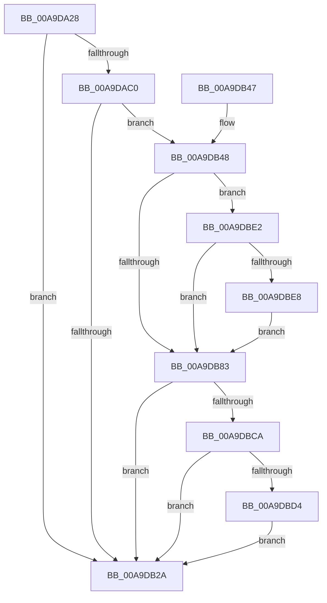

# PopInitializePowerPolicySimulate

- RVA: `0x00A9DA28`–`0x00A9DBF3` (길이 `459` bytes)
- VA: `0x0000000140A9DA28`
- 실행 섹션: `PAGE`
- PDB 이름 있음: `예`; PDB Function 태그: `아니요`
- unwind 정보 RVA: `0x000BA7CC`
- 디코드: `107`개 명령, `459/459` bytes 표시
- 미해석 바이트: `0` (있으면 어셈블리에 `.byte`로 보존)

> 이 문서는 커널 이미지의 기계어와 PDB 기호를 분석해 생성했습니다. 4번과 5번은 함수 원형과 자료형을 바이너리 사용 방식에서 추정한 C 해석이며 원본 소스 복구 결과는 아닙니다.

## 1. Dependencies

- 직접 호출 지점: **10**; 고유 호출 대상: **6**
- 직접 호출자로 확인된 함수: **2**
- RIP 상대 이미지 참조: **9**

### Outgoing calls
- `0x00A9DAB7` → [ZwOpenKey](../../text/6A/ZwOpenKey_function_006AD310.md) (function, `0x006AD310`)
- `0x00A9DACB` → [RtlInitUnicodeString](../../text/42/RtlInitUnicodeString_function_0042A780.md) (function, `0x0042A780`)
- `0x00A9DB16` → [ZwCreateKey](../../text/6A/ZwCreateKey_function_006AD470.md) (function, `0x006AD470`)
- `0x00A9DB21` → [ZwClose](../../text/6A/ZwClose_function_006AD2B0.md) (function, `0x006AD2B0`)
- `0x00A9DB31` → [_security_check_cookie](../../text/6A/_security_check_cookie_function_006AC640.md) (function, `0x006AC640`)
- `0x00A9DB53` → [RtlInitUnicodeString](../../text/42/RtlInitUnicodeString_function_0042A780.md) (function, `0x0042A780`)
- `0x00A9DB7A` → [ZwQueryValueKey](../../text/6A/ZwQueryValueKey_function_006AD3B0.md) (function, `0x006AD3B0`)
- `0x00A9DB8E` → [RtlInitUnicodeString](../../text/42/RtlInitUnicodeString_function_0042A780.md) (function, `0x0042A780`)
- `0x00A9DBB2` → [ZwQueryValueKey](../../text/6A/ZwQueryValueKey_function_006AD3B0.md) (function, `0x006AD3B0`)
- `0x00A9DBBD` → [ZwClose](../../text/6A/ZwClose_function_006AD2B0.md) (function, `0x006AD2B0`)

### Direct callers
- [PopTransitionSystemPowerStateEx](../../pagelk/B7/PopTransitionSystemPowerStateEx_function_00B7E8C0.md) at `0x00B7EC7F`
- [PoInitSystem](../../init/C7/PoInitSystem_function_00C72358.md) at `0x00C73079`

### Static image references
- `0x00A9DA3A` → RVA `0x00E0A740` (`.data`; read)
- `0x00A9DA80` → RVA `0x00E67460` (`.data`; read)
- `0x00A9DA86` → RVA `0x00F0CF0C` (`.data`; write)
- `0x00A9DA8C` → RVA `0x00FD9EF8` (`PAGEDATA`; read)
- `0x00A9DAC0` → RVA `0x0001C6B0` (`.rdata`; read)
- `0x00A9DB48` → RVA `0x0001C6E0` (`.rdata`; read)
- `0x00A9DB83` → RVA `0x0001C718` (`.rdata`; read)
- `0x00A9DBD7` → RVA `0x00F0CF0C` (`.data`; read/write)
- `0x00A9DBEB` → RVA `0x00F0C2E0` (`.data`; write)

## 2. Other-region calls and transfers

- 다른 실행 섹션으로 향하는 call: **10**
  - `0x00A9DAB7` → [ZwOpenKey](../../text/6A/ZwOpenKey_function_006AD310.md) (`PAGE` → `.text`)
  - `0x00A9DACB` → [RtlInitUnicodeString](../../text/42/RtlInitUnicodeString_function_0042A780.md) (`PAGE` → `.text`)
  - `0x00A9DB16` → [ZwCreateKey](../../text/6A/ZwCreateKey_function_006AD470.md) (`PAGE` → `.text`)
  - `0x00A9DB21` → [ZwClose](../../text/6A/ZwClose_function_006AD2B0.md) (`PAGE` → `.text`)
  - `0x00A9DB31` → [_security_check_cookie](../../text/6A/_security_check_cookie_function_006AC640.md) (`PAGE` → `.text`)
  - `0x00A9DB53` → [RtlInitUnicodeString](../../text/42/RtlInitUnicodeString_function_0042A780.md) (`PAGE` → `.text`)
  - `0x00A9DB7A` → [ZwQueryValueKey](../../text/6A/ZwQueryValueKey_function_006AD3B0.md) (`PAGE` → `.text`)
  - `0x00A9DB8E` → [RtlInitUnicodeString](../../text/42/RtlInitUnicodeString_function_0042A780.md) (`PAGE` → `.text`)
  - `0x00A9DBB2` → [ZwQueryValueKey](../../text/6A/ZwQueryValueKey_function_006AD3B0.md) (`PAGE` → `.text`)
  - `0x00A9DBBD` → [ZwClose](../../text/6A/ZwClose_function_006AD2B0.md) (`PAGE` → `.text`)
- 별도 외부 분기/꼬리 이동을 확인하지 못했습니다.

## 3. Assembly (complete function range)

```asm
00A9DA28  48 89 5C 24 08                  mov qword ptr [rsp + 8], rbx
00A9DA2D  55                              push rbp
00A9DA2E  48 8D 6C 24 A9                  lea rbp, [rsp - 0x57]
00A9DA33  48 81 EC C0 00 00 00            sub rsp, 0xc0
00A9DA3A  48 8B 05 FF CC 36 00            mov rax, qword ptr [rip + 0x36ccff]
00A9DA41  48 33 C4                        xor rax, rsp
00A9DA44  48 89 45 4F                     mov qword ptr [rbp + 0x4f], rax
00A9DA48  48 83 65 EF 00                  and qword ptr [rbp - 0x11], 0
00A9DA4D  4C 8D 45 07                     lea r8, [rbp + 7]
00A9DA51  83 65 E7 00                     and dword ptr [rbp - 0x19], 0
00A9DA55  48 8D 4D EF                     lea rcx, [rbp - 0x11]
00A9DA59  48 83 65 DF 00                  and qword ptr [rbp - 0x21], 0
00A9DA5E  33 C0                           xor eax, eax
00A9DA60  83 65 D7 00                     and dword ptr [rbp - 0x29], 0
00A9DA64  0F 57 C0                        xorps xmm0, xmm0
00A9DA67  83 65 23 00                     and dword ptr [rbp + 0x23], 0
00A9DA6B  0F 57 C9                        xorps xmm1, xmm1
00A9DA6E  48 83 65 0F 00                  and qword ptr [rbp + 0xf], 0
00A9DA73  BA 19 00 02 00                  mov edx, 0x20019
00A9DA78  89 45 47                        mov dword ptr [rbp + 0x47], eax
00A9DA7B  BB 30 00 00 00                  mov ebx, 0x30
00A9DA80  8B 05 DA 99 3C 00               mov eax, dword ptr [rip + 0x3c99da]
00A9DA86  89 05 80 F4 46 00               mov dword ptr [rip + 0x46f480], eax
00A9DA8C  48 8D 05 65 C4 53 00            lea rax, [rip + 0x53c465]
00A9DA93  48 C7 45 07 30 00 00 00         mov qword ptr [rbp + 7], 0x30
00A9DA9B  83 65 0B 00                     and dword ptr [rbp + 0xb], 0
00A9DA9F  48 89 45 17                     mov qword ptr [rbp + 0x17], rax
00A9DAA3  0F 11 45 F7                     movups xmmword ptr [rbp - 9], xmm0
00A9DAA7  C7 45 1F 40 02 00 00            mov dword ptr [rbp + 0x1f], 0x240
00A9DAAE  0F 11 4D 37                     movups xmmword ptr [rbp + 0x37], xmm1
00A9DAB2  F3 0F 7F 45 27                  movdqu xmmword ptr [rbp + 0x27], xmm0
00A9DAB7  E8 54 F8 C0 FF                  call 0x1406ad310
00A9DABC  85 C0                           test eax, eax
00A9DABE  78 6A                           js 0x140a9db2a
00A9DAC0  48 8D 15 E9 EB 57 FF            lea rdx, [rip - 0xa81417]
00A9DAC7  48 8D 4D F7                     lea rcx, [rbp - 9]
00A9DACB  E8 B0 CC 98 FF                  call 0x14042a780
00A9DAD0  48 8B 45 EF                     mov rax, qword ptr [rbp - 0x11]
00A9DAD4  4C 8D 45 07                     lea r8, [rbp + 7]
00A9DAD8  48 89 45 0F                     mov qword ptr [rbp + 0xf], rax
00A9DADC  48 8D 4D DF                     lea rcx, [rbp - 0x21]
00A9DAE0  48 8D 45 F7                     lea rax, [rbp - 9]
00A9DAE4  89 5D 07                        mov dword ptr [rbp + 7], ebx
00A9DAE7  48 89 45 17                     mov qword ptr [rbp + 0x17], rax
00A9DAEB  0F 57 C0                        xorps xmm0, xmm0
00A9DAEE  48 8D 45 E7                     lea rax, [rbp - 0x19]
00A9DAF2  C7 45 1F 40 02 00 00            mov dword ptr [rbp + 0x1f], 0x240
00A9DAF9  48 89 44 24 30                  mov qword ptr [rsp + 0x30], rax
00A9DAFE  45 33 C9                        xor r9d, r9d
00A9DB01  83 64 24 28 00                  and dword ptr [rsp + 0x28], 0
00A9DB06  BA 19 00 02 00                  mov edx, 0x20019
00A9DB0B  48 83 64 24 20 00               and qword ptr [rsp + 0x20], 0
00A9DB11  F3 0F 7F 45 27                  movdqu xmmword ptr [rbp + 0x27], xmm0
00A9DB16  E8 55 F9 C0 FF                  call 0x1406ad470
00A9DB1B  48 8B 4D EF                     mov rcx, qword ptr [rbp - 0x11]
00A9DB1F  8B D8                           mov ebx, eax
00A9DB21  E8 8A F7 C0 FF                  call 0x1406ad2b0
00A9DB26  85 DB                           test ebx, ebx
00A9DB28  79 1E                           jns 0x140a9db48
00A9DB2A  48 8B 4D 4F                     mov rcx, qword ptr [rbp + 0x4f]
00A9DB2E  48 33 CC                        xor rcx, rsp
00A9DB31  E8 0A EB C0 FF                  call 0x1406ac640
00A9DB36  48 8B 9C 24 D0 00 00 00         mov rbx, qword ptr [rsp + 0xd0]
00A9DB3E  48 81 C4 C0 00 00 00            add rsp, 0xc0
00A9DB45  5D                              pop rbp
00A9DB46  C3                              ret
00A9DB47  CC                              int3
00A9DB48  48 8D 15 91 EB 57 FF            lea rdx, [rip - 0xa8146f]
00A9DB4F  48 8D 4D F7                     lea rcx, [rbp - 9]
00A9DB53  E8 28 CC 98 FF                  call 0x14042a780
00A9DB58  48 8B 4D DF                     mov rcx, qword ptr [rbp - 0x21]
00A9DB5C  48 8D 45 D7                     lea rax, [rbp - 0x29]
00A9DB60  BB 14 00 00 00                  mov ebx, 0x14
00A9DB65  48 89 44 24 28                  mov qword ptr [rsp + 0x28], rax
00A9DB6A  4C 8D 4D 37                     lea r9, [rbp + 0x37]
00A9DB6E  89 5C 24 20                     mov dword ptr [rsp + 0x20], ebx
00A9DB72  48 8D 55 F7                     lea rdx, [rbp - 9]
00A9DB76  44 8D 43 EE                     lea r8d, [rbx - 0x12]
00A9DB7A  E8 31 F8 C0 FF                  call 0x1406ad3b0
00A9DB7F  85 C0                           test eax, eax
00A9DB81  79 5F                           jns 0x140a9dbe2
00A9DB83  48 8D 15 8E EB 57 FF            lea rdx, [rip - 0xa81472]
00A9DB8A  48 8D 4D F7                     lea rcx, [rbp - 9]
00A9DB8E  E8 ED CB 98 FF                  call 0x14042a780
00A9DB93  48 8B 4D DF                     mov rcx, qword ptr [rbp - 0x21]
00A9DB97  48 8D 45 D7                     lea rax, [rbp - 0x29]
00A9DB9B  48 89 44 24 28                  mov qword ptr [rsp + 0x28], rax
00A9DBA0  4C 8D 4D 37                     lea r9, [rbp + 0x37]
00A9DBA4  41 B8 02 00 00 00               mov r8d, 2
00A9DBAA  89 5C 24 20                     mov dword ptr [rsp + 0x20], ebx
00A9DBAE  48 8D 55 F7                     lea rdx, [rbp - 9]
00A9DBB2  E8 F9 F7 C0 FF                  call 0x1406ad3b0
00A9DBB7  48 8B 4D DF                     mov rcx, qword ptr [rbp - 0x21]
00A9DBBB  8B D8                           mov ebx, eax
00A9DBBD  E8 EE F6 C0 FF                  call 0x1406ad2b0
00A9DBC2  85 DB                           test ebx, ebx
00A9DBC4  0F 88 60 FF FF FF               js 0x140a9db2a
00A9DBCA  83 7D 3F 04                     cmp dword ptr [rbp + 0x3f], 4
00A9DBCE  0F 85 56 FF FF FF               jne 0x140a9db2a
00A9DBD4  8B 45 43                        mov eax, dword ptr [rbp + 0x43]
00A9DBD7  09 05 2F F3 46 00               or dword ptr [rip + 0x46f32f], eax
00A9DBDD  E9 48 FF FF FF                  jmp 0x140a9db2a
00A9DBE2  83 7D 3F 04                     cmp dword ptr [rbp + 0x3f], 4
00A9DBE6  75 9B                           jne 0x140a9db83
00A9DBE8  8B 45 43                        mov eax, dword ptr [rbp + 0x43]
00A9DBEB  89 05 EF E6 46 00               mov dword ptr [rip + 0x46e6ef], eax
00A9DBF1  EB 90                           jmp 0x140a9db83
```

## 4. C-style interpretation (structured pseudocode)

```c
__int64 __fastcall PopInitializePowerPolicySimulate(__int64 a1, __int64 a2, __int64 a3, int a4)
{
    __int64 result;
    __int64 v_rsp;
    unsigned __int64 v_stack_m10;
    unsigned int v_stack_m18;
    unsigned int v_stack_m1C;
    unsigned int v_stack_m20;
    unsigned __int64 v_stack_m28;
    unsigned __int64 v_stack_m38;
    unsigned int v_stack_m3C;
    unsigned int v_stack_m40;
    unsigned __int64 v_stack_m48;
    unsigned __int64 v_stack_m50;
    unsigned int v_stack_m54;
    unsigned __int64 v_stack_m58;
    unsigned __int64 v_stack_m5F;
    unsigned __int64 v_stack_m68;
    unsigned __int64 v_stack_m70;
    unsigned int v_stack_m78;
    unsigned __int64 v_stack_m80;
    unsigned int v_stack_m88;
    unsigned __int64 v_stack_m98;
    unsigned int v_stack_mA0;
    unsigned __int64 v_stack_mA8;
    unsigned int v_stack_p20;
    unsigned __int64 v_stack_p28;
    unsigned __int64 v_stack_p8;

    v_stack_p8 = v_rbx;
    v_rsp = (v_rsp) - (192);
    result = (*(unsigned __int64 *)(v_rip + 3591423)) ^ (v_rsp);
    v_stack_m10 = result;
    result = 0;
    v_stack_m18 = 0;
    *(unsigned int *)(v_rip + 4650112) = (unsigned int)((unsigned int)(*(unsigned int *)(v_rip + 3971546)));
    v_stack_m58 = 48;
    v_stack_m48 = v_rip + 5489765;
    v_stack_m68 = v_xmm0;
    v_stack_m40 = 576;
    v_stack_m28 = v_xmm1;
    v_stack_m38 = v_xmm0;
    result = ZwOpenKey(v_stack_m70, (unsigned int)(0x20019ULL), v_stack_m58, a4);
    if (sign_flag) goto loc_00A9DB2A;
    result = RtlInitUnicodeString(v_stack_m68, v_rip - 11015191, v_stack_m58, a4);
    v_stack_m50 = v_stack_m70;
    v_stack_m58 = 48;
    v_stack_m48 = v_stack_m68;
    v_stack_m40 = 576;
    v_stack_m98 = v_stack_m78;
    a4 = 0;
    v_stack_m38 = v_xmm0;
    result = ZwCreateKey(v_stack_m80, (unsigned int)(0x20019ULL), v_stack_m58, a4);
    result = ZwClose(v_stack_m70, (unsigned int)(0x20019ULL), v_stack_m58, a4);
    if (!sign_flag) goto loc_00A9DB48;
loc_00A9DB2A:
    a1 = (v_stack_m10) ^ (v_rsp);
    result = _security_check_cookie(a1, (unsigned int)(0x20019ULL), v_stack_m58, a4);
    v_rsp = (v_rsp) + (192);
    return result;
loc_00A9DB48:
    result = RtlInitUnicodeString(v_stack_m68, v_rip - 11015279, v_stack_m58, a4);
    v_stack_p28 = v_stack_m88;
    v_stack_p20 = 20;
    result = ZwQueryValueKey(v_stack_m80, v_stack_m68, 20 - 18, v_stack_m28);
    if (!sign_flag) goto loc_00A9DBE2;
loc_00A9DB83:
    result = RtlInitUnicodeString(v_stack_m68, v_rip - 11015282, 20 - 18, v_stack_m28);
    v_stack_p28 = v_stack_m88;
    v_stack_p20 = 20;
    result = ZwQueryValueKey(v_stack_m80, v_stack_m68, 2, v_stack_m28);
    result = ZwClose(v_stack_m80, v_stack_m68, 2, v_stack_m28);
    if (sign_flag) goto loc_00A9DB2A;
    if (v_stack_m20 != 4) goto loc_00A9DB2A;
    goto loc_00A9DB2A;
loc_00A9DBE2:
    if (v_stack_m20 != 4) goto loc_00A9DB83;
    *(unsigned int *)(v_rip + 4646639) = (unsigned int)((unsigned int)(v_stack_m1C));
    goto loc_00A9DB83;
}
```

## 5. (Beta) C Style

```c
int64_t PopInitializePowerPolicySimulate(int64_t Arg1, int64_t Arg2, int64_t Arg3, int32_t Arg4)
{
    int64_t result;
    int64_t local_rsp;
    uint64_t v_stack_m10;
    uint32_t v_stack_m18;
    uint32_t v_stack_m1C;
    uint32_t v_stack_m20;
    uint64_t v_stack_m28;
    uint64_t v_stack_m38;
    uint32_t v_stack_m3C;
    uint32_t v_stack_m40;
    uint64_t v_stack_m48;
    uint64_t v_stack_m50;
    uint32_t v_stack_m54;
    uint64_t v_stack_m58;
    uint64_t v_stack_m5F;
    uint64_t v_stack_m68;
    uint64_t v_stack_m70;
    uint32_t v_stack_m78;
    uint64_t v_stack_m80;
    uint32_t v_stack_m88;
    uint64_t v_stack_m98;
    uint32_t v_stack_mA0;
    uint64_t v_stack_mA8;
    uint32_t v_stack_p20;
    uint64_t v_stack_p28;
    uint64_t v_stack_p8;

    v_stack_p8 = local_rbx;
    local_rsp = (local_rsp) - (192);
    result = (*(uint64_t *)(v_rip + 0x36CCFF)) ^ (local_rsp);
    v_stack_m10 = result;
    result = 0;
    v_stack_m18 = 0;
    *(uint32_t *)(v_rip + 0x46F480) = (uint32_t)((uint32_t)(*(uint32_t *)(v_rip + 0x3C99DA)));
    v_stack_m58 = 48;
    v_stack_m48 = v_rip + 5489765;
    v_stack_m68 = v_xmm0;
    v_stack_m40 = 576;
    v_stack_m28 = v_xmm1;
    v_stack_m38 = v_xmm0;
    result = ZwOpenKey(v_stack_m70, (uint32_t)(0x20019ULL), v_stack_m58, Arg4);
    if (sign_flag) goto loc_00A9DB2A;
    result = RtlInitUnicodeString(v_stack_m68, v_rip - 11015191, v_stack_m58, Arg4);
    v_stack_m50 = v_stack_m70;
    v_stack_m58 = 48;
    v_stack_m48 = v_stack_m68;
    v_stack_m40 = 576;
    v_stack_m98 = v_stack_m78;
    Arg4 = 0;
    v_stack_m38 = v_xmm0;
    result = ZwCreateKey(v_stack_m80, (uint32_t)(0x20019ULL), v_stack_m58, Arg4);
    result = ZwClose(v_stack_m70, (uint32_t)(0x20019ULL), v_stack_m58, Arg4);
    if (!sign_flag) goto loc_00A9DB48;
loc_00A9DB2A:
    Arg1 = (v_stack_m10) ^ (local_rsp);
    result = _security_check_cookie(Arg1, (uint32_t)(0x20019ULL), v_stack_m58, Arg4);
    local_rsp = (local_rsp) + (192);
    return result;
loc_00A9DB48:
    result = RtlInitUnicodeString(v_stack_m68, v_rip - 11015279, v_stack_m58, Arg4);
    v_stack_p28 = v_stack_m88;
    v_stack_p20 = 20;
    result = ZwQueryValueKey(v_stack_m80, v_stack_m68, 20 - 18, v_stack_m28);
    if (!sign_flag) goto loc_00A9DBE2;
loc_00A9DB83:
    result = RtlInitUnicodeString(v_stack_m68, v_rip - 11015282, 20 - 18, v_stack_m28);
    v_stack_p28 = v_stack_m88;
    v_stack_p20 = 20;
    result = ZwQueryValueKey(v_stack_m80, v_stack_m68, 2, v_stack_m28);
    result = ZwClose(v_stack_m80, v_stack_m68, 2, v_stack_m28);
    if (sign_flag) goto loc_00A9DB2A;
    if (v_stack_m20 != 4) goto loc_00A9DB2A;
    goto loc_00A9DB2A;
loc_00A9DBE2:
    if (v_stack_m20 != 4) goto loc_00A9DB83;
    *(uint32_t *)(v_rip + 0x46E6EF) = (uint32_t)((uint32_t)(v_stack_m1C));
    goto loc_00A9DB83;
}
```

## 6. Execution-region graph

[열기: 2D/3D 그래프와 함수 탐색 컨트롤 패널](../../../control-panel.html?section=page&rva=0x00A9DA28&view=graph)

- 2D 그래프는 위에서 아래로 흐르고, 3D 그래프는 빈 공간을 드래그해 회전합니다. Shift+드래그는 이동, 휠은 확대·축소, 함수 노드 선택은 대상 보고서 이동입니다.

### Static fallback


