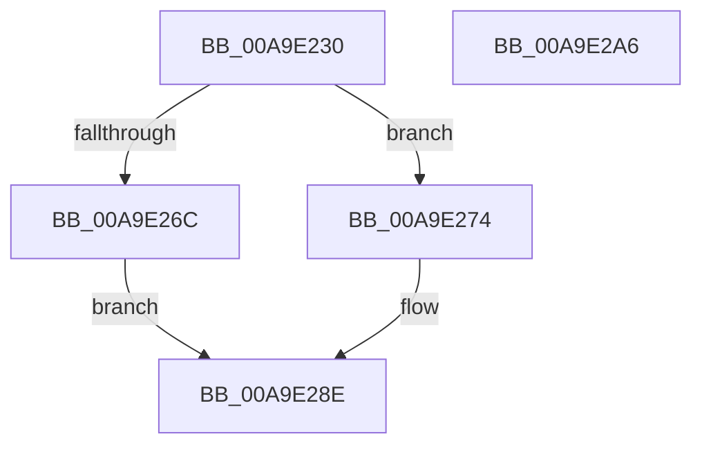

# PopMeasureEnergyChange

- RVA: `0x00A9E230`–`0x00A9E2A7` (길이 `119` bytes)
- VA: `0x0000000140A9E230`
- 실행 섹션: `PAGE`
- PDB 이름 있음: `예`; PDB Function 태그: `아니요`
- unwind 정보 RVA: `0x000BA858`
- 디코드: `31`개 명령, `119/119` bytes 표시
- 미해석 바이트: `0` (있으면 어셈블리에 `.byte`로 보존)

> 이 문서는 커널 이미지의 기계어와 PDB 기호를 분석해 생성했습니다. 4번과 5번은 함수 원형과 자료형을 바이너리 사용 방식에서 추정한 C 해석이며 원본 소스 복구 결과는 아닙니다.

## 1. Dependencies

- 직접 호출 지점: **2**; 고유 호출 대상: **2**
- 직접 호출자로 확인된 함수: **2**
- RIP 상대 이미지 참조: **2**

### Outgoing calls
- `0x00A9E24C` → [PopAcquireRwLockShared](../../text/2D/PopAcquireRwLockShared_function_002D9A40.md) (function, `0x002D9A40`)
- `0x00A9E25F` → [PopReleaseRwLock](../../text/2D/PopReleaseRwLock_function_002DFBBC.md) (function, `0x002DFBBC`)

### Direct callers
- [PopCalculateCsSummary](../../text/43/PopCalculateCsSummary_function_0043A1B0.md) at `0x0043A25B`
- [PopTransitionTelemetryOsState](PopTransitionTelemetryOsState_function_00A9DD40.md) at `0x00A9DF84`

### Static image references
- `0x00A9E242` → RVA `0x00F0C238` (`.data`; read)
- `0x00A9E251` → RVA `0x00F0C2B0` (`.data`; read)

## 2. Other-region calls and transfers

- 다른 실행 섹션으로 향하는 call: **2**
  - `0x00A9E24C` → [PopAcquireRwLockShared](../../text/2D/PopAcquireRwLockShared_function_002D9A40.md) (`PAGE` → `.text`)
  - `0x00A9E25F` → [PopReleaseRwLock](../../text/2D/PopReleaseRwLock_function_002DFBBC.md) (`PAGE` → `.text`)
- 별도 외부 분기/꼬리 이동을 확인하지 못했습니다.

## 3. Assembly (complete function range)

```asm
00A9E230  48 89 5C 24 08                  mov qword ptr [rsp + 8], rbx
00A9E235  57                              push rdi
00A9E236  48 83 EC 30                     sub rsp, 0x30
00A9E23A  48 8B D9                        mov rbx, rcx
00A9E23D  0F 29 74 24 20                  movaps xmmword ptr [rsp + 0x20], xmm6
00A9E242  48 8D 0D EF DF 46 00            lea rcx, [rip + 0x46dfef]
00A9E249  48 8B FA                        mov rdi, rdx
00A9E24C  E8 EF B7 83 FF                  call 0x1402d9a40
00A9E251  0F 10 35 58 E0 46 00            movups xmm6, xmmword ptr [rip + 0x46e058]
00A9E258  48 8D 0D D9 DF 46 00            lea rcx, [rip + 0x46dfd9]
00A9E25F  E8 58 19 84 FF                  call 0x1402dfbbc
00A9E264  33 C0                           xor eax, eax
00A9E266  48 39 47 08                     cmp qword ptr [rdi + 8], rax
00A9E26A  75 08                           jne 0x140a9e274
00A9E26C  C7 03 01 00 00 00               mov dword ptr [rbx], 1
00A9E272  EB 1A                           jmp 0x140a9e28e
00A9E274  66 0F 7E F0                     movd eax, xmm6
00A9E278  66 0F 6F C6                     movdqa xmm0, xmm6
00A9E27C  66 0F 73 D8 08                  psrldq xmm0, 8
00A9E281  0B 07                           or eax, dword ptr [rdi]
00A9E283  89 03                           mov dword ptr [rbx], eax
00A9E285  66 48 0F 7E C0                  movq rax, xmm0
00A9E28A  48 2B 47 08                     sub rax, qword ptr [rdi + 8]
00A9E28E  48 89 43 08                     mov qword ptr [rbx + 8], rax
00A9E292  48 8B 5C 24 40                  mov rbx, qword ptr [rsp + 0x40]
00A9E297  F3 0F 7F 37                     movdqu xmmword ptr [rdi], xmm6
00A9E29B  0F 28 74 24 20                  movaps xmm6, xmmword ptr [rsp + 0x20]
00A9E2A0  48 83 C4 30                     add rsp, 0x30
00A9E2A4  5F                              pop rdi
00A9E2A5  C3                              ret
00A9E2A6  CC                              int3
```

## 4. C-style interpretation (structured pseudocode)

```c
__int64 __fastcall PopMeasureEnergyChange(__int64 a1, __int64 a2)
{
    __int64 result;
    __int64 v_rsp;
    unsigned __int64 v_stack_m18;
    unsigned __int64 v_stack_p8;

    v_stack_p8 = v_rbx;
    v_rsp = (v_rsp) - (48);
    v_stack_m18 = v_xmm6;
    result = PopAcquireRwLockShared(v_rip + 4644847, a2, a3, a4);
    result = PopReleaseRwLock(v_rip + 4644825, a2, a3, a4);
    result = 0;
    if ((*(unsigned __int64 *)(a2 + 8)) != 0) goto loc_00A9E274;
    *(unsigned int *)(a1) = 1;
    goto loc_00A9E28E;
loc_00A9E274:
    result = (unsigned int)((result) | (*(unsigned int *)(a2)));
    *(unsigned int *)(a1) = (unsigned int)(result);
    result = (result) - (*(unsigned __int64 *)(a2 + 8));
loc_00A9E28E:
    *(unsigned __int64 *)(a1 + 8) = result;
    *(unsigned __int64 *)(a2) = v_xmm6;
    v_rsp = (v_rsp) + (48);
    return result;
}
```

## 5. (Beta) C Style

```c
int64_t PopMeasureEnergyChange(void *Arg1, void *Arg2)
{
    uint8_t *arg1 = (uint8_t *)Arg1;
    uint8_t *arg2 = (uint8_t *)Arg2;

    int64_t result;
    int64_t local_rsp;
    uint64_t v_stack_m18;
    uint64_t v_stack_p8;

    v_stack_p8 = local_rbx;
    local_rsp = (local_rsp) - (48);
    v_stack_m18 = v_xmm6;
    result = PopAcquireRwLockShared(v_rip + 4644847, Arg2, a3, a4);
    result = PopReleaseRwLock(v_rip + 4644825, Arg2, a3, a4);
    result = 0;
    if ((*(uint64_t *)(arg2 + 0x8)) != 0) goto loc_00A9E274;
    *(uint32_t *)(arg1) = 1;
    goto loc_00A9E28E;
loc_00A9E274:
    result = (uint32_t)((result) | (*(uint32_t *)(arg2)));
    *(uint32_t *)(arg1) = (uint32_t)(result);
    result = (result) - (*(uint64_t *)(arg2 + 0x8));
loc_00A9E28E:
    *(uint64_t *)(arg1 + 0x8) = result;
    *(uint64_t *)(arg2) = v_xmm6;
    local_rsp = (local_rsp) + (48);
    return result;
}
```

### 관측된 메모리 오프셋

구조체 형식이 확인되지 않은 접근은 인자 기준의 오프셋으로만 기록했습니다.

| 기준 인자 | 오프셋 표현 | 폭 (bit) | 접근 |
|---|---:|---:|---|
| `Arg1` | `+ 0x0` | `32` | `W` |
| `Arg1` | `+ 0x8` | `64` | `W` |
| `Arg2` | `+ 0x0` | `32` | `R` |
| `Arg2` | `+ 0x0` | `128` | `W` |
| `Arg2` | `+ 0x8` | `64` | `R` |

## 6. Execution-region graph

[열기: 2D/3D 그래프와 함수 탐색 컨트롤 패널](../../../control-panel.html?section=page&rva=0x00A9E230&view=graph)

- 2D 그래프는 위에서 아래로 흐르고, 3D 그래프는 빈 공간을 드래그해 회전합니다. Shift+드래그는 이동, 휠은 확대·축소, 함수 노드 선택은 대상 보고서 이동입니다.

### Static fallback


