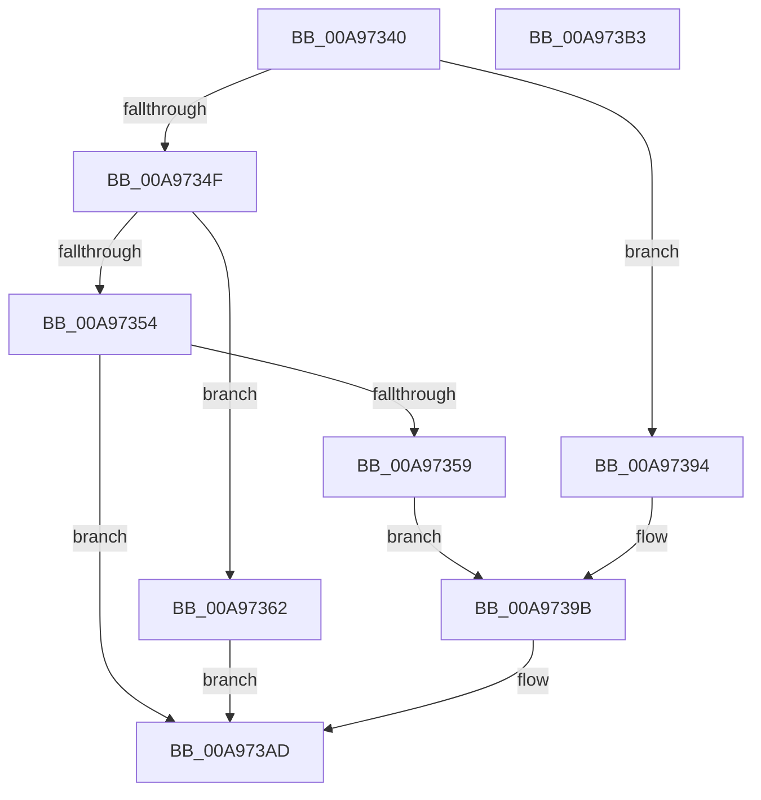

# PopMonitorProcessBrightnessAction

- RVA: `0x00A97340`–`0x00A973B4` (길이 `116` bytes)
- VA: `0x0000000140A97340`
- 실행 섹션: `PAGE`
- PDB 이름 있음: `예`; PDB Function 태그: `아니요`
- unwind 정보 RVA: `0x000B9D4C`
- 디코드: `32`개 명령, `116/116` bytes 표시
- 미해석 바이트: `0` (있으면 어셈블리에 `.byte`로 보존)

> 이 문서는 커널 이미지의 기계어와 PDB 기호를 분석해 생성했습니다. 4번과 5번은 함수 원형과 자료형을 바이너리 사용 방식에서 추정한 C 해석이며 원본 소스 복구 결과는 아닙니다.

## 1. Dependencies

- 직접 호출 지점: **3**; 고유 호출 대상: **3**
- 직접 호출자로 확인된 함수: **1**
- RIP 상대 이미지 참조: **2**

### Outgoing calls
- `0x00A9736D` → [memset](../../text/6C/memset_function_006C6C40.md) (function, `0x006C6C40`)
- `0x00A9738D` → [PopUmpoSendPowerMessage](../../text/23/PopUmpoSendPowerMessage_function_00230730.md) (function, `0x00230730`)
- `0x00A973A8` → [PopSetPowerSettingValueAcDc](../91/PopSetPowerSettingValueAcDc_function_00914D6C.md) (function, `0x00914D6C`)

### Direct callers
- [PopMonitorProcessLoop](PopMonitorProcessLoop_function_00A97228.md) at `0x00A972FA`

### Static image references
- `0x00A97359` → RVA `0x00024628` (`.rdata`; read)
- `0x00A97394` → RVA `0x0001C348` (`.rdata`; read)

## 2. Other-region calls and transfers

- 다른 실행 섹션으로 향하는 call: **2**
  - `0x00A9736D` → [memset](../../text/6C/memset_function_006C6C40.md) (`PAGE` → `.text`)
  - `0x00A9738D` → [PopUmpoSendPowerMessage](../../text/23/PopUmpoSendPowerMessage_function_00230730.md) (`PAGE` → `.text`)
- 별도 외부 분기/꼬리 이동을 확인하지 못했습니다.

## 3. Assembly (complete function range)

```asm
00A97340  89 54 24 10                     mov dword ptr [rsp + 0x10], edx
00A97344  53                              push rbx
00A97345  48 83 EC 70                     sub rsp, 0x70
00A97349  8B DA                           mov ebx, edx
00A9734B  85 C9                           test ecx, ecx
00A9734D  74 45                           je 0x140a97394
00A9734F  83 E9 02                        sub ecx, 2
00A97352  74 0E                           je 0x140a97362
00A97354  83 F9 01                        cmp ecx, 1
00A97357  75 54                           jne 0x140a973ad
00A97359  48 8D 0D C8 D2 58 FF            lea rcx, [rip - 0xa72d38]
00A97360  EB 39                           jmp 0x140a9739b
00A97362  33 D2                           xor edx, edx
00A97364  48 8D 4C 24 20                  lea rcx, [rsp + 0x20]
00A97369  44 8D 42 48                     lea r8d, [rdx + 0x48]
00A9736D  E8 CE F8 C2 FF                  call 0x1406c6c40
00A97372  45 33 C9                        xor r9d, r9d
00A97375  C7 44 24 20 0B 00 00 00         mov dword ptr [rsp + 0x20], 0xb
00A9737D  45 33 C0                        xor r8d, r8d
00A97380  89 5C 24 28                     mov dword ptr [rsp + 0x28], ebx
00A97384  48 8D 4C 24 20                  lea rcx, [rsp + 0x20]
00A97389  41 8D 51 48                     lea edx, [r9 + 0x48]
00A9738D  E8 9E 93 79 FF                  call 0x140230730
00A97392  EB 19                           jmp 0x140a973ad
00A97394  48 8D 0D AD 4F 58 FF            lea rcx, [rip - 0xa7b053]
00A9739B  4C 8D 84 24 88 00 00 00         lea r8, [rsp + 0x88]
00A973A3  BA 04 00 00 00                  mov edx, 4
00A973A8  E8 BF D9 E7 FF                  call 0x140914d6c
00A973AD  48 83 C4 70                     add rsp, 0x70
00A973B1  5B                              pop rbx
00A973B2  C3                              ret
00A973B3  CC                              int3
```

## 4. C-style interpretation (structured pseudocode)

```c
__int64 __fastcall PopMonitorProcessBrightnessAction(int a1, int a2, __int64 a3, int a4)
{
    __int64 result;
    __int64 v_rsp;
    unsigned int v_stack_m50;
    unsigned __int64 v_stack_m58;
    unsigned int v_stack_p10;

    v_stack_p10 = a2;
    v_rsp = (v_rsp) - (112);
    if (a1 == 0) goto loc_00A97394;
    a1 = (unsigned int)((a1) - (2));
    if (condition_is_equal) goto loc_00A97362;
    if (a1 != 1) goto loc_00A973AD;
    goto loc_00A9739B;
loc_00A97362:
    a2 = 0;
    result = memset(v_stack_m58, a2, a2 + 72, a4);
    a4 = 0;
    v_stack_m58 = 11;
    a3 = 0;
    v_stack_m50 = (unsigned int)((unsigned int)(a2));
    result = PopUmpoSendPowerMessage(v_stack_m58, a4 + 72, a3, a4);
    goto loc_00A973AD;
loc_00A97394:
loc_00A9739B:
    result = PopSetPowerSettingValueAcDc(v_rip - 10989651, 4, v_stack_p10, a4);
loc_00A973AD:
    v_rsp = (v_rsp) + (112);
    return result;
}
```

## 5. (Beta) C Style

```c
int64_t PopMonitorProcessBrightnessAction(int32_t Arg1, int32_t Arg2, int64_t Arg3, int32_t Arg4)
{
    int64_t result;
    int64_t local_rsp;
    uint32_t v_stack_m50;
    uint64_t v_stack_m58;
    uint32_t v_stack_p10;

    v_stack_p10 = Arg2;
    local_rsp = (local_rsp) - (112);
    if (Arg1 == 0) goto loc_00A97394;
    Arg1 = (uint32_t)((Arg1) - (2));
    if (condition_is_equal) goto loc_00A97362;
    if (Arg1 != 1) goto loc_00A973AD;
    goto loc_00A9739B;
loc_00A97362:
    Arg2 = 0;
    result = memset(v_stack_m58, Arg2, Arg2 + 72, Arg4);
    Arg4 = 0;
    v_stack_m58 = 11;
    Arg3 = 0;
    v_stack_m50 = (uint32_t)((uint32_t)(Arg2));
    result = PopUmpoSendPowerMessage(v_stack_m58, Arg4 + 72, Arg3, Arg4);
    goto loc_00A973AD;
loc_00A97394:
loc_00A9739B:
    result = PopSetPowerSettingValueAcDc(v_rip - 10989651, 4, v_stack_p10, Arg4);
loc_00A973AD:
    local_rsp = (local_rsp) + (112);
    return result;
}
```

## 6. Execution-region graph

[열기: 2D/3D 그래프와 함수 탐색 컨트롤 패널](../../../control-panel.html?section=page&rva=0x00A97340&view=graph)

- 2D 그래프는 위에서 아래로 흐르고, 3D 그래프는 빈 공간을 드래그해 회전합니다. Shift+드래그는 이동, 휠은 확대·축소, 함수 노드 선택은 대상 보고서 이동입니다.

### Static fallback


