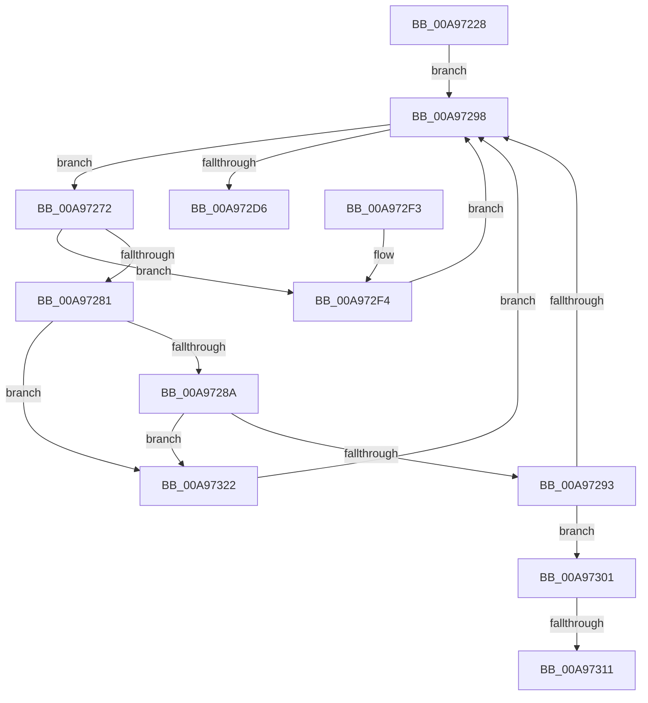

# PopMonitorProcessLoop

- RVA: `0x00A97228`–`0x00A9733A` (길이 `274` bytes)
- VA: `0x0000000140A97228`
- 실행 섹션: `PAGE`
- PDB 이름 있음: `예`; PDB Function 태그: `예`
- unwind 정보 RVA: `0x000B9D20`
- 디코드: `65`개 명령, `274/274` bytes 표시
- 미해석 바이트: `0` (있으면 어셈블리에 `.byte`로 보존)

> 이 문서는 커널 이미지의 기계어와 PDB 기호를 분석해 생성했습니다. 4번과 5번은 함수 원형과 자료형을 바이너리 사용 방식에서 추정한 C 해석이며 원본 소스 복구 결과는 아닙니다.

## 1. Dependencies

- 직접 호출 지점: **6**; 고유 호출 대상: **5**
- 직접 호출자로 확인된 함수: **2**
- RIP 상대 이미지 참조: **4**

### Outgoing calls
- `0x00A97269` → [memset](../../text/6C/memset_function_006C6C40.md) (function, `0x006C6C40`)
- `0x00A972CD` → [ZwAlpcSendWaitReceivePort](../../text/6A/ZwAlpcSendWaitReceivePort_function_006AE290.md) (function, `0x006AE290`)
- `0x00A972DD` → [_security_check_cookie](../../text/6A/_security_check_cookie_function_006AC640.md) (function, `0x006AC640`)
- `0x00A972FA` → [PopMonitorProcessBrightnessAction](PopMonitorProcessBrightnessAction_function_00A97340.md) (function, `0x00A97340`)
- `0x00A97311` → [ZwClose](../../text/6A/ZwClose_function_006AD2B0.md) (function, `0x006AD2B0`)
- `0x00A97329` → [ZwClose](../../text/6A/ZwClose_function_006AD2B0.md) (function, `0x006AD2B0`)

### Direct callers
- [PopMonitorAlpcCallback](PopMonitorAlpcCallback_function_00A97210.md) at `0x00A97214`
- [PopUmpoInitializeMonitorChannel](../../init/C4/PopUmpoInitializeMonitorChannel_function_00C42B6C.md) at `0x00C42CB9`

### Static image references
- `0x00A9723A` → RVA `0x00E0A740` (`.data`; read)
- `0x00A97298` → RVA `0x00F084A8` (`.data`; read)
- `0x00A97301` → RVA `0x00F084B0` (`.data`; read)
- `0x00A97316` → RVA `0x00F084B0` (`.data`; write)

## 2. Other-region calls and transfers

- 다른 실행 섹션으로 향하는 call: **5**
  - `0x00A97269` → [memset](../../text/6C/memset_function_006C6C40.md) (`PAGE` → `.text`)
  - `0x00A972CD` → [ZwAlpcSendWaitReceivePort](../../text/6A/ZwAlpcSendWaitReceivePort_function_006AE290.md) (`PAGE` → `.text`)
  - `0x00A972DD` → [_security_check_cookie](../../text/6A/_security_check_cookie_function_006AC640.md) (`PAGE` → `.text`)
  - `0x00A97311` → [ZwClose](../../text/6A/ZwClose_function_006AD2B0.md) (`PAGE` → `.text`)
  - `0x00A97329` → [ZwClose](../../text/6A/ZwClose_function_006AD2B0.md) (`PAGE` → `.text`)
- call이 아닌 외부 분기/꼬리 이동: **2**
  - `0x00A9730B` → [sub_00B47C52](../B4/Unknown_function_00B47C52.md) (`tail-transfer`)
  - `0x00A9731D` → [sub_00B47C52](../B4/Unknown_function_00B47C52.md) (`tail-transfer`)

## 3. Assembly (complete function range)

```asm
00A97228  48 89 5C 24 08                  mov qword ptr [rsp + 8], rbx
00A9722D  55                              push rbp
00A9722E  48 8D 6C 24 E0                  lea rbp, [rsp - 0x20]
00A97233  48 81 EC 20 01 00 00            sub rsp, 0x120
00A9723A  48 8B 05 FF 34 37 00            mov rax, qword ptr [rip + 0x3734ff]
00A97241  48 33 C4                        xor rax, rsp
00A97244  48 89 45 10                     mov qword ptr [rbp + 0x10], rax
00A97248  33 C0                           xor eax, eax
00A9724A  48 8D 4D 90                     lea rcx, [rbp - 0x70]
00A9724E  0F 57 C0                        xorps xmm0, xmm0
00A97251  48 89 44 24 78                  mov qword ptr [rsp + 0x78], rax
00A97256  33 D2                           xor edx, edx
00A97258  89 45 80                        mov dword ptr [rbp - 0x80], eax
00A9725B  0F 11 44 24 58                  movups xmmword ptr [rsp + 0x58], xmm0
00A97260  44 8D 40 48                     lea r8d, [rax + 0x48]
00A97264  0F 11 44 24 68                  movups xmmword ptr [rsp + 0x68], xmm0
00A97269  E8 D2 F9 C2 FF                  call 0x1406c6c40
00A9726E  33 DB                           xor ebx, ebx
00A97270  EB 26                           jmp 0x140a97298
00A97272  0F B7 4D E4                     movzx ecx, word ptr [rbp - 0x1c]
00A97276  81 E1 FF 00 FF FF               and ecx, 0xffff00ff
00A9727C  83 E9 03                        sub ecx, 3
00A9727F  74 73                           je 0x140a972f4
00A97281  83 E9 02                        sub ecx, 2
00A97284  0F 84 98 00 00 00               je 0x140a97322
00A9728A  83 E9 01                        sub ecx, 1
00A9728D  0F 84 8F 00 00 00               je 0x140a97322
00A97293  83 F9 04                        cmp ecx, 4
00A97296  74 69                           je 0x140a97301
00A97298  48 8B 0D 09 12 47 00            mov rcx, qword ptr [rip + 0x471209]
00A9729F  48 8D 44 24 50                  lea rax, [rsp + 0x50]
00A972A4  48 89 5C 24 38                  mov qword ptr [rsp + 0x38], rbx
00A972A9  45 33 C9                        xor r9d, r9d
00A972AC  48 89 5C 24 30                  mov qword ptr [rsp + 0x30], rbx
00A972B1  45 33 C0                        xor r8d, r8d
00A972B4  48 89 44 24 28                  mov qword ptr [rsp + 0x28], rax
00A972B9  33 D2                           xor edx, edx
00A972BB  48 8D 45 E0                     lea rax, [rbp - 0x20]
00A972BF  48 C7 44 24 50 30 00 00 00      mov qword ptr [rsp + 0x50], 0x30
00A972C8  48 89 44 24 20                  mov qword ptr [rsp + 0x20], rax
00A972CD  E8 BE 6F C1 FF                  call 0x1406ae290
00A972D2  85 C0                           test eax, eax
00A972D4  74 9C                           je 0x140a97272
00A972D6  48 8B 4D 10                     mov rcx, qword ptr [rbp + 0x10]
00A972DA  48 33 CC                        xor rcx, rsp
00A972DD  E8 5E 53 C1 FF                  call 0x1406ac640
00A972E2  48 8B 9C 24 30 01 00 00         mov rbx, qword ptr [rsp + 0x130]
00A972EA  48 81 C4 20 01 00 00            add rsp, 0x120
00A972F1  5D                              pop rbp
00A972F2  C3                              ret
00A972F3  CC                              int3
00A972F4  8B 55 0C                        mov edx, dword ptr [rbp + 0xc]
00A972F7  8B 4D 08                        mov ecx, dword ptr [rbp + 8]
00A972FA  E8 41 00 00 00                  call 0x140a97340
00A972FF  EB 97                           jmp 0x140a97298
00A97301  48 8B 0D A8 11 47 00            mov rcx, qword ptr [rip + 0x4711a8]
00A97308  48 85 C9                        test rcx, rcx
00A9730B  0F 84 41 09 0B 00               je 0x140b47c52
00A97311  E8 9A 5F C1 FF                  call 0x1406ad2b0
00A97316  48 89 1D 93 11 47 00            mov qword ptr [rip + 0x471193], rbx
00A9731D  E9 30 09 0B 00                  jmp 0x140b47c52
00A97322  48 8B 0D 87 11 47 00            mov rcx, qword ptr [rip + 0x471187]
00A97329  E8 82 5F C1 FF                  call 0x1406ad2b0
00A9732E  48 89 1D 7B 11 47 00            mov qword ptr [rip + 0x47117b], rbx
00A97335  E9 5E FF FF FF                  jmp 0x140a97298
```

## 4. C-style interpretation (structured pseudocode)

```c
__int64 __fastcall PopMonitorProcessLoop(__int64 a1, int a2, __int64 a3, int a4)
{
    __int64 result;
    __int64 v_rbx;
    __int64 v_rsp;
    unsigned __int64 v_stack_m100;
    unsigned __int64 v_stack_m108;
    unsigned __int64 v_stack_m18;
    unsigned int v_stack_m1C;
    unsigned int v_stack_m20;
    unsigned __int64 v_stack_m28;
    unsigned __int16 v_stack_m44;
    unsigned __int64 v_stack_m48;
    unsigned __int64 v_stack_m98;
    unsigned int v_stack_mA8;
    unsigned __int64 v_stack_mB0;
    unsigned __int64 v_stack_mC0;
    unsigned __int64 v_stack_mD0;
    unsigned __int64 v_stack_mD8;
    unsigned __int64 v_stack_mF0;
    unsigned __int64 v_stack_mF8;
    unsigned __int64 v_stack_p8;

    v_stack_p8 = v_rbx;
    v_rsp = (v_rsp) - (288);
    result = (*(unsigned __int64 *)(v_rip + 3618047)) ^ (v_rsp);
    v_stack_m18 = result;
    result = 0;
    v_stack_mB0 = 0;
    a2 = 0;
    v_stack_mA8 = 0;
    v_stack_mD0 = v_xmm0;
    v_stack_mC0 = v_xmm0;
    result = memset(v_stack_m98, a2, result + 72, a4);
    v_rbx = 0;
    goto loc_00A97298;
loc_00A97272:
    a1 = (unsigned int)((v_stack_m44) & (0xFFFF00FFULL));
    a1 = (unsigned int)((a1) - (3));
    if (condition_is_equal) goto loc_00A972F4;
    a1 = (unsigned int)((a1) - (2));
    if (condition_is_equal) goto loc_00A97322;
    a1 = (unsigned int)((a1) - (1));
    if (condition_is_equal) goto loc_00A97322;
    if (((unsigned int)(a1)) == 4) goto loc_00A97301;
loc_00A97298:
    v_stack_mF0 = 0;
    a4 = 0;
    v_stack_mF8 = 0;
    a3 = 0;
    v_stack_m100 = v_stack_mD8;
    a2 = 0;
    v_stack_mD8 = 48;
    v_stack_m108 = v_stack_m48;
    result = ZwAlpcSendWaitReceivePort(*(unsigned __int64 *)(v_rip + 4657673), a2, a3, a4);
    if ((unsigned int)(result) == 0) goto loc_00A97272;
    a1 = (v_stack_m18) ^ (v_rsp);
    result = _security_check_cookie(a1, a2, a3, a4);
    v_rsp = (v_rsp) + (288);
    return result;
loc_00A972F4:
    result = PopMonitorProcessBrightnessAction((unsigned int)(v_stack_m20), (unsigned int)(v_stack_m1C), a3, a4);
    goto loc_00A97298;
loc_00A97301:
    result = ZwClose(*(unsigned __int64 *)(v_rip + 4657576), (unsigned int)(v_stack_m1C), a3, a4);
    *(unsigned __int64 *)(v_rip + 4657555) = v_stack_p8;
loc_00A97322:
    result = ZwClose(*(unsigned __int64 *)(v_rip + 4657543), (unsigned int)(v_stack_m1C), a3, a4);
    *(unsigned __int64 *)(v_rip + 4657531) = v_stack_p8;
    goto loc_00A97298;
}
```

## 5. (Beta) C Style

```c
int64_t PopMonitorProcessLoop(int64_t Arg1, int32_t Arg2, int64_t Arg3, int32_t Arg4)
{
    int64_t result;
    int64_t local_rbx;
    int64_t local_rsp;
    uint64_t v_stack_m100;
    uint64_t v_stack_m108;
    uint64_t v_stack_m18;
    uint32_t v_stack_m1C;
    uint32_t v_stack_m20;
    uint64_t v_stack_m28;
    uint16_t v_stack_m44;
    uint64_t v_stack_m48;
    uint64_t v_stack_m98;
    uint32_t v_stack_mA8;
    uint64_t v_stack_mB0;
    uint64_t v_stack_mC0;
    uint64_t v_stack_mD0;
    uint64_t v_stack_mD8;
    uint64_t v_stack_mF0;
    uint64_t v_stack_mF8;
    uint64_t v_stack_p8;

    v_stack_p8 = local_rbx;
    local_rsp = (local_rsp) - (288);
    result = (*(uint64_t *)(v_rip + 0x3734FF)) ^ (local_rsp);
    v_stack_m18 = result;
    result = 0;
    v_stack_mB0 = 0;
    Arg2 = 0;
    v_stack_mA8 = 0;
    v_stack_mD0 = v_xmm0;
    v_stack_mC0 = v_xmm0;
    result = memset(v_stack_m98, Arg2, result + 72, Arg4);
    local_rbx = 0;
    goto loc_00A97298;
loc_00A97272:
    Arg1 = (uint32_t)((v_stack_m44) & (0xFFFF00FFULL));
    Arg1 = (uint32_t)((Arg1) - (3));
    if (condition_is_equal) goto loc_00A972F4;
    Arg1 = (uint32_t)((Arg1) - (2));
    if (condition_is_equal) goto loc_00A97322;
    Arg1 = (uint32_t)((Arg1) - (1));
    if (condition_is_equal) goto loc_00A97322;
    if (((uint32_t)(Arg1)) == 4) goto loc_00A97301;
loc_00A97298:
    v_stack_mF0 = 0;
    Arg4 = 0;
    v_stack_mF8 = 0;
    Arg3 = 0;
    v_stack_m100 = v_stack_mD8;
    Arg2 = 0;
    v_stack_mD8 = 48;
    v_stack_m108 = v_stack_m48;
    result = ZwAlpcSendWaitReceivePort(*(uint64_t *)(v_rip + 0x471209), Arg2, Arg3, Arg4);
    if ((uint32_t)(result) == 0) goto loc_00A97272;
    Arg1 = (v_stack_m18) ^ (local_rsp);
    result = _security_check_cookie(Arg1, Arg2, Arg3, Arg4);
    local_rsp = (local_rsp) + (288);
    return result;
loc_00A972F4:
    result = PopMonitorProcessBrightnessAction((uint32_t)(v_stack_m20), (uint32_t)(v_stack_m1C), Arg3, Arg4);
    goto loc_00A97298;
loc_00A97301:
    result = ZwClose(*(uint64_t *)(v_rip + 0x4711A8), (uint32_t)(v_stack_m1C), Arg3, Arg4);
    *(uint64_t *)(v_rip + 0x471193) = v_stack_p8;
loc_00A97322:
    result = ZwClose(*(uint64_t *)(v_rip + 0x471187), (uint32_t)(v_stack_m1C), Arg3, Arg4);
    *(uint64_t *)(v_rip + 0x47117B) = v_stack_p8;
    goto loc_00A97298;
}
```

## 6. Execution-region graph

[열기: 2D/3D 그래프와 함수 탐색 컨트롤 패널](../../../control-panel.html?section=page&rva=0x00A97228&view=graph)

- 2D 그래프는 위에서 아래로 흐르고, 3D 그래프는 빈 공간을 드래그해 회전합니다. Shift+드래그는 이동, 휠은 확대·축소, 함수 노드 선택은 대상 보고서 이동입니다.

### Static fallback


