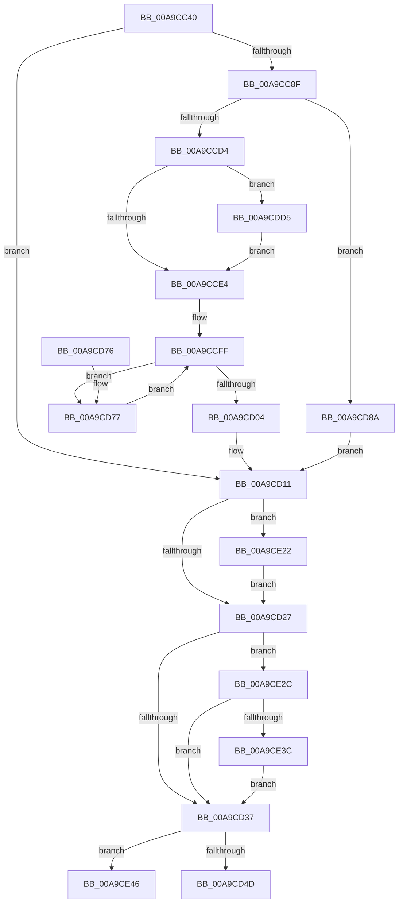

# PopPolicyWorkerAction

- RVA: `0x00A9CC40`–`0x00A9CE4D` (길이 `525` bytes)
- VA: `0x0000000140A9CC40`
- 실행 섹션: `PAGE`
- PDB 이름 있음: `예`; PDB Function 태그: `아니요`
- unwind 정보 RVA: `0x000BA694`
- 디코드: `112`개 명령, `525/525` bytes 표시
- 미해석 바이트: `0` (있으면 어셈블리에 `.byte`로 보존)

> 이 문서는 커널 이미지의 기계어와 PDB 기호를 분석해 생성했습니다. 4번과 5번은 함수 원형과 자료형을 바이너리 사용 방식에서 추정한 C 해석이며 원본 소스 복구 결과는 아닙니다.

## 1. Dependencies

- 직접 호출 지점: **13**; 고유 호출 대상: **10**
- 직접 호출자로 확인된 함수: **0**
- RIP 상대 이미지 참조: **17**

### Outgoing calls
- `0x00A9CC6D` → [PopAcquirePolicyLock](../../pagelk/B7/PopAcquirePolicyLock_function_00B783C0.md) (function, `0x00B783C0`)
- `0x00A9CCA4` → [PopSetPowerActionState](../../text/4B/PopSetPowerActionState_function_004BC8A8.md) (function, `0x004BC8A8`)
- `0x00A9CCBB` → [PopIssueActionRequest](PopIssueActionRequest_function_00A9CE54.md) (function, `0x00A9CE54`)
- `0x00A9CCEC` → [PopSetPowerActionState](../../text/4B/PopSetPowerActionState_function_004BC8A8.md) (function, `0x004BC8A8`)
- `0x00A9CD09` → [PopGetPolicyWorker](../../text/48/PopGetPolicyWorker_function_00482D24.md) (function, `0x00482D24`)
- `0x00A9CD19` → [PopReleasePolicyLock](../../pagelk/B7/PopReleasePolicyLock_function_00B78410.md) (function, `0x00B78410`)
- `0x00A9CD57` → [_security_check_cookie](../../text/6A/_security_check_cookie_function_006AC640.md) (function, `0x006AC640`)
- `0x00A9CD7D` → [PopCompleteAction](PopCompleteAction_function_00A9D338.md) (function, `0x00A9D338`)
- `0x00A9CDC1` → [PopSetPowerActionState](../../text/4B/PopSetPowerActionState_function_004BC8A8.md) (function, `0x004BC8A8`)
- `0x00A9CDCB` → [PopGetPolicyWorker](../../text/48/PopGetPolicyWorker_function_00482D24.md) (function, `0x00482D24`)
- `0x00A9CE18` → [EtwTraceKernelEvent](../../text/23/EtwTraceKernelEvent_function_00235350.md) (function, `0x00235350`)
- `0x00A9CE22` → [PopThermalSxExit](../../text/5D/PopThermalSxExit_function_005D55F8.md) (function, `0x005D55F8`)
- `0x00A9CE3C` → [guard_dispatch_icall](../../text/6B/guard_dispatch_icall_function_006BAAD0.md) (function, `0x006BAAD0`)

### Direct callers
- 이 함수 시작 RVA로 연결되는 직접 call은 확인되지 않았습니다. 간접 호출은 완전히 역산할 수 없습니다.

### Static image references
- `0x00A9CC58` → RVA `0x00E0A740` (`.data`; read)
- `0x00A9CC7B` → RVA `0x00F0BD41` (`.data`; read)
- `0x00A9CC82` → RVA `0x00F0BF08` (`.data`; write)
- `0x00A9CC8F` → RVA `0x00F0BD44` (`.data`; read)
- `0x00A9CC98` → RVA `0x00F0BD48` (`.data`; read)
- `0x00A9CC9E` → RVA `0x00F0BD4C` (`.data`; read)
- `0x00A9CCA9` → RVA `0x00F0BD54` (`.data`; read)
- `0x00A9CCC0` → RVA `0x00F0BD40` (`.data`; read)
- `0x00A9CCD4` → RVA `0x00FC6B10` (`ALMOSTRO`; read)
- `0x00A9CCE6` → RVA `0x00F0BD50` (`.data`; write)
- `0x00A9CCF1` → RVA `0x00F0CE70` (`.data`; read)
- `0x00A9CD11` → RVA `0x00F0BF08` (`.data`; read/write)
- `0x00A9CD27` → RVA `0x00F0C680` (`.data`; write)
- `0x00A9CDA6` → RVA `0x00F0BD54` (`.data`; write)
- `0x00A9CDB5` → RVA `0x00F0BD4C` (`.data`; write)
- `0x00A9CDBB` → RVA `0x00F0BD40` (`.data`; write)
- `0x00A9CE2C` → RVA `0x00E67770` (`.data`; read)

## 2. Other-region calls and transfers

- 다른 실행 섹션으로 향하는 call: **11**
  - `0x00A9CC6D` → [PopAcquirePolicyLock](../../pagelk/B7/PopAcquirePolicyLock_function_00B783C0.md) (`PAGE` → `PAGELK`)
  - `0x00A9CCA4` → [PopSetPowerActionState](../../text/4B/PopSetPowerActionState_function_004BC8A8.md) (`PAGE` → `.text`)
  - `0x00A9CCEC` → [PopSetPowerActionState](../../text/4B/PopSetPowerActionState_function_004BC8A8.md) (`PAGE` → `.text`)
  - `0x00A9CD09` → [PopGetPolicyWorker](../../text/48/PopGetPolicyWorker_function_00482D24.md) (`PAGE` → `.text`)
  - `0x00A9CD19` → [PopReleasePolicyLock](../../pagelk/B7/PopReleasePolicyLock_function_00B78410.md) (`PAGE` → `PAGELK`)
  - `0x00A9CD57` → [_security_check_cookie](../../text/6A/_security_check_cookie_function_006AC640.md) (`PAGE` → `.text`)
  - `0x00A9CDC1` → [PopSetPowerActionState](../../text/4B/PopSetPowerActionState_function_004BC8A8.md) (`PAGE` → `.text`)
  - `0x00A9CDCB` → [PopGetPolicyWorker](../../text/48/PopGetPolicyWorker_function_00482D24.md) (`PAGE` → `.text`)
  - `0x00A9CE18` → [EtwTraceKernelEvent](../../text/23/EtwTraceKernelEvent_function_00235350.md) (`PAGE` → `.text`)
  - `0x00A9CE22` → [PopThermalSxExit](../../text/5D/PopThermalSxExit_function_005D55F8.md) (`PAGE` → `.text`)
  - `0x00A9CE3C` → [guard_dispatch_icall](../../text/6B/guard_dispatch_icall_function_006BAAD0.md) (`PAGE` → `.text`)
- 별도 외부 분기/꼬리 이동을 확인하지 못했습니다.

## 3. Assembly (complete function range)

```asm
00A9CC40  48 89 5C 24 08                  mov qword ptr [rsp + 8], rbx
00A9CC45  48 89 6C 24 10                  mov qword ptr [rsp + 0x10], rbp
00A9CC4A  48 89 74 24 18                  mov qword ptr [rsp + 0x18], rsi
00A9CC4F  57                              push rdi
00A9CC50  41 56                           push r14
00A9CC52  41 57                           push r15
00A9CC54  48 83 EC 60                     sub rsp, 0x60
00A9CC58  48 8B 05 E1 DA 36 00            mov rax, qword ptr [rip + 0x36dae1]
00A9CC5F  48 33 C4                        xor rax, rsp
00A9CC62  48 89 44 24 50                  mov qword ptr [rsp + 0x50], rax
00A9CC67  40 32 F6                        xor sil, sil
00A9CC6A  40 32 ED                        xor bpl, bpl
00A9CC6D  E8 4E B7 0D 00                  call 0x140b783c0
00A9CC72  65 48 8B 04 25 88 01 00 00      mov rax, qword ptr gs:[0x188]
00A9CC7B  80 3D BF F0 46 00 01            cmp byte ptr [rip + 0x46f0bf], 1
00A9CC82  48 89 05 7F F2 46 00            mov qword ptr [rip + 0x46f27f], rax
00A9CC89  0F 85 82 00 00 00               jne 0x140a9cd11
00A9CC8F  4C 63 3D AE F0 46 00            movsxd r15, dword ptr [rip + 0x46f0ae]
00A9CC96  B1 02                           mov cl, 2
00A9CC98  8B 3D AA F0 46 00               mov edi, dword ptr [rip + 0x46f0aa]
00A9CC9E  8B 1D A8 F0 46 00               mov ebx, dword ptr [rip + 0x46f0a8]
00A9CCA4  E8 FF FB A1 FF                  call 0x1404bc8a8
00A9CCA9  44 8B 35 A4 F0 46 00            mov r14d, dword ptr [rip + 0x46f0a4]
00A9CCB0  44 8B CB                        mov r9d, ebx
00A9CCB3  44 8B C7                        mov r8d, edi
00A9CCB6  41 8B D7                        mov edx, r15d
00A9CCB9  33 C9                           xor ecx, ecx
00A9CCBB  E8 94 01 00 00                  call 0x140a9ce54
00A9CCC0  8A 15 7A F0 46 00               mov dl, byte ptr [rip + 0x46f07a]
00A9CCC6  8B F8                           mov edi, eax
00A9CCC8  40 B5 01                        mov bpl, 1
00A9CCCB  F6 C2 02                        test dl, 2
00A9CCCE  0F 85 B6 00 00 00               jne 0x140a9cd8a
00A9CCD4  F7 05 32 9E 52 00 00 80 00 00   test dword ptr [rip + 0x529e32], 0x8000
00A9CCDE  0F 85 F1 00 00 00               jne 0x140a9cdd5
00A9CCE4  33 C9                           xor ecx, ecx
00A9CCE6  89 3D 64 F0 46 00               mov dword ptr [rip + 0x46f064], edi
00A9CCEC  E8 B7 FB A1 FF                  call 0x1404bc8a8
00A9CCF1  48 8B 1D 78 01 47 00            mov rbx, qword ptr [rip + 0x470178]
00A9CCF8  48 8D 35 71 01 47 00            lea rsi, [rip + 0x470171]
00A9CCFF  48 3B DE                        cmp rbx, rsi
00A9CD02  75 73                           jne 0x140a9cd77
00A9CD04  B9 01 00 00 00                  mov ecx, 1
00A9CD09  E8 16 60 9E FF                  call 0x140482d24
00A9CD0E  40 8A F5                        mov sil, bpl
00A9CD11  48 83 25 EF F1 46 00 00         and qword ptr [rip + 0x46f1ef], 0
00A9CD19  E8 F2 B6 0D 00                  call 0x140b78410
00A9CD1E  40 84 F6                        test sil, sil
00A9CD21  0F 85 FB 00 00 00               jne 0x140a9ce22
00A9CD27  C6 05 52 F9 46 00 00            mov byte ptr [rip + 0x46f952], 0
00A9CD2E  40 84 ED                        test bpl, bpl
00A9CD31  0F 85 F5 00 00 00               jne 0x140a9ce2c
00A9CD37  65 48 8B 04 25 88 01 00 00      mov rax, qword ptr gs:[0x188]
00A9CD40  83 B8 E4 01 00 00 00            cmp dword ptr [rax + 0x1e4], 0
00A9CD47  0F 85 F9 00 00 00               jne 0x140a9ce46
00A9CD4D  33 C0                           xor eax, eax
00A9CD4F  48 8B 4C 24 50                  mov rcx, qword ptr [rsp + 0x50]
00A9CD54  48 33 CC                        xor rcx, rsp
00A9CD57  E8 E4 F8 C0 FF                  call 0x1406ac640
00A9CD5C  4C 8D 5C 24 60                  lea r11, [rsp + 0x60]
00A9CD61  49 8B 5B 20                     mov rbx, qword ptr [r11 + 0x20]
00A9CD65  49 8B 6B 28                     mov rbp, qword ptr [r11 + 0x28]
00A9CD69  49 8B 73 30                     mov rsi, qword ptr [r11 + 0x30]
00A9CD6D  49 8B E3                        mov rsp, r11
00A9CD70  41 5F                           pop r15
00A9CD72  41 5E                           pop r14
00A9CD74  5F                              pop rdi
00A9CD75  C3                              ret
00A9CD76  CC                              int3
00A9CD77  48 8B 4B 10                     mov rcx, qword ptr [rbx + 0x10]
00A9CD7B  8B D7                           mov edx, edi
00A9CD7D  E8 B6 05 00 00                  call 0x140a9d338
00A9CD82  48 8B 1B                        mov rbx, qword ptr [rbx]
00A9CD85  E9 75 FF FF FF                  jmp 0x140a9ccff
00A9CD8A  83 3D B7 EF 46 00 05            cmp dword ptr [rip + 0x46efb7], 5
00A9CD91  B8 06 00 00 00                  mov eax, 6
00A9CD96  40 8A CD                        mov cl, bpl
00A9CD99  44 0F 44 F0                     cmove r14d, eax
00A9CD9D  8B 05 A9 EF 46 00               mov eax, dword ptr [rip + 0x46efa9]
00A9CDA3  83 E0 FC                        and eax, 0xfffffffc
00A9CDA6  44 89 35 A7 EF 46 00            mov dword ptr [rip + 0x46efa7], r14d
00A9CDAD  0D 20 00 00 80                  or eax, 0x80000020
00A9CDB2  80 E2 FD                        and dl, 0xfd
00A9CDB5  89 05 91 EF 46 00               mov dword ptr [rip + 0x46ef91], eax
00A9CDBB  88 15 7F EF 46 00               mov byte ptr [rip + 0x46ef7f], dl
00A9CDC1  E8 E2 FA A1 FF                  call 0x1404bc8a8
00A9CDC6  B9 02 00 00 00                  mov ecx, 2
00A9CDCB  E8 54 5F 9E FF                  call 0x140482d24
00A9CDD0  E9 3C FF FF FF                  jmp 0x140a9cd11
00A9CDD5  83 64 24 3C 00                  and dword ptr [rsp + 0x3c], 0
00A9CDDA  48 8D 44 24 30                  lea rax, [rsp + 0x30]
00A9CDDF  83 64 24 4C 00                  and dword ptr [rsp + 0x4c], 0
00A9CDE4  48 8D 4C 24 40                  lea rcx, [rsp + 0x40]
00A9CDE9  41 B9 23 12 00 00               mov r9d, 0x1223
00A9CDEF  48 89 44 24 40                  mov qword ptr [rsp + 0x40], rax
00A9CDF4  BA 01 00 00 00                  mov edx, 1
00A9CDF9  4C 89 7C 24 30                  mov qword ptr [rsp + 0x30], r15
00A9CDFE  41 B8 00 80 00 80               mov r8d, 0x80008000
00A9CE04  89 7C 24 38                     mov dword ptr [rsp + 0x38], edi
00A9CE08  C7 44 24 48 10 00 00 00         mov dword ptr [rsp + 0x48], 0x10
00A9CE10  C7 44 24 20 02 18 50 00         mov dword ptr [rsp + 0x20], 0x501802
00A9CE18  E8 33 85 79 FF                  call 0x140235350
00A9CE1D  E9 C2 FE FF FF                  jmp 0x140a9cce4
00A9CE22  E8 D1 87 B3 FF                  call 0x1405d55f8
00A9CE27  E9 FB FE FF FF                  jmp 0x140a9cd27
00A9CE2C  48 8B 05 3D A9 3C 00            mov rax, qword ptr [rip + 0x3ca93d]
00A9CE33  48 85 C0                        test rax, rax
00A9CE36  0F 84 FB FE FF FF               je 0x140a9cd37
00A9CE3C  E8 8F DC C1 FF                  call 0x1406baad0
00A9CE41  E9 F1 FE FF FF                  jmp 0x140a9cd37
00A9CE46  B9 20 00 00 00                  mov ecx, 0x20
00A9CE4B  CD 29                           int 0x29
```

## 4. C-style interpretation (structured pseudocode)

```c
__int64 __fastcall PopPolicyWorkerAction(void)
{
    __int64 result;
    __int64 v_r14;
    __int64 v_rbp;
    __int64 v_rsi;
    __int64 v_rsp;
    unsigned int v_stack_m14;
    unsigned __int64 v_stack_m18;
    unsigned __int64 v_stack_m20;
    unsigned int v_stack_m24;
    unsigned __int64 v_stack_m28;
    unsigned __int64 v_stack_m30;
    unsigned int v_stack_m40;
    unsigned __int64 v_stack_p10;
    unsigned __int64 v_stack_p18;
    unsigned __int64 v_stack_p8;

    v_stack_p8 = v_rbx;
    v_stack_p10 = v_rbp;
    v_stack_p18 = v_rsi;
    v_rsp = (v_rsp) - (96);
    result = (*(unsigned __int64 *)(v_rip + 3594977)) ^ (v_rsp);
    v_stack_m28 = result;
    v_rsi = 0;
    v_rbp = 0;
    result = PopAcquirePolicyLock(a1, a2, a3, a4);
    *(unsigned __int64 *)(v_rip + 4649599) = *(unsigned __int64 *)(gs_base + (0 + 392));
    if ((*(unsigned __int8 *)(v_rip + 4649151)) != 1) goto loc_00A9CD11;
    result = PopSetPowerActionState(2, a2, a3, a4);
    a1 = 0;
    result = PopIssueActionRequest(a1, (unsigned int)((unsigned int)((int)(*(unsigned int *)(v_rip + 4649134)))), (unsigned int)((unsigned int)((unsigned int)(*(unsigned int *)(v_rip + 4649130)))), (unsigned int)((unsigned int)((unsigned int)(*(unsigned int *)(v_rip + 4649128)))));
    if ((((unsigned __int8)(*(unsigned __int8 *)(v_rip + 4649082))) & (2)) != 0) goto loc_00A9CD8A;
    if (((*(unsigned int *)(v_rip + 5414450)) & (0x8000ULL)) != 0) goto loc_00A9CDD5;
loc_00A9CCE4:
    a1 = 0;
    *(unsigned int *)(v_rip + 4649060) = (unsigned int)((unsigned int)((unsigned int)(result)));
    result = PopSetPowerActionState(a1, *(unsigned __int8 *)(v_rip + 4649082), (unsigned int)((unsigned int)((unsigned int)(*(unsigned int *)(v_rip + 4649130)))), (unsigned int)((unsigned int)((unsigned int)(*(unsigned int *)(v_rip + 4649128)))));
loc_00A9CCFF:
    if ((*(unsigned __int64 *)(v_rip + 4653432)) != (v_rip + 4653425)) goto loc_00A9CD77;
    result = PopGetPolicyWorker(1, *(unsigned __int8 *)(v_rip + 4649082), (unsigned int)((unsigned int)((unsigned int)(*(unsigned int *)(v_rip + 4649130)))), (unsigned int)((unsigned int)((unsigned int)(*(unsigned int *)(v_rip + 4649128)))));
loc_00A9CD11:
    result = PopReleasePolicyLock(1, *(unsigned __int8 *)(v_rip + 4649082), (unsigned int)((unsigned int)((unsigned int)(*(unsigned int *)(v_rip + 4649130)))), (unsigned int)((unsigned int)((unsigned int)(*(unsigned int *)(v_rip + 4649128)))));
    if (1 != 0) goto loc_00A9CE22;
loc_00A9CD27:
    *(unsigned __int8 *)(v_rip + 4651346) = 0;
    if (1 != 0) goto loc_00A9CE2C;
loc_00A9CD37:
    if ((*(unsigned int *)(*(unsigned __int64 *)(gs_base + (0 + 392)) + 484)) != 0) goto loc_00A9CE46;
    result = 0;
    a1 = (v_stack_m28) ^ (v_rsp);
    result = _security_check_cookie(a1, *(unsigned __int8 *)(v_rip + 4649082), (unsigned int)((unsigned int)((unsigned int)(*(unsigned int *)(v_rip + 4649130)))), (unsigned int)((unsigned int)((unsigned int)(*(unsigned int *)(v_rip + 4649128)))));
    return result;
loc_00A9CD77:
    result = PopCompleteAction(*(unsigned __int64 *)(*(unsigned __int64 *)(v_stack_m18 + 32) + 16), (unsigned int)((unsigned int)((unsigned int)((unsigned int)(result)))), (unsigned int)((unsigned int)((unsigned int)(*(unsigned int *)(v_rip + 4649130)))), (unsigned int)((unsigned int)((unsigned int)(*(unsigned int *)(v_rip + 4649128)))));
    goto loc_00A9CCFF;
loc_00A9CD8A:
    v_r14 = (unsigned int)(*(unsigned int *)(v_rip + 4649124));
    if ((*(unsigned int *)(v_rip + 4648887)) == 5) { v_r14 = 6; }
    result = (unsigned int)(((unsigned int)(*(unsigned int *)(v_rip + 4648873))) & (0xFFFFFFFCULL));
    *(unsigned int *)(v_rip + 4648871) = (unsigned int)(v_r14);
    result = (unsigned int)((result) | (0x80000020ULL));
    a2 = (unsigned __int8)(((unsigned int)((unsigned int)((unsigned int)((unsigned int)(result))))) & (253));
    *(unsigned int *)(v_rip + 4648849) = (unsigned int)(result);
    *(unsigned __int8 *)(v_rip + 4648831) = (unsigned __int8)(a2);
    result = PopSetPowerActionState((unsigned __int8)(*(unsigned __int64 *)(v_stack_m18 + 40)), a2, (unsigned int)((unsigned int)((unsigned int)(*(unsigned int *)(v_rip + 4649130)))), (unsigned int)((unsigned int)((unsigned int)(*(unsigned int *)(v_rip + 4649128)))));
    result = PopGetPolicyWorker(2, a2, (unsigned int)((unsigned int)((unsigned int)(*(unsigned int *)(v_rip + 4649130)))), (unsigned int)((unsigned int)((unsigned int)(*(unsigned int *)(v_rip + 4649128)))));
    goto loc_00A9CD11;
loc_00A9CDD5:
    v_stack_m20 = v_stack_m30;
    v_stack_m30 = (int)(*(unsigned int *)(v_rip + 4649134));
    v_stack_m28 = (unsigned int)((unsigned int)((unsigned int)(result)));
    v_stack_m18 = 16;
    v_stack_m40 = 0x501802ULL;
    result = EtwTraceKernelEvent(v_stack_m20, 1, (unsigned int)(0x80008000ULL), (unsigned int)(0x1223ULL));
    goto loc_00A9CCE4;
loc_00A9CE22:
    result = PopThermalSxExit(v_stack_m20, 1, (unsigned int)(0x80008000ULL), (unsigned int)(0x1223ULL));
    goto loc_00A9CD27;
loc_00A9CE2C:
    if (*(unsigned __int64 *)(v_rip + 3975485) == 0) goto loc_00A9CD37;
    result = guard_dispatch_icall(v_stack_m20, 1, (unsigned int)(0x80008000ULL), (unsigned int)(0x1223ULL));
    goto loc_00A9CD37;
loc_00A9CE46:
    return result;
}
```

## 5. (Beta) C Style

```c
void PopPolicyWorkerAction(void)
{
    int64_t result;
    int64_t local_r14;
    int64_t local_rbp;
    int64_t local_rsi;
    int64_t local_rsp;
    uint32_t v_stack_m14;
    uint64_t v_stack_m18;
    uint64_t v_stack_m20;
    uint32_t v_stack_m24;
    uint64_t v_stack_m28;
    uint64_t v_stack_m30;
    uint32_t v_stack_m40;
    uint64_t v_stack_p10;
    uint64_t v_stack_p18;
    uint64_t v_stack_p8;

    v_stack_p8 = local_rbx;
    v_stack_p10 = local_rbp;
    v_stack_p18 = local_rsi;
    local_rsp = (local_rsp) - (96);
    result = (*(uint64_t *)(v_rip + 0x36DAE1)) ^ (local_rsp);
    v_stack_m28 = result;
    local_rsi = 0;
    local_rbp = 0;
    result = PopAcquirePolicyLock(a1, a2, a3, a4);
    *(uint64_t *)(v_rip + 0x46F27F) = *(uint64_t *)(gs_base + (0 + 0x188));
    if ((*(uint8_t *)(v_rip + 0x46F0BF)) != 1) goto loc_00A9CD11;
    result = PopSetPowerActionState(2, a2, a3, a4);
    a1 = 0;
    result = PopIssueActionRequest(a1, (uint32_t)((uint32_t)((int32_t)(*(uint32_t *)(v_rip + 0x46F0AE)))), (uint32_t)((uint32_t)((uint32_t)(*(uint32_t *)(v_rip + 0x46F0AA)))), (uint32_t)((uint32_t)((uint32_t)(*(uint32_t *)(v_rip + 0x46F0A8)))));
    if ((((uint8_t)(*(uint8_t *)(v_rip + 0x46F07A))) & (2)) != 0) goto loc_00A9CD8A;
    if (((*(uint32_t *)(v_rip + 0x529E32)) & (0x8000ULL)) != 0) goto loc_00A9CDD5;
loc_00A9CCE4:
    a1 = 0;
    *(uint32_t *)(v_rip + 0x46F064) = (uint32_t)((uint32_t)((uint32_t)(result)));
    result = PopSetPowerActionState(a1, *(uint8_t *)(v_rip + 0x46F07A), (uint32_t)((uint32_t)((uint32_t)(*(uint32_t *)(v_rip + 0x46F0AA)))), (uint32_t)((uint32_t)((uint32_t)(*(uint32_t *)(v_rip + 0x46F0A8)))));
loc_00A9CCFF:
    if ((*(uint64_t *)(v_rip + 0x470178)) != (v_rip + 4653425)) goto loc_00A9CD77;
    result = PopGetPolicyWorker(1, *(uint8_t *)(v_rip + 0x46F07A), (uint32_t)((uint32_t)((uint32_t)(*(uint32_t *)(v_rip + 0x46F0AA)))), (uint32_t)((uint32_t)((uint32_t)(*(uint32_t *)(v_rip + 0x46F0A8)))));
loc_00A9CD11:
    result = PopReleasePolicyLock(1, *(uint8_t *)(v_rip + 0x46F07A), (uint32_t)((uint32_t)((uint32_t)(*(uint32_t *)(v_rip + 0x46F0AA)))), (uint32_t)((uint32_t)((uint32_t)(*(uint32_t *)(v_rip + 0x46F0A8)))));
    if (1 != 0) goto loc_00A9CE22;
loc_00A9CD27:
    *(uint8_t *)(v_rip + 0x46F952) = 0;
    if (1 != 0) goto loc_00A9CE2C;
loc_00A9CD37:
    if ((*(uint32_t *)(*(uint64_t *)(gs_base + (0 + 0x188)) + 0x1E4)) != 0) goto loc_00A9CE46;
    result = 0;
    a1 = (v_stack_m28) ^ (local_rsp);
    result = _security_check_cookie(a1, *(uint8_t *)(v_rip + 0x46F07A), (uint32_t)((uint32_t)((uint32_t)(*(uint32_t *)(v_rip + 0x46F0AA)))), (uint32_t)((uint32_t)((uint32_t)(*(uint32_t *)(v_rip + 0x46F0A8)))));
    return result;
loc_00A9CD77:
    result = PopCompleteAction(*(uint64_t *)(*(uint64_t *)(v_stack_m18 + 0x20) + 0x10), (uint32_t)((uint32_t)((uint32_t)((uint32_t)(result)))), (uint32_t)((uint32_t)((uint32_t)(*(uint32_t *)(v_rip + 0x46F0AA)))), (uint32_t)((uint32_t)((uint32_t)(*(uint32_t *)(v_rip + 0x46F0A8)))));
    goto loc_00A9CCFF;
loc_00A9CD8A:
    local_r14 = (uint32_t)(*(uint32_t *)(v_rip + 0x46F0A4));
    if ((*(uint32_t *)(v_rip + 0x46EFB7)) == 5) { local_r14 = 6; }
    result = (uint32_t)(((uint32_t)(*(uint32_t *)(v_rip + 0x46EFA9))) & (0xFFFFFFFCULL));
    *(uint32_t *)(v_rip + 0x46EFA7) = (uint32_t)(local_r14);
    result = (uint32_t)((result) | (0x80000020ULL));
    a2 = (uint8_t)(((uint32_t)((uint32_t)((uint32_t)((uint32_t)(result))))) & (253));
    *(uint32_t *)(v_rip + 0x46EF91) = (uint32_t)(result);
    *(uint8_t *)(v_rip + 0x46EF7F) = (uint8_t)(a2);
    result = PopSetPowerActionState((uint8_t)(*(uint64_t *)(v_stack_m18 + 0x28)), a2, (uint32_t)((uint32_t)((uint32_t)(*(uint32_t *)(v_rip + 0x46F0AA)))), (uint32_t)((uint32_t)((uint32_t)(*(uint32_t *)(v_rip + 0x46F0A8)))));
    result = PopGetPolicyWorker(2, a2, (uint32_t)((uint32_t)((uint32_t)(*(uint32_t *)(v_rip + 0x46F0AA)))), (uint32_t)((uint32_t)((uint32_t)(*(uint32_t *)(v_rip + 0x46F0A8)))));
    goto loc_00A9CD11;
loc_00A9CDD5:
    v_stack_m20 = v_stack_m30;
    v_stack_m30 = (int32_t)(*(uint32_t *)(v_rip + 0x46F0AE));
    v_stack_m28 = (uint32_t)((uint32_t)((uint32_t)(result)));
    v_stack_m18 = 16;
    v_stack_m40 = 0x501802ULL;
    result = EtwTraceKernelEvent(v_stack_m20, 1, (uint32_t)(0x80008000ULL), (uint32_t)(0x1223ULL));
    goto loc_00A9CCE4;
loc_00A9CE22:
    result = PopThermalSxExit(v_stack_m20, 1, (uint32_t)(0x80008000ULL), (uint32_t)(0x1223ULL));
    goto loc_00A9CD27;
loc_00A9CE2C:
    if (*(uint64_t *)(v_rip + 0x3CA93D) == 0) goto loc_00A9CD37;
    result = guard_dispatch_icall(v_stack_m20, 1, (uint32_t)(0x80008000ULL), (uint32_t)(0x1223ULL));
    goto loc_00A9CD37;
loc_00A9CE46:
    return result;
}
```

## 6. Execution-region graph

[열기: 2D/3D 그래프와 함수 탐색 컨트롤 패널](../../../control-panel.html?section=page&rva=0x00A9CC40&view=graph)

- 2D 그래프는 위에서 아래로 흐르고, 3D 그래프는 빈 공간을 드래그해 회전합니다. Shift+드래그는 이동, 휠은 확대·축소, 함수 노드 선택은 대상 보고서 이동입니다.

### Static fallback


