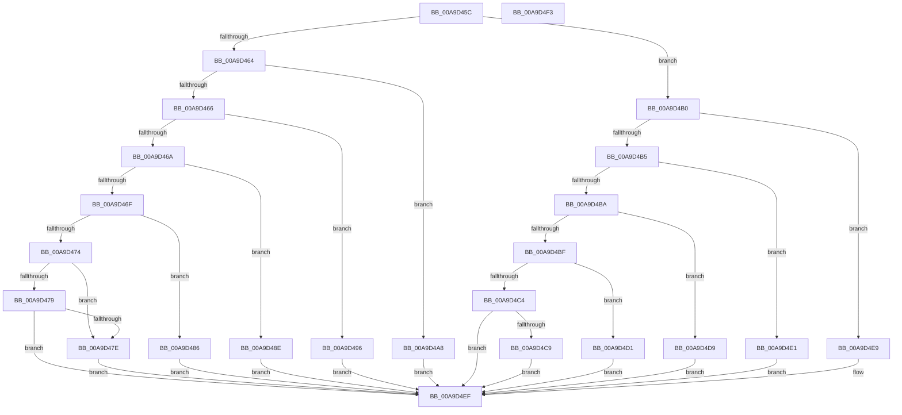

# PopPotsGetActionEntryReason

- RVA: `0x00A9D45C`–`0x00A9D4F4` (길이 `152` bytes)
- VA: `0x0000000140A9D45C`
- 실행 섹션: `PAGE`
- PDB 이름 있음: `예`; PDB Function 태그: `아니요`
- unwind 정보 RVA: `0x000DB714`
- 디코드: `49`개 명령, `152/152` bytes 표시
- 미해석 바이트: `0` (있으면 어셈블리에 `.byte`로 보존)

> 이 문서는 커널 이미지의 기계어와 PDB 기호를 분석해 생성했습니다. 4번과 5번은 함수 원형과 자료형을 바이너리 사용 방식에서 추정한 C 해석이며 원본 소스 복구 결과는 아닙니다.

## 1. Dependencies

- 직접 호출 지점: **0**; 고유 호출 대상: **0**
- 직접 호출자로 확인된 함수: **1**
- RIP 상대 이미지 참조: **0**

### Outgoing calls
- 직접 디코드된 call 명령이 없습니다.

### Direct callers
- [PopIssueActionRequest](PopIssueActionRequest_function_00A9CE54.md) at `0x00A9CF60`

### Static image references
- 디코드된 RIP-relative 메모리 참조가 없습니다.

## 2. Other-region calls and transfers

- 다른 실행 섹션으로 향하는 call: **0**
- 별도 외부 분기/꼬리 이동을 확인하지 못했습니다.

## 3. Assembly (complete function range)

```asm
00A9D45C  45 33 C0                        xor r8d, r8d
00A9D45F  83 F9 06                        cmp ecx, 6
00A9D462  7F 4C                           jg 0x140a9d4b0
00A9D464  74 42                           je 0x140a9d4a8
00A9D466  85 C9                           test ecx, ecx
00A9D468  74 2C                           je 0x140a9d496
00A9D46A  83 E9 01                        sub ecx, 1
00A9D46D  74 1F                           je 0x140a9d48e
00A9D46F  83 E9 01                        sub ecx, 1
00A9D472  74 12                           je 0x140a9d486
00A9D474  83 E9 02                        sub ecx, 2
00A9D477  74 05                           je 0x140a9d47e
00A9D479  83 F9 01                        cmp ecx, 1
00A9D47C  75 71                           jne 0x140a9d4ef
00A9D47E  41 B8 00 01 00 00               mov r8d, 0x100
00A9D484  EB 69                           jmp 0x140a9d4ef
00A9D486  41 B8 80 00 00 00               mov r8d, 0x80
00A9D48C  EB 61                           jmp 0x140a9d4ef
00A9D48E  41 B8 40 00 00 00               mov r8d, 0x40
00A9D494  EB 59                           jmp 0x140a9d4ef
00A9D496  B8 10 00 00 00                  mov eax, 0x10
00A9D49B  83 FA 04                        cmp edx, 4
00A9D49E  44 8D 40 10                     lea r8d, [rax + 0x10]
00A9D4A2  44 0F 45 C0                     cmovne r8d, eax
00A9D4A6  EB 47                           jmp 0x140a9d4ef
00A9D4A8  41 B8 00 02 00 00               mov r8d, 0x200
00A9D4AE  EB 3F                           jmp 0x140a9d4ef
00A9D4B0  83 E9 07                        sub ecx, 7
00A9D4B3  74 34                           je 0x140a9d4e9
00A9D4B5  83 E9 04                        sub ecx, 4
00A9D4B8  74 27                           je 0x140a9d4e1
00A9D4BA  83 E9 01                        sub ecx, 1
00A9D4BD  74 1A                           je 0x140a9d4d9
00A9D4BF  83 E9 01                        sub ecx, 1
00A9D4C2  74 0D                           je 0x140a9d4d1
00A9D4C4  83 F9 01                        cmp ecx, 1
00A9D4C7  75 26                           jne 0x140a9d4ef
00A9D4C9  41 B8 00 00 00 01               mov r8d, 0x1000000
00A9D4CF  EB 1E                           jmp 0x140a9d4ef
00A9D4D1  41 B8 00 00 80 00               mov r8d, 0x800000
00A9D4D7  EB 16                           jmp 0x140a9d4ef
00A9D4D9  41 B8 00 00 40 00               mov r8d, 0x400000
00A9D4DF  EB 0E                           jmp 0x140a9d4ef
00A9D4E1  41 B8 00 00 20 00               mov r8d, 0x200000
00A9D4E7  EB 06                           jmp 0x140a9d4ef
00A9D4E9  41 B8 00 04 00 00               mov r8d, 0x400
00A9D4EF  41 8B C0                        mov eax, r8d
00A9D4F2  C3                              ret
00A9D4F3  CC                              int3
```

## 4. C-style interpretation (structured pseudocode)

```c
__int64 __fastcall PopPotsGetActionEntryReason(int a1, int a2, int a3)
{
    a3 = 0;
    if (a1 > 6) goto loc_00A9D4B0;
    if (a1 == 6) goto loc_00A9D4A8;
    if (a1 == 0) goto loc_00A9D496;
    a1 = (unsigned int)((a1) - (1));
    if (condition_is_equal) goto loc_00A9D48E;
    a1 = (unsigned int)((a1) - (1));
    if (condition_is_equal) goto loc_00A9D486;
    a1 = (unsigned int)((a1) - (2));
    if (condition_is_equal) goto loc_00A9D47E;
    if (a1 != 1) goto loc_00A9D4EF;
loc_00A9D47E:
    goto loc_00A9D4EF;
loc_00A9D486:
    goto loc_00A9D4EF;
loc_00A9D48E:
    goto loc_00A9D4EF;
loc_00A9D496:
    a3 = 16 + 16;
    if (a2 != 4) { a3 = 16; }
    goto loc_00A9D4EF;
loc_00A9D4A8:
    goto loc_00A9D4EF;
loc_00A9D4B0:
    a1 = (unsigned int)((a1) - (7));
    if (condition_is_equal) goto loc_00A9D4E9;
    a1 = (unsigned int)((a1) - (4));
    if (condition_is_equal) goto loc_00A9D4E1;
    a1 = (unsigned int)((a1) - (1));
    if (condition_is_equal) goto loc_00A9D4D9;
    a1 = (unsigned int)((a1) - (1));
    if (condition_is_equal) goto loc_00A9D4D1;
    if (a1 != 1) goto loc_00A9D4EF;
    goto loc_00A9D4EF;
loc_00A9D4D1:
    goto loc_00A9D4EF;
loc_00A9D4D9:
    goto loc_00A9D4EF;
loc_00A9D4E1:
    goto loc_00A9D4EF;
loc_00A9D4E9:
loc_00A9D4EF:
    return (unsigned int)((unsigned int)((unsigned int)(0x400ULL)));
}
```

## 5. (Beta) C Style

```c
int64_t PopPotsGetActionEntryReason(int32_t Arg1, int32_t Arg2, int32_t Arg3)
{
    Arg3 = 0;
    if (Arg1 > 6) goto loc_00A9D4B0;
    if (Arg1 == 6) goto loc_00A9D4A8;
    if (Arg1 == 0) goto loc_00A9D496;
    Arg1 = (uint32_t)((Arg1) - (1));
    if (condition_is_equal) goto loc_00A9D48E;
    Arg1 = (uint32_t)((Arg1) - (1));
    if (condition_is_equal) goto loc_00A9D486;
    Arg1 = (uint32_t)((Arg1) - (2));
    if (condition_is_equal) goto loc_00A9D47E;
    if (Arg1 != 1) goto loc_00A9D4EF;
loc_00A9D47E:
    goto loc_00A9D4EF;
loc_00A9D486:
    goto loc_00A9D4EF;
loc_00A9D48E:
    goto loc_00A9D4EF;
loc_00A9D496:
    Arg3 = 16 + 16;
    if (Arg2 != 4) { Arg3 = 16; }
    goto loc_00A9D4EF;
loc_00A9D4A8:
    goto loc_00A9D4EF;
loc_00A9D4B0:
    Arg1 = (uint32_t)((Arg1) - (7));
    if (condition_is_equal) goto loc_00A9D4E9;
    Arg1 = (uint32_t)((Arg1) - (4));
    if (condition_is_equal) goto loc_00A9D4E1;
    Arg1 = (uint32_t)((Arg1) - (1));
    if (condition_is_equal) goto loc_00A9D4D9;
    Arg1 = (uint32_t)((Arg1) - (1));
    if (condition_is_equal) goto loc_00A9D4D1;
    if (Arg1 != 1) goto loc_00A9D4EF;
    goto loc_00A9D4EF;
loc_00A9D4D1:
    goto loc_00A9D4EF;
loc_00A9D4D9:
    goto loc_00A9D4EF;
loc_00A9D4E1:
    goto loc_00A9D4EF;
loc_00A9D4E9:
loc_00A9D4EF:
    return (uint32_t)((uint32_t)((uint32_t)(0x400ULL)));
}
```

## 6. Execution-region graph

[열기: 2D/3D 그래프와 함수 탐색 컨트롤 패널](../../../control-panel.html?section=page&rva=0x00A9D45C&view=graph)

- 2D 그래프는 위에서 아래로 흐르고, 3D 그래프는 빈 공간을 드래그해 회전합니다. Shift+드래그는 이동, 휠은 확대·축소, 함수 노드 선택은 대상 보고서 이동입니다.

### Static fallback


