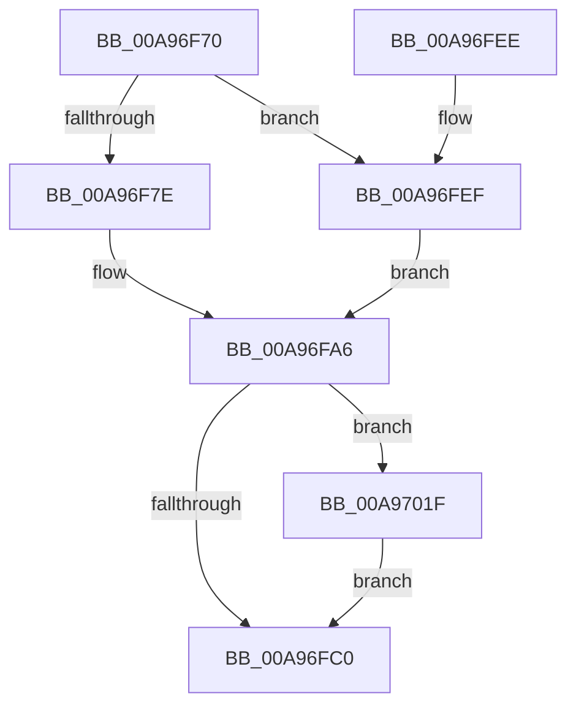

# PopPowerRequestCallbackPerfBoostRequired

- RVA: `0x00A96F70`–`0x00A97028` (길이 `184` bytes)
- VA: `0x0000000140A96F70`
- 실행 섹션: `PAGE`
- PDB 이름 있음: `예`; PDB Function 태그: `아니요`
- unwind 정보 RVA: `0x000B9CF8`
- 디코드: `45`개 명령, `184/184` bytes 표시
- 미해석 바이트: `0` (있으면 어셈블리에 `.byte`로 보존)

> 이 문서는 커널 이미지의 기계어와 PDB 기호를 분석해 생성했습니다. 4번과 5번은 함수 원형과 자료형을 바이너리 사용 방식에서 추정한 C 해석이며 원본 소스 복구 결과는 아닙니다.

## 1. Dependencies

- 직접 호출 지점: **11**; 고유 호출 대상: **7**
- 직접 호출자로 확인된 함수: **0**
- RIP 상대 이미지 참조: **3**

### Outgoing calls
- `0x00A96F7E` → [PpmPerfClearBootOverrides](../../text/4F/PpmPerfClearBootOverrides_function_004FCF44.md) (function, `0x004FCF44`)
- `0x00A96F8A` → [PpmAcquireLock](../../text/2D/PpmAcquireLock_function_002D9AA4.md) (function, `0x002D9AA4`)
- `0x00A96F95` → [PpmHeteroHgsCheckContainmentDecision](../../text/3B/PpmHeteroHgsCheckContainmentDecision_function_003BEFF8.md) (function, `0x003BEFF8`)
- `0x00A96F9A` → [PpmParkApplyPolicy](../../text/4B/PpmParkApplyPolicy_function_004B613C.md) (function, `0x004B613C`)
- `0x00A96FA1` → [PpmPerfUpdateDomainPolicy](PpmPerfUpdateDomainPolicy_function_00A97030.md) (function, `0x00A97030`)
- `0x00A96FE3` → [ZwUpdateWnfStateData](../../text/6B/ZwUpdateWnfStateData_function_006B0D10.md) (function, `0x006B0D10`)
- `0x00A96FF6` → [PpmAcquireLock](../../text/2D/PpmAcquireLock_function_002D9AA4.md) (function, `0x002D9AA4`)
- `0x00A97002` → [PpmHeteroHgsCheckContainmentDecision](../../text/3B/PpmHeteroHgsCheckContainmentDecision_function_003BEFF8.md) (function, `0x003BEFF8`)
- `0x00A97007` → [PpmParkApplyPolicy](../../text/4B/PpmParkApplyPolicy_function_004B613C.md) (function, `0x004B613C`)
- `0x00A9700E` → [PpmPerfUpdateDomainPolicy](PpmPerfUpdateDomainPolicy_function_00A97030.md) (function, `0x00A97030`)
- `0x00A97018` → [PoLatencySensitivityHint](../../text/3B/PoLatencySensitivityHint_function_003BE9B0.md) (function, `0x003BE9B0`)

### Direct callers
- 이 함수 시작 RVA로 연결되는 직접 call은 확인되지 않았습니다. 간접 호출은 완전히 역산할 수 없습니다.

### Static image references
- `0x00A96F83` → RVA `0x00F0CC00` (`.data`; read)
- `0x00A96F8F` → RVA `0x00F0E0F0` (`.data`; write)
- `0x00A96FCF` → RVA `0x0001C3B0` (`.rdata`; read)

## 2. Other-region calls and transfers

- 다른 실행 섹션으로 향하는 call: **9**
  - `0x00A96F7E` → [PpmPerfClearBootOverrides](../../text/4F/PpmPerfClearBootOverrides_function_004FCF44.md) (`PAGE` → `.text`)
  - `0x00A96F8A` → [PpmAcquireLock](../../text/2D/PpmAcquireLock_function_002D9AA4.md) (`PAGE` → `.text`)
  - `0x00A96F95` → [PpmHeteroHgsCheckContainmentDecision](../../text/3B/PpmHeteroHgsCheckContainmentDecision_function_003BEFF8.md) (`PAGE` → `.text`)
  - `0x00A96F9A` → [PpmParkApplyPolicy](../../text/4B/PpmParkApplyPolicy_function_004B613C.md) (`PAGE` → `.text`)
  - `0x00A96FE3` → [ZwUpdateWnfStateData](../../text/6B/ZwUpdateWnfStateData_function_006B0D10.md) (`PAGE` → `.text`)
  - `0x00A96FF6` → [PpmAcquireLock](../../text/2D/PpmAcquireLock_function_002D9AA4.md) (`PAGE` → `.text`)
  - `0x00A97002` → [PpmHeteroHgsCheckContainmentDecision](../../text/3B/PpmHeteroHgsCheckContainmentDecision_function_003BEFF8.md) (`PAGE` → `.text`)
  - `0x00A97007` → [PpmParkApplyPolicy](../../text/4B/PpmParkApplyPolicy_function_004B613C.md) (`PAGE` → `.text`)
  - `0x00A97018` → [PoLatencySensitivityHint](../../text/3B/PoLatencySensitivityHint_function_003BE9B0.md) (`PAGE` → `.text`)
- 별도 외부 분기/꼬리 이동을 확인하지 못했습니다.

## 3. Assembly (complete function range)

```asm
00A96F70  40 53                           push rbx
00A96F72  48 83 EC 40                     sub rsp, 0x40
00A96F76  41 8A D8                        mov bl, r8b
00A96F79  45 84 C0                        test r8b, r8b
00A96F7C  75 71                           jne 0x140a96fef
00A96F7E  E8 C1 5F A6 FF                  call 0x1404fcf44
00A96F83  48 8D 0D 76 5C 47 00            lea rcx, [rip + 0x475c76]
00A96F8A  E8 15 2B 84 FF                  call 0x1402d9aa4
00A96F8F  88 1D 5B 71 47 00               mov byte ptr [rip + 0x47715b], bl
00A96F95  E8 5E 80 92 FF                  call 0x1403beff8
00A96F9A  E8 9D F1 A1 FF                  call 0x1404b613c
00A96F9F  33 C9                           xor ecx, ecx
00A96FA1  E8 8A 00 00 00                  call 0x140a97030
00A96FA6  48 83 64 24 68 00               and qword ptr [rsp + 0x68], 0
00A96FAC  8B 44 24 68                     mov eax, dword ptr [rsp + 0x68]
00A96FB0  83 4C 24 6C FF                  or dword ptr [rsp + 0x6c], 0xffffffff
00A96FB5  83 C8 01                        or eax, 1
00A96FB8  89 44 24 68                     mov dword ptr [rsp + 0x68], eax
00A96FBC  84 DB                           test bl, bl
00A96FBE  75 5F                           jne 0x140a9701f
00A96FC0  83 64 24 30 00                  and dword ptr [rsp + 0x30], 0
00A96FC5  48 8D 54 24 68                  lea rdx, [rsp + 0x68]
00A96FCA  83 64 24 28 00                  and dword ptr [rsp + 0x28], 0
00A96FCF  48 8D 0D DA 53 58 FF            lea rcx, [rip - 0xa7ac26]
00A96FD6  48 83 64 24 20 00               and qword ptr [rsp + 0x20], 0
00A96FDC  45 33 C9                        xor r9d, r9d
00A96FDF  45 8D 41 08                     lea r8d, [r9 + 8]
00A96FE3  E8 28 9D C1 FF                  call 0x1406b0d10
00A96FE8  48 83 C4 40                     add rsp, 0x40
00A96FEC  5B                              pop rbx
00A96FED  C3                              ret
00A96FEE  CC                              int3
00A96FEF  48 8D 0D 0A 5C 47 00            lea rcx, [rip + 0x475c0a]
00A96FF6  E8 A9 2A 84 FF                  call 0x1402d9aa4
00A96FFB  C6 05 EE 70 47 00 01            mov byte ptr [rip + 0x4770ee], 1
00A97002  E8 F1 7F 92 FF                  call 0x1403beff8
00A97007  E8 30 F1 A1 FF                  call 0x1404b613c
00A9700C  33 C9                           xor ecx, ecx
00A9700E  E8 1D 00 00 00                  call 0x140a97030
00A97013  B9 03 00 00 00                  mov ecx, 3
00A97018  E8 93 79 92 FF                  call 0x1403be9b0
00A9701D  EB 87                           jmp 0x140a96fa6
00A9701F  83 C8 02                        or eax, 2
00A97022  89 44 24 68                     mov dword ptr [rsp + 0x68], eax
00A97026  EB 98                           jmp 0x140a96fc0
```

## 4. C-style interpretation (structured pseudocode)

```c
__int64 __fastcall PopPowerRequestCallbackPerfBoostRequired(__int64 a1, __int64 a2, unsigned __int8 a3, int a4)
{
    __int64 result;
    __int64 v_rsp;
    unsigned int v_stack_m18;
    unsigned int v_stack_m20;
    unsigned __int64 v_stack_m28;
    unsigned __int64 v_stack_p20;
    unsigned int v_stack_p24;
    unsigned int v_stack_p68;

    v_rsp = (v_rsp) - (64);
    if (a3 != 0) goto loc_00A96FEF;
    result = PpmPerfClearBootOverrides(a1, a2, a3, a4);
    result = PpmAcquireLock(v_rip + 4676726, a2, a3, a4);
    *(unsigned __int8 *)(v_rip + 4682075) = a3;
    result = PpmHeteroHgsCheckContainmentDecision(v_rip + 4676726, a2, a3, a4);
    result = PpmParkApplyPolicy(v_rip + 4676726, a2, a3, a4);
    a1 = 0;
    result = PpmPerfUpdateDomainPolicy(a1, a2, a3, a4);
loc_00A96FA6:
    result = (unsigned int)(((unsigned int)(v_stack_p20)) | (1));
    v_stack_p20 = (unsigned int)(result);
    if (a3 != 0) goto loc_00A9701F;
loc_00A96FC0:
    a4 = 0;
    result = ZwUpdateWnfStateData(v_rip - 10988582, v_stack_p20, a4 + 8, a4);
    v_rsp = (v_rsp) + (64);
    return result;
loc_00A96FEF:
    result = PpmAcquireLock(v_rip + 4676618, v_stack_p20, a4 + 8, a4);
    *(unsigned __int8 *)(v_rip + 4681966) = 1;
    result = PpmHeteroHgsCheckContainmentDecision(v_rip + 4676618, v_stack_p20, a4 + 8, a4);
    result = PpmParkApplyPolicy(v_rip + 4676618, v_stack_p20, a4 + 8, a4);
    a1 = 0;
    result = PpmPerfUpdateDomainPolicy(a1, v_stack_p20, a4 + 8, a4);
    result = PoLatencySensitivityHint(3, v_stack_p20, a4 + 8, a4);
    goto loc_00A96FA6;
loc_00A9701F:
    result = (unsigned int)((result) | (2));
    v_stack_p68 = (unsigned int)(result);
    goto loc_00A96FC0;
}
```

## 5. (Beta) C Style

```c
int64_t PopPowerRequestCallbackPerfBoostRequired(int64_t Arg1, int64_t Arg2, uint8_t Arg3, int32_t Arg4)
{
    int64_t result;
    int64_t local_rsp;
    uint32_t v_stack_m18;
    uint32_t v_stack_m20;
    uint64_t v_stack_m28;
    uint64_t v_stack_p20;
    uint32_t v_stack_p24;
    uint32_t v_stack_p68;

    local_rsp = (local_rsp) - (64);
    if (Arg3 != 0) goto loc_00A96FEF;
    result = PpmPerfClearBootOverrides(Arg1, Arg2, Arg3, Arg4);
    result = PpmAcquireLock(v_rip + 4676726, Arg2, Arg3, Arg4);
    *(uint8_t *)(v_rip + 0x47715B) = Arg3;
    result = PpmHeteroHgsCheckContainmentDecision(v_rip + 4676726, Arg2, Arg3, Arg4);
    result = PpmParkApplyPolicy(v_rip + 4676726, Arg2, Arg3, Arg4);
    Arg1 = 0;
    result = PpmPerfUpdateDomainPolicy(Arg1, Arg2, Arg3, Arg4);
loc_00A96FA6:
    result = (uint32_t)(((uint32_t)(v_stack_p20)) | (1));
    v_stack_p20 = (uint32_t)(result);
    if (Arg3 != 0) goto loc_00A9701F;
loc_00A96FC0:
    Arg4 = 0;
    result = ZwUpdateWnfStateData(v_rip - 10988582, v_stack_p20, Arg4 + 8, Arg4);
    local_rsp = (local_rsp) + (64);
    return result;
loc_00A96FEF:
    result = PpmAcquireLock(v_rip + 4676618, v_stack_p20, Arg4 + 8, Arg4);
    *(uint8_t *)(v_rip + 0x4770EE) = 1;
    result = PpmHeteroHgsCheckContainmentDecision(v_rip + 4676618, v_stack_p20, Arg4 + 8, Arg4);
    result = PpmParkApplyPolicy(v_rip + 4676618, v_stack_p20, Arg4 + 8, Arg4);
    Arg1 = 0;
    result = PpmPerfUpdateDomainPolicy(Arg1, v_stack_p20, Arg4 + 8, Arg4);
    result = PoLatencySensitivityHint(3, v_stack_p20, Arg4 + 8, Arg4);
    goto loc_00A96FA6;
loc_00A9701F:
    result = (uint32_t)((result) | (2));
    v_stack_p68 = (uint32_t)(result);
    goto loc_00A96FC0;
}
```

## 6. Execution-region graph

[열기: 2D/3D 그래프와 함수 탐색 컨트롤 패널](../../../control-panel.html?section=page&rva=0x00A96F70&view=graph)

- 2D 그래프는 위에서 아래로 흐르고, 3D 그래프는 빈 공간을 드래그해 회전합니다. Shift+드래그는 이동, 휠은 확대·축소, 함수 노드 선택은 대상 보고서 이동입니다.

### Static fallback


