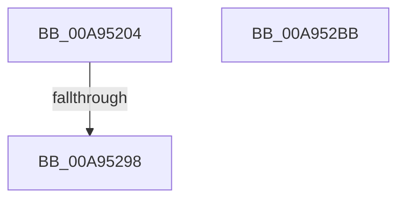

# PopReadHiberbootGroupPolicy

- RVA: `0x00A95204`–`0x00A952BC` (길이 `184` bytes)
- VA: `0x0000000140A95204`
- 실행 섹션: `PAGE`
- PDB 이름 있음: `예`; PDB Function 태그: `예`
- unwind 정보 RVA: `0x000B9718`
- 디코드: `46`개 명령, `184/184` bytes 표시
- 미해석 바이트: `0` (있으면 어셈블리에 `.byte`로 보존)

> 이 문서는 커널 이미지의 기계어와 PDB 기호를 분석해 생성했습니다. 4번과 5번은 함수 원형과 자료형을 바이너리 사용 방식에서 추정한 C 해석이며 원본 소스 복구 결과는 아닙니다.

## 1. Dependencies

- 직접 호출 지점: **3**; 고유 호출 대상: **3**
- 직접 호출자로 확인된 함수: **1**
- RIP 상대 이미지 참조: **2**

### Outgoing calls
- `0x00A95254` → [RtlInitUnicodeString](../../text/42/RtlInitUnicodeString_function_0042A780.md) (function, `0x0042A780`)
- `0x00A95289` → [ZwOpenKey](../../text/6A/ZwOpenKey_function_006AD310.md) (function, `0x006AD310`)
- `0x00A952A1` → [_security_check_cookie](../../text/6A/_security_check_cookie_function_006AC640.md) (function, `0x006AC640`)

### Direct callers
- [PopReadHiberbootPolicy](PopReadHiberbootPolicy_function_00A9517C.md) at `0x00A951B6`

### Static image references
- `0x00A9521B` → RVA `0x00E0A740` (`.data`; read)
- `0x00A9522E` → RVA `0x0001C2B0` (`.rdata`; read)

## 2. Other-region calls and transfers

- 다른 실행 섹션으로 향하는 call: **3**
  - `0x00A95254` → [RtlInitUnicodeString](../../text/42/RtlInitUnicodeString_function_0042A780.md) (`PAGE` → `.text`)
  - `0x00A95289` → [ZwOpenKey](../../text/6A/ZwOpenKey_function_006AD310.md) (`PAGE` → `.text`)
  - `0x00A952A1` → [_security_check_cookie](../../text/6A/_security_check_cookie_function_006AC640.md) (`PAGE` → `.text`)
- call이 아닌 외부 분기/꼬리 이동: **1**
  - `0x00A95292` → [sub_00B475B2](../B4/Unknown_function_00B475B2.md) (`tail-transfer`)

## 3. Assembly (complete function range)

```asm
00A95204  48 89 5C 24 10                  mov qword ptr [rsp + 0x10], rbx
00A95209  48 89 7C 24 18                  mov qword ptr [rsp + 0x18], rdi
00A9520E  55                              push rbp
00A9520F  48 8D 6C 24 A9                  lea rbp, [rsp - 0x57]
00A95214  48 81 EC A0 00 00 00            sub rsp, 0xa0
00A9521B  48 8B 05 1E 55 37 00            mov rax, qword ptr [rip + 0x37551e]
00A95222  48 33 C4                        xor rax, rsp
00A95225  48 89 45 4F                     mov qword ptr [rbp + 0x4f], rax
00A95229  48 83 65 EF 00                  and qword ptr [rbp - 0x11], 0
00A9522E  48 8D 15 7B 70 58 FF            lea rdx, [rip - 0xa78f85]
00A95235  83 65 E7 00                     and dword ptr [rbp - 0x19], 0
00A95239  33 C0                           xor eax, eax
00A9523B  21 45 23                        and dword ptr [rbp + 0x23], eax
00A9523E  48 8B F9                        mov rdi, rcx
00A95241  88 01                           mov byte ptr [rcx], al
00A95243  0F 57 C0                        xorps xmm0, xmm0
00A95246  89 45 0B                        mov dword ptr [rbp + 0xb], eax
00A95249  48 8D 4D F7                     lea rcx, [rbp - 9]
00A9524D  21 45 0B                        and dword ptr [rbp + 0xb], eax
00A95250  0F 11 45 F7                     movups xmmword ptr [rbp - 9], xmm0
00A95254  E8 27 55 99 FF                  call 0x14042a780
00A95259  48 83 65 0F 00                  and qword ptr [rbp + 0xf], 0
00A9525E  48 8D 45 F7                     lea rax, [rbp - 9]
00A95262  0F 57 C0                        xorps xmm0, xmm0
00A95265  48 89 45 17                     mov qword ptr [rbp + 0x17], rax
00A95269  4C 8D 45 07                     lea r8, [rbp + 7]
00A9526D  C7 45 07 30 00 00 00            mov dword ptr [rbp + 7], 0x30
00A95274  BA 19 00 02 00                  mov edx, 0x20019
00A95279  C7 45 1F 40 02 00 00            mov dword ptr [rbp + 0x1f], 0x240
00A95280  48 8D 4D EF                     lea rcx, [rbp - 0x11]
00A95284  F3 0F 7F 45 27                  movdqu xmmword ptr [rbp + 0x27], xmm0
00A95289  E8 82 80 C1 FF                  call 0x1406ad310
00A9528E  8B D8                           mov ebx, eax
00A95290  85 C0                           test eax, eax
00A95292  0F 89 1A 23 0B 00               jns 0x140b475b2
00A95298  8B C3                           mov eax, ebx
00A9529A  48 8B 4D 4F                     mov rcx, qword ptr [rbp + 0x4f]
00A9529E  48 33 CC                        xor rcx, rsp
00A952A1  E8 9A 73 C1 FF                  call 0x1406ac640
00A952A6  4C 8D 9C 24 A0 00 00 00         lea r11, [rsp + 0xa0]
00A952AE  49 8B 5B 18                     mov rbx, qword ptr [r11 + 0x18]
00A952B2  49 8B 7B 20                     mov rdi, qword ptr [r11 + 0x20]
00A952B6  49 8B E3                        mov rsp, r11
00A952B9  5D                              pop rbp
00A952BA  C3                              ret
00A952BB  CC                              int3
```

## 4. C-style interpretation (structured pseudocode)

```c
__int64 __fastcall PopReadHiberbootGroupPolicy(__int64 a1)
{
    __int64 result;
    __int64 v_rsp;
    unsigned __int64 v_stack_m10;
    unsigned __int64 v_stack_m38;
    unsigned int v_stack_m3C;
    unsigned int v_stack_m40;
    unsigned __int64 v_stack_m48;
    unsigned __int64 v_stack_m50;
    unsigned int v_stack_m54;
    unsigned __int64 v_stack_m58;
    unsigned __int64 v_stack_m5F;
    unsigned __int64 v_stack_m68;
    unsigned __int64 v_stack_m70;
    unsigned int v_stack_m78;
    unsigned __int64 v_stack_m8;
    unsigned __int64 v_stack_p10;
    unsigned __int64 v_stack_p18;

    v_stack_p10 = v_rbx;
    v_stack_p18 = v_rdi;
    v_rsp = (v_rsp) - (160);
    result = (*(unsigned __int64 *)(v_rip + 3626270)) ^ (v_rsp);
    v_stack_m10 = result;
    result = 0;
    *(unsigned __int8 *)(a1) = 0;
    v_stack_m54 = 0;
    v_stack_m68 = v_xmm0;
    result = RtlInitUnicodeString(v_stack_m68, v_rip - 10981253, a3, a4);
    v_stack_m48 = v_stack_m68;
    v_stack_m58 = 48;
    v_stack_m40 = 576;
    v_stack_m38 = v_xmm0;
    result = ZwOpenKey(v_stack_m70, (unsigned int)(0x20019ULL), v_stack_m58, a4);
    a1 = (v_stack_m10) ^ (v_rsp);
    result = _security_check_cookie(a1, (unsigned int)(0x20019ULL), v_stack_m58, a4);
    return result;
}
```

## 5. (Beta) C Style

```c
int64_t PopReadHiberbootGroupPolicy(void *Arg1)
{
    uint8_t *arg1 = (uint8_t *)Arg1;

    int64_t result;
    int64_t local_rsp;
    uint64_t v_stack_m10;
    uint64_t v_stack_m38;
    uint32_t v_stack_m3C;
    uint32_t v_stack_m40;
    uint64_t v_stack_m48;
    uint64_t v_stack_m50;
    uint32_t v_stack_m54;
    uint64_t v_stack_m58;
    uint64_t v_stack_m5F;
    uint64_t v_stack_m68;
    uint64_t v_stack_m70;
    uint32_t v_stack_m78;
    uint64_t v_stack_m8;
    uint64_t v_stack_p10;
    uint64_t v_stack_p18;

    v_stack_p10 = local_rbx;
    v_stack_p18 = local_rdi;
    local_rsp = (local_rsp) - (160);
    result = (*(uint64_t *)(v_rip + 0x37551E)) ^ (local_rsp);
    v_stack_m10 = result;
    result = 0;
    *(uint8_t *)(arg1) = 0;
    v_stack_m54 = 0;
    v_stack_m68 = v_xmm0;
    result = RtlInitUnicodeString(v_stack_m68, v_rip - 10981253, a3, a4);
    v_stack_m48 = v_stack_m68;
    v_stack_m58 = 48;
    v_stack_m40 = 576;
    v_stack_m38 = v_xmm0;
    result = ZwOpenKey(v_stack_m70, (uint32_t)(0x20019ULL), v_stack_m58, a4);
    Arg1 = (v_stack_m10) ^ (local_rsp);
    result = _security_check_cookie(Arg1, (uint32_t)(0x20019ULL), v_stack_m58, a4);
    return result;
}
```

### 관측된 메모리 오프셋

구조체 형식이 확인되지 않은 접근은 인자 기준의 오프셋으로만 기록했습니다.

| 기준 인자 | 오프셋 표현 | 폭 (bit) | 접근 |
|---|---:|---:|---|
| `Arg1` | `+ 0x0` | `8` | `W` |

## 6. Execution-region graph

[열기: 2D/3D 그래프와 함수 탐색 컨트롤 패널](../../../control-panel.html?section=page&rva=0x00A95204&view=graph)

- 2D 그래프는 위에서 아래로 흐르고, 3D 그래프는 빈 공간을 드래그해 회전합니다. Shift+드래그는 이동, 휠은 확대·축소, 함수 노드 선택은 대상 보고서 이동입니다.

### Static fallback


