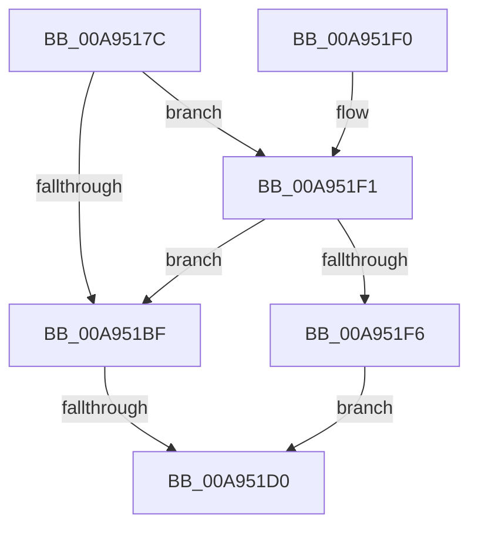

# PopReadHiberbootPolicy

- RVA: `0x00A9517C`–`0x00A951FB` (길이 `127` bytes)
- VA: `0x0000000140A9517C`
- 실행 섹션: `PAGE`
- PDB 이름 있음: `예`; PDB Function 태그: `예`
- unwind 정보 RVA: `0x000B96EC`
- 디코드: `38`개 명령, `127/127` bytes 표시
- 미해석 바이트: `0` (있으면 어셈블리에 `.byte`로 보존)

> 이 문서는 커널 이미지의 기계어와 PDB 기호를 분석해 생성했습니다. 4번과 5번은 함수 원형과 자료형을 바이너리 사용 방식에서 추정한 C 해석이며 원본 소스 복구 결과는 아닙니다.

## 1. Dependencies

- 직접 호출 지점: **3**; 고유 호출 대상: **3**
- 직접 호출자로 확인된 함수: **1**
- RIP 상대 이미지 참조: **1**

### Outgoing calls
- `0x00A951B6` → [PopReadHiberbootGroupPolicy](PopReadHiberbootGroupPolicy_function_00A95204.md) (function, `0x00A95204`)
- `0x00A951C3` → [PopOpenPowerKey](../../text/4B/PopOpenPowerKey_function_004B4314.md) (function, `0x004B4314`)
- `0x00A951D9` → [_security_check_cookie](../../text/6A/_security_check_cookie_function_006AC640.md) (function, `0x006AC640`)

### Direct callers
- [NtPowerInformation](../95/NtPowerInformation_function_00955D80.md) at `0x0095768A`

### Static image references
- `0x00A9518E` → RVA `0x00E0A740` (`.data`; read)

## 2. Other-region calls and transfers

- 다른 실행 섹션으로 향하는 call: **2**
  - `0x00A951C3` → [PopOpenPowerKey](../../text/4B/PopOpenPowerKey_function_004B4314.md) (`PAGE` → `.text`)
  - `0x00A951D9` → [_security_check_cookie](../../text/6A/_security_check_cookie_function_006AC640.md) (`PAGE` → `.text`)
- call이 아닌 외부 분기/꼬리 이동: **1**
  - `0x00A951CA` → [sub_00B47552](../B4/Unknown_function_00B47552.md) (`tail-transfer`)

## 3. Assembly (complete function range)

```asm
00A9517C  48 89 5C 24 10                  mov qword ptr [rsp + 0x10], rbx
00A95181  48 89 7C 24 18                  mov qword ptr [rsp + 0x18], rdi
00A95186  55                              push rbp
00A95187  48 8B EC                        mov rbp, rsp
00A9518A  48 83 EC 70                     sub rsp, 0x70
00A9518E  48 8B 05 AB 55 37 00            mov rax, qword ptr [rip + 0x3755ab]
00A95195  48 33 C4                        xor rax, rsp
00A95198  48 89 45 F8                     mov qword ptr [rbp - 8], rax
00A9519C  33 DB                           xor ebx, ebx
00A9519E  48 8B F9                        mov rdi, rcx
00A951A1  0F 57 C0                        xorps xmm0, xmm0
00A951A4  88 5D C0                        mov byte ptr [rbp - 0x40], bl
00A951A7  48 8D 4D C0                     lea rcx, [rbp - 0x40]
00A951AB  48 89 5D C8                     mov qword ptr [rbp - 0x38], rbx
00A951AF  89 5D C4                        mov dword ptr [rbp - 0x3c], ebx
00A951B2  0F 11 45 D0                     movups xmmword ptr [rbp - 0x30], xmm0
00A951B6  E8 49 00 00 00                  call 0x140a95204
00A951BB  85 C0                           test eax, eax
00A951BD  79 32                           jns 0x140a951f1
00A951BF  48 8D 4D C8                     lea rcx, [rbp - 0x38]
00A951C3  E8 4C F1 A1 FF                  call 0x1404b4314
00A951C8  85 C0                           test eax, eax
00A951CA  0F 89 82 23 0B 00               jns 0x140b47552
00A951D0  88 1F                           mov byte ptr [rdi], bl
00A951D2  48 8B 4D F8                     mov rcx, qword ptr [rbp - 8]
00A951D6  48 33 CC                        xor rcx, rsp
00A951D9  E8 62 74 C1 FF                  call 0x1406ac640
00A951DE  4C 8D 5C 24 70                  lea r11, [rsp + 0x70]
00A951E3  49 8B 5B 18                     mov rbx, qword ptr [r11 + 0x18]
00A951E7  49 8B 7B 20                     mov rdi, qword ptr [r11 + 0x20]
00A951EB  49 8B E3                        mov rsp, r11
00A951EE  5D                              pop rbp
00A951EF  C3                              ret
00A951F0  CC                              int3
00A951F1  38 5D C0                        cmp byte ptr [rbp - 0x40], bl
00A951F4  74 C9                           je 0x140a951bf
00A951F6  8A 5D C0                        mov bl, byte ptr [rbp - 0x40]
00A951F9  EB D5                           jmp 0x140a951d0
```

## 4. C-style interpretation (structured pseudocode)

```c
__int64 __fastcall PopReadHiberbootPolicy(__int64 a1)
{
    __int64 result;
    __int64 v_rbx;
    __int64 v_rsp;
    unsigned __int64 v_stack_m10;
    unsigned __int64 v_stack_m38;
    unsigned __int64 v_stack_m40;
    unsigned int v_stack_m44;
    unsigned __int8 v_stack_m48;
    unsigned __int64 v_stack_m8;
    unsigned __int64 v_stack_p10;
    unsigned __int64 v_stack_p18;

    v_stack_p10 = v_rbx;
    v_stack_p18 = v_rdi;
    v_rsp = (v_rsp) - (112);
    result = (*(unsigned __int64 *)(v_rip + 3626411)) ^ (v_rsp);
    v_stack_m10 = result;
    v_rbx = 0;
    v_stack_m48 = 0;
    v_stack_m40 = 0;
    v_stack_m44 = 0;
    v_stack_m38 = v_xmm0;
    result = PopReadHiberbootGroupPolicy(v_stack_m48, a2, a3, a4);
    if (!sign_flag) goto loc_00A951F1;
loc_00A951BF:
    result = PopOpenPowerKey(v_stack_m40, a2, a3, a4);
loc_00A951D0:
    *(unsigned __int8 *)(a1) = 0;
    a1 = (v_stack_m10) ^ (v_rsp);
    result = _security_check_cookie(a1, a2, a3, a4);
    return result;
loc_00A951F1:
    if (v_stack_m48 == ((unsigned __int8)(*(unsigned __int64 *)(v_stack_m8 + 24)))) goto loc_00A951BF;
    goto loc_00A951D0;
}
```

## 5. (Beta) C Style

```c
int64_t PopReadHiberbootPolicy(void *Arg1)
{
    uint8_t *arg1 = (uint8_t *)Arg1;

    int64_t result;
    int64_t local_rbx;
    int64_t local_rsp;
    uint64_t v_stack_m10;
    uint64_t v_stack_m38;
    uint64_t v_stack_m40;
    uint32_t v_stack_m44;
    uint8_t v_stack_m48;
    uint64_t v_stack_m8;
    uint64_t v_stack_p10;
    uint64_t v_stack_p18;

    v_stack_p10 = local_rbx;
    v_stack_p18 = local_rdi;
    local_rsp = (local_rsp) - (112);
    result = (*(uint64_t *)(v_rip + 0x3755AB)) ^ (local_rsp);
    v_stack_m10 = result;
    local_rbx = 0;
    v_stack_m48 = 0;
    v_stack_m40 = 0;
    v_stack_m44 = 0;
    v_stack_m38 = v_xmm0;
    result = PopReadHiberbootGroupPolicy(v_stack_m48, a2, a3, a4);
    if (!sign_flag) goto loc_00A951F1;
loc_00A951BF:
    result = PopOpenPowerKey(v_stack_m40, a2, a3, a4);
loc_00A951D0:
    *(uint8_t *)(arg1) = 0;
    Arg1 = (v_stack_m10) ^ (local_rsp);
    result = _security_check_cookie(Arg1, a2, a3, a4);
    return result;
loc_00A951F1:
    if (v_stack_m48 == ((uint8_t)(*(uint64_t *)(v_stack_m8 + 0x18)))) goto loc_00A951BF;
    goto loc_00A951D0;
}
```

### 관측된 메모리 오프셋

구조체 형식이 확인되지 않은 접근은 인자 기준의 오프셋으로만 기록했습니다.

| 기준 인자 | 오프셋 표현 | 폭 (bit) | 접근 |
|---|---:|---:|---|
| `Arg1` | `+ 0x0` | `8` | `W` |

## 6. Execution-region graph

[열기: 2D/3D 그래프와 함수 탐색 컨트롤 패널](../../../control-panel.html?section=page&rva=0x00A9517C&view=graph)

- 2D 그래프는 위에서 아래로 흐르고, 3D 그래프는 빈 공간을 드래그해 회전합니다. Shift+드래그는 이동, 휠은 확대·축소, 함수 노드 선택은 대상 보고서 이동입니다.

### Static fallback


