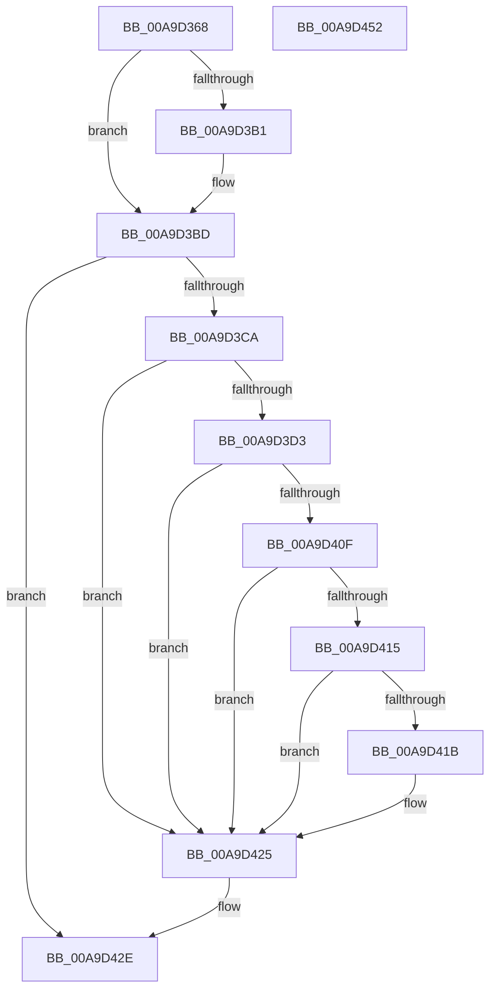

# PopReadSystemAwayModePolicy

- RVA: `0x00A9D368`–`0x00A9D453` (길이 `235` bytes)
- VA: `0x0000000140A9D368`
- 실행 섹션: `PAGE`
- PDB 이름 있음: `예`; PDB Function 태그: `아니요`
- unwind 정보 RVA: `0x000BA6D4`
- 디코드: `62`개 명령, `235/235` bytes 표시
- 미해석 바이트: `0` (있으면 어셈블리에 `.byte`로 보존)

> 이 문서는 커널 이미지의 기계어와 PDB 기호를 분석해 생성했습니다. 4번과 5번은 함수 원형과 자료형을 바이너리 사용 방식에서 추정한 C 해석이며 원본 소스 복구 결과는 아닙니다.

## 1. Dependencies

- 직접 호출 지점: **5**; 고유 호출 대상: **5**
- 직접 호출자로 확인된 함수: **1**
- RIP 상대 이미지 참조: **5**

### Outgoing calls
- `0x00A9D3C1` → [PopOpenPowerKey](../../text/4B/PopOpenPowerKey_function_004B4314.md) (function, `0x004B4314`)
- `0x00A9D3DE` → [RtlInitUnicodeString](../../text/42/RtlInitUnicodeString_function_0042A780.md) (function, `0x0042A780`)
- `0x00A9D406` → [ZwQueryValueKey](../../text/6A/ZwQueryValueKey_function_006AD3B0.md) (function, `0x006AD3B0`)
- `0x00A9D429` → [ZwClose](../../text/6A/ZwClose_function_006AD2B0.md) (function, `0x006AD2B0`)
- `0x00A9D43B` → [_security_check_cookie](../../text/6A/_security_check_cookie_function_006AC640.md) (function, `0x006AC640`)

### Direct callers
- [PopIssueActionRequest](PopIssueActionRequest_function_00A9CE54.md) at `0x00A9CE9F`

### Static image references
- `0x00A9D37A` → RVA `0x00E0A740` (`.data`; read)
- `0x00A9D395` → RVA `0x00F0CE12` (`.data`; read)
- `0x00A9D3B1` → RVA `0x00E01A28` (`.data`; read)
- `0x00A9D3D3` → RVA `0x00029688` (`.rdata`; read)
- `0x00A9D42E` → RVA `0x00F0CE10` (`.data`; write)

## 2. Other-region calls and transfers

- 다른 실행 섹션으로 향하는 call: **5**
  - `0x00A9D3C1` → [PopOpenPowerKey](../../text/4B/PopOpenPowerKey_function_004B4314.md) (`PAGE` → `.text`)
  - `0x00A9D3DE` → [RtlInitUnicodeString](../../text/42/RtlInitUnicodeString_function_0042A780.md) (`PAGE` → `.text`)
  - `0x00A9D406` → [ZwQueryValueKey](../../text/6A/ZwQueryValueKey_function_006AD3B0.md) (`PAGE` → `.text`)
  - `0x00A9D429` → [ZwClose](../../text/6A/ZwClose_function_006AD2B0.md) (`PAGE` → `.text`)
  - `0x00A9D43B` → [_security_check_cookie](../../text/6A/_security_check_cookie_function_006AC640.md) (`PAGE` → `.text`)
- 별도 외부 분기/꼬리 이동을 확인하지 못했습니다.

## 3. Assembly (complete function range)

```asm
00A9D368  48 89 5C 24 08                  mov qword ptr [rsp + 8], rbx
00A9D36D  48 89 74 24 10                  mov qword ptr [rsp + 0x10], rsi
00A9D372  55                              push rbp
00A9D373  48 8B EC                        mov rbp, rsp
00A9D376  48 83 EC 70                     sub rsp, 0x70
00A9D37A  48 8B 05 BF D3 36 00            mov rax, qword ptr [rip + 0x36d3bf]
00A9D381  48 33 C4                        xor rax, rsp
00A9D384  48 89 45 F8                     mov qword ptr [rbp - 8], rax
00A9D388  48 83 65 C8 00                  and qword ptr [rbp - 0x38], 0
00A9D38D  33 C0                           xor eax, eax
00A9D38F  83 65 C0 00                     and dword ptr [rbp - 0x40], 0
00A9D393  32 DB                           xor bl, bl
00A9D395  38 05 77 FA 46 00               cmp byte ptr [rip + 0x46fa77], al
00A9D39B  0F 57 C0                        xorps xmm0, xmm0
00A9D39E  0F 57 C9                        xorps xmm1, xmm1
00A9D3A1  89 45 F0                        mov dword ptr [rbp - 0x10], eax
00A9D3A4  8D 70 01                        lea esi, [rax + 1]
00A9D3A7  0F 11 45 D0                     movups xmmword ptr [rbp - 0x30], xmm0
00A9D3AB  0F 11 4D E0                     movups xmmword ptr [rbp - 0x20], xmm1
00A9D3AF  74 0C                           je 0x140a9d3bd
00A9D3B1  39 05 71 46 36 00               cmp dword ptr [rip + 0x364671], eax
00A9D3B7  0F B6 DB                        movzx ebx, bl
00A9D3BA  0F 47 DE                        cmova ebx, esi
00A9D3BD  48 8D 4D C8                     lea rcx, [rbp - 0x38]
00A9D3C1  E8 4E 6F A1 FF                  call 0x1404b4314
00A9D3C6  85 C0                           test eax, eax
00A9D3C8  78 64                           js 0x140a9d42e
00A9D3CA  80 3D 41 FA 46 00 00            cmp byte ptr [rip + 0x46fa41], 0
00A9D3D1  74 52                           je 0x140a9d425
00A9D3D3  48 8D 15 AE C2 58 FF            lea rdx, [rip - 0xa73d52]
00A9D3DA  48 8D 4D D0                     lea rcx, [rbp - 0x30]
00A9D3DE  E8 9D D3 98 FF                  call 0x14042a780
00A9D3E3  48 8B 4D C8                     mov rcx, qword ptr [rbp - 0x38]
00A9D3E7  48 8D 45 C0                     lea rax, [rbp - 0x40]
00A9D3EB  48 89 44 24 28                  mov qword ptr [rsp + 0x28], rax
00A9D3F0  4C 8D 4D E0                     lea r9, [rbp - 0x20]
00A9D3F4  41 B8 02 00 00 00               mov r8d, 2
00A9D3FA  C7 44 24 20 14 00 00 00         mov dword ptr [rsp + 0x20], 0x14
00A9D402  48 8D 55 D0                     lea rdx, [rbp - 0x30]
00A9D406  E8 A5 FF C0 FF                  call 0x1406ad3b0
00A9D40B  85 C0                           test eax, eax
00A9D40D  78 16                           js 0x140a9d425
00A9D40F  83 7D E4 04                     cmp dword ptr [rbp - 0x1c], 4
00A9D413  75 10                           jne 0x140a9d425
00A9D415  83 7D E8 04                     cmp dword ptr [rbp - 0x18], 4
00A9D419  75 0A                           jne 0x140a9d425
00A9D41B  83 7D EC 00                     cmp dword ptr [rbp - 0x14], 0
00A9D41F  0F B6 DB                        movzx ebx, bl
00A9D422  0F 45 DE                        cmovne ebx, esi
00A9D425  48 8B 4D C8                     mov rcx, qword ptr [rbp - 0x38]
00A9D429  E8 82 FE C0 FF                  call 0x1406ad2b0
00A9D42E  88 1D DC F9 46 00               mov byte ptr [rip + 0x46f9dc], bl
00A9D434  48 8B 4D F8                     mov rcx, qword ptr [rbp - 8]
00A9D438  48 33 CC                        xor rcx, rsp
00A9D43B  E8 00 F2 C0 FF                  call 0x1406ac640
00A9D440  4C 8D 5C 24 70                  lea r11, [rsp + 0x70]
00A9D445  49 8B 5B 10                     mov rbx, qword ptr [r11 + 0x10]
00A9D449  49 8B 73 18                     mov rsi, qword ptr [r11 + 0x18]
00A9D44D  49 8B E3                        mov rsp, r11
00A9D450  5D                              pop rbp
00A9D451  C3                              ret
00A9D452  CC                              int3
```

## 4. C-style interpretation (structured pseudocode)

```c
__int64 __fastcall PopReadSystemAwayModePolicy(void)
{
    __int64 result;
    __int64 v_rbx;
    __int64 v_rsp;
    unsigned __int64 v_stack_m10;
    unsigned int v_stack_m18;
    unsigned int v_stack_m1C;
    unsigned int v_stack_m20;
    unsigned int v_stack_m24;
    unsigned __int64 v_stack_m28;
    unsigned __int64 v_stack_m38;
    unsigned __int64 v_stack_m40;
    unsigned int v_stack_m48;
    unsigned __int64 v_stack_m50;
    unsigned int v_stack_m58;
    unsigned __int64 v_stack_m8;
    unsigned __int64 v_stack_p10;
    unsigned __int64 v_stack_p8;

    v_stack_p8 = v_rbx;
    v_stack_p10 = v_rsi;
    v_rsp = (v_rsp) - (112);
    result = (*(unsigned __int64 *)(v_rip + 3593151)) ^ (v_rsp);
    v_stack_m10 = result;
    result = 0;
    v_rbx = 0;
    v_stack_m18 = 0;
    v_stack_m38 = v_xmm0;
    v_stack_m28 = v_xmm1;
    if ((*(unsigned __int8 *)(v_rip + 4651639)) != 0) {
        v_rbx = 0;
        if ((*(unsigned int *)(v_rip + 3556977)) > 0) { v_rbx = (unsigned int)(result + 1); }
    }
    result = PopOpenPowerKey(v_stack_m40, a2, a3, a4);
    if (sign_flag) goto loc_00A9D42E;
    if ((*(unsigned __int8 *)(v_rip + 4651585)) == 0) goto loc_00A9D425;
    result = RtlInitUnicodeString(v_stack_m38, v_rip - 10960210, a3, a4);
    v_stack_m50 = v_stack_m48;
    v_stack_m58 = 20;
    result = ZwQueryValueKey(v_stack_m40, v_stack_m38, 2, v_stack_m28);
    if (sign_flag) goto loc_00A9D425;
    if (v_stack_m24 != 4) goto loc_00A9D425;
    if (v_stack_m20 == 4) {
        v_rbx = (unsigned __int8)(v_rbx);
        if (v_stack_m1C != 0) { v_rbx = (unsigned int)(result + 1); }
    }
    result = ZwClose(v_stack_m40, v_stack_m38, 2, v_stack_m28);
loc_00A9D42E:
    *(unsigned __int8 *)(v_rip + 4651484) = (unsigned __int8)(v_rbx);
    a1 = (v_stack_m10) ^ (v_rsp);
    result = _security_check_cookie(a1, v_stack_m38, 2, v_stack_m28);
    return result;
}
```

## 5. (Beta) C Style

```c
void PopReadSystemAwayModePolicy(void)
{
    int64_t result;
    int64_t local_rbx;
    int64_t local_rsp;
    uint64_t v_stack_m10;
    uint32_t v_stack_m18;
    uint32_t v_stack_m1C;
    uint32_t v_stack_m20;
    uint32_t v_stack_m24;
    uint64_t v_stack_m28;
    uint64_t v_stack_m38;
    uint64_t v_stack_m40;
    uint32_t v_stack_m48;
    uint64_t v_stack_m50;
    uint32_t v_stack_m58;
    uint64_t v_stack_m8;
    uint64_t v_stack_p10;
    uint64_t v_stack_p8;

    v_stack_p8 = local_rbx;
    v_stack_p10 = local_rsi;
    local_rsp = (local_rsp) - (112);
    result = (*(uint64_t *)(v_rip + 0x36D3BF)) ^ (local_rsp);
    v_stack_m10 = result;
    result = 0;
    local_rbx = 0;
    v_stack_m18 = 0;
    v_stack_m38 = v_xmm0;
    v_stack_m28 = v_xmm1;
    if ((*(uint8_t *)(v_rip + 0x46FA77)) != 0) {
        local_rbx = 0;
        if ((*(uint32_t *)(v_rip + 0x364671)) > 0) { local_rbx = (uint32_t)(result + 1); }
    }
    result = PopOpenPowerKey(v_stack_m40, a2, a3, a4);
    if (sign_flag) goto loc_00A9D42E;
    if ((*(uint8_t *)(v_rip + 0x46FA41)) == 0) goto loc_00A9D425;
    result = RtlInitUnicodeString(v_stack_m38, v_rip - 10960210, a3, a4);
    v_stack_m50 = v_stack_m48;
    v_stack_m58 = 20;
    result = ZwQueryValueKey(v_stack_m40, v_stack_m38, 2, v_stack_m28);
    if (sign_flag) goto loc_00A9D425;
    if (v_stack_m24 != 4) goto loc_00A9D425;
    if (v_stack_m20 == 4) {
        local_rbx = (uint8_t)(local_rbx);
        if (v_stack_m1C != 0) { local_rbx = (uint32_t)(result + 1); }
    }
    result = ZwClose(v_stack_m40, v_stack_m38, 2, v_stack_m28);
loc_00A9D42E:
    *(uint8_t *)(v_rip + 0x46F9DC) = (uint8_t)(local_rbx);
    a1 = (v_stack_m10) ^ (local_rsp);
    result = _security_check_cookie(a1, v_stack_m38, 2, v_stack_m28);
    return result;
}
```

## 6. Execution-region graph

[열기: 2D/3D 그래프와 함수 탐색 컨트롤 패널](../../../control-panel.html?section=page&rva=0x00A9D368&view=graph)

- 2D 그래프는 위에서 아래로 흐르고, 3D 그래프는 빈 공간을 드래그해 회전합니다. Shift+드래그는 이동, 휠은 확대·축소, 함수 노드 선택은 대상 보고서 이동입니다.

### Static fallback


