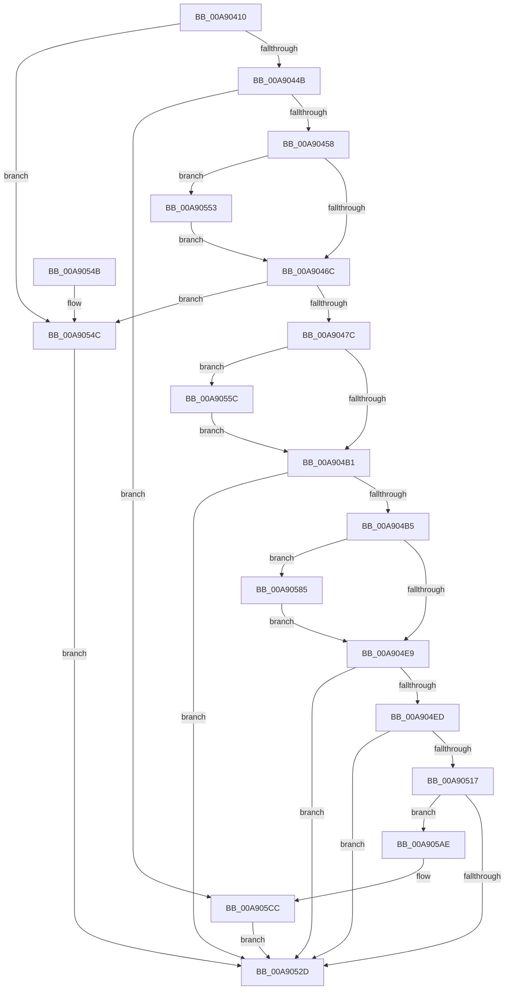

# PopResizeHiberFile

- RVA: `0x00A90410`–`0x00A905D3` (길이 `451` bytes)
- VA: `0x0000000140A90410`
- 실행 섹션: `PAGE`
- PDB 이름 있음: `예`; PDB Function 태그: `아니요`
- unwind 정보 RVA: `0x000B8E90`
- 디코드: `106`개 명령, `451/451` bytes 표시
- 미해석 바이트: `0` (있으면 어셈블리에 `.byte`로 보존)

> 이 문서는 커널 이미지의 기계어와 PDB 기호를 분석해 생성했습니다. 4번과 5번은 함수 원형과 자료형을 바이너리 사용 방식에서 추정한 C 해석이며 원본 소스 복구 결과는 아닙니다.

## 1. Dependencies

- 직접 호출 지점: **8**; 고유 호출 대상: **6**
- 직접 호출자로 확인된 함수: **2**
- RIP 상대 이미지 참조: **5**

### Outgoing calls
- `0x00A9045F` → [PopValidateHiberFileSize](PopValidateHiberFileSize_function_00A90678.md) (function, `0x00A90678`)
- `0x00A9049F` → [ZwSetInformationFile](../../text/6A/ZwSetInformationFile_function_006AD5B0.md) (function, `0x006AD5B0`)
- `0x00A904D7` → [ZwSetInformationFile](../../text/6A/ZwSetInformationFile_function_006AD5B0.md) (function, `0x006AD5B0`)
- `0x00A9050C` → [PopSanityCheckHiberFile](PopSanityCheckHiberFile_function_00A90840.md) (function, `0x00A90840`)
- `0x00A9051E` → [PopSetHiberFileMcb](PopSetHiberFileMcb_function_00A905DC.md) (function, `0x00A905DC`)
- `0x00A90578` → [KeWaitForSingleObject](../../text/20/KeWaitForSingleObject_function_0020E6B0.md) (function, `0x0020E6B0`)
- `0x00A905A1` → [KeWaitForSingleObject](../../text/20/KeWaitForSingleObject_function_0020E6B0.md) (function, `0x0020E6B0`)
- `0x00A905C7` → [FsRtlIssueFileNotificationFsctl](../71/FsRtlIssueFileNotificationFsctl_function_007161D8.md) (function, `0x007161D8`)

### Direct callers
- [PopAdjustHiberFile](../75/PopAdjustHiberFile_function_0075CBE8.md) at `0x0075CC1B`
- [PopEnlargeHiberFile](../75/PopEnlargeHiberFile_function_0075D564.md) at `0x0075D5A6`

### Static image references
- `0x00A90439` → RVA `0x00F0BF28` (`.data`; read)
- `0x00A9044B` → RVA `0x00F0BF30` (`.data`; read)
- `0x00A9047C` → RVA `0x00F0BF20` (`.data`; read)
- `0x00A905B2` → RVA `0x0002AF40` (`.rdata`; read)
- `0x00A905C0` → RVA `0x00F0BF30` (`.data`; write)

## 2. Other-region calls and transfers

- 다른 실행 섹션으로 향하는 call: **4**
  - `0x00A9049F` → [ZwSetInformationFile](../../text/6A/ZwSetInformationFile_function_006AD5B0.md) (`PAGE` → `.text`)
  - `0x00A904D7` → [ZwSetInformationFile](../../text/6A/ZwSetInformationFile_function_006AD5B0.md) (`PAGE` → `.text`)
  - `0x00A90578` → [KeWaitForSingleObject](../../text/20/KeWaitForSingleObject_function_0020E6B0.md) (`PAGE` → `.text`)
  - `0x00A905A1` → [KeWaitForSingleObject](../../text/20/KeWaitForSingleObject_function_0020E6B0.md) (`PAGE` → `.text`)
- 별도 외부 분기/꼬리 이동을 확인하지 못했습니다.

## 3. Assembly (complete function range)

```asm
00A90410  48 89 5C 24 08                  mov qword ptr [rsp + 8], rbx
00A90415  48 89 7C 24 18                  mov qword ptr [rsp + 0x18], rdi
00A9041A  55                              push rbp
00A9041B  48 8B EC                        mov rbp, rsp
00A9041E  48 83 EC 60                     sub rsp, 0x60
00A90422  48 83 65 D0 00                  and qword ptr [rbp - 0x30], 0
00A90427  0F 57 C0                        xorps xmm0, xmm0
00A9042A  48 83 65 D8 00                  and qword ptr [rbp - 0x28], 0
00A9042F  48 8B FA                        mov rdi, rdx
00A90432  83 65 18 00                     and dword ptr [rbp + 0x18], 0
00A90436  48 8B D9                        mov rbx, rcx
00A90439  48 83 3D E7 BA 47 00 00         cmp qword ptr [rip + 0x47bae7], 0
00A90441  0F 11 45 F0                     movups xmmword ptr [rbp - 0x10], xmm0
00A90445  0F 84 01 01 00 00               je 0x140a9054c
00A9044B  48 39 0D DE BA 47 00            cmp qword ptr [rip + 0x47bade], rcx
00A90452  0F 84 74 01 00 00               je 0x140a905cc
00A90458  45 33 C9                        xor r9d, r9d
00A9045B  48 8D 55 D0                     lea rdx, [rbp - 0x30]
00A9045F  E8 14 02 00 00                  call 0x140a90678
00A90464  85 C0                           test eax, eax
00A90466  0F 88 E7 00 00 00               js 0x140a90553
00A9046C  48 8B C3                        mov rax, rbx
00A9046F  48 89 5D 28                     mov qword ptr [rbp + 0x28], rbx
00A90473  48 85 C0                        test rax, rax
00A90476  0F 8E D0 00 00 00               jle 0x140a9054c
00A9047C  48 8B 0D 9D BA 47 00            mov rcx, qword ptr [rip + 0x47ba9d]
00A90483  4C 8D 45 E0                     lea r8, [rbp - 0x20]
00A90487  48 89 5D E0                     mov qword ptr [rbp - 0x20], rbx
00A9048B  48 8D 55 F0                     lea rdx, [rbp - 0x10]
00A9048F  BB 08 00 00 00                  mov ebx, 8
00A90494  C7 44 24 20 13 00 00 00         mov dword ptr [rsp + 0x20], 0x13
00A9049C  44 8B CB                        mov r9d, ebx
00A9049F  E8 0C D1 C1 FF                  call 0x1406ad5b0
00A904A4  8B C8                           mov ecx, eax
00A904A6  3D 03 01 00 00                  cmp eax, 0x103
00A904AB  0F 84 AB 00 00 00               je 0x140a9055c
00A904B1  85 C9                           test ecx, ecx
00A904B3  78 78                           js 0x140a9052d
00A904B5  48 8B 45 28                     mov rax, qword ptr [rbp + 0x28]
00A904B9  4C 8D 45 E8                     lea r8, [rbp - 0x18]
00A904BD  48 8B 0D 5C BA 47 00            mov rcx, qword ptr [rip + 0x47ba5c]
00A904C4  48 8D 55 F0                     lea rdx, [rbp - 0x10]
00A904C8  44 8B CB                        mov r9d, ebx
00A904CB  48 89 45 E8                     mov qword ptr [rbp - 0x18], rax
00A904CF  C7 44 24 20 14 00 00 00         mov dword ptr [rsp + 0x20], 0x14
00A904D7  E8 D4 D0 C1 FF                  call 0x1406ad5b0
00A904DC  8B C8                           mov ecx, eax
00A904DE  3D 03 01 00 00                  cmp eax, 0x103
00A904E3  0F 84 9C 00 00 00               je 0x140a90585
00A904E9  85 C9                           test ecx, ecx
00A904EB  78 40                           js 0x140a9052d
00A904ED  48 8B 15 34 BA 47 00            mov rdx, qword ptr [rip + 0x47ba34]
00A904F4  48 8D 45 18                     lea rax, [rbp + 0x18]
00A904F8  48 8B 0D 21 BA 47 00            mov rcx, qword ptr [rip + 0x47ba21]
00A904FF  4C 8D 4D D8                     lea r9, [rbp - 0x28]
00A90503  4C 8D 45 28                     lea r8, [rbp + 0x28]
00A90507  48 89 44 24 20                  mov qword ptr [rsp + 0x20], rax
00A9050C  E8 2F 03 00 00                  call 0x140a90840
00A90511  8B C8                           mov ecx, eax
00A90513  85 C0                           test eax, eax
00A90515  78 16                           js 0x140a9052d
00A90517  8B 55 18                        mov edx, dword ptr [rbp + 0x18]
00A9051A  48 8B 4D D8                     mov rcx, qword ptr [rbp - 0x28]
00A9051E  E8 B9 00 00 00                  call 0x140a905dc
00A90523  8B C8                           mov ecx, eax
00A90525  85 C0                           test eax, eax
00A90527  0F 89 81 00 00 00               jns 0x140a905ae
00A9052D  48 8B 05 FC B9 47 00            mov rax, qword ptr [rip + 0x47b9fc]
00A90534  4C 8D 5C 24 60                  lea r11, [rsp + 0x60]
00A90539  49 8B 5B 10                     mov rbx, qword ptr [r11 + 0x10]
00A9053D  48 89 07                        mov qword ptr [rdi], rax
00A90540  8B C1                           mov eax, ecx
00A90542  49 8B 7B 20                     mov rdi, qword ptr [r11 + 0x20]
00A90546  49 8B E3                        mov rsp, r11
00A90549  5D                              pop rbp
00A9054A  C3                              ret
00A9054B  CC                              int3
00A9054C  B9 01 00 00 C0                  mov ecx, 0xc0000001
00A90551  EB DA                           jmp 0x140a9052d
00A90553  48 8B 5D D0                     mov rbx, qword ptr [rbp - 0x30]
00A90557  E9 10 FF FF FF                  jmp 0x140a9046c
00A9055C  48 8B 0D C5 B9 47 00            mov rcx, qword ptr [rip + 0x47b9c5]
00A90563  45 33 C9                        xor r9d, r9d
00A90566  48 83 64 24 20 00               and qword ptr [rsp + 0x20], 0
00A9056C  48 81 C1 98 00 00 00            add rcx, 0x98
00A90573  45 33 C0                        xor r8d, r8d
00A90576  33 D2                           xor edx, edx
00A90578  E8 33 E1 77 FF                  call 0x14020e6b0
00A9057D  8B 4D F0                        mov ecx, dword ptr [rbp - 0x10]
00A90580  E9 2C FF FF FF                  jmp 0x140a904b1
00A90585  48 8B 0D 9C B9 47 00            mov rcx, qword ptr [rip + 0x47b99c]
00A9058C  45 33 C9                        xor r9d, r9d
00A9058F  48 83 64 24 20 00               and qword ptr [rsp + 0x20], 0
00A90595  48 81 C1 98 00 00 00            add rcx, 0x98
00A9059C  45 33 C0                        xor r8d, r8d
00A9059F  33 D2                           xor edx, edx
00A905A1  E8 0A E1 77 FF                  call 0x14020e6b0
00A905A6  8B 4D F0                        mov ecx, dword ptr [rbp - 0x10]
00A905A9  E9 3B FF FF FF                  jmp 0x140a904e9
00A905AE  48 8B 45 28                     mov rax, qword ptr [rbp + 0x28]
00A905B2  4C 8D 05 87 A9 59 FF            lea r8, [rip - 0xa65679]
00A905B9  48 8B 0D 68 B9 47 00            mov rcx, qword ptr [rip + 0x47b968]
00A905C0  48 89 05 69 B9 47 00            mov qword ptr [rip + 0x47b969], rax
00A905C7  E8 0C 5C C8 FF                  call 0x1407161d8
00A905CC  33 C9                           xor ecx, ecx
00A905CE  E9 5A FF FF FF                  jmp 0x140a9052d
```

## 4. C-style interpretation (structured pseudocode)

```c
__int64 __fastcall PopResizeHiberFile(__int64 a1, __int64 a2, __int64 a3, int a4)
{
    __int64 result;
    __int64 v_rsp;
    unsigned __int64 v_stack_m18;
    unsigned __int64 v_stack_m20;
    unsigned __int64 v_stack_m28;
    unsigned __int64 v_stack_m30;
    unsigned __int64 v_stack_m38;
    unsigned __int64 v_stack_m40;
    unsigned int v_stack_m48;
    unsigned __int64 v_stack_m8;
    unsigned int v_stack_p10;
    unsigned __int64 v_stack_p18;
    unsigned __int64 v_stack_p20;
    unsigned __int64 v_stack_p8;

    v_stack_p8 = v_rbx;
    v_stack_p18 = v_rdi;
    v_rsp = (v_rsp) - (96);
    v_stack_m18 = v_xmm0;
    if ((*(unsigned __int64 *)(v_rip + 4700903)) == 0) goto loc_00A9054C;
    if ((*(unsigned __int64 *)(v_rip + 4700894)) == a1) goto loc_00A905CC;
    a4 = 0;
    result = PopValidateHiberFileSize(a1, v_stack_m38, a3, a4);
    if (sign_flag) goto loc_00A90553;
loc_00A9046C:
    v_stack_p20 = a1;
    if (condition_is_less_or_equal) goto loc_00A9054C;
    v_stack_m28 = a1;
    v_stack_m48 = 19;
    result = ZwSetInformationFile(*(unsigned __int64 *)(v_rip + 4700829), v_stack_m18, v_stack_m28, 8);
    if (((unsigned int)(result)) == 259) goto loc_00A9055C;
loc_00A904B1:
    if (sign_flag) goto loc_00A9052D;
    v_stack_m20 = v_stack_p20;
    v_stack_m48 = 20;
    result = ZwSetInformationFile(*(unsigned __int64 *)(v_rip + 4700764), v_stack_m18, v_stack_m20, 8);
    if (((unsigned int)(result)) == 259) goto loc_00A90585;
loc_00A904E9:
    if (sign_flag) goto loc_00A9052D;
    v_stack_m48 = v_stack_p10;
    result = PopSanityCheckHiberFile(*(unsigned __int64 *)(v_rip + 4700705), *(unsigned __int64 *)(v_rip + 4700724), v_stack_p20, v_stack_m30);
    if (sign_flag) goto loc_00A9052D;
    result = PopSetHiberFileMcb(v_stack_m30, (unsigned int)(v_stack_p10), v_stack_p20, v_stack_m30);
    if (!sign_flag) goto loc_00A905AE;
loc_00A9052D:
    *(unsigned __int64 *)(a2) = *(unsigned __int64 *)(v_rip + 4700668);
    return (unsigned int)((unsigned int)((unsigned int)((unsigned int)(result))));
loc_00A9054C:
    goto loc_00A9052D;
loc_00A90553:
    goto loc_00A9046C;
loc_00A9055C:
    a4 = 0;
    a1 = (*(unsigned __int64 *)(v_rip + 4700613)) + (152);
    a3 = 0;
    a2 = 0;
    result = KeWaitForSingleObject(a1, a2, a3, a4);
    goto loc_00A904B1;
loc_00A90585:
    a4 = 0;
    a1 = (*(unsigned __int64 *)(v_rip + 4700572)) + (152);
    a3 = 0;
    a2 = 0;
    result = KeWaitForSingleObject(a1, a2, a3, a4);
    goto loc_00A904E9;
loc_00A905AE:
    *(unsigned __int64 *)(v_rip + 4700521) = v_stack_p20;
    result = FsRtlIssueFileNotificationFsctl(*(unsigned __int64 *)(v_rip + 4700520), a2, v_rip - 10901113, a4);
loc_00A905CC:
    a1 = 0;
    goto loc_00A9052D;
}
```

## 5. (Beta) C Style

```c
int64_t PopResizeHiberFile(int64_t Arg1, void *Arg2, int64_t Arg3, int32_t Arg4)
{
    uint8_t *arg2 = (uint8_t *)Arg2;

    int64_t result;
    int64_t local_rsp;
    uint64_t v_stack_m18;
    uint64_t v_stack_m20;
    uint64_t v_stack_m28;
    uint64_t v_stack_m30;
    uint64_t v_stack_m38;
    uint64_t v_stack_m40;
    uint32_t v_stack_m48;
    uint64_t v_stack_m8;
    uint32_t v_stack_p10;
    uint64_t v_stack_p18;
    uint64_t v_stack_p20;
    uint64_t v_stack_p8;

    v_stack_p8 = local_rbx;
    v_stack_p18 = local_rdi;
    local_rsp = (local_rsp) - (96);
    v_stack_m18 = v_xmm0;
    if ((*(uint64_t *)(v_rip + 0x47BAE7)) == 0) goto loc_00A9054C;
    if ((*(uint64_t *)(v_rip + 0x47BADE)) == Arg1) goto loc_00A905CC;
    Arg4 = 0;
    result = PopValidateHiberFileSize(Arg1, v_stack_m38, Arg3, Arg4);
    if (sign_flag) goto loc_00A90553;
loc_00A9046C:
    v_stack_p20 = Arg1;
    if (condition_is_less_or_equal) goto loc_00A9054C;
    v_stack_m28 = Arg1;
    v_stack_m48 = 19;
    result = ZwSetInformationFile(*(uint64_t *)(v_rip + 0x47BA9D), v_stack_m18, v_stack_m28, 8);
    if (((uint32_t)(result)) == 259) goto loc_00A9055C;
loc_00A904B1:
    if (sign_flag) goto loc_00A9052D;
    v_stack_m20 = v_stack_p20;
    v_stack_m48 = 20;
    result = ZwSetInformationFile(*(uint64_t *)(v_rip + 0x47BA5C), v_stack_m18, v_stack_m20, 8);
    if (((uint32_t)(result)) == 259) goto loc_00A90585;
loc_00A904E9:
    if (sign_flag) goto loc_00A9052D;
    v_stack_m48 = v_stack_p10;
    result = PopSanityCheckHiberFile(*(uint64_t *)(v_rip + 0x47BA21), *(uint64_t *)(v_rip + 0x47BA34), v_stack_p20, v_stack_m30);
    if (sign_flag) goto loc_00A9052D;
    result = PopSetHiberFileMcb(v_stack_m30, (uint32_t)(v_stack_p10), v_stack_p20, v_stack_m30);
    if (!sign_flag) goto loc_00A905AE;
loc_00A9052D:
    *(uint64_t *)(arg2) = *(uint64_t *)(v_rip + 0x47B9FC);
    return (uint32_t)((uint32_t)((uint32_t)((uint32_t)(result))));
loc_00A9054C:
    goto loc_00A9052D;
loc_00A90553:
    goto loc_00A9046C;
loc_00A9055C:
    Arg4 = 0;
    Arg1 = (*(uint64_t *)(v_rip + 0x47B9C5)) + (152);
    Arg3 = 0;
    Arg2 = 0;
    result = KeWaitForSingleObject(Arg1, Arg2, Arg3, Arg4);
    goto loc_00A904B1;
loc_00A90585:
    Arg4 = 0;
    Arg1 = (*(uint64_t *)(v_rip + 0x47B99C)) + (152);
    Arg3 = 0;
    Arg2 = 0;
    result = KeWaitForSingleObject(Arg1, Arg2, Arg3, Arg4);
    goto loc_00A904E9;
loc_00A905AE:
    *(uint64_t *)(v_rip + 0x47B969) = v_stack_p20;
    result = FsRtlIssueFileNotificationFsctl(*(uint64_t *)(v_rip + 0x47B968), Arg2, v_rip - 10901113, Arg4);
loc_00A905CC:
    Arg1 = 0;
    goto loc_00A9052D;
}
```

### 관측된 메모리 오프셋

구조체 형식이 확인되지 않은 접근은 인자 기준의 오프셋으로만 기록했습니다.

| 기준 인자 | 오프셋 표현 | 폭 (bit) | 접근 |
|---|---:|---:|---|
| `Arg2` | `+ 0x0` | `64` | `W` |

## 6. Execution-region graph

[열기: 2D/3D 그래프와 함수 탐색 컨트롤 패널](../../../control-panel.html?section=page&rva=0x00A90410&view=graph)

- 2D 그래프는 위에서 아래로 흐르고, 3D 그래프는 빈 공간을 드래그해 회전합니다. Shift+드래그는 이동, 휠은 확대·축소, 함수 노드 선택은 대상 보고서 이동입니다.

### Static fallback


