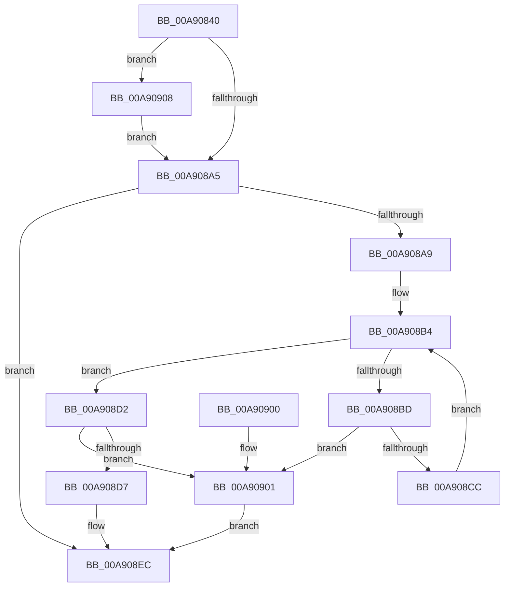

# PopSanityCheckHiberFile

- RVA: `0x00A90840`–`0x00A9092B` (길이 `235` bytes)
- VA: `0x0000000140A90840`
- 실행 섹션: `PAGE`
- PDB 이름 있음: `예`; PDB Function 태그: `아니요`
- unwind 정보 RVA: `0x000B8ECC`
- 디코드: `65`개 명령, `235/235` bytes 표시
- 미해석 바이트: `0` (있으면 어셈블리에 `.byte`로 보존)

> 이 문서는 커널 이미지의 기계어와 PDB 기호를 분석해 생성했습니다. 4번과 5번은 함수 원형과 자료형을 바이너리 사용 방식에서 추정한 C 해석이며 원본 소스 복구 결과는 아닙니다.

## 1. Dependencies

- 직접 호출 지점: **2**; 고유 호출 대상: **2**
- 직접 호출자로 확인된 함수: **2**
- RIP 상대 이미지 참조: **0**

### Outgoing calls
- `0x00A90897` → [ZwFsControlFile](../../text/6A/ZwFsControlFile_function_006AD7F0.md) (function, `0x006AD7F0`)
- `0x00A9091D` → [KeWaitForSingleObject](../../text/20/KeWaitForSingleObject_function_0020E6B0.md) (function, `0x0020E6B0`)

### Direct callers
- [PopCreateHiberFile](../75/PopCreateHiberFile_function_0075CE70.md) at `0x0075D30B`
- [PopResizeHiberFile](PopResizeHiberFile_function_00A90410.md) at `0x00A9050C`

### Static image references
- 디코드된 RIP-relative 메모리 참조가 없습니다.

## 2. Other-region calls and transfers

- 다른 실행 섹션으로 향하는 call: **2**
  - `0x00A90897` → [ZwFsControlFile](../../text/6A/ZwFsControlFile_function_006AD7F0.md) (`PAGE` → `.text`)
  - `0x00A9091D` → [KeWaitForSingleObject](../../text/20/KeWaitForSingleObject_function_0020E6B0.md) (`PAGE` → `.text`)
- 별도 외부 분기/꼬리 이동을 확인하지 못했습니다.

## 3. Assembly (complete function range)

```asm
00A90840  4C 8B DC                        mov r11, rsp
00A90843  49 89 5B 08                     mov qword ptr [r11 + 8], rbx
00A90847  49 89 73 10                     mov qword ptr [r11 + 0x10], rsi
00A9084B  57                              push rdi
00A9084C  48 83 EC 70                     sub rsp, 0x70
00A90850  49 83 63 D8 00                  and qword ptr [r11 - 0x28], 0
00A90855  49 8D 43 D8                     lea rax, [r11 - 0x28]
00A90859  48 8B FA                        mov rdi, rdx
00A9085C  49 8B D8                        mov rbx, r8
00A9085F  BA 08 00 00 00                  mov edx, 8
00A90864  49 8B F1                        mov rsi, r9
00A90867  89 54 24 48                     mov dword ptr [rsp + 0x48], edx
00A9086B  0F 57 C0                        xorps xmm0, xmm0
00A9086E  49 89 43 C8                     mov qword ptr [r11 - 0x38], rax
00A90872  45 33 C9                        xor r9d, r9d
00A90875  89 54 24 38                     mov dword ptr [rsp + 0x38], edx
00A90879  49 8D 43 E0                     lea rax, [r11 - 0x20]
00A9087D  49 89 5B B8                     mov qword ptr [r11 - 0x48], rbx
00A90881  45 33 C0                        xor r8d, r8d
00A90884  C7 44 24 28 3B 00 09 00         mov dword ptr [rsp + 0x28], 0x9003b
00A9088C  33 D2                           xor edx, edx
00A9088E  49 89 43 A8                     mov qword ptr [r11 - 0x58], rax
00A90892  0F 11 44 24 58                  movups xmmword ptr [rsp + 0x58], xmm0
00A90897  E8 54 CF C1 FF                  call 0x1406ad7f0
00A9089C  8B D0                           mov edx, eax
00A9089E  3D 03 01 00 00                  cmp eax, 0x103
00A908A3  74 63                           je 0x140a90908
00A908A5  85 D2                           test edx, edx
00A908A7  78 43                           js 0x140a908ec
00A908A9  4C 8B 4C 24 50                  mov r9, qword ptr [rsp + 0x50]
00A908AE  45 33 D2                        xor r10d, r10d
00A908B1  45 33 C0                        xor r8d, r8d
00A908B4  4B 8B 0C C1                     mov rcx, qword ptr [r9 + r8*8]
00A908B8  48 85 C9                        test rcx, rcx
00A908BB  74 15                           je 0x140a908d2
00A908BD  4C 03 D1                        add r10, rcx
00A908C0  41 8D 40 01                     lea eax, [r8 + 1]
00A908C4  41 83 7C C1 04 00               cmp dword ptr [r9 + rax*8 + 4], 0
00A908CA  7C 35                           jl 0x140a90901
00A908CC  41 83 C0 02                     add r8d, 2
00A908D0  EB E2                           jmp 0x140a908b4
00A908D2  4C 3B 13                        cmp r10, qword ptr [rbx]
00A908D5  7C 2A                           jl 0x140a90901
00A908D7  48 8B 84 24 A0 00 00 00         mov rax, qword ptr [rsp + 0xa0]
00A908DF  42 8D 0C C5 10 00 00 00         lea ecx, [r8*8 + 0x10]
00A908E7  4C 89 0E                        mov qword ptr [rsi], r9
00A908EA  89 08                           mov dword ptr [rax], ecx
00A908EC  4C 8D 5C 24 70                  lea r11, [rsp + 0x70]
00A908F1  8B C2                           mov eax, edx
00A908F3  49 8B 5B 10                     mov rbx, qword ptr [r11 + 0x10]
00A908F7  49 8B 73 18                     mov rsi, qword ptr [r11 + 0x18]
00A908FB  49 8B E3                        mov rsp, r11
00A908FE  5F                              pop rdi
00A908FF  C3                              ret
00A90900  CC                              int3
00A90901  BA 01 00 00 C0                  mov edx, 0xc0000001
00A90906  EB E4                           jmp 0x140a908ec
00A90908  48 83 64 24 20 00               and qword ptr [rsp + 0x20], 0
00A9090E  48 8D 8F 98 00 00 00            lea rcx, [rdi + 0x98]
00A90915  45 33 C9                        xor r9d, r9d
00A90918  45 33 C0                        xor r8d, r8d
00A9091B  33 D2                           xor edx, edx
00A9091D  E8 8E DD 77 FF                  call 0x14020e6b0
00A90922  8B 54 24 58                     mov edx, dword ptr [rsp + 0x58]
00A90926  E9 7A FF FF FF                  jmp 0x140a908a5
```

## 4. C-style interpretation (structured pseudocode)

```c
__int64 __fastcall PopSanityCheckHiberFile(__int64 a1, __int64 a2, __int64 a3, __int64 a4, __int64 a5)
{
    __int64 result;
    __int64 v_r10;
    __int64 v_rsp;
    unsigned int v_stack_m18;
    unsigned __int64 v_stack_m20;
    unsigned __int64 v_stack_m28;
    unsigned int v_stack_m30;
    unsigned int v_stack_m40;
    unsigned int v_stack_m50;
    unsigned __int64 v_stack_m8;

    *(unsigned __int64 *)(v_rsp + 8) = v_rbx;
    *(unsigned __int64 *)(v_rsp + 16) = v_rsi;
    v_rsp = (v_rsp) - (112);
    v_stack_m30 = 8;
    *(unsigned __int64 *)(v_rsp - 56) = v_rsp - 40;
    a4 = 0;
    v_stack_m40 = 8;
    *(unsigned __int64 *)(v_rsp - 72) = a3;
    a3 = 0;
    v_stack_m50 = 0x9003BULL;
    a2 = 0;
    *(unsigned __int64 *)(v_rsp - 88) = v_rsp - 32;
    v_stack_m20 = v_xmm0;
    result = ZwFsControlFile(a1, a2, a3, a4);
    if (((unsigned int)(result)) == 259) goto loc_00A90908;
loc_00A908A5:
    if (sign_flag) goto loc_00A908EC;
    v_r10 = 0;
    a3 = 0;
loc_00A908B4:
    if (*(unsigned __int64 *)(v_stack_m28 + a3 * 8) == 0) goto loc_00A908D2;
    v_r10 = (v_r10) + (*(unsigned __int64 *)(v_stack_m28 + a3 * 8));
    if ((*(unsigned int *)(v_stack_m28 + a3 + 1 * 8 + 4)) < 0) goto loc_00A90901;
    a3 = (unsigned int)((a3) + (2));
    goto loc_00A908B4;
loc_00A908D2:
    if (v_r10 < (*(unsigned __int64 *)(a3))) goto loc_00A90901;
    *(unsigned __int64 *)(a4) = v_stack_m28;
    *(unsigned int *)(a5) = (unsigned int)(a3 * 8 + 16);
loc_00A908EC:
    return (unsigned int)((unsigned int)((unsigned int)((unsigned int)(result))));
loc_00A90901:
    goto loc_00A908EC;
loc_00A90908:
    a4 = 0;
    a3 = 0;
    a2 = 0;
    result = KeWaitForSingleObject(a2 + 152, a2, a3, a4);
    goto loc_00A908A5;
}
```

## 5. (Beta) C Style

```c
int64_t PopSanityCheckHiberFile(int64_t Arg1, void *Arg2, void *Arg3, void *Arg4, void *Arg5)
{
    uint8_t *arg2 = (uint8_t *)Arg2;
    uint8_t *arg3 = (uint8_t *)Arg3;
    uint8_t *arg4 = (uint8_t *)Arg4;
    uint8_t *arg5 = (uint8_t *)Arg5;

    int64_t result;
    int64_t local_r10;
    int64_t local_rsp;
    uint32_t v_stack_m18;
    uint64_t v_stack_m20;
    uint64_t v_stack_m28;
    uint32_t v_stack_m30;
    uint32_t v_stack_m40;
    uint32_t v_stack_m50;
    uint64_t v_stack_m8;

    *(uint64_t *)(local_rsp + 0x8) = local_rbx;
    *(uint64_t *)(local_rsp + 0x10) = local_rsi;
    local_rsp = (local_rsp) - (112);
    v_stack_m30 = 8;
    *(uint64_t *)(local_rsp - 0x38) = local_rsp - 40;
    Arg4 = 0;
    v_stack_m40 = 8;
    *(void **)(local_rsp - 0x48) = Arg3;
    Arg3 = 0;
    v_stack_m50 = 0x9003BULL;
    Arg2 = 0;
    *(uint64_t *)(local_rsp - 0x58) = local_rsp - 32;
    v_stack_m20 = v_xmm0;
    result = ZwFsControlFile(Arg1, Arg2, Arg3, Arg4);
    if (((uint32_t)(result)) == 259) goto loc_00A90908;
loc_00A908A5:
    if (sign_flag) goto loc_00A908EC;
    local_r10 = 0;
    Arg3 = 0;
loc_00A908B4:
    if (*(uint64_t *)(v_stack_m28 + arg3 * 8) == 0) goto loc_00A908D2;
    local_r10 = (local_r10) + (*(uint64_t *)(v_stack_m28 + arg3 * 8));
    if ((*(uint32_t *)(v_stack_m28 + arg3 + 0x1 * 8 + 0x4)) < 0) goto loc_00A90901;
    Arg3 = (uint32_t)((Arg3) + (2));
    goto loc_00A908B4;
loc_00A908D2:
    if (local_r10 < (*(uint64_t *)(arg3))) goto loc_00A90901;
    *(uint64_t *)(arg4) = v_stack_m28;
    *(uint32_t *)(arg5) = (uint32_t)(Arg3 * 8 + 16);
loc_00A908EC:
    return (uint32_t)((uint32_t)((uint32_t)((uint32_t)(result))));
loc_00A90901:
    goto loc_00A908EC;
loc_00A90908:
    Arg4 = 0;
    Arg3 = 0;
    Arg2 = 0;
    result = KeWaitForSingleObject(Arg2 + 152, Arg2, Arg3, Arg4);
    goto loc_00A908A5;
}
```

### 관측된 메모리 오프셋

구조체 형식이 확인되지 않은 접근은 인자 기준의 오프셋으로만 기록했습니다.

| 기준 인자 | 오프셋 표현 | 폭 (bit) | 접근 |
|---|---:|---:|---|
| `Arg2` | `+ 0x98` | `64` | `R` |
| `Arg3` | `+ 0x0` | `64` | `R` |
| `Arg4` | `+ 0x0` | `64` | `W` |
| `Arg5` | `+ 0x0` | `32` | `W` |

## 6. Execution-region graph

[열기: 2D/3D 그래프와 함수 탐색 컨트롤 패널](../../../control-panel.html?section=page&rva=0x00A90840&view=graph)

- 2D 그래프는 위에서 아래로 흐르고, 3D 그래프는 빈 공간을 드래그해 회전합니다. Shift+드래그는 이동, 휠은 확대·축소, 함수 노드 선택은 대상 보고서 이동입니다.

### Static fallback


