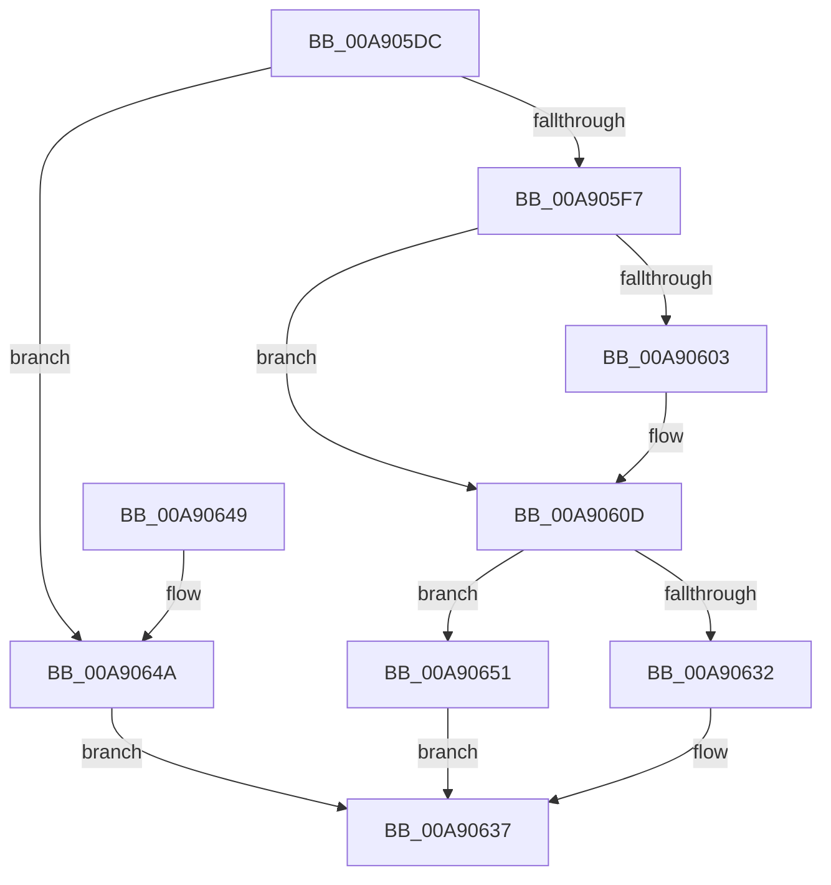

# PopSetHiberFileMcb

- RVA: `0x00A905DC`–`0x00A9066F` (길이 `147` bytes)
- VA: `0x0000000140A905DC`
- 실행 섹션: `PAGE`
- PDB 이름 있음: `예`; PDB Function 태그: `아니요`
- unwind 정보 RVA: `0x000AD0CC`
- 디코드: `40`개 명령, `147/147` bytes 표시
- 미해석 바이트: `0` (있으면 어셈블리에 `.byte`로 보존)

> 이 문서는 커널 이미지의 기계어와 PDB 기호를 분석해 생성했습니다. 4번과 5번은 함수 원형과 자료형을 바이너리 사용 방식에서 추정한 C 해석이며 원본 소스 복구 결과는 아닙니다.

## 1. Dependencies

- 직접 호출 지점: **4**; 고유 호출 대상: **3**
- 직접 호출자로 확인된 함수: **2**
- RIP 상대 이미지 참조: **4**

### Outgoing calls
- `0x00A90608` → [ExFreePoolWithTag](../../poolcode/B8/ExFreePoolWithTag_function_00B82870.md) (function, `0x00B82870`)
- `0x00A90621` → [ExAllocatePool2](../../poolcode/B8/ExAllocatePool2_function_00B820F0.md) (function, `0x00B820F0`)
- `0x00A9065E` → [memcpy](../../text/6C/memcpy_function_006C6840.md) (function, `0x006C6840`)
- `0x00A90668` → [ExFreePoolWithTag](../../poolcode/B8/ExFreePoolWithTag_function_00B82870.md) (function, `0x00B82870`)

### Direct callers
- [PopCreateHiberFile](../75/PopCreateHiberFile_function_0075CE70.md) at `0x0075D31D`
- [PopResizeHiberFile](PopResizeHiberFile_function_00A90410.md) at `0x00A9051E`

### Static image references
- `0x00A905F7` → RVA `0x00F0BF38` (`.data`; read)
- `0x00A90610` → RVA `0x00F0BF40` (`.data`; write)
- `0x00A90626` → RVA `0x00F0BF38` (`.data`; write)
- `0x00A90651` → RVA `0x00F0BF40` (`.data`; read)

## 2. Other-region calls and transfers

- 다른 실행 섹션으로 향하는 call: **4**
  - `0x00A90608` → [ExFreePoolWithTag](../../poolcode/B8/ExFreePoolWithTag_function_00B82870.md) (`PAGE` → `POOLCODE`)
  - `0x00A90621` → [ExAllocatePool2](../../poolcode/B8/ExAllocatePool2_function_00B820F0.md) (`PAGE` → `POOLCODE`)
  - `0x00A9065E` → [memcpy](../../text/6C/memcpy_function_006C6840.md) (`PAGE` → `.text`)
  - `0x00A90668` → [ExFreePoolWithTag](../../poolcode/B8/ExFreePoolWithTag_function_00B82870.md) (`PAGE` → `POOLCODE`)
- 별도 외부 분기/꼬리 이동을 확인하지 못했습니다.

## 3. Assembly (complete function range)

```asm
00A905DC  48 89 5C 24 08                  mov qword ptr [rsp + 8], rbx
00A905E1  48 89 74 24 10                  mov qword ptr [rsp + 0x10], rsi
00A905E6  57                              push rdi
00A905E7  48 83 EC 20                     sub rsp, 0x20
00A905EB  33 DB                           xor ebx, ebx
00A905ED  8B F2                           mov esi, edx
00A905EF  48 8B F9                        mov rdi, rcx
00A905F2  48 85 C9                        test rcx, rcx
00A905F5  74 53                           je 0x140a9064a
00A905F7  48 8B 0D 3A B9 47 00            mov rcx, qword ptr [rip + 0x47b93a]
00A905FE  48 85 C9                        test rcx, rcx
00A90601  74 0A                           je 0x140a9060d
00A90603  BA 68 69 62 72                  mov edx, 0x72626968
00A90608  E8 63 22 0F 00                  call 0x140b82870
00A9060D  48 8B D6                        mov rdx, rsi
00A90610  89 35 2A B9 47 00               mov dword ptr [rip + 0x47b92a], esi
00A90616  B9 40 00 00 00                  mov ecx, 0x40
00A9061B  41 B8 68 69 62 72               mov r8d, 0x72626968
00A90621  E8 CA 1A 0F 00                  call 0x140b820f0
00A90626  48 89 05 0B B9 47 00            mov qword ptr [rip + 0x47b90b], rax
00A9062D  48 85 C0                        test rax, rax
00A90630  75 1F                           jne 0x140a90651
00A90632  BB 9A 00 00 C0                  mov ebx, 0xc000009a
00A90637  48 8B 74 24 38                  mov rsi, qword ptr [rsp + 0x38]
00A9063C  8B C3                           mov eax, ebx
00A9063E  48 8B 5C 24 30                  mov rbx, qword ptr [rsp + 0x30]
00A90643  48 83 C4 20                     add rsp, 0x20
00A90647  5F                              pop rdi
00A90648  C3                              ret
00A90649  CC                              int3
00A9064A  BB 0D 00 00 C0                  mov ebx, 0xc000000d
00A9064F  EB E6                           jmp 0x140a90637
00A90651  44 8B 05 E8 B8 47 00            mov r8d, dword ptr [rip + 0x47b8e8]
00A90658  48 8B D7                        mov rdx, rdi
00A9065B  48 8B C8                        mov rcx, rax
00A9065E  E8 DD 61 C3 FF                  call 0x1406c6840
00A90663  33 D2                           xor edx, edx
00A90665  48 8B CF                        mov rcx, rdi
00A90668  E8 03 22 0F 00                  call 0x140b82870
00A9066D  EB C8                           jmp 0x140a90637
```

## 4. C-style interpretation (structured pseudocode)

```c
__int64 __fastcall PopSetHiberFileMcb(__int64 a1, int a2)
{
    __int64 result;
    __int64 v_rbx;
    __int64 v_rsp;
    unsigned __int64 v_stack_p10;
    unsigned __int64 v_stack_p8;

    v_stack_p8 = v_rbx;
    v_stack_p10 = v_rsi;
    v_rsp = (v_rsp) - (32);
    v_rbx = 0;
    if (a1 == 0) goto loc_00A9064A;
    if (*(unsigned __int64 *)(v_rip + 4700474) != 0) {
        a2 = 0x72626968ULL;
        result = ExFreePoolWithTag(*(unsigned __int64 *)(v_rip + 4700474), a2, a3, a4);
    }
    *(unsigned int *)(v_rip + 4700458) = (unsigned int)((unsigned int)(a2));
    result = ExAllocatePool2(64, (unsigned int)(a2), (unsigned int)(0x72626968ULL), a4);
    *(unsigned __int64 *)(v_rip + 4700427) = result;
    if (result != 0) goto loc_00A90651;
loc_00A90637:
    v_rsp = (v_rsp) + (32);
    return (unsigned int)((unsigned int)((unsigned int)(0xC000009AULL)));
loc_00A9064A:
    goto loc_00A90637;
loc_00A90651:
    result = memcpy((unsigned int)((unsigned int)((unsigned int)(0xC000009AULL))), a1, (unsigned int)(*(unsigned int *)(v_rip + 4700392)), a4);
    a2 = 0;
    result = ExFreePoolWithTag(a1, a2, (unsigned int)(*(unsigned int *)(v_rip + 4700392)), a4);
    goto loc_00A90637;
}
```

## 5. (Beta) C Style

```c
int64_t PopSetHiberFileMcb(int64_t Arg1, int32_t Arg2)
{
    int64_t result;
    int64_t local_rbx;
    int64_t local_rsp;
    uint64_t v_stack_p10;
    uint64_t v_stack_p8;

    v_stack_p8 = local_rbx;
    v_stack_p10 = local_rsi;
    local_rsp = (local_rsp) - (32);
    local_rbx = 0;
    if (Arg1 == 0) goto loc_00A9064A;
    if (*(uint64_t *)(v_rip + 0x47B93A) != 0) {
        Arg2 = 0x72626968ULL;
        result = ExFreePoolWithTag(*(uint64_t *)(v_rip + 0x47B93A), Arg2, a3, a4);
    }
    *(uint32_t *)(v_rip + 0x47B92A) = (uint32_t)((uint32_t)(Arg2));
    result = ExAllocatePool2(64, (uint32_t)(Arg2), (uint32_t)(0x72626968ULL), a4);
    *(uint64_t *)(v_rip + 0x47B90B) = result;
    if (result != 0) goto loc_00A90651;
loc_00A90637:
    local_rsp = (local_rsp) + (32);
    return (uint32_t)((uint32_t)((uint32_t)(0xC000009AULL)));
loc_00A9064A:
    goto loc_00A90637;
loc_00A90651:
    result = memcpy((uint32_t)((uint32_t)((uint32_t)(0xC000009AULL))), Arg1, (uint32_t)(*(uint32_t *)(v_rip + 0x47B8E8)), a4);
    Arg2 = 0;
    result = ExFreePoolWithTag(Arg1, Arg2, (uint32_t)(*(uint32_t *)(v_rip + 0x47B8E8)), a4);
    goto loc_00A90637;
}
```

## 6. Execution-region graph

[열기: 2D/3D 그래프와 함수 탐색 컨트롤 패널](../../../control-panel.html?section=page&rva=0x00A905DC&view=graph)

- 2D 그래프는 위에서 아래로 흐르고, 3D 그래프는 빈 공간을 드래그해 회전합니다. Shift+드래그는 이동, 휠은 확대·축소, 함수 노드 선택은 대상 보고서 이동입니다.

### Static fallback


