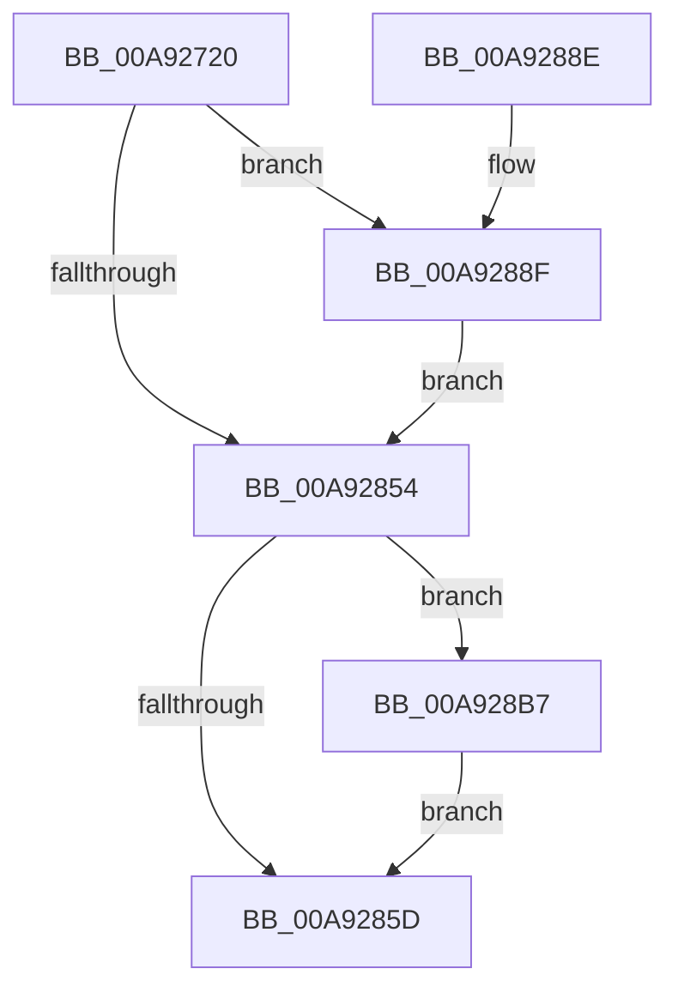

# PopSleepstudySendSessionChangeEvent

- RVA: `0x00A92720`–`0x00A928E2` (길이 `450` bytes)
- VA: `0x0000000140A92720`
- 실행 섹션: `PAGE`
- PDB 이름 있음: `예`; PDB Function 태그: `아니요`
- unwind 정보 RVA: `0x000B9428`
- 디코드: `93`개 명령, `450/450` bytes 표시
- 미해석 바이트: `0` (있으면 어셈블리에 `.byte`로 보존)

> 이 문서는 커널 이미지의 기계어와 PDB 기호를 분석해 생성했습니다. 4번과 5번은 함수 원형과 자료형을 바이너리 사용 방식에서 추정한 C 해석이며 원본 소스 복구 결과는 아닙니다.

## 1. Dependencies

- 직접 호출 지점: **4**; 고유 호출 대상: **3**
- 직접 호출자로 확인된 함수: **1**
- RIP 상대 이미지 참조: **7**

### Outgoing calls
- `0x00A92865` → [PopSleepstudySendSessionChangeWnf](PopSleepstudySendSessionChangeWnf_function_00A928E8.md) (function, `0x00A928E8`)
- `0x00A92871` → [_security_check_cookie](../../text/6A/_security_check_cookie_function_006AC640.md) (function, `0x006AC640`)
- `0x00A928B0` → [EtwWrite](../../text/41/EtwWrite_function_0041C720.md) (function, `0x0041C720`)
- `0x00A928D8` → [EtwWrite](../../text/41/EtwWrite_function_0041C720.md) (function, `0x0041C720`)

### Direct callers
- [PopSleepstudyStartNextSession](../AC/PopSleepstudyStartNextSession_function_00AC4720.md) at `0x00AC4B6A`

### Static image references
- `0x00A9273A` → RVA `0x00E0A740` (`.data`; read)
- `0x00A927E5` → RVA `0x00E67858` (`.data`; read)
- `0x00A92854` → RVA `0x00E67859` (`.data`; read)
- `0x00A9288F` → RVA `0x00F0B408` (`.data`; read)
- `0x00A928A9` → RVA `0x000222A0` (`.rdata`; read)
- `0x00A928B7` → RVA `0x00F0B6B8` (`.data`; read)
- `0x00A928D1` → RVA `0x00029828` (`.rdata`; read)

## 2. Other-region calls and transfers

- 다른 실행 섹션으로 향하는 call: **3**
  - `0x00A92871` → [_security_check_cookie](../../text/6A/_security_check_cookie_function_006AC640.md) (`PAGE` → `.text`)
  - `0x00A928B0` → [EtwWrite](../../text/41/EtwWrite_function_0041C720.md) (`PAGE` → `.text`)
  - `0x00A928D8` → [EtwWrite](../../text/41/EtwWrite_function_0041C720.md) (`PAGE` → `.text`)
- 별도 외부 분기/꼬리 이동을 확인하지 못했습니다.

## 3. Assembly (complete function range)

```asm
00A92720  48 89 5C 24 08                  mov qword ptr [rsp + 8], rbx
00A92725  48 89 74 24 18                  mov qword ptr [rsp + 0x18], rsi
00A9272A  55                              push rbp
00A9272B  57                              push rdi
00A9272C  41 56                           push r14
00A9272E  48 8D 6C 24 E0                  lea rbp, [rsp - 0x20]
00A92733  48 81 EC 20 01 00 00            sub rsp, 0x120
00A9273A  48 8B 05 FF 7F 37 00            mov rax, qword ptr [rip + 0x377fff]
00A92741  48 33 C4                        xor rax, rsp
00A92744  48 89 45 10                     mov qword ptr [rbp + 0x10], rax
00A92748  4C 8B C1                        mov r8, rcx
00A9274B  48 89 4C 24 70                  mov qword ptr [rsp + 0x70], rcx
00A92750  48 8B DA                        mov rbx, rdx
00A92753  48 C7 44 24 48 04 00 00 00      mov qword ptr [rsp + 0x48], 4
00A9275C  48 8D 7A 20                     lea rdi, [rdx + 0x20]
00A92760  48 C7 44 24 58 04 00 00 00      mov qword ptr [rsp + 0x58], 4
00A92769  48 B8 C4 02 00 00 80 F7 FF FF   movabs rax, 0xfffff780000002c4
00A92773  48 89 7C 24 50                  mov qword ptr [rsp + 0x50], rdi
00A92778  48 89 44 24 40                  mov qword ptr [rsp + 0x40], rax
00A9277D  45 33 F6                        xor r14d, r14d
00A92780  48 8D 41 08                     lea rax, [rcx + 8]
00A92784  48 C7 44 24 68 08 00 00 00      mov qword ptr [rsp + 0x68], 8
00A9278D  48 8B 49 18                     mov rcx, qword ptr [rcx + 0x18]
00A92791  48 8D 73 08                     lea rsi, [rbx + 8]
00A92795  49 2B 48 10                     sub rcx, qword ptr [r8 + 0x10]
00A92799  48 89 44 24 60                  mov qword ptr [rsp + 0x60], rax
00A9279E  48 B8 CD CC CC CC CC CC CC CC   movabs rax, 0xcccccccccccccccd
00A927A8  48 F7 E1                        mul rcx
00A927AB  48 8D 44 24 38                  lea rax, [rsp + 0x38]
00A927B0  48 C7 44 24 78 04 00 00 00      mov qword ptr [rsp + 0x78], 4
00A927B9  48 89 45 80                     mov qword ptr [rbp - 0x80], rax
00A927BD  49 8D 40 28                     lea rax, [r8 + 0x28]
00A927C1  48 89 45 90                     mov qword ptr [rbp - 0x70], rax
00A927C5  49 8D 40 30                     lea rax, [r8 + 0x30]
00A927C9  48 89 45 A0                     mov qword ptr [rbp - 0x60], rax
00A927CD  49 8D 40 2C                     lea rax, [r8 + 0x2c]
00A927D1  48 89 45 B0                     mov qword ptr [rbp - 0x50], rax
00A927D5  49 8D 40 34                     lea rax, [r8 + 0x34]
00A927D9  48 89 45 C0                     mov qword ptr [rbp - 0x40], rax
00A927DD  0F B6 43 38                     movzx eax, byte ptr [rbx + 0x38]
00A927E1  48 C1 EA 03                     shr rdx, 3
00A927E5  44 38 35 6C 50 3D 00            cmp byte ptr [rip + 0x3d506c], r14b
00A927EC  89 44 24 30                     mov dword ptr [rsp + 0x30], eax
00A927F0  48 8D 44 24 30                  lea rax, [rsp + 0x30]
00A927F5  48 89 45 F0                     mov qword ptr [rbp - 0x10], rax
00A927F9  48 89 54 24 38                  mov qword ptr [rsp + 0x38], rdx
00A927FE  48 C7 45 88 08 00 00 00         mov qword ptr [rbp - 0x78], 8
00A92806  48 C7 45 98 04 00 00 00         mov qword ptr [rbp - 0x68], 4
00A9280E  48 C7 45 A8 04 00 00 00         mov qword ptr [rbp - 0x58], 4
00A92816  48 C7 45 B8 04 00 00 00         mov qword ptr [rbp - 0x48], 4
00A9281E  48 C7 45 C8 04 00 00 00         mov qword ptr [rbp - 0x38], 4
00A92826  48 89 75 D0                     mov qword ptr [rbp - 0x30], rsi
00A9282A  48 C7 45 D8 08 00 00 00         mov qword ptr [rbp - 0x28], 8
00A92832  48 89 5D E0                     mov qword ptr [rbp - 0x20], rbx
00A92836  48 C7 45 E8 04 00 00 00         mov qword ptr [rbp - 0x18], 4
00A9283E  48 C7 45 F8 04 00 00 00         mov qword ptr [rbp - 8], 4
00A92846  48 89 7D 00                     mov qword ptr [rbp], rdi
00A9284A  48 C7 45 08 04 00 00 00         mov qword ptr [rbp + 8], 4
00A92852  75 3B                           jne 0x140a9288f
00A92854  44 38 35 FE 4F 3D 00            cmp byte ptr [rip + 0x3d4ffe], r14b
00A9285B  75 5A                           jne 0x140a928b7
00A9285D  44 8B 07                        mov r8d, dword ptr [rdi]
00A92860  8B 13                           mov edx, dword ptr [rbx]
00A92862  48 8B 0E                        mov rcx, qword ptr [rsi]
00A92865  E8 7E 00 00 00                  call 0x140a928e8
00A9286A  48 8B 4D 10                     mov rcx, qword ptr [rbp + 0x10]
00A9286E  48 33 CC                        xor rcx, rsp
00A92871  E8 CA 9D C1 FF                  call 0x1406ac640
00A92876  4C 8D 9C 24 20 01 00 00         lea r11, [rsp + 0x120]
00A9287E  49 8B 5B 20                     mov rbx, qword ptr [r11 + 0x20]
00A92882  49 8B 73 30                     mov rsi, qword ptr [r11 + 0x30]
00A92886  49 8B E3                        mov rsp, r11
00A92889  41 5E                           pop r14
00A9288B  5F                              pop rdi
00A9288C  5D                              pop rbp
00A9288D  C3                              ret
00A9288E  CC                              int3
00A9288F  48 8B 0D 72 8B 47 00            mov rcx, qword ptr [rip + 0x478b72]
00A92896  48 8D 44 24 40                  lea rax, [rsp + 0x40]
00A9289B  41 B9 0D 00 00 00               mov r9d, 0xd
00A928A1  48 89 44 24 20                  mov qword ptr [rsp + 0x20], rax
00A928A6  45 33 C0                        xor r8d, r8d
00A928A9  48 8D 15 F0 F9 58 FF            lea rdx, [rip - 0xa70610]
00A928B0  E8 6B 9E 98 FF                  call 0x14041c720
00A928B5  EB 9D                           jmp 0x140a92854
00A928B7  48 8B 0D FA 8D 47 00            mov rcx, qword ptr [rip + 0x478dfa]
00A928BE  48 8D 44 24 40                  lea rax, [rsp + 0x40]
00A928C3  41 B9 0D 00 00 00               mov r9d, 0xd
00A928C9  48 89 44 24 20                  mov qword ptr [rsp + 0x20], rax
00A928CE  45 33 C0                        xor r8d, r8d
00A928D1  48 8D 15 50 6F 59 FF            lea rdx, [rip - 0xa690b0]
00A928D8  E8 43 9E 98 FF                  call 0x14041c720
00A928DD  E9 7B FF FF FF                  jmp 0x140a9285d
```

## 4. C-style interpretation (structured pseudocode)

```c
__int64 __fastcall PopSleepstudySendSessionChangeEvent(__int64 a1, __int64 a2)
{
    __int64 result;
    __int64 v_r14;
    __int64 v_rsp;
    unsigned __int64 v_stack_m100;
    unsigned int v_stack_m108;
    unsigned __int64 v_stack_m18;
    unsigned __int64 v_stack_m28;
    unsigned __int64 v_stack_m30;
    unsigned __int64 v_stack_m38;
    unsigned __int64 v_stack_m40;
    unsigned __int64 v_stack_m48;
    unsigned __int64 v_stack_m50;
    unsigned __int64 v_stack_m58;
    unsigned __int64 v_stack_m60;
    unsigned __int64 v_stack_m68;
    unsigned __int64 v_stack_m70;
    unsigned __int64 v_stack_m78;
    unsigned __int64 v_stack_m80;
    unsigned __int64 v_stack_m88;
    unsigned __int64 v_stack_m90;
    unsigned __int64 v_stack_m98;
    unsigned __int64 v_stack_mA0;
    unsigned __int64 v_stack_mA8;
    unsigned __int64 v_stack_mB0;
    unsigned __int64 v_stack_mB8;
    unsigned __int64 v_stack_mC0;
    unsigned __int64 v_stack_mC8;
    unsigned __int64 v_stack_mD0;
    unsigned __int64 v_stack_mD8;
    unsigned __int64 v_stack_mE0;
    unsigned __int64 v_stack_mE8;
    unsigned __int64 v_stack_mF0;
    unsigned __int64 v_stack_mF8;
    unsigned __int64 v_stack_p18;
    unsigned __int64 v_stack_p8;

    v_stack_p8 = v_rbx;
    v_stack_p18 = v_rsi;
    v_rsp = (v_rsp) - (288);
    result = (*(unsigned __int64 *)(v_rip + 3637247)) ^ (v_rsp);
    v_stack_m28 = result;
    v_stack_mC8 = a1;
    v_stack_mF0 = 4;
    v_stack_mE0 = 4;
    v_stack_mE8 = a2 + 32;
    v_stack_mF8 = result;
    v_r14 = 0;
    v_stack_mD0 = 8;
    a1 = (*(unsigned __int64 *)(a1 + 24)) - (*(unsigned __int64 *)(a1 + 16));
    v_stack_mD8 = a1 + 8;
    v_stack_mC0 = 4;
    v_stack_mB8 = v_stack_m100;
    v_stack_mA8 = a1 + 40;
    v_stack_m98 = a1 + 48;
    v_stack_m88 = a1 + 44;
    v_stack_m78 = a1 + 52;
    a2 = (a2) >> (3);
    v_stack_m108 = (unsigned int)(*(unsigned __int8 *)(a2 + 56));
    v_stack_m48 = v_stack_m108;
    v_stack_m100 = a2;
    v_stack_mB0 = 8;
    v_stack_mA0 = 4;
    v_stack_m90 = 4;
    v_stack_m80 = 4;
    v_stack_m70 = 4;
    v_stack_m68 = a2 + 8;
    v_stack_m60 = 8;
    v_stack_m58 = a2;
    v_stack_m50 = 4;
    v_stack_m40 = 4;
    v_stack_m38 = a2 + 32;
    v_stack_m30 = 4;
    if ((*(unsigned __int8 *)(v_rip + 4018284)) != 0) goto loc_00A9288F;
loc_00A92854:
    if ((*(unsigned __int8 *)(v_rip + 4018174)) != 0) goto loc_00A928B7;
loc_00A9285D:
    result = PopSleepstudySendSessionChangeWnf(*(unsigned __int64 *)(a2 + 8), (unsigned int)(*(unsigned int *)(a2)), (unsigned int)(*(unsigned int *)(a2 + 32)), a4);
    a1 = (v_stack_m28) ^ (v_rsp);
    result = _security_check_cookie(a1, (unsigned int)(*(unsigned int *)(a2)), (unsigned int)(*(unsigned int *)(a2 + 32)), a4);
    return result;
loc_00A9288F:
    v_stack_m100 = v_stack_mE0;
    a3 = 0;
    result = EtwWrite(*(unsigned __int64 *)(v_rip + 4688754), v_rip - 10946064, a3, 13);
    goto loc_00A92854;
loc_00A928B7:
    v_stack_m100 = v_stack_mE0;
    a3 = 0;
    result = EtwWrite(*(unsigned __int64 *)(v_rip + 4689402), v_rip - 10916016, a3, 13);
    goto loc_00A9285D;
}
```

## 5. (Beta) C Style

```c
int64_t PopSleepstudySendSessionChangeEvent(void *Arg1, void *Arg2)
{
    uint8_t *arg1 = (uint8_t *)Arg1;
    uint8_t *arg2 = (uint8_t *)Arg2;

    int64_t result;
    int64_t local_r14;
    int64_t local_rsp;
    uint64_t v_stack_m100;
    uint32_t v_stack_m108;
    uint64_t v_stack_m18;
    uint64_t v_stack_m28;
    uint64_t v_stack_m30;
    uint64_t v_stack_m38;
    uint64_t v_stack_m40;
    uint64_t v_stack_m48;
    uint64_t v_stack_m50;
    uint64_t v_stack_m58;
    uint64_t v_stack_m60;
    uint64_t v_stack_m68;
    uint64_t v_stack_m70;
    uint64_t v_stack_m78;
    uint64_t v_stack_m80;
    uint64_t v_stack_m88;
    uint64_t v_stack_m90;
    uint64_t v_stack_m98;
    uint64_t v_stack_mA0;
    uint64_t v_stack_mA8;
    uint64_t v_stack_mB0;
    uint64_t v_stack_mB8;
    uint64_t v_stack_mC0;
    uint64_t v_stack_mC8;
    uint64_t v_stack_mD0;
    uint64_t v_stack_mD8;
    uint64_t v_stack_mE0;
    uint64_t v_stack_mE8;
    uint64_t v_stack_mF0;
    uint64_t v_stack_mF8;
    uint64_t v_stack_p18;
    uint64_t v_stack_p8;

    v_stack_p8 = local_rbx;
    v_stack_p18 = local_rsi;
    local_rsp = (local_rsp) - (288);
    result = (*(uint64_t *)(v_rip + 0x377FFF)) ^ (local_rsp);
    v_stack_m28 = result;
    v_stack_mC8 = Arg1;
    v_stack_mF0 = 4;
    v_stack_mE0 = 4;
    v_stack_mE8 = Arg2 + 32;
    v_stack_mF8 = result;
    local_r14 = 0;
    v_stack_mD0 = 8;
    Arg1 = (*(uint64_t *)(arg1 + 0x18)) - (*(uint64_t *)(arg1 + 0x10));
    v_stack_mD8 = Arg1 + 8;
    v_stack_mC0 = 4;
    v_stack_mB8 = v_stack_m100;
    v_stack_mA8 = Arg1 + 40;
    v_stack_m98 = Arg1 + 48;
    v_stack_m88 = Arg1 + 44;
    v_stack_m78 = Arg1 + 52;
    Arg2 = (Arg2) >> (3);
    v_stack_m108 = (uint32_t)(*(uint8_t *)(arg2 + 0x38));
    v_stack_m48 = v_stack_m108;
    v_stack_m100 = Arg2;
    v_stack_mB0 = 8;
    v_stack_mA0 = 4;
    v_stack_m90 = 4;
    v_stack_m80 = 4;
    v_stack_m70 = 4;
    v_stack_m68 = Arg2 + 8;
    v_stack_m60 = 8;
    v_stack_m58 = Arg2;
    v_stack_m50 = 4;
    v_stack_m40 = 4;
    v_stack_m38 = Arg2 + 32;
    v_stack_m30 = 4;
    if ((*(uint8_t *)(v_rip + 0x3D506C)) != 0) goto loc_00A9288F;
loc_00A92854:
    if ((*(uint8_t *)(v_rip + 0x3D4FFE)) != 0) goto loc_00A928B7;
loc_00A9285D:
    result = PopSleepstudySendSessionChangeWnf(*(uint64_t *)(arg2 + 0x8), (uint32_t)(*(uint32_t *)(arg2)), (uint32_t)(*(uint32_t *)(arg2 + 0x20)), a4);
    Arg1 = (v_stack_m28) ^ (local_rsp);
    result = _security_check_cookie(Arg1, (uint32_t)(*(uint32_t *)(arg2)), (uint32_t)(*(uint32_t *)(arg2 + 0x20)), a4);
    return result;
loc_00A9288F:
    v_stack_m100 = v_stack_mE0;
    a3 = 0;
    result = EtwWrite(*(uint64_t *)(v_rip + 0x478B72), v_rip - 10946064, a3, 13);
    goto loc_00A92854;
loc_00A928B7:
    v_stack_m100 = v_stack_mE0;
    a3 = 0;
    result = EtwWrite(*(uint64_t *)(v_rip + 0x478DFA), v_rip - 10916016, a3, 13);
    goto loc_00A9285D;
}
```

### 관측된 메모리 오프셋

구조체 형식이 확인되지 않은 접근은 인자 기준의 오프셋으로만 기록했습니다.

| 기준 인자 | 오프셋 표현 | 폭 (bit) | 접근 |
|---|---:|---:|---|
| `Arg1` | `+ 0x8` | `64` | `R` |
| `Arg1` | `+ 0x10` | `64` | `R` |
| `Arg1` | `+ 0x18` | `64` | `R` |
| `Arg1` | `+ 0x28` | `64` | `R` |
| `Arg1` | `+ 0x2C` | `64` | `R` |
| `Arg1` | `+ 0x30` | `64` | `R` |
| `Arg1` | `+ 0x34` | `64` | `R` |
| `Arg2` | `+ 0x0` | `32` | `R` |
| `Arg2` | `+ 0x0` | `64` | `R` |
| `Arg2` | `+ 0x8` | `64` | `R` |
| `Arg2` | `+ 0x20` | `64` | `R` |
| `Arg2` | `+ 0x38` | `8` | `R` |

## 6. Execution-region graph

[열기: 2D/3D 그래프와 함수 탐색 컨트롤 패널](../../../control-panel.html?section=page&rva=0x00A92720&view=graph)

- 2D 그래프는 위에서 아래로 흐르고, 3D 그래프는 빈 공간을 드래그해 회전합니다. Shift+드래그는 이동, 휠은 확대·축소, 함수 노드 선택은 대상 보고서 이동입니다.

### Static fallback


