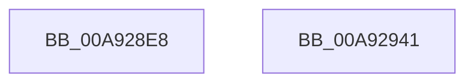

# PopSleepstudySendSessionChangeWnf

- RVA: `0x00A928E8`–`0x00A92942` (길이 `90` bytes)
- VA: `0x0000000140A928E8`
- 실행 섹션: `PAGE`
- PDB 이름 있음: `예`; PDB Function 태그: `아니요`
- unwind 정보 RVA: `0x00065FB8`
- 디코드: `23`개 명령, `90/90` bytes 표시
- 미해석 바이트: `0` (있으면 어셈블리에 `.byte`로 보존)

> 이 문서는 커널 이미지의 기계어와 PDB 기호를 분석해 생성했습니다. 4번과 5번은 함수 원형과 자료형을 바이너리 사용 방식에서 추정한 C 해석이며 원본 소스 복구 결과는 아닙니다.

## 1. Dependencies

- 직접 호출 지점: **2**; 고유 호출 대상: **2**
- 직접 호출자로 확인된 함수: **2**
- RIP 상대 이미지 참조: **2**

### Outgoing calls
- `0x00A9292A` → [ZwUpdateWnfStateData](../../text/6B/ZwUpdateWnfStateData_function_006B0D10.md) (function, `0x006B0D10`)
- `0x00A92937` → [_security_check_cookie](../../text/6A/_security_check_cookie_function_006AC640.md) (function, `0x006AC640`)

### Direct callers
- [PopSleepstudySendSessionChangeEvent](PopSleepstudySendSessionChangeEvent_function_00A92720.md) at `0x00A92865`
- [PopSleepstudyInitialize](../../init/C7/PopSleepstudyInitialize_function_00C76C60.md) at `0x00C76D30`

### Static image references
- `0x00A928EF` → RVA `0x00E0A740` (`.data`; read)
- `0x00A92908` → RVA `0x0001C1E0` (`.rdata`; read)

## 2. Other-region calls and transfers

- 다른 실행 섹션으로 향하는 call: **2**
  - `0x00A9292A` → [ZwUpdateWnfStateData](../../text/6B/ZwUpdateWnfStateData_function_006B0D10.md) (`PAGE` → `.text`)
  - `0x00A92937` → [_security_check_cookie](../../text/6A/_security_check_cookie_function_006AC640.md) (`PAGE` → `.text`)
- 별도 외부 분기/꼬리 이동을 확인하지 못했습니다.

## 3. Assembly (complete function range)

```asm
00A928E8  4C 8B DC                        mov r11, rsp
00A928EB  48 83 EC 68                     sub rsp, 0x68
00A928EF  48 8B 05 4A 7E 37 00            mov rax, qword ptr [rip + 0x377e4a]
00A928F6  48 33 C4                        xor rax, rsp
00A928F9  48 89 44 24 50                  mov qword ptr [rsp + 0x50], rax
00A928FE  33 C0                           xor eax, eax
00A92900  49 89 4B D8                     mov qword ptr [r11 - 0x28], rcx
00A92904  89 54 24 48                     mov dword ptr [rsp + 0x48], edx
00A92908  48 8D 0D D1 98 58 FF            lea rcx, [rip - 0xa7672f]
00A9290F  89 44 24 30                     mov dword ptr [rsp + 0x30], eax
00A92913  49 8D 53 D8                     lea rdx, [r11 - 0x28]
00A92917  45 89 43 E4                     mov dword ptr [r11 - 0x1c], r8d
00A9291B  45 33 C9                        xor r9d, r9d
00A9291E  89 44 24 28                     mov dword ptr [rsp + 0x28], eax
00A92922  44 8D 40 10                     lea r8d, [rax + 0x10]
00A92926  49 89 43 B8                     mov qword ptr [r11 - 0x48], rax
00A9292A  E8 E1 E3 C1 FF                  call 0x1406b0d10
00A9292F  48 8B 4C 24 50                  mov rcx, qword ptr [rsp + 0x50]
00A92934  48 33 CC                        xor rcx, rsp
00A92937  E8 04 9D C1 FF                  call 0x1406ac640
00A9293C  48 83 C4 68                     add rsp, 0x68
00A92940  C3                              ret
00A92941  CC                              int3
```

## 4. C-style interpretation (structured pseudocode)

```c
__int64 __fastcall PopSleepstudySendSessionChangeWnf(__int64 a1, int a2, int a3, int a4)
{
    __int64 result;
    __int64 v_rsp;
    unsigned __int64 v_stack_m18;
    unsigned int v_stack_m20;
    unsigned int v_stack_m38;
    unsigned int v_stack_m40;

    v_rsp = (v_rsp) - (104);
    result = (*(unsigned __int64 *)(v_rip + 3636810)) ^ (v_rsp);
    v_stack_m18 = result;
    result = 0;
    *(unsigned __int64 *)(v_rsp - 40) = a1;
    v_stack_m20 = a2;
    v_stack_m38 = 0;
    *(unsigned int *)(v_rsp - 28) = a3;
    a4 = 0;
    v_stack_m40 = 0;
    *(unsigned __int64 *)(v_rsp - 72) = 0;
    result = ZwUpdateWnfStateData(v_rip - 10970927, v_rsp - 40, result + 16, a4);
    a1 = (v_stack_m18) ^ (v_rsp);
    result = _security_check_cookie(a1, v_rsp - 40, result + 16, a4);
    v_rsp = (v_rsp) + (104);
    return result;
}
```

## 5. (Beta) C Style

```c
int64_t PopSleepstudySendSessionChangeWnf(int64_t Arg1, int32_t Arg2, int32_t Arg3, int32_t Arg4)
{
    int64_t result;
    int64_t local_rsp;
    uint64_t v_stack_m18;
    uint32_t v_stack_m20;
    uint32_t v_stack_m38;
    uint32_t v_stack_m40;

    local_rsp = (local_rsp) - (104);
    result = (*(uint64_t *)(v_rip + 0x377E4A)) ^ (local_rsp);
    v_stack_m18 = result;
    result = 0;
    *(uint64_t *)(local_rsp - 0x28) = Arg1;
    v_stack_m20 = Arg2;
    v_stack_m38 = 0;
    *(uint32_t *)(local_rsp - 0x1C) = Arg3;
    Arg4 = 0;
    v_stack_m40 = 0;
    *(uint64_t *)(local_rsp - 0x48) = 0;
    result = ZwUpdateWnfStateData(v_rip - 10970927, local_rsp - 40, result + 16, Arg4);
    Arg1 = (v_stack_m18) ^ (local_rsp);
    result = _security_check_cookie(Arg1, local_rsp - 40, result + 16, Arg4);
    local_rsp = (local_rsp) + (104);
    return result;
}
```

## 6. Execution-region graph

[열기: 2D/3D 그래프와 함수 탐색 컨트롤 패널](../../../control-panel.html?section=page&rva=0x00A928E8&view=graph)

- 2D 그래프는 위에서 아래로 흐르고, 3D 그래프는 빈 공간을 드래그해 회전합니다. Shift+드래그는 이동, 휠은 확대·축소, 함수 노드 선택은 대상 보고서 이동입니다.

### Static fallback


