# PopTransitionTelemetryOsState

- RVA: `0x00A9DD40`–`0x00A9E229` (길이 `1,257` bytes)
- VA: `0x0000000140A9DD40`
- 실행 섹션: `PAGE`
- PDB 이름 있음: `예`; PDB Function 태그: `예`
- unwind 정보 RVA: `0x000BA81C`
- 디코드: `260`개 명령, `1,257/1,257` bytes 표시
- 미해석 바이트: `0` (있으면 어셈블리에 `.byte`로 보존)

> 이 문서는 커널 이미지의 기계어와 PDB 기호를 분석해 생성했습니다. 4번과 5번은 함수 원형과 자료형을 바이너리 사용 방식에서 추정한 C 해석이며 원본 소스 복구 결과는 아닙니다.

## 1. Dependencies

- 직접 호출 지점: **14**; 고유 호출 대상: **7**
- 직접 호출자로 확인된 함수: **4**
- RIP 상대 이미지 참조: **55**

### Outgoing calls
- `0x00A9DDA0` → [_security_check_cookie](../../text/6A/_security_check_cookie_function_006AC640.md) (function, `0x006AC640`)
- `0x00A9DE43` → [PopAcquireRwLockExclusive](../../text/43/PopAcquireRwLockExclusive_function_00430B44.md) (function, `0x00430B44`)
- `0x00A9DF31` → [PopReleaseRwLock](../../text/2D/PopReleaseRwLock_function_002DFBBC.md) (function, `0x002DFBBC`)
- `0x00A9DF3D` → [PopAcquireRwLockShared](../../text/2D/PopAcquireRwLockShared_function_002D9A40.md) (function, `0x002D9A40`)
- `0x00A9DF58` → [PopReleaseRwLock](../../text/2D/PopReleaseRwLock_function_002DFBBC.md) (function, `0x002DFBBC`)
- `0x00A9DF84` → [PopMeasureEnergyChange](PopMeasureEnergyChange_function_00A9E230.md) (function, `0x00A9E230`)
- `0x00A9DFFC` → [PopReleaseRwLock](../../text/2D/PopReleaseRwLock_function_002DFBBC.md) (function, `0x002DFBBC`)
- `0x00A9E055` → [EtwTelemetryCoverageReport](../../text/46/EtwTelemetryCoverageReport_function_00460430.md) (function, `0x00460430`)
- `0x00A9E0A0` → [TelemetryCoverageStringHashInternal](../../text/4D/TelemetryCoverageStringHashInternal_function_004D51A0.md) (function, `0x004D51A0`)
- `0x00A9E0E1` → [TelemetryCoverageStringHashInternal](../../text/4D/TelemetryCoverageStringHashInternal_function_004D51A0.md) (function, `0x004D51A0`)
- `0x00A9E122` → [TelemetryCoverageStringHashInternal](../../text/4D/TelemetryCoverageStringHashInternal_function_004D51A0.md) (function, `0x004D51A0`)
- `0x00A9E163` → [TelemetryCoverageStringHashInternal](../../text/4D/TelemetryCoverageStringHashInternal_function_004D51A0.md) (function, `0x004D51A0`)
- `0x00A9E1A4` → [TelemetryCoverageStringHashInternal](../../text/4D/TelemetryCoverageStringHashInternal_function_004D51A0.md) (function, `0x004D51A0`)
- `0x00A9E207` → [TelemetryCoverageStringHashInternal](../../text/4D/TelemetryCoverageStringHashInternal_function_004D51A0.md) (function, `0x004D51A0`)

### Direct callers
- [PopDiagTraceControlCallback](../A3/PopDiagTraceControlCallback_function_00A38CB0.md) at `0x00A38EBD`
- [PopNotifyTelemetryOsState](../AC/PopNotifyTelemetryOsState_function_00AC3CB4.md) at `0x00AC3D4F`
- [PopSleepstudyStartNextSession](../AC/PopSleepstudyStartNextSession_function_00AC4720.md) at `0x00AC49C5`
- [PopSleepstudyStartNextSession](../AC/PopSleepstudyStartNextSession_function_00AC4720.md) at `0x00AC4BE5`
- [PopDiagInitialize](../../init/C3/PopDiagInitialize_function_00C3F2C0.md) at `0x00C3F494`

### Static image references
- `0x00A9DD66` → RVA `0x00E0A740` (`.data`; read)
- `0x00A9DD7C` → RVA `0x00E07748` (`.data`; read)
- `0x00A9DDD1` → RVA `0x00E07758` (`.data`; read)
- `0x00A9DDDA` → RVA `0x00E07760` (`.data`; read)
- `0x00A9DDE4` → RVA `0x00F0B4CC` (`.data`; read)
- `0x00A9DE3C` → RVA `0x00F0B480` (`.data`; read)
- `0x00A9DE48` → RVA `0x00F0B4C8` (`.data`; read)
- `0x00A9DE79` → RVA `0x00F0B4A8` (`.data`; read)
- `0x00A9DEA3` → RVA `0x00F0B4A0` (`.data`; read)
- `0x00A9DEBA` → RVA `0x00F0B4B8` (`.data`; read)
- `0x00A9DEC8` → RVA `0x00F0B4B8` (`.data`; write)
- `0x00A9DECF` → RVA `0x00F0B4B0` (`.data`; read)
- `0x00A9DED9` → RVA `0x00F0B4B0` (`.data`; write)
- `0x00A9DEE7` → RVA `0x00F0B4C0` (`.data`; read)
- `0x00A9DEF7` → RVA `0x00F0B4C0` (`.data`; write)
- `0x00A9DEFD` → RVA `0x00F0B490` (`.data`; read)
- `0x00A9DF07` → RVA `0x00F0B494` (`.data`; read)
- `0x00A9DF1A` → RVA `0x00F0B4C4` (`.data`; read)
- `0x00A9DF36` → RVA `0x00F0C238` (`.data`; read)
- `0x00A9DF42` → RVA `0x00F0C248` (`.data`; read)
- `0x00A9DF79` → RVA `0x00F0B4D0` (`.data`; read)
- `0x00A9DF90` → RVA `0x00F0B49C` (`.data`; read)
- `0x00A9DF9A` → RVA `0x00F0B498` (`.data`; read)
- `0x00A9DFAF` → RVA `0x00F0B4C4` (`.data`; read/write)
- `0x00A9DFB5` → RVA `0x00F0B490` (`.data`; write)
- `0x00A9DFBB` → RVA `0x00F0B494` (`.data`; write)
- `0x00A9DFCF` → RVA `0x00F0B4C8` (`.data`; read/write)
- `0x00A9E01D` → RVA `0x00E0767C` (`.data`; read)
- `0x00A9E029` → RVA `0x00E07678` (`.data`; read)
- `0x00A9E032` → RVA `0x00E07670` (`.data`; read)
- `0x00A9E048` → RVA `0x00E07678` (`.data`; write)
- `0x00A9E07B` → RVA `0x00E0758C` (`.data`; read)
- `0x00A9E087` → RVA `0x00E07588` (`.data`; read)
- `0x00A9E094` → RVA `0x00E07580` (`.data`; read)
- `0x00A9E0A5` → RVA `0x00E07588` (`.data`; write)
- `0x00A9E0BC` → RVA `0x00E075BC` (`.data`; read)
- `0x00A9E0C8` → RVA `0x00E075B8` (`.data`; read)
- `0x00A9E0D5` → RVA `0x00E075B0` (`.data`; read)
- `0x00A9E0E6` → RVA `0x00E075B8` (`.data`; write)
- `0x00A9E0FD` → RVA `0x00E075A4` (`.data`; read)
- `0x00A9E109` → RVA `0x00E075A0` (`.data`; read)
- `0x00A9E116` → RVA `0x00E07598` (`.data`; read)
- `0x00A9E127` → RVA `0x00E075A0` (`.data`; write)
- `0x00A9E13E` → RVA `0x00E075EC` (`.data`; read)
- `0x00A9E14A` → RVA `0x00E075E8` (`.data`; read)
- `0x00A9E157` → RVA `0x00E075E0` (`.data`; read)
- `0x00A9E168` → RVA `0x00E075E8` (`.data`; write)
- `0x00A9E17F` → RVA `0x00E075D4` (`.data`; read)
- `0x00A9E18B` → RVA `0x00E075D0` (`.data`; read)
- `0x00A9E198` → RVA `0x00E075C8` (`.data`; read)
- `0x00A9E1A9` → RVA `0x00E075D0` (`.data`; write)
- `0x00A9E1E2` → RVA `0x00E07694` (`.data`; read)
- `0x00A9E1EE` → RVA `0x00E07690` (`.data`; read)
- `0x00A9E1FB` → RVA `0x00E07688` (`.data`; read)
- `0x00A9E20C` → RVA `0x00E07690` (`.data`; write)

## 2. Other-region calls and transfers

- 다른 실행 섹션으로 향하는 call: **13**
  - `0x00A9DDA0` → [_security_check_cookie](../../text/6A/_security_check_cookie_function_006AC640.md) (`PAGE` → `.text`)
  - `0x00A9DE43` → [PopAcquireRwLockExclusive](../../text/43/PopAcquireRwLockExclusive_function_00430B44.md) (`PAGE` → `.text`)
  - `0x00A9DF31` → [PopReleaseRwLock](../../text/2D/PopReleaseRwLock_function_002DFBBC.md) (`PAGE` → `.text`)
  - `0x00A9DF3D` → [PopAcquireRwLockShared](../../text/2D/PopAcquireRwLockShared_function_002D9A40.md) (`PAGE` → `.text`)
  - `0x00A9DF58` → [PopReleaseRwLock](../../text/2D/PopReleaseRwLock_function_002DFBBC.md) (`PAGE` → `.text`)
  - `0x00A9DFFC` → [PopReleaseRwLock](../../text/2D/PopReleaseRwLock_function_002DFBBC.md) (`PAGE` → `.text`)
  - `0x00A9E055` → [EtwTelemetryCoverageReport](../../text/46/EtwTelemetryCoverageReport_function_00460430.md) (`PAGE` → `.text`)
  - `0x00A9E0A0` → [TelemetryCoverageStringHashInternal](../../text/4D/TelemetryCoverageStringHashInternal_function_004D51A0.md) (`PAGE` → `.text`)
  - `0x00A9E0E1` → [TelemetryCoverageStringHashInternal](../../text/4D/TelemetryCoverageStringHashInternal_function_004D51A0.md) (`PAGE` → `.text`)
  - `0x00A9E122` → [TelemetryCoverageStringHashInternal](../../text/4D/TelemetryCoverageStringHashInternal_function_004D51A0.md) (`PAGE` → `.text`)
  - `0x00A9E163` → [TelemetryCoverageStringHashInternal](../../text/4D/TelemetryCoverageStringHashInternal_function_004D51A0.md) (`PAGE` → `.text`)
  - `0x00A9E1A4` → [TelemetryCoverageStringHashInternal](../../text/4D/TelemetryCoverageStringHashInternal_function_004D51A0.md) (`PAGE` → `.text`)
  - `0x00A9E207` → [TelemetryCoverageStringHashInternal](../../text/4D/TelemetryCoverageStringHashInternal_function_004D51A0.md) (`PAGE` → `.text`)
- call이 아닌 외부 분기/꼬리 이동: **15**
  - `0x00A9DFAA` → [sub_00B48B0A + 0x1BC](../B4/Unknown_function_00B48B0A.md) (`tail-transfer`)
  - `0x00A9E00B` → [sub_00B48B0A + 0x3C](../B4/Unknown_function_00B48B0A.md) (`tail-transfer`)
  - `0x00A9E08E` → [sub_00B48B0A](../B4/Unknown_function_00B48B0A.md) (`tail-transfer`)
  - `0x00A9E0AB` → [sub_00B48B0A](../B4/Unknown_function_00B48B0A.md) (`tail-transfer`)
  - `0x00A9E0CF` → [sub_00B48B0A + 0xC](../B4/Unknown_function_00B48B0A.md) (`tail-transfer`)
  - `0x00A9E0EC` → [sub_00B48B0A + 0xC](../B4/Unknown_function_00B48B0A.md) (`tail-transfer`)
  - `0x00A9E110` → [sub_00B48B0A + 0x18](../B4/Unknown_function_00B48B0A.md) (`tail-transfer`)
  - `0x00A9E12D` → [sub_00B48B0A + 0x18](../B4/Unknown_function_00B48B0A.md) (`tail-transfer`)
  - `0x00A9E151` → [sub_00B48B0A + 0x24](../B4/Unknown_function_00B48B0A.md) (`tail-transfer`)
  - `0x00A9E16E` → [sub_00B48B0A + 0x24](../B4/Unknown_function_00B48B0A.md) (`tail-transfer`)
  - `0x00A9E192` → [sub_00B48B0A + 0x30](../B4/Unknown_function_00B48B0A.md) (`tail-transfer`)
  - `0x00A9E1AF` → [sub_00B48B0A + 0x30](../B4/Unknown_function_00B48B0A.md) (`tail-transfer`)
  - `0x00A9E1D0` → [sub_00B48B0A + 0x178](../B4/Unknown_function_00B48B0A.md) (`tail-transfer`)
  - `0x00A9E1F5` → [sub_00B48B0A + 0x16C](../B4/Unknown_function_00B48B0A.md) (`tail-transfer`)
  - `0x00A9E212` → [sub_00B48B0A + 0x16C](../B4/Unknown_function_00B48B0A.md) (`tail-transfer`)

## 3. Assembly (complete function range)

```asm
00A9DD40  48 8B C4                        mov rax, rsp
00A9DD43  48 89 58 08                     mov qword ptr [rax + 8], rbx
00A9DD47  48 89 70 10                     mov qword ptr [rax + 0x10], rsi
00A9DD4B  48 89 78 18                     mov qword ptr [rax + 0x18], rdi
00A9DD4F  55                              push rbp
00A9DD50  41 54                           push r12
00A9DD52  41 55                           push r13
00A9DD54  41 56                           push r14
00A9DD56  41 57                           push r15
00A9DD58  48 8D A8 78 FE FF FF            lea rbp, [rax - 0x188]
00A9DD5F  48 81 EC 60 02 00 00            sub rsp, 0x260
00A9DD66  48 8B 05 D3 C9 36 00            mov rax, qword ptr [rip + 0x36c9d3]
00A9DD6D  48 33 C4                        xor rax, rsp
00A9DD70  48 89 85 50 01 00 00            mov qword ptr [rbp + 0x150], rax
00A9DD77  33 C0                           xor eax, eax
00A9DD79  45 33 F6                        xor r14d, r14d
00A9DD7C  44 39 35 C5 99 36 00            cmp dword ptr [rip + 0x3699c5], r14d
00A9DD83  8B FA                           mov edi, edx
00A9DD85  48 89 45 84                     mov qword ptr [rbp - 0x7c], rax
00A9DD89  8B D9                           mov ebx, ecx
00A9DD8B  48 89 45 80                     mov qword ptr [rbp - 0x80], rax
00A9DD8F  41 8B F6                        mov esi, r14d
00A9DD92  77 33                           ja 0x140a9ddc7
00A9DD94  8B C6                           mov eax, esi
00A9DD96  48 8B 8D 50 01 00 00            mov rcx, qword ptr [rbp + 0x150]
00A9DD9D  48 33 CC                        xor rcx, rsp
00A9DDA0  E8 9B E8 C0 FF                  call 0x1406ac640
00A9DDA5  4C 8D 9C 24 60 02 00 00         lea r11, [rsp + 0x260]
00A9DDAD  49 8B 5B 30                     mov rbx, qword ptr [r11 + 0x30]
00A9DDB1  49 8B 73 38                     mov rsi, qword ptr [r11 + 0x38]
00A9DDB5  49 8B 7B 40                     mov rdi, qword ptr [r11 + 0x40]
00A9DDB9  49 8B E3                        mov rsp, r11
00A9DDBC  41 5F                           pop r15
00A9DDBE  41 5E                           pop r14
00A9DDC0  41 5D                           pop r13
00A9DDC2  41 5C                           pop r12
00A9DDC4  5D                              pop rbp
00A9DDC5  C3                              ret
00A9DDC6  CC                              int3
00A9DDC7  48 BA 00 00 00 00 00 80 00 00   movabs rdx, 0x800000000000
00A9DDD1  48 85 15 80 99 36 00            test qword ptr [rip + 0x369980], rdx
00A9DDD8  74 BA                           je 0x140a9dd94
00A9DDDA  48 8B 05 7F 99 36 00            mov rax, qword ptr [rip + 0x36997f]
00A9DDE1  48 23 C2                        and rax, rdx
00A9DDE4  44 38 35 E1 D6 46 00            cmp byte ptr [rip + 0x46d6e1], r14b
00A9DDEB  74 A7                           je 0x140a9dd94
00A9DDED  48 3B 05 6C 99 36 00            cmp rax, qword ptr [rip + 0x36996c]
00A9DDF4  75 9E                           jne 0x140a9dd94
00A9DDF6  83 E9 02                        sub ecx, 2
00A9DDF9  0F 84 CE 03 00 00               je 0x140a9e1cd
00A9DDFF  83 E9 01                        sub ecx, 1
00A9DE02  0F 84 FE 01 00 00               je 0x140a9e006
00A9DE08  83 F9 01                        cmp ecx, 1
00A9DE0B  75 2F                           jne 0x140a9de3c
00A9DE0D  8B CF                           mov ecx, edi
00A9DE0F  83 E9 03                        sub ecx, 3
00A9DE12  0F 84 5B 03 00 00               je 0x140a9e173
00A9DE18  83 E9 01                        sub ecx, 1
00A9DE1B  0F 84 11 03 00 00               je 0x140a9e132
00A9DE21  83 E9 01                        sub ecx, 1
00A9DE24  0F 84 C7 02 00 00               je 0x140a9e0f1
00A9DE2A  83 E9 01                        sub ecx, 1
00A9DE2D  0F 84 7D 02 00 00               je 0x140a9e0b0
00A9DE33  83 F9 02                        cmp ecx, 2
00A9DE36  0F 84 33 02 00 00               je 0x140a9e06f
00A9DE3C  48 8D 0D 3D D6 46 00            lea rcx, [rip + 0x46d63d]
00A9DE43  E8 FC 2C 99 FF                  call 0x140430b44
00A9DE48  8B 35 7A D6 46 00               mov esi, dword ptr [rip + 0x46d67a]
00A9DE4E  83 FB 05                        cmp ebx, 5
00A9DE51  0F 84 83 01 00 00               je 0x140a9dfda
00A9DE57  49 B8 B0 03 00 00 80 F7 FF FF   movabs r8, 0xfffff780000003b0
00A9DE61  49 B9 08 00 00 00 80 F7 FF FF   movabs r9, 0xfffff78000000008
00A9DE6B  49 8B 10                        mov rdx, qword ptr [r8]
00A9DE6E  49 8B 09                        mov rcx, qword ptr [r9]
00A9DE71  49 8B 00                        mov rax, qword ptr [r8]
00A9DE74  48 3B D0                        cmp rdx, rax
00A9DE77  75 F2                           jne 0x140a9de6b
00A9DE79  48 2B 0D 28 D6 46 00            sub rcx, qword ptr [rip + 0x46d628]
00A9DE80  49 B8 4B 59 86 38 D6 C5 6D 34   movabs r8, 0x346dc5d63886594b
00A9DE8A  48 2B CA                        sub rcx, rdx
00A9DE8D  49 8B C0                        mov rax, r8
00A9DE90  48 F7 E1                        mul rcx
00A9DE93  48 A1 08 00 00 00 80 F7 FF FF   movabs rax, qword ptr [0xfffff78000000008]
00A9DE9D  48 8B C8                        mov rcx, rax
00A9DEA0  4C 8B FA                        mov r15, rdx
00A9DEA3  48 2B 0D F6 D5 46 00            sub rcx, qword ptr [rip + 0x46d5f6]
00A9DEAA  49 8B C0                        mov rax, r8
00A9DEAD  48 F7 E1                        mul rcx
00A9DEB0  49 C1 EF 0B                     shr r15, 0xb
00A9DEB4  4C 8B E2                        mov r12, rdx
00A9DEB7  49 8B C7                        mov rax, r15
00A9DEBA  48 2B 05 F7 D5 46 00            sub rax, qword ptr [rip + 0x46d5f7]
00A9DEC1  49 C1 EC 0B                     shr r12, 0xb
00A9DEC5  4D 8B EC                        mov r13, r12
00A9DEC8  4C 89 3D E9 D5 46 00            mov qword ptr [rip + 0x46d5e9], r15
00A9DECF  4C 2B 2D DA D5 46 00            sub r13, qword ptr [rip + 0x46d5da]
00A9DED6  49 3B C5                        cmp rax, r13
00A9DED9  4C 89 25 D0 D5 46 00            mov qword ptr [rip + 0x46d5d0], r12
00A9DEE0  49 8B CD                        mov rcx, r13
00A9DEE3  48 0F 46 C8                     cmovbe rcx, rax
00A9DEE7  8B 05 D3 D5 46 00               mov eax, dword ptr [rip + 0x46d5d3]
00A9DEED  FF C0                           inc eax
00A9DEEF  48 89 4D A0                     mov qword ptr [rbp - 0x60], rcx
00A9DEF3  89 44 24 54                     mov dword ptr [rsp + 0x54], eax
00A9DEF7  89 05 C3 D5 46 00               mov dword ptr [rip + 0x46d5c3], eax
00A9DEFD  8B 05 8D D5 46 00               mov eax, dword ptr [rip + 0x46d58d]
00A9DF03  89 44 24 4C                     mov dword ptr [rsp + 0x4c], eax
00A9DF07  8B 05 87 D5 46 00               mov eax, dword ptr [rip + 0x46d587]
00A9DF0D  89 44 24 50                     mov dword ptr [rsp + 0x50], eax
00A9DF11  83 FB 05                        cmp ebx, 5
00A9DF14  0F 85 95 00 00 00               jne 0x140a9dfaf
00A9DF1A  8B 05 A4 D5 46 00               mov eax, dword ptr [rip + 0x46d5a4]
00A9DF20  48 8D 0D 59 D5 46 00            lea rcx, [rip + 0x46d559]
00A9DF27  8B 35 9B D5 46 00               mov esi, dword ptr [rip + 0x46d59b]
00A9DF2D  89 44 24 5C                     mov dword ptr [rsp + 0x5c], eax
00A9DF31  E8 86 1C 84 FF                  call 0x1402dfbbc
00A9DF36  48 8D 0D FB E2 46 00            lea rcx, [rip + 0x46e2fb]
00A9DF3D  E8 FE BA 83 FF                  call 0x1402d9a40
00A9DF42  0F 10 05 FF E2 46 00            movups xmm0, xmmword ptr [rip + 0x46e2ff]
00A9DF49  48 8D 0D E8 E2 46 00            lea rcx, [rip + 0x46e2e8]
00A9DF50  0F 11 45 90                     movups xmmword ptr [rbp - 0x70], xmm0
00A9DF54  0F 11 45 D0                     movups xmmword ptr [rbp - 0x30], xmm0
00A9DF58  E8 5F 1C 84 FF                  call 0x1402dfbbc
00A9DF5D  0F 10 45 90                     movups xmm0, xmmword ptr [rbp - 0x70]
00A9DF61  44 89 74 24 44                  mov dword ptr [rsp + 0x44], r14d
00A9DF66  66 0F 73 D8 08                  psrldq xmm0, 8
00A9DF6B  66 41 0F 7E C6                  movd r14d, xmm0
00A9DF70  45 85 F6                        test r14d, r14d
00A9DF73  0F 85 9E 02 00 00               jne 0x140a9e217
00A9DF79  48 8D 15 50 D5 46 00            lea rdx, [rip + 0x46d550]
00A9DF80  48 8D 4D 80                     lea rcx, [rbp - 0x80]
00A9DF84  E8 A7 02 00 00                  call 0x140a9e230
00A9DF89  83 3D B8 97 36 00 05            cmp dword ptr [rip + 0x3697b8], 5
00A9DF90  8B 05 06 D5 46 00               mov eax, dword ptr [rip + 0x46d506]
00A9DF96  89 44 24 7C                     mov dword ptr [rsp + 0x7c], eax
00A9DF9A  8B 05 F8 D4 46 00               mov eax, dword ptr [rip + 0x46d4f8]
00A9DFA0  89 44 24 78                     mov dword ptr [rsp + 0x78], eax
00A9DFA4  0F 86 EA FD FF FF               jbe 0x140a9dd94
00A9DFAA  E9 17 AD 0A 00                  jmp 0x140b48cc6
00A9DFAF  FF 05 0F D5 46 00               inc dword ptr [rip + 0x46d50f]
00A9DFB5  89 1D D5 D4 46 00               mov dword ptr [rip + 0x46d4d5], ebx
00A9DFBB  89 3D D3 D4 46 00               mov dword ptr [rip + 0x46d4d3], edi
00A9DFC1  83 FB 01                        cmp ebx, 1
00A9DFC4  74 09                           je 0x140a9dfcf
00A9DFC6  83 FB 04                        cmp ebx, 4
00A9DFC9  0F 85 4B FF FF FF               jne 0x140a9df1a
00A9DFCF  FF 05 F3 D4 46 00               inc dword ptr [rip + 0x46d4f3]
00A9DFD5  E9 40 FF FF FF                  jmp 0x140a9df1a
00A9DFDA  8B 05 B0 D4 46 00               mov eax, dword ptr [rip + 0x46d4b0]
00A9DFE0  83 F8 01                        cmp eax, 1
00A9DFE3  0F 84 6E FE FF FF               je 0x140a9de57
00A9DFE9  83 C0 FC                        add eax, -4
00A9DFEC  83 F8 01                        cmp eax, 1
00A9DFEF  0F 86 62 FE FF FF               jbe 0x140a9de57
00A9DFF5  48 8D 0D 84 D4 46 00            lea rcx, [rip + 0x46d484]
00A9DFFC  E8 BB 1B 84 FF                  call 0x1402dfbbc
00A9E001  E9 8E FD FF FF                  jmp 0x140a9dd94
00A9E006  8B CF                           mov ecx, edi
00A9E008  83 E9 03                        sub ecx, 3
00A9E00B  0F 85 35 AB 0A 00               jne 0x140b48b46
00A9E011  48 B8 7C 03 00 00 80 F7 FF FF   movabs rax, 0xfffff7800000037c
00A9E01B  8B 00                           mov eax, dword ptr [rax]
00A9E01D  39 05 59 96 36 00               cmp dword ptr [rip + 0x369659], eax
00A9E023  0F 83 13 FE FF FF               jae 0x140a9de3c
00A9E029  44 39 35 48 96 36 00            cmp dword ptr [rip + 0x369648], r14d
00A9E030  75 1C                           jne 0x140a9e04e
00A9E032  48 8B 15 37 96 36 00            mov rdx, qword ptr [rip + 0x369637]
00A9E039  B9 C5 9D 1C 81                  mov ecx, 0x811c9dc5
00A9E03E  8A 02                           mov al, byte ptr [rdx]
00A9E040  84 C0                           test al, al
00A9E042  0F 85 6C 01 00 00               jne 0x140a9e1b4
00A9E048  89 0D 2A 96 36 00               mov dword ptr [rip + 0x36962a], ecx
00A9E04E  48 8D 0D 1B 96 36 00            lea rcx, [rip + 0x36961b]
00A9E055  E8 D6 23 9C FF                  call 0x140460430
00A9E05A  E9 DD FD FF FF                  jmp 0x140a9de3c
00A9E05F  C7 05 0F 96 36 00 01 00 00 00   mov dword ptr [rip + 0x36960f], 1
00A9E069  85 C9                           test ecx, ecx
00A9E06B  74 E1                           je 0x140a9e04e
00A9E06D  EB D9                           jmp 0x140a9e048
00A9E06F  48 B8 7C 03 00 00 80 F7 FF FF   movabs rax, 0xfffff7800000037c
00A9E079  8B 00                           mov eax, dword ptr [rax]
00A9E07B  39 05 0B 95 36 00               cmp dword ptr [rip + 0x36950b], eax
00A9E081  0F 83 B5 FD FF FF               jae 0x140a9de3c
00A9E087  44 39 35 FA 94 36 00            cmp dword ptr [rip + 0x3694fa], r14d
00A9E08E  0F 85 76 AA 0A 00               jne 0x140b48b0a
00A9E094  48 8B 0D E5 94 36 00            mov rcx, qword ptr [rip + 0x3694e5]
00A9E09B  48 8D 54 24 30                  lea rdx, [rsp + 0x30]
00A9E0A0  E8 FB 70 A3 FF                  call 0x1404d51a0
00A9E0A5  89 05 DD 94 36 00               mov dword ptr [rip + 0x3694dd], eax
00A9E0AB  E9 5A AA 0A 00                  jmp 0x140b48b0a
00A9E0B0  48 B8 7C 03 00 00 80 F7 FF FF   movabs rax, 0xfffff7800000037c
00A9E0BA  8B 00                           mov eax, dword ptr [rax]
00A9E0BC  39 05 FA 94 36 00               cmp dword ptr [rip + 0x3694fa], eax
00A9E0C2  0F 83 74 FD FF FF               jae 0x140a9de3c
00A9E0C8  44 39 35 E9 94 36 00            cmp dword ptr [rip + 0x3694e9], r14d
00A9E0CF  0F 85 41 AA 0A 00               jne 0x140b48b16
00A9E0D5  48 8B 0D D4 94 36 00            mov rcx, qword ptr [rip + 0x3694d4]
00A9E0DC  48 8D 54 24 30                  lea rdx, [rsp + 0x30]
00A9E0E1  E8 BA 70 A3 FF                  call 0x1404d51a0
00A9E0E6  89 05 CC 94 36 00               mov dword ptr [rip + 0x3694cc], eax
00A9E0EC  E9 25 AA 0A 00                  jmp 0x140b48b16
00A9E0F1  48 B8 7C 03 00 00 80 F7 FF FF   movabs rax, 0xfffff7800000037c
00A9E0FB  8B 00                           mov eax, dword ptr [rax]
00A9E0FD  39 05 A1 94 36 00               cmp dword ptr [rip + 0x3694a1], eax
00A9E103  0F 83 33 FD FF FF               jae 0x140a9de3c
00A9E109  44 39 35 90 94 36 00            cmp dword ptr [rip + 0x369490], r14d
00A9E110  0F 85 0C AA 0A 00               jne 0x140b48b22
00A9E116  48 8B 0D 7B 94 36 00            mov rcx, qword ptr [rip + 0x36947b]
00A9E11D  48 8D 54 24 30                  lea rdx, [rsp + 0x30]
00A9E122  E8 79 70 A3 FF                  call 0x1404d51a0
00A9E127  89 05 73 94 36 00               mov dword ptr [rip + 0x369473], eax
00A9E12D  E9 F0 A9 0A 00                  jmp 0x140b48b22
00A9E132  48 B8 7C 03 00 00 80 F7 FF FF   movabs rax, 0xfffff7800000037c
00A9E13C  8B 00                           mov eax, dword ptr [rax]
00A9E13E  39 05 A8 94 36 00               cmp dword ptr [rip + 0x3694a8], eax
00A9E144  0F 83 F2 FC FF FF               jae 0x140a9de3c
00A9E14A  44 39 35 97 94 36 00            cmp dword ptr [rip + 0x369497], r14d
00A9E151  0F 85 D7 A9 0A 00               jne 0x140b48b2e
00A9E157  48 8B 0D 82 94 36 00            mov rcx, qword ptr [rip + 0x369482]
00A9E15E  48 8D 54 24 30                  lea rdx, [rsp + 0x30]
00A9E163  E8 38 70 A3 FF                  call 0x1404d51a0
00A9E168  89 05 7A 94 36 00               mov dword ptr [rip + 0x36947a], eax
00A9E16E  E9 BB A9 0A 00                  jmp 0x140b48b2e
00A9E173  48 B8 7C 03 00 00 80 F7 FF FF   movabs rax, 0xfffff7800000037c
00A9E17D  8B 00                           mov eax, dword ptr [rax]
00A9E17F  39 05 4F 94 36 00               cmp dword ptr [rip + 0x36944f], eax
00A9E185  0F 83 B1 FC FF FF               jae 0x140a9de3c
00A9E18B  44 39 35 3E 94 36 00            cmp dword ptr [rip + 0x36943e], r14d
00A9E192  0F 85 A2 A9 0A 00               jne 0x140b48b3a
00A9E198  48 8B 0D 29 94 36 00            mov rcx, qword ptr [rip + 0x369429]
00A9E19F  48 8D 54 24 30                  lea rdx, [rsp + 0x30]
00A9E1A4  E8 F7 6F A3 FF                  call 0x1404d51a0
00A9E1A9  89 05 21 94 36 00               mov dword ptr [rip + 0x369421], eax
00A9E1AF  E9 86 A9 0A 00                  jmp 0x140b48b3a
00A9E1B4  69 C9 93 01 00 01               imul ecx, ecx, 0x1000193
00A9E1BA  48 FF C2                        inc rdx
00A9E1BD  0F BE C0                        movsx eax, al
00A9E1C0  03 C8                           add ecx, eax
00A9E1C2  8A 02                           mov al, byte ptr [rdx]
00A9E1C4  84 C0                           test al, al
00A9E1C6  75 EC                           jne 0x140a9e1b4
00A9E1C8  E9 92 FE FF FF                  jmp 0x140a9e05f
00A9E1CD  83 FF 02                        cmp edi, 2
00A9E1D0  0F 85 AC AA 0A 00               jne 0x140b48c82
00A9E1D6  48 B8 7C 03 00 00 80 F7 FF FF   movabs rax, 0xfffff7800000037c
00A9E1E0  8B 00                           mov eax, dword ptr [rax]
00A9E1E2  39 05 AC 94 36 00               cmp dword ptr [rip + 0x3694ac], eax
00A9E1E8  0F 83 4E FC FF FF               jae 0x140a9de3c
00A9E1EE  44 39 35 9B 94 36 00            cmp dword ptr [rip + 0x36949b], r14d
00A9E1F5  0F 85 7B AA 0A 00               jne 0x140b48c76
00A9E1FB  48 8B 0D 86 94 36 00            mov rcx, qword ptr [rip + 0x369486]
00A9E202  48 8D 54 24 30                  lea rdx, [rsp + 0x30]
00A9E207  E8 94 6F A3 FF                  call 0x1404d51a0
00A9E20C  89 05 7E 94 36 00               mov dword ptr [rip + 0x36947e], eax
00A9E212  E9 5F AA 0A 00                  jmp 0x140b48c76
00A9E217  6B 45 DC 64                     imul eax, dword ptr [rbp - 0x24], 0x64
00A9E21B  33 D2                           xor edx, edx
00A9E21D  41 F7 F6                        div r14d
00A9E220  89 44 24 44                     mov dword ptr [rsp + 0x44], eax
00A9E224  E9 50 FD FF FF                  jmp 0x140a9df79
```

## 4. C-style interpretation (structured pseudocode)

```c
__int64 __fastcall PopTransitionTelemetryOsState(int a1, int a2)
{
    __int64 result;
    __int64 v_r12;
    __int64 v_r13;
    __int64 v_r14;
    __int64 v_r15;
    __int64 v_rsp;
    unsigned int v_stack_m1E4;
    unsigned int v_stack_m1E8;
    unsigned int v_stack_m204;
    unsigned int v_stack_m20C;
    unsigned int v_stack_m210;
    unsigned int v_stack_m214;
    unsigned int v_stack_m21C;
    unsigned __int64 v_stack_m230;
    unsigned __int64 v_stack_m28;

    *(unsigned __int64 *)(v_rsp + 8) = v_rbx;
    *(unsigned __int64 *)(v_rsp + 16) = v_rsi;
    *(unsigned __int64 *)(v_rsp + 24) = v_rdi;
    v_rsp = (v_rsp) - (608);
    result = (*(unsigned __int64 *)(v_rip + 3590611)) ^ (v_rsp);
    *(unsigned __int64 *)(v_rsp - 392 + 336) = result;
    result = 0;
    v_r14 = 0;
    *(unsigned __int64 *)(v_rsp - 392 - 124) = 0;
    *(unsigned __int64 *)(v_rsp - 392 - 128) = 0;
    if ((*(unsigned int *)(v_rip + 3578309)) > 0) goto loc_00A9DDC7;
loc_00A9DD94:
    a1 = (*(unsigned __int64 *)(v_rsp - 392 + 336)) ^ (v_rsp);
    result = _security_check_cookie(a1, a2, a3, a4);
    return result;
loc_00A9DDC7:
    if (((*(unsigned __int64 *)(v_rip + 3578240)) & (a2)) == 0) goto loc_00A9DD94;
    result = (*(unsigned __int64 *)(v_rip + 3578239)) & (a2);
    if ((*(unsigned __int8 *)(v_rip + 4642529)) == 0) goto loc_00A9DD94;
    if (result != (*(unsigned __int64 *)(v_rip + 3578220))) goto loc_00A9DD94;
    a1 = (unsigned int)((a1) - (2));
    if (condition_is_equal) goto loc_00A9E1CD;
    a1 = (unsigned int)((a1) - (1));
    if (condition_is_equal) goto loc_00A9E006;
    if (a1 != 1) goto loc_00A9DE3C;
    a1 = (unsigned int)(((unsigned int)((unsigned int)(*(unsigned __int64 *)(v_stack_m28 + 64)))) - (3));
    if (condition_is_equal) goto loc_00A9E173;
    a1 = (unsigned int)((a1) - (1));
    if (condition_is_equal) goto loc_00A9E132;
    a1 = (unsigned int)((a1) - (1));
    if (condition_is_equal) goto loc_00A9E0F1;
    a1 = (unsigned int)((a1) - (1));
    if (condition_is_equal) goto loc_00A9E0B0;
    if (a1 == 2) goto loc_00A9E06F;
loc_00A9DE3C:
    result = PopAcquireRwLockExclusive(v_rip + 4642365, a2, a3, a4);
    if (((unsigned int)(*(unsigned __int64 *)(v_stack_m28 + 48))) == 5) goto loc_00A9DFDA;
loc_00A9DE57:
loc_00A9DE6B:
    if ((*(unsigned __int64 *)(a3)) != (*(unsigned __int64 *)(a3))) goto loc_00A9DE6B;
    a1 = (*(unsigned __int64 *)(a4)) - (*(unsigned __int64 *)(v_rip + 4642344));
    a1 = (a1) - (*(unsigned __int64 *)(a3));
    a1 = (a3) - (*(unsigned __int64 *)(v_rip + 4642294));
    v_r15 = (*(unsigned __int64 *)(a3)) >> (11);
    result = (v_r15) - (*(unsigned __int64 *)(v_rip + 4642295));
    v_r12 = (*(unsigned __int64 *)(a3)) >> (11);
    *(unsigned __int64 *)(v_rip + 4642281) = v_r15;
    v_r13 = (v_r12) - (*(unsigned __int64 *)(v_rip + 4642266));
    *(unsigned __int64 *)(v_rip + 4642256) = v_r12;
    a1 = v_r13;
    if (result <= v_r13) { a1 = result; }
    result = (unsigned int)(((unsigned int)(*(unsigned int *)(v_rip + 4642259))) + 1);
    *(unsigned __int64 *)(v_rsp - 392 - 96) = a1;
    v_stack_m20C = (unsigned int)(result);
    *(unsigned int *)(v_rip + 4642243) = (unsigned int)(result);
    v_stack_m214 = (unsigned int)((unsigned int)(*(unsigned int *)(v_rip + 4642189)));
    v_stack_m210 = (unsigned int)((unsigned int)(*(unsigned int *)(v_rip + 4642183)));
    if (((unsigned int)(*(unsigned __int64 *)(v_stack_m28 + 48))) != 5) goto loc_00A9DFAF;
loc_00A9DF1A:
    v_stack_m204 = (unsigned int)((unsigned int)(*(unsigned int *)(v_rip + 4642212)));
    result = PopReleaseRwLock(v_rip + 4642137, *(unsigned __int64 *)(a3), a3, a4);
    result = PopAcquireRwLockShared(v_rip + 4645627, *(unsigned __int64 *)(a3), a3, a4);
    *(unsigned __int64 *)(v_rsp - 392 - 112) = v_xmm0;
    *(unsigned __int64 *)(v_rsp - 392 - 48) = v_xmm0;
    result = PopReleaseRwLock(v_rip + 4645608, *(unsigned __int64 *)(a3), a3, a4);
    v_stack_m21C = 0;
    if (0 != 0) goto loc_00A9E217;
loc_00A9DF79:
    result = PopMeasureEnergyChange(v_rsp - 392 - 128, v_rip + 4642128, a3, a4);
    v_stack_m1E4 = (unsigned int)((unsigned int)(*(unsigned int *)(v_rip + 4642054)));
    v_stack_m1E8 = (unsigned int)((unsigned int)(*(unsigned int *)(v_rip + 4642040)));
    if ((*(unsigned int *)(v_rip + 3577784)) <= 5) goto loc_00A9DD94;
loc_00A9DFAF:
    *(unsigned int *)(v_rip + 4642005) = (unsigned int)(*(unsigned __int64 *)(v_stack_m28 + 48));
    *(unsigned int *)(v_rip + 4642003) = (unsigned int)(*(unsigned __int64 *)(v_stack_m28 + 64));
    if (((unsigned int)(*(unsigned __int64 *)(v_stack_m28 + 48))) == 1) goto loc_00A9DFCF;
    if (((unsigned int)(*(unsigned __int64 *)(v_stack_m28 + 48))) != 4) goto loc_00A9DF1A;
loc_00A9DFCF:
    goto loc_00A9DF1A;
loc_00A9DFDA:
    if (((unsigned int)((unsigned int)(*(unsigned int *)(v_rip + 4641968)))) == 1) goto loc_00A9DE57;
    result = (unsigned int)(((unsigned int)(*(unsigned int *)(v_rip + 4641968))) + (-4));
    if (((unsigned int)(result)) <= 1) goto loc_00A9DE57;
    result = PopReleaseRwLock(v_rip + 4641924, v_rip + 4642128, a3, a4);
    goto loc_00A9DD94;
loc_00A9E006:
    a1 = (unsigned int)(((unsigned int)((unsigned int)(*(unsigned __int64 *)(v_stack_m28 + 64)))) - (3));
    if ((*(unsigned int *)(v_rip + 3577433)) >= ((unsigned int)((unsigned int)(*(unsigned int *)(result))))) goto loc_00A9DE3C;
    if ((*(unsigned int *)(v_rip + 3577416)) != 0) goto loc_00A9E04E;
    if ((unsigned __int8)(*(unsigned __int8 *)(*(unsigned __int64 *)(v_rip + 3577399))) != 0) goto loc_00A9E1B4;
loc_00A9E048:
    *(unsigned int *)(v_rip + 3577386) = (unsigned int)((unsigned int)(0x811C9DC5ULL));
loc_00A9E04E:
    result = EtwTelemetryCoverageReport(v_rip + 3577371, *(unsigned __int64 *)(v_rip + 3577399), a3, a4);
    goto loc_00A9DE3C;
loc_00A9E05F:
    *(unsigned int *)(v_rip + 3577359) = 1;
    if ((unsigned int)(v_rip + 3577371) == 0) goto loc_00A9E04E;
    goto loc_00A9E048;
loc_00A9E06F:
    if ((*(unsigned int *)(v_rip + 3577099)) >= ((unsigned int)((unsigned int)(*(unsigned int *)(result))))) goto loc_00A9DE3C;
    result = TelemetryCoverageStringHashInternal(*(unsigned __int64 *)(v_rip + 3577061), v_stack_m230, a3, a4);
    *(unsigned int *)(v_rip + 3577053) = (unsigned int)(result);
loc_00A9E0B0:
    if ((*(unsigned int *)(v_rip + 3577082)) >= ((unsigned int)((unsigned int)(*(unsigned int *)(result))))) goto loc_00A9DE3C;
    result = TelemetryCoverageStringHashInternal(*(unsigned __int64 *)(v_rip + 3577044), v_stack_m230, a3, a4);
    *(unsigned int *)(v_rip + 3577036) = (unsigned int)(result);
loc_00A9E0F1:
    if ((*(unsigned int *)(v_rip + 3576993)) >= ((unsigned int)((unsigned int)(*(unsigned int *)(result))))) goto loc_00A9DE3C;
    result = TelemetryCoverageStringHashInternal(*(unsigned __int64 *)(v_rip + 3576955), v_stack_m230, a3, a4);
    *(unsigned int *)(v_rip + 3576947) = (unsigned int)(result);
loc_00A9E132:
    if ((*(unsigned int *)(v_rip + 3577000)) >= ((unsigned int)((unsigned int)(*(unsigned int *)(result))))) goto loc_00A9DE3C;
    result = TelemetryCoverageStringHashInternal(*(unsigned __int64 *)(v_rip + 3576962), v_stack_m230, a3, a4);
    *(unsigned int *)(v_rip + 3576954) = (unsigned int)(result);
loc_00A9E173:
    if ((*(unsigned int *)(v_rip + 3576911)) >= ((unsigned int)((unsigned int)(*(unsigned int *)(result))))) goto loc_00A9DE3C;
    result = TelemetryCoverageStringHashInternal(*(unsigned __int64 *)(v_rip + 3576873), v_stack_m230, a3, a4);
    *(unsigned int *)(v_rip + 3576865) = (unsigned int)(result);
loc_00A9E1B4:
    a1 = (unsigned int)((*(unsigned __int64 *)(v_rip + 3576873)) * ((unsigned int)(*(unsigned __int64 *)(v_rip + 3576873))));
    a2 = (v_stack_m230) + 1;
    a1 = (unsigned int)((a1) + ((unsigned int)((__int8)((unsigned __int8)(result)))));
    if ((unsigned __int8)(*(unsigned __int8 *)(a2)) != 0) goto loc_00A9E1B4;
    goto loc_00A9E05F;
loc_00A9E1CD:
    if ((*(unsigned int *)(v_rip + 3577004)) >= ((unsigned int)((unsigned int)(*(unsigned int *)(*(unsigned __int8 *)(a2)))))) goto loc_00A9DE3C;
    result = TelemetryCoverageStringHashInternal(*(unsigned __int64 *)(v_rip + 3576966), v_stack_m230, a3, a4);
    *(unsigned int *)(v_rip + 3576958) = (unsigned int)(result);
loc_00A9E217:
    result = (unsigned int)((result) * (*(unsigned int *)(v_rsp - 392 - 36)));
    a2 = 0;
    v_stack_m21C = (unsigned int)(result);
    goto loc_00A9DF79;
}
```

## 5. (Beta) C Style

```c
int64_t PopTransitionTelemetryOsState(int32_t Arg1, int32_t Arg2)
{
    int64_t result;
    int64_t local_r12;
    int64_t local_r13;
    int64_t local_r14;
    int64_t local_r15;
    int64_t local_rsp;
    uint32_t v_stack_m1E4;
    uint32_t v_stack_m1E8;
    uint32_t v_stack_m204;
    uint32_t v_stack_m20C;
    uint32_t v_stack_m210;
    uint32_t v_stack_m214;
    uint32_t v_stack_m21C;
    uint64_t v_stack_m230;
    uint64_t v_stack_m28;

    *(uint64_t *)(local_rsp + 0x8) = local_rbx;
    *(uint64_t *)(local_rsp + 0x10) = local_rsi;
    *(uint64_t *)(local_rsp + 0x18) = local_rdi;
    local_rsp = (local_rsp) - (608);
    result = (*(uint64_t *)(v_rip + 0x36C9D3)) ^ (local_rsp);
    *(uint64_t *)(local_rsp - 0x188 + 0x150) = result;
    result = 0;
    local_r14 = 0;
    *(uint64_t *)(local_rsp - 0x188 - 0x7C) = 0;
    *(uint64_t *)(local_rsp - 0x188 - 0x80) = 0;
    if ((*(uint32_t *)(v_rip + 0x3699C5)) > 0) goto loc_00A9DDC7;
loc_00A9DD94:
    Arg1 = (*(uint64_t *)(local_rsp - 0x188 + 0x150)) ^ (local_rsp);
    result = _security_check_cookie(Arg1, Arg2, a3, a4);
    return result;
loc_00A9DDC7:
    if (((*(uint64_t *)(v_rip + 0x369980)) & (Arg2)) == 0) goto loc_00A9DD94;
    result = (*(uint64_t *)(v_rip + 0x36997F)) & (Arg2);
    if ((*(uint8_t *)(v_rip + 0x46D6E1)) == 0) goto loc_00A9DD94;
    if (result != (*(uint64_t *)(v_rip + 0x36996C))) goto loc_00A9DD94;
    Arg1 = (uint32_t)((Arg1) - (2));
    if (condition_is_equal) goto loc_00A9E1CD;
    Arg1 = (uint32_t)((Arg1) - (1));
    if (condition_is_equal) goto loc_00A9E006;
    if (Arg1 != 1) goto loc_00A9DE3C;
    Arg1 = (uint32_t)(((uint32_t)((uint32_t)(*(uint64_t *)(v_stack_m28 + 0x40)))) - (3));
    if (condition_is_equal) goto loc_00A9E173;
    Arg1 = (uint32_t)((Arg1) - (1));
    if (condition_is_equal) goto loc_00A9E132;
    Arg1 = (uint32_t)((Arg1) - (1));
    if (condition_is_equal) goto loc_00A9E0F1;
    Arg1 = (uint32_t)((Arg1) - (1));
    if (condition_is_equal) goto loc_00A9E0B0;
    if (Arg1 == 2) goto loc_00A9E06F;
loc_00A9DE3C:
    result = PopAcquireRwLockExclusive(v_rip + 4642365, Arg2, a3, a4);
    if (((uint32_t)(*(uint64_t *)(v_stack_m28 + 0x30))) == 5) goto loc_00A9DFDA;
loc_00A9DE57:
loc_00A9DE6B:
    if ((*(uint64_t *)(a3)) != (*(uint64_t *)(a3))) goto loc_00A9DE6B;
    Arg1 = (*(uint64_t *)(a4)) - (*(uint64_t *)(v_rip + 0x46D628));
    Arg1 = (Arg1) - (*(uint64_t *)(a3));
    Arg1 = (a3) - (*(uint64_t *)(v_rip + 0x46D5F6));
    local_r15 = (*(uint64_t *)(a3)) >> (11);
    result = (local_r15) - (*(uint64_t *)(v_rip + 0x46D5F7));
    local_r12 = (*(uint64_t *)(a3)) >> (11);
    *(uint64_t *)(v_rip + 0x46D5E9) = local_r15;
    local_r13 = (local_r12) - (*(uint64_t *)(v_rip + 0x46D5DA));
    *(uint64_t *)(v_rip + 0x46D5D0) = local_r12;
    Arg1 = local_r13;
    if (result <= local_r13) { Arg1 = result; }
    result = (uint32_t)(((uint32_t)(*(uint32_t *)(v_rip + 0x46D5D3))) + 1);
    *(uint64_t *)(local_rsp - 0x188 - 0x60) = Arg1;
    v_stack_m20C = (uint32_t)(result);
    *(uint32_t *)(v_rip + 0x46D5C3) = (uint32_t)(result);
    v_stack_m214 = (uint32_t)((uint32_t)(*(uint32_t *)(v_rip + 0x46D58D)));
    v_stack_m210 = (uint32_t)((uint32_t)(*(uint32_t *)(v_rip + 0x46D587)));
    if (((uint32_t)(*(uint64_t *)(v_stack_m28 + 0x30))) != 5) goto loc_00A9DFAF;
loc_00A9DF1A:
    v_stack_m204 = (uint32_t)((uint32_t)(*(uint32_t *)(v_rip + 0x46D5A4)));
    result = PopReleaseRwLock(v_rip + 4642137, *(uint64_t *)(a3), a3, a4);
    result = PopAcquireRwLockShared(v_rip + 4645627, *(uint64_t *)(a3), a3, a4);
    *(uint64_t *)(local_rsp - 0x188 - 0x70) = v_xmm0;
    *(uint64_t *)(local_rsp - 0x188 - 0x30) = v_xmm0;
    result = PopReleaseRwLock(v_rip + 4645608, *(uint64_t *)(a3), a3, a4);
    v_stack_m21C = 0;
    if (0 != 0) goto loc_00A9E217;
loc_00A9DF79:
    result = PopMeasureEnergyChange(local_rsp - 392 - 128, v_rip + 4642128, a3, a4);
    v_stack_m1E4 = (uint32_t)((uint32_t)(*(uint32_t *)(v_rip + 0x46D506)));
    v_stack_m1E8 = (uint32_t)((uint32_t)(*(uint32_t *)(v_rip + 0x46D4F8)));
    if ((*(uint32_t *)(v_rip + 0x3697B8)) <= 5) goto loc_00A9DD94;
loc_00A9DFAF:
    *(uint32_t *)(v_rip + 0x46D4D5) = (uint32_t)(*(uint64_t *)(v_stack_m28 + 0x30));
    *(uint32_t *)(v_rip + 0x46D4D3) = (uint32_t)(*(uint64_t *)(v_stack_m28 + 0x40));
    if (((uint32_t)(*(uint64_t *)(v_stack_m28 + 0x30))) == 1) goto loc_00A9DFCF;
    if (((uint32_t)(*(uint64_t *)(v_stack_m28 + 0x30))) != 4) goto loc_00A9DF1A;
loc_00A9DFCF:
    goto loc_00A9DF1A;
loc_00A9DFDA:
    if (((uint32_t)((uint32_t)(*(uint32_t *)(v_rip + 0x46D4B0)))) == 1) goto loc_00A9DE57;
    result = (uint32_t)(((uint32_t)(*(uint32_t *)(v_rip + 0x46D4B0))) + (-4));
    if (((uint32_t)(result)) <= 1) goto loc_00A9DE57;
    result = PopReleaseRwLock(v_rip + 4641924, v_rip + 4642128, a3, a4);
    goto loc_00A9DD94;
loc_00A9E006:
    Arg1 = (uint32_t)(((uint32_t)((uint32_t)(*(uint64_t *)(v_stack_m28 + 0x40)))) - (3));
    if ((*(uint32_t *)(v_rip + 0x369659)) >= ((uint32_t)((uint32_t)(*(uint32_t *)(result))))) goto loc_00A9DE3C;
    if ((*(uint32_t *)(v_rip + 0x369648)) != 0) goto loc_00A9E04E;
    if ((uint8_t)(*(uint8_t *)(*(uint64_t *)(v_rip + 0x369637))) != 0) goto loc_00A9E1B4;
loc_00A9E048:
    *(uint32_t *)(v_rip + 0x36962A) = (uint32_t)((uint32_t)(0x811C9DC5ULL));
loc_00A9E04E:
    result = EtwTelemetryCoverageReport(v_rip + 3577371, *(uint64_t *)(v_rip + 0x369637), a3, a4);
    goto loc_00A9DE3C;
loc_00A9E05F:
    *(uint32_t *)(v_rip + 0x36960F) = 1;
    if ((uint32_t)(v_rip + 3577371) == 0) goto loc_00A9E04E;
    goto loc_00A9E048;
loc_00A9E06F:
    if ((*(uint32_t *)(v_rip + 0x36950B)) >= ((uint32_t)((uint32_t)(*(uint32_t *)(result))))) goto loc_00A9DE3C;
    result = TelemetryCoverageStringHashInternal(*(uint64_t *)(v_rip + 0x3694E5), v_stack_m230, a3, a4);
    *(uint32_t *)(v_rip + 0x3694DD) = (uint32_t)(result);
loc_00A9E0B0:
    if ((*(uint32_t *)(v_rip + 0x3694FA)) >= ((uint32_t)((uint32_t)(*(uint32_t *)(result))))) goto loc_00A9DE3C;
    result = TelemetryCoverageStringHashInternal(*(uint64_t *)(v_rip + 0x3694D4), v_stack_m230, a3, a4);
    *(uint32_t *)(v_rip + 0x3694CC) = (uint32_t)(result);
loc_00A9E0F1:
    if ((*(uint32_t *)(v_rip + 0x3694A1)) >= ((uint32_t)((uint32_t)(*(uint32_t *)(result))))) goto loc_00A9DE3C;
    result = TelemetryCoverageStringHashInternal(*(uint64_t *)(v_rip + 0x36947B), v_stack_m230, a3, a4);
    *(uint32_t *)(v_rip + 0x369473) = (uint32_t)(result);
loc_00A9E132:
    if ((*(uint32_t *)(v_rip + 0x3694A8)) >= ((uint32_t)((uint32_t)(*(uint32_t *)(result))))) goto loc_00A9DE3C;
    result = TelemetryCoverageStringHashInternal(*(uint64_t *)(v_rip + 0x369482), v_stack_m230, a3, a4);
    *(uint32_t *)(v_rip + 0x36947A) = (uint32_t)(result);
loc_00A9E173:
    if ((*(uint32_t *)(v_rip + 0x36944F)) >= ((uint32_t)((uint32_t)(*(uint32_t *)(result))))) goto loc_00A9DE3C;
    result = TelemetryCoverageStringHashInternal(*(uint64_t *)(v_rip + 0x369429), v_stack_m230, a3, a4);
    *(uint32_t *)(v_rip + 0x369421) = (uint32_t)(result);
loc_00A9E1B4:
    Arg1 = (uint32_t)((*(uint64_t *)(v_rip + 0x369429)) * ((uint32_t)(*(uint64_t *)(v_rip + 0x369429))));
    Arg2 = (v_stack_m230) + 1;
    Arg1 = (uint32_t)((Arg1) + ((uint32_t)((int8_t)((uint8_t)(result)))));
    if ((uint8_t)(*(uint8_t *)(Arg2)) != 0) goto loc_00A9E1B4;
    goto loc_00A9E05F;
loc_00A9E1CD:
    if ((*(uint32_t *)(v_rip + 0x3694AC)) >= ((uint32_t)((uint32_t)(*(uint32_t *)(*(uint8_t *)(Arg2)))))) goto loc_00A9DE3C;
    result = TelemetryCoverageStringHashInternal(*(uint64_t *)(v_rip + 0x369486), v_stack_m230, a3, a4);
    *(uint32_t *)(v_rip + 0x36947E) = (uint32_t)(result);
loc_00A9E217:
    result = (uint32_t)((result) * (*(uint32_t *)(local_rsp - 0x188 - 0x24)));
    Arg2 = 0;
    v_stack_m21C = (uint32_t)(result);
    goto loc_00A9DF79;
}
```

## 6. Execution-region graph

[열기: 2D/3D 그래프와 함수 탐색 컨트롤 패널](../../../control-panel.html?section=page&rva=0x00A9DD40&view=graph)

- 2D 그래프는 위에서 아래로 흐르고, 3D 그래프는 빈 공간을 드래그해 회전합니다. Shift+드래그는 이동, 휠은 확대·축소, 함수 노드 선택은 대상 보고서 이동입니다.

### Static fallback

```mermaid
flowchart TD
  bb_00A9DD40[BB_00A9DD40]
  bb_00A9DD94[BB_00A9DD94]
  bb_00A9DDC6[BB_00A9DDC6]
  bb_00A9DDC7[BB_00A9DDC7]
  bb_00A9DDDA[BB_00A9DDDA]
  bb_00A9DDED[BB_00A9DDED]
  bb_00A9DDF6[BB_00A9DDF6]
  bb_00A9DDFF[BB_00A9DDFF]
  bb_00A9DE08[BB_00A9DE08]
  bb_00A9DE0D[BB_00A9DE0D]
  bb_00A9DE18[BB_00A9DE18]
  bb_00A9DE21[BB_00A9DE21]
  bb_00A9DE2A[BB_00A9DE2A]
  bb_00A9DE33[BB_00A9DE33]
  bb_00A9DE3C[BB_00A9DE3C]
  bb_00A9DE57[BB_00A9DE57]
  bb_00A9DE6B[BB_00A9DE6B]
  bb_00A9DE79[BB_00A9DE79]
  bb_00A9DF1A[BB_00A9DF1A]
  bb_00A9DF79[BB_00A9DF79]
  bb_00A9DFAA[BB_00A9DFAA]
  bb_00A9DFAF[BB_00A9DFAF]
  bb_00A9DFC6[BB_00A9DFC6]
  bb_00A9DFCF[BB_00A9DFCF]
  bb_00A9DFDA[BB_00A9DFDA]
  bb_00A9DFE9[BB_00A9DFE9]
  bb_00A9DFF5[BB_00A9DFF5]
  bb_00A9E006[BB_00A9E006]
  bb_00A9E011[BB_00A9E011]
  bb_00A9E029[BB_00A9E029]
  bb_00A9E032[BB_00A9E032]
  bb_00A9E048[BB_00A9E048]
  bb_00A9E04E[BB_00A9E04E]
  bb_00A9E05F[BB_00A9E05F]
  bb_00A9E06D[BB_00A9E06D]
  bb_00A9E06F[BB_00A9E06F]
  bb_00A9E087[BB_00A9E087]
  bb_00A9E094[BB_00A9E094]
  bb_00A9E0B0[BB_00A9E0B0]
  bb_00A9E0C8[BB_00A9E0C8]
  bb_00A9E0D5[BB_00A9E0D5]
  bb_00A9E0F1[BB_00A9E0F1]
  bb_00A9E109[BB_00A9E109]
  bb_00A9E116[BB_00A9E116]
  bb_00A9E132[BB_00A9E132]
  bb_00A9E14A[BB_00A9E14A]
  bb_00A9E157[BB_00A9E157]
  bb_00A9E173[BB_00A9E173]
  bb_00A9E18B[BB_00A9E18B]
  bb_00A9E198[BB_00A9E198]
  bb_00A9E1B4[BB_00A9E1B4]
  bb_00A9E1C8[BB_00A9E1C8]
  bb_00A9E1CD[BB_00A9E1CD]
  bb_00A9E1D6[BB_00A9E1D6]
  bb_00A9E1EE[BB_00A9E1EE]
  bb_00A9E1FB[BB_00A9E1FB]
  bb_00A9E217[BB_00A9E217]
  bb_00A9DD40 -->|branch| bb_00A9DDC7
  bb_00A9DD40 -->|fallthrough| bb_00A9DD94
  bb_00A9DDC6 -->|flow| bb_00A9DDC7
  bb_00A9DDC7 -->|branch| bb_00A9DD94
  bb_00A9DDC7 -->|fallthrough| bb_00A9DDDA
  bb_00A9DDDA -->|branch| bb_00A9DD94
  bb_00A9DDDA -->|fallthrough| bb_00A9DDED
  bb_00A9DDED -->|branch| bb_00A9DD94
  bb_00A9DDED -->|fallthrough| bb_00A9DDF6
  bb_00A9DDF6 -->|branch| bb_00A9E1CD
  bb_00A9DDF6 -->|fallthrough| bb_00A9DDFF
  bb_00A9DDFF -->|branch| bb_00A9E006
  bb_00A9DDFF -->|fallthrough| bb_00A9DE08
  bb_00A9DE08 -->|branch| bb_00A9DE3C
  bb_00A9DE08 -->|fallthrough| bb_00A9DE0D
  bb_00A9DE0D -->|branch| bb_00A9E173
  bb_00A9DE0D -->|fallthrough| bb_00A9DE18
  bb_00A9DE18 -->|branch| bb_00A9E132
  bb_00A9DE18 -->|fallthrough| bb_00A9DE21
  bb_00A9DE21 -->|branch| bb_00A9E0F1
  bb_00A9DE21 -->|fallthrough| bb_00A9DE2A
  bb_00A9DE2A -->|branch| bb_00A9E0B0
  bb_00A9DE2A -->|fallthrough| bb_00A9DE33
  bb_00A9DE33 -->|branch| bb_00A9E06F
  bb_00A9DE33 -->|fallthrough| bb_00A9DE3C
  bb_00A9DE3C -->|branch| bb_00A9DFDA
  bb_00A9DE3C -->|fallthrough| bb_00A9DE57
  bb_00A9DE57 -->|flow| bb_00A9DE6B
  bb_00A9DE6B -->|branch| bb_00A9DE6B
  bb_00A9DE6B -->|fallthrough| bb_00A9DE79
  bb_00A9DE79 -->|branch| bb_00A9DFAF
  bb_00A9DE79 -->|fallthrough| bb_00A9DF1A
  bb_00A9DF1A -->|branch| bb_00A9E217
  bb_00A9DF1A -->|fallthrough| bb_00A9DF79
  bb_00A9DF79 -->|branch| bb_00A9DD94
  bb_00A9DF79 -->|fallthrough| bb_00A9DFAA
  bb_00A9DFAF -->|branch| bb_00A9DFCF
  bb_00A9DFAF -->|fallthrough| bb_00A9DFC6
  bb_00A9DFC6 -->|branch| bb_00A9DF1A
  bb_00A9DFC6 -->|fallthrough| bb_00A9DFCF
  bb_00A9DFCF -->|branch| bb_00A9DF1A
  bb_00A9DFDA -->|branch| bb_00A9DE57
  bb_00A9DFDA -->|fallthrough| bb_00A9DFE9
  bb_00A9DFE9 -->|branch| bb_00A9DE57
  bb_00A9DFE9 -->|fallthrough| bb_00A9DFF5
  bb_00A9DFF5 -->|branch| bb_00A9DD94
  bb_00A9E006 -->|fallthrough| bb_00A9E011
  bb_00A9E011 -->|branch| bb_00A9DE3C
  bb_00A9E011 -->|fallthrough| bb_00A9E029
  bb_00A9E029 -->|branch| bb_00A9E04E
  bb_00A9E029 -->|fallthrough| bb_00A9E032
  bb_00A9E032 -->|branch| bb_00A9E1B4
  bb_00A9E032 -->|fallthrough| bb_00A9E048
  bb_00A9E048 -->|flow| bb_00A9E04E
  bb_00A9E04E -->|branch| bb_00A9DE3C
  bb_00A9E05F -->|branch| bb_00A9E04E
  bb_00A9E05F -->|fallthrough| bb_00A9E06D
  bb_00A9E06D -->|branch| bb_00A9E048
  bb_00A9E06F -->|branch| bb_00A9DE3C
  bb_00A9E06F -->|fallthrough| bb_00A9E087
  bb_00A9E087 -->|fallthrough| bb_00A9E094
  bb_00A9E0B0 -->|branch| bb_00A9DE3C
  bb_00A9E0B0 -->|fallthrough| bb_00A9E0C8
  bb_00A9E0C8 -->|fallthrough| bb_00A9E0D5
  bb_00A9E0F1 -->|branch| bb_00A9DE3C
  bb_00A9E0F1 -->|fallthrough| bb_00A9E109
  bb_00A9E109 -->|fallthrough| bb_00A9E116
  bb_00A9E132 -->|branch| bb_00A9DE3C
  bb_00A9E132 -->|fallthrough| bb_00A9E14A
  bb_00A9E14A -->|fallthrough| bb_00A9E157
  bb_00A9E173 -->|branch| bb_00A9DE3C
  bb_00A9E173 -->|fallthrough| bb_00A9E18B
  bb_00A9E18B -->|fallthrough| bb_00A9E198
  bb_00A9E1B4 -->|branch| bb_00A9E1B4
  bb_00A9E1B4 -->|fallthrough| bb_00A9E1C8
  bb_00A9E1C8 -->|branch| bb_00A9E05F
  bb_00A9E1CD -->|fallthrough| bb_00A9E1D6
  bb_00A9E1D6 -->|branch| bb_00A9DE3C
  bb_00A9E1D6 -->|fallthrough| bb_00A9E1EE
  bb_00A9E1EE -->|fallthrough| bb_00A9E1FB
  bb_00A9E217 -->|branch| bb_00A9DF79
```


