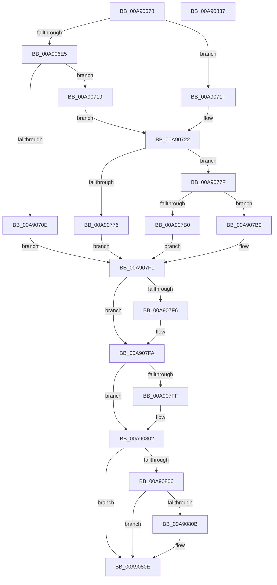

# PopValidateHiberFileSize

- RVA: `0x00A90678`–`0x00A90838` (길이 `448` bytes)
- VA: `0x0000000140A90678`
- 실행 섹션: `PAGE`
- PDB 이름 있음: `예`; PDB Function 태그: `아니요`
- unwind 정보 RVA: `0x000B8EA4`
- 디코드: `124`개 명령, `448/448` bytes 표시
- 미해석 바이트: `0` (있으면 어셈블리에 `.byte`로 보존)

> 이 문서는 커널 이미지의 기계어와 PDB 기호를 분석해 생성했습니다. 4번과 5번은 함수 원형과 자료형을 바이너리 사용 방식에서 추정한 C 해석이며 원본 소스 복구 결과는 아닙니다.

## 1. Dependencies

- 직접 호출 지점: **5**; 고유 호출 대상: **5**
- 직접 호출자로 확인된 함수: **3**
- RIP 상대 이미지 참조: **4**

### Outgoing calls
- `0x00A90700` → [ZwQueryInformationFile](../../text/6A/ZwQueryInformationFile_function_006AD2F0.md) (function, `0x006AD2F0`)
- `0x00A90768` → [ZwOpenFile](../../text/6A/ZwOpenFile_function_006AD730.md) (function, `0x006AD730`)
- `0x00A90799` → [ZwQueryVolumeInformationFile](../../text/6A/ZwQueryVolumeInformationFile_function_006AD9F0.md) (function, `0x006AD9F0`)
- `0x00A907A4` → [ZwClose](../../text/6A/ZwClose_function_006AD2B0.md) (function, `0x006AD2B0`)
- `0x00A90817` → [_security_check_cookie](../../text/6A/_security_check_cookie_function_006AC640.md) (function, `0x006AC640`)

### Direct callers
- [PopSetHiberFileType](../70/PopSetHiberFileType_function_00703268.md) at `0x007032CE`
- [PopSetHiberFileSize](../70/PopSetHiberFileSize_function_00703974.md) at `0x007039C8`
- [PopResizeHiberFile](PopResizeHiberFile_function_00A90410.md) at `0x00A9045F`

### Static image references
- `0x00A90694` → RVA `0x00E0A740` (`.data`; read)
- `0x00A906B4` → RVA `0x00F0BF28` (`.data`; read)
- `0x00A906E5` → RVA `0x00F0BF20` (`.data`; read)
- `0x00A90726` → RVA `0x00F0CFD0` (`.data`; read)

## 2. Other-region calls and transfers

- 다른 실행 섹션으로 향하는 call: **5**
  - `0x00A90700` → [ZwQueryInformationFile](../../text/6A/ZwQueryInformationFile_function_006AD2F0.md) (`PAGE` → `.text`)
  - `0x00A90768` → [ZwOpenFile](../../text/6A/ZwOpenFile_function_006AD730.md) (`PAGE` → `.text`)
  - `0x00A90799` → [ZwQueryVolumeInformationFile](../../text/6A/ZwQueryVolumeInformationFile_function_006AD9F0.md) (`PAGE` → `.text`)
  - `0x00A907A4` → [ZwClose](../../text/6A/ZwClose_function_006AD2B0.md) (`PAGE` → `.text`)
  - `0x00A90817` → [_security_check_cookie](../../text/6A/_security_check_cookie_function_006AC640.md) (`PAGE` → `.text`)
- 별도 외부 분기/꼬리 이동을 확인하지 못했습니다.

## 3. Assembly (complete function range)

```asm
00A90678  48 89 5C 24 08                  mov qword ptr [rsp + 8], rbx
00A9067D  55                              push rbp
00A9067E  56                              push rsi
00A9067F  57                              push rdi
00A90680  41 54                           push r12
00A90682  41 55                           push r13
00A90684  41 56                           push r14
00A90686  41 57                           push r15
00A90688  48 8D 6C 24 D9                  lea rbp, [rsp - 0x27]
00A9068D  48 81 EC C0 00 00 00            sub rsp, 0xc0
00A90694  48 8B 05 A5 A0 37 00            mov rax, qword ptr [rip + 0x37a0a5]
00A9069B  48 33 C4                        xor rax, rsp
00A9069E  48 89 45 17                     mov qword ptr [rbp + 0x17], rax
00A906A2  0F 57 C0                        xorps xmm0, xmm0
00A906A5  33 C0                           xor eax, eax
00A906A7  4D 8B F8                        mov r15, r8
00A906AA  48 89 45 0F                     mov qword ptr [rbp + 0xf], rax
00A906AE  45 33 C0                        xor r8d, r8d
00A906B1  0F 57 C9                        xorps xmm1, xmm1
00A906B4  4C 39 05 6D B8 47 00            cmp qword ptr [rip + 0x47b86d], r8
00A906BB  4D 8B F1                        mov r14, r9
00A906BE  4C 8B E2                        mov r12, rdx
00A906C1  44 89 45 B3                     mov dword ptr [rbp - 0x4d], r8d
00A906C5  4C 8B E9                        mov r13, rcx
00A906C8  44 89 45 CB                     mov dword ptr [rbp - 0x35], r8d
00A906CC  0F 11 45 DF                     movups xmmword ptr [rbp - 0x21], xmm0
00A906D0  4C 89 45 97                     mov qword ptr [rbp - 0x69], r8
00A906D4  41 8B F8                        mov edi, r8d
00A906D7  0F 11 45 EF                     movups xmmword ptr [rbp - 0x11], xmm0
00A906DB  0F 11 4D FF                     movups xmmword ptr [rbp - 1], xmm1
00A906DF  0F 11 45 9F                     movups xmmword ptr [rbp - 0x61], xmm0
00A906E3  74 3A                           je 0x140a9071f
00A906E5  48 8B 0D 34 B8 47 00            mov rcx, qword ptr [rip + 0x47b834]
00A906EC  44 8D 48 18                     lea r9d, [rax + 0x18]
00A906F0  4C 8D 45 FF                     lea r8, [rbp - 1]
00A906F4  C7 44 24 20 05 00 00 00         mov dword ptr [rsp + 0x20], 5
00A906FC  48 8D 55 9F                     lea rdx, [rbp - 0x61]
00A90700  E8 EB CB C1 FF                  call 0x1406ad2f0
00A90705  45 33 C0                        xor r8d, r8d
00A90708  8B F0                           mov esi, eax
00A9070A  85 C0                           test eax, eax
00A9070C  79 0B                           jns 0x140a90719
00A9070E  41 8B D0                        mov edx, r8d
00A90711  8D 4F 03                        lea ecx, [rdi + 3]
00A90714  E9 D8 00 00 00                  jmp 0x140a907f1
00A90719  48 8B 5D FF                     mov rbx, qword ptr [rbp - 1]
00A9071D  EB 03                           jmp 0x140a90722
00A9071F  49 8B D8                        mov rbx, r8
00A90722  4C 89 45 B7                     mov qword ptr [rbp - 0x49], r8
00A90726  48 8D 05 A3 C8 47 00            lea rax, [rip + 0x47c8a3]
00A9072D  0F 57 C0                        xorps xmm0, xmm0
00A90730  C7 44 24 28 20 00 00 00         mov dword ptr [rsp + 0x28], 0x20
00A90738  4C 8D 45 AF                     lea r8, [rbp - 0x51]
00A9073C  48 89 45 BF                     mov qword ptr [rbp - 0x41], rax
00A90740  4C 8D 4D 9F                     lea r9, [rbp - 0x61]
00A90744  C7 45 AF 30 00 00 00            mov dword ptr [rbp - 0x51], 0x30
00A9074B  BA 00 00 00 C0                  mov edx, 0xc0000000
00A90750  C7 45 C7 40 02 00 00            mov dword ptr [rbp - 0x39], 0x240
00A90757  48 8D 4D 97                     lea rcx, [rbp - 0x69]
00A9075B  C7 44 24 20 03 00 00 00         mov dword ptr [rsp + 0x20], 3
00A90763  F3 0F 7F 45 CF                  movdqu xmmword ptr [rbp - 0x31], xmm0
00A90768  E8 C3 CF C1 FF                  call 0x1406ad730
00A9076D  45 33 C0                        xor r8d, r8d
00A90770  8B F0                           mov esi, eax
00A90772  85 C0                           test eax, eax
00A90774  79 09                           jns 0x140a9077f
00A90776  41 8B D0                        mov edx, r8d
00A90779  41 8D 48 04                     lea ecx, [r8 + 4]
00A9077D  EB 72                           jmp 0x140a907f1
00A9077F  48 8B 4D 97                     mov rcx, qword ptr [rbp - 0x69]
00A90783  4C 8D 45 DF                     lea r8, [rbp - 0x21]
00A90787  41 B9 20 00 00 00               mov r9d, 0x20
00A9078D  C7 44 24 20 07 00 00 00         mov dword ptr [rsp + 0x20], 7
00A90795  48 8D 55 9F                     lea rdx, [rbp - 0x61]
00A90799  E8 52 D2 C1 FF                  call 0x1406ad9f0
00A9079E  48 8B 4D 97                     mov rcx, qword ptr [rbp - 0x69]
00A907A2  8B F0                           mov esi, eax
00A907A4  E8 07 CB C1 FF                  call 0x1406ad2b0
00A907A9  45 33 C0                        xor r8d, r8d
00A907AC  85 F6                           test esi, esi
00A907AE  79 09                           jns 0x140a907b9
00A907B0  41 8B D0                        mov edx, r8d
00A907B3  41 8D 48 05                     lea ecx, [r8 + 5]
00A907B7  EB 38                           jmp 0x140a907f1
00A907B9  8B 7D F7                        mov edi, dword ptr [rbp - 9]
00A907BC  4C 2B EB                        sub r13, rbx
00A907BF  0F AF 7D FB                     imul edi, dword ptr [rbp - 5]
00A907C3  B9 06 00 00 00                  mov ecx, 6
00A907C8  BE 01 00 00 C0                  mov esi, 0xc0000001
00A907CD  48 0F AF 7D EF                  imul rdi, qword ptr [rbp - 0x11]
00A907D2  48 8D 87 00 00 00 F0            lea rax, [rdi - 0x10000000]
00A907D9  48 85 C0                        test rax, rax
00A907DC  48 8B D0                        mov rdx, rax
00A907DF  49 0F 4E D0                     cmovle rdx, r8
00A907E3  48 03 D3                        add rdx, rbx
00A907E6  49 3B C5                        cmp rax, r13
00A907E9  41 0F 4D C8                     cmovge ecx, r8d
00A907ED  41 0F 4D F0                     cmovge esi, r8d
00A907F1  4D 85 E4                        test r12, r12
00A907F4  74 04                           je 0x140a907fa
00A907F6  49 89 14 24                     mov qword ptr [r12], rdx
00A907FA  4D 85 FF                        test r15, r15
00A907FD  74 03                           je 0x140a90802
00A907FF  49 89 3F                        mov qword ptr [r15], rdi
00A90802  85 F6                           test esi, esi
00A90804  79 08                           jns 0x140a9080e
00A90806  4D 85 F6                        test r14, r14
00A90809  74 03                           je 0x140a9080e
00A9080B  41 89 0E                        mov dword ptr [r14], ecx
00A9080E  8B C6                           mov eax, esi
00A90810  48 8B 4D 17                     mov rcx, qword ptr [rbp + 0x17]
00A90814  48 33 CC                        xor rcx, rsp
00A90817  E8 24 BE C1 FF                  call 0x1406ac640
00A9081C  48 8B 9C 24 00 01 00 00         mov rbx, qword ptr [rsp + 0x100]
00A90824  48 81 C4 C0 00 00 00            add rsp, 0xc0
00A9082B  41 5F                           pop r15
00A9082D  41 5E                           pop r14
00A9082F  41 5D                           pop r13
00A90831  41 5C                           pop r12
00A90833  5F                              pop rdi
00A90834  5E                              pop rsi
00A90835  5D                              pop rbp
00A90836  C3                              ret
00A90837  CC                              int3
```

## 4. C-style interpretation (structured pseudocode)

```c
__int64 __fastcall PopValidateHiberFileSize(__int64 a1, __int64 a2, __int64 a3, __int64 a4)
{
    __int64 result;
    __int64 v_r13;
    __int64 v_rdi;
    __int64 v_rsi;
    __int64 v_rsp;
    unsigned __int64 v_stack_m48;
    unsigned __int64 v_stack_m50;
    unsigned __int64 v_stack_m5F;
    unsigned __int64 v_stack_m60;
    unsigned int v_stack_m64;
    unsigned int v_stack_m68;
    unsigned __int64 v_stack_m70;
    unsigned __int64 v_stack_m80;
    unsigned __int64 v_stack_m90;
    unsigned int v_stack_m94;
    unsigned int v_stack_m98;
    unsigned __int64 v_stack_mA0;
    unsigned __int64 v_stack_mA8;
    unsigned int v_stack_mAC;
    unsigned __int64 v_stack_mB0;
    unsigned __int64 v_stack_mC0;
    unsigned __int64 v_stack_mC8;
    unsigned int v_stack_mD0;
    unsigned int v_stack_mD8;
    unsigned __int64 v_stack_p8;

    v_stack_p8 = v_rbx;
    v_rsp = (v_rsp) - (192);
    result = (*(unsigned __int64 *)(v_rip + 3645605)) ^ (v_rsp);
    v_stack_m48 = result;
    result = 0;
    v_stack_m50 = 0;
    a3 = 0;
    v_stack_mAC = 0;
    v_stack_m94 = 0;
    v_stack_m80 = v_xmm0;
    v_stack_mC8 = 0;
    v_stack_m70 = v_xmm0;
    v_stack_m60 = v_xmm1;
    v_stack_mC0 = v_xmm0;
    if ((*(unsigned __int64 *)(v_rip + 4700269)) == 0) goto loc_00A9071F;
    v_stack_mD8 = 5;
    result = ZwQueryInformationFile(*(unsigned __int64 *)(v_rip + 4700212), v_stack_mC0, v_stack_m60, result + 24);
    a3 = 0;
    if (!sign_flag) goto loc_00A90719;
    goto loc_00A907F1;
loc_00A90719:
    goto loc_00A90722;
loc_00A9071F:
loc_00A90722:
    v_stack_mA8 = 0;
    v_stack_mD0 = 32;
    v_stack_mA0 = v_rip + 4704419;
    v_stack_mB0 = 48;
    v_stack_m98 = 576;
    v_stack_mD8 = 3;
    v_stack_m90 = v_xmm0;
    result = ZwOpenFile(v_stack_mC8, (unsigned int)(0xC0000000ULL), v_stack_mB0, v_stack_mC0);
    a3 = 0;
    if (!sign_flag) goto loc_00A9077F;
    goto loc_00A907F1;
loc_00A9077F:
    v_stack_mD8 = 7;
    result = ZwQueryVolumeInformationFile(v_stack_mC8, v_stack_mC0, v_stack_m80, 32);
    result = ZwClose(v_stack_mC8, v_stack_mC0, v_stack_m80, 32);
    a3 = 0;
    if (!sign_flag) goto loc_00A907B9;
    goto loc_00A907F1;
loc_00A907B9:
    v_r13 = (a1) - (0);
    v_rdi = (unsigned int)(((unsigned int)(v_stack_m68)) * (v_stack_m64));
    v_rdi = (v_rdi) * (v_stack_m70);
    a2 = v_rdi - 268435456;
    if (condition_is_less_or_equal) { a2 = 0; }
    a2 = (a2) + (0);
    a1 = 6;
    if ((v_rdi - 268435456) >= v_r13) { a1 = 0; }
    v_rsi = (unsigned int)(0xC0000001ULL);
    if ((v_rdi - 268435456) >= v_r13) { v_rsi = 0; }
loc_00A907F1:
    if (a2 != 0) {
        *(unsigned __int64 *)(a2) = a2;
    }
    if (0 != 0) {
        *(unsigned __int64 *)(a3) = v_rdi;
    }
    if (!sign_flag) goto loc_00A9080E;
    if (a4 != 0) {
        *(unsigned int *)(a4) = (unsigned int)(a1);
    }
    a1 = (v_stack_m48) ^ (v_rsp);
    result = _security_check_cookie(a1, a2, a3, 32);
    v_rsp = (v_rsp) + (192);
    return result;
}
```

## 5. (Beta) C Style

```c
int64_t PopValidateHiberFileSize(int64_t Arg1, int64_t Arg2, int64_t Arg3, int64_t Arg4)
{
    int64_t result;
    int64_t local_r13;
    int64_t local_rdi;
    int64_t local_rsi;
    int64_t local_rsp;
    uint64_t v_stack_m48;
    uint64_t v_stack_m50;
    uint64_t v_stack_m5F;
    uint64_t v_stack_m60;
    uint32_t v_stack_m64;
    uint32_t v_stack_m68;
    uint64_t v_stack_m70;
    uint64_t v_stack_m80;
    uint64_t v_stack_m90;
    uint32_t v_stack_m94;
    uint32_t v_stack_m98;
    uint64_t v_stack_mA0;
    uint64_t v_stack_mA8;
    uint32_t v_stack_mAC;
    uint64_t v_stack_mB0;
    uint64_t v_stack_mC0;
    uint64_t v_stack_mC8;
    uint32_t v_stack_mD0;
    uint32_t v_stack_mD8;
    uint64_t v_stack_p8;

    v_stack_p8 = local_rbx;
    local_rsp = (local_rsp) - (192);
    result = (*(uint64_t *)(v_rip + 0x37A0A5)) ^ (local_rsp);
    v_stack_m48 = result;
    result = 0;
    v_stack_m50 = 0;
    Arg3 = 0;
    v_stack_mAC = 0;
    v_stack_m94 = 0;
    v_stack_m80 = v_xmm0;
    v_stack_mC8 = 0;
    v_stack_m70 = v_xmm0;
    v_stack_m60 = v_xmm1;
    v_stack_mC0 = v_xmm0;
    if ((*(uint64_t *)(v_rip + 0x47B86D)) == 0) goto loc_00A9071F;
    v_stack_mD8 = 5;
    result = ZwQueryInformationFile(*(uint64_t *)(v_rip + 0x47B834), v_stack_mC0, v_stack_m60, result + 24);
    Arg3 = 0;
    if (!sign_flag) goto loc_00A90719;
    goto loc_00A907F1;
loc_00A90719:
    goto loc_00A90722;
loc_00A9071F:
loc_00A90722:
    v_stack_mA8 = 0;
    v_stack_mD0 = 32;
    v_stack_mA0 = v_rip + 4704419;
    v_stack_mB0 = 48;
    v_stack_m98 = 576;
    v_stack_mD8 = 3;
    v_stack_m90 = v_xmm0;
    result = ZwOpenFile(v_stack_mC8, (uint32_t)(0xC0000000ULL), v_stack_mB0, v_stack_mC0);
    Arg3 = 0;
    if (!sign_flag) goto loc_00A9077F;
    goto loc_00A907F1;
loc_00A9077F:
    v_stack_mD8 = 7;
    result = ZwQueryVolumeInformationFile(v_stack_mC8, v_stack_mC0, v_stack_m80, 32);
    result = ZwClose(v_stack_mC8, v_stack_mC0, v_stack_m80, 32);
    Arg3 = 0;
    if (!sign_flag) goto loc_00A907B9;
    goto loc_00A907F1;
loc_00A907B9:
    local_r13 = (Arg1) - (0);
    local_rdi = (uint32_t)(((uint32_t)(v_stack_m68)) * (v_stack_m64));
    local_rdi = (local_rdi) * (v_stack_m70);
    Arg2 = local_rdi - 268435456;
    if (condition_is_less_or_equal) { Arg2 = 0; }
    Arg2 = (Arg2) + (0);
    Arg1 = 6;
    if ((local_rdi - 268435456) >= local_r13) { Arg1 = 0; }
    local_rsi = (uint32_t)(0xC0000001ULL);
    if ((local_rdi - 268435456) >= local_r13) { local_rsi = 0; }
loc_00A907F1:
    if (Arg2 != 0) {
        *(uint64_t *)(Arg2) = Arg2;
    }
    if (0 != 0) {
        *(uint64_t *)(Arg3) = local_rdi;
    }
    if (!sign_flag) goto loc_00A9080E;
    if (Arg4 != 0) {
        *(uint32_t *)(Arg4) = (uint32_t)(Arg1);
    }
    Arg1 = (v_stack_m48) ^ (local_rsp);
    result = _security_check_cookie(Arg1, Arg2, Arg3, 32);
    local_rsp = (local_rsp) + (192);
    return result;
}
```

## 6. Execution-region graph

[열기: 2D/3D 그래프와 함수 탐색 컨트롤 패널](../../../control-panel.html?section=page&rva=0x00A90678&view=graph)

- 2D 그래프는 위에서 아래로 흐르고, 3D 그래프는 빈 공간을 드래그해 회전합니다. Shift+드래그는 이동, 휠은 확대·축소, 함수 노드 선택은 대상 보고서 이동입니다.

### Static fallback


