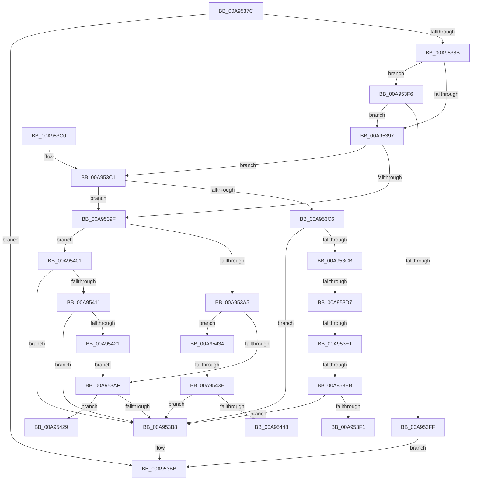

# PopVerifySystemPowerState

- RVA: `0x00A9537C`–`0x00A9544D` (길이 `209` bytes)
- VA: `0x0000000140A9537C`
- 실행 섹션: `PAGE`
- PDB 이름 있음: `예`; PDB Function 태그: `예`
- unwind 정보 RVA: `0x000B97B8`
- 디코드: `57`개 명령, `209/209` bytes 표시
- 미해석 바이트: `0` (있으면 어셈블리에 `.byte`로 보존)

> 이 문서는 커널 이미지의 기계어와 PDB 기호를 분석해 생성했습니다. 4번과 5번은 함수 원형과 자료형을 바이너리 사용 방식에서 추정한 C 해석이며 원본 소스 복구 결과는 아닙니다.

## 1. Dependencies

- 직접 호출 지점: **2**; 고유 호출 대상: **2**
- 직접 호출자로 확인된 함수: **5**
- RIP 상대 이미지 참조: **2**

### Outgoing calls
- `0x00A95408` → [PopIsHiberbootSupported](../70/PopIsHiberbootSupported_function_00702F8C.md) (function, `0x00702F8C`)
- `0x00A95418` → [PopIsHibernateSupported](../AA/PopIsHibernateSupported_function_00AA3DFC.md) (function, `0x00AA3DFC`)

### Direct callers
- [PopActionRetrieveInitialState](../../text/4B/PopActionRetrieveInitialState_function_004B8AEC.md) at `0x004B8BA4`
- [PopExecutePowerAction](../75/PopExecutePowerAction_function_0075E6B4.md) at `0x0075E772`
- [PdcPoVerifyPowerState](../76/PdcPoVerifyPowerState_function_007695B0.md) at `0x007695C9`
- [PopVerifySystemPowerPolicy](../91/PopVerifySystemPowerPolicy_function_00910A8C.md) at `0x009110E4`
- [PopAdvanceSystemPowerState](../AD/PopAdvanceSystemPowerState_function_00AD2A20.md) at `0x00AD2A7D`
- [PopAdvanceSystemPowerState](../AD/PopAdvanceSystemPowerState_function_00AD2A20.md) at `0x00AD2A95`

### Static image references
- `0x00A953AF` → RVA `0x00F0CEC5` (`.data`; read)
- `0x00A95401` → RVA `0x00F0CEC0` (`.data`; read)

## 2. Other-region calls and transfers

- 다른 실행 섹션으로 향하는 call: **0**
- call이 아닌 외부 분기/꼬리 이동: **7**
  - `0x00A953D1` → [sub_00B47610 + 0x37](../B4/Unknown_function_00B47610.md) (`tail-transfer`)
  - `0x00A953DB` → [sub_00B47610 + 0x4A](../B4/Unknown_function_00B47610.md) (`tail-transfer`)
  - `0x00A953E5` → [sub_00B47610 + 0x5D](../B4/Unknown_function_00B47610.md) (`tail-transfer`)
  - `0x00A953F1` → [sub_00B47610 + 0x70](../B4/Unknown_function_00B47610.md) (`tail-transfer`)
  - `0x00A9542F` → [sub_00B47610](../B4/Unknown_function_00B47610.md) (`tail-transfer`)
  - `0x00A95438` → [sub_00B47610](../B4/Unknown_function_00B47610.md) (`tail-transfer`)
  - `0x00A95448` → [sub_00B47610 + 0x13](../B4/Unknown_function_00B47610.md) (`tail-transfer`)

## 3. Assembly (complete function range)

```asm
00A9537C  48 83 EC 28                     sub rsp, 0x28
00A95380  44 8B D2                        mov r10d, edx
00A95383  4C 8B D9                        mov r11, rcx
00A95386  48 85 C9                        test rcx, rcx
00A95389  74 30                           je 0x140a953bb
00A9538B  44 8B 09                        mov r9d, dword ptr [rcx]
00A9538E  45 8B C1                        mov r8d, r9d
00A95391  41 83 F9 FF                     cmp r9d, -1
00A95395  7F 5F                           jg 0x140a953f6
00A95397  41 8B CA                        mov ecx, r10d
00A9539A  45 85 D2                        test r10d, r10d
00A9539D  75 22                           jne 0x140a953c1
00A9539F  41 83 F9 05                     cmp r9d, 5
00A953A3  74 5C                           je 0x140a95401
00A953A5  41 83 F8 04                     cmp r8d, 4
00A953A9  0F 85 85 00 00 00               jne 0x140a95434
00A953AF  80 3D 0F 7B 47 00 00            cmp byte ptr [rip + 0x477b0f], 0
00A953B6  74 71                           je 0x140a95429
00A953B8  45 89 0B                        mov dword ptr [r11], r9d
00A953BB  48 83 C4 28                     add rsp, 0x28
00A953BF  C3                              ret
00A953C0  CC                              int3
00A953C1  83 E9 01                        sub ecx, 1
00A953C4  74 D9                           je 0x140a9539f
00A953C6  83 F9 01                        cmp ecx, 1
00A953C9  75 ED                           jne 0x140a953b8
00A953CB  8A C1                           mov al, cl
00A953CD  41 83 F8 02                     cmp r8d, 2
00A953D1  0F 84 70 22 0B 00               je 0x140b47647
00A953D7  41 83 F8 03                     cmp r8d, 3
00A953DB  0F 84 79 22 0B 00               je 0x140b4765a
00A953E1  41 83 F8 04                     cmp r8d, 4
00A953E5  0F 84 82 22 0B 00               je 0x140b4766d
00A953EB  41 83 F8 05                     cmp r8d, 5
00A953EF  75 C7                           jne 0x140a953b8
00A953F1  E9 8A 22 0B 00                  jmp 0x140b47680
00A953F6  41 8D 41 FE                     lea eax, [r9 - 2]
00A953FA  83 F8 03                        cmp eax, 3
00A953FD  76 98                           jbe 0x140a95397
00A953FF  EB BA                           jmp 0x140a953bb
00A95401  48 8D 0D B8 7A 47 00            lea rcx, [rip + 0x477ab8]
00A95408  E8 7F DB C6 FF                  call 0x140702f8c
00A9540D  84 C0                           test al, al
00A9540F  75 A7                           jne 0x140a953b8
00A95411  48 8D 0D A8 7A 47 00            lea rcx, [rip + 0x477aa8]
00A95418  E8 DF E9 00 00                  call 0x140aa3dfc
00A9541D  84 C0                           test al, al
00A9541F  75 97                           jne 0x140a953b8
00A95421  41 B9 04 00 00 00               mov r9d, 4
00A95427  EB 86                           jmp 0x140a953af
00A95429  41 B9 03 00 00 00               mov r9d, 3
00A9542F  E9 DC 21 0B 00                  jmp 0x140b47610
00A95434  41 83 F8 03                     cmp r8d, 3
00A95438  0F 84 D2 21 0B 00               je 0x140b47610
00A9543E  41 83 F8 02                     cmp r8d, 2
00A95442  0F 85 70 FF FF FF               jne 0x140a953b8
00A95448  E9 D6 21 0B 00                  jmp 0x140b47623
```

## 4. C-style interpretation (structured pseudocode)

```c
__int64 __fastcall PopVerifySystemPowerState(__int64 a1, int a2)
{
    __int64 result;
    __int64 v_rsp;

    v_rsp = (v_rsp) - (40);
    if (a1 == 0) goto loc_00A953BB;
    if (((unsigned int)((unsigned int)(*(unsigned int *)(a1)))) > -1) goto loc_00A953F6;
loc_00A95397:
    if ((unsigned int)((unsigned int)(a2)) != 0) goto loc_00A953C1;
loc_00A9539F:
    if (((unsigned int)((unsigned int)(*(unsigned int *)(a1)))) == 5) goto loc_00A95401;
    if (((unsigned int)((unsigned int)((unsigned int)((unsigned int)(*(unsigned int *)(a1)))))) != 4) goto loc_00A95434;
loc_00A953AF:
    if ((*(unsigned __int8 *)(v_rip + 4684559)) == 0) goto loc_00A95429;
loc_00A953B8:
    *(unsigned int *)(a1) = (unsigned int)((unsigned int)(*(unsigned int *)(a1)));
loc_00A953BB:
    v_rsp = (v_rsp) + (40);
    return result;
loc_00A953C1:
    a1 = (unsigned int)(((unsigned int)((unsigned int)((unsigned int)(a2)))) - (1));
    if (condition_is_equal) goto loc_00A9539F;
    if (((unsigned int)(a1)) != 1) goto loc_00A953B8;
    if (((unsigned int)((unsigned int)((unsigned int)((unsigned int)(*(unsigned int *)(a1)))))) != 5) goto loc_00A953B8;
loc_00A953F6:
    if (((unsigned int)((unsigned int)(*(unsigned int *)(a1)) - 2)) <= 3) goto loc_00A95397;
    goto loc_00A953BB;
loc_00A95401:
    result = PopIsHiberbootSupported(v_rip + 4684472, a2, (unsigned int)((unsigned int)((unsigned int)(*(unsigned int *)(a1)))), (unsigned int)(*(unsigned int *)(a1)));
    if ((unsigned __int8)(result) != 0) goto loc_00A953B8;
    result = PopIsHibernateSupported(v_rip + 4684456, a2, (unsigned int)((unsigned int)((unsigned int)(*(unsigned int *)(a1)))), (unsigned int)(*(unsigned int *)(a1)));
    if ((unsigned __int8)(result) != 0) goto loc_00A953B8;
    goto loc_00A953AF;
loc_00A95429:
loc_00A95434:
    if (((unsigned int)((unsigned int)((unsigned int)((unsigned int)(*(unsigned int *)(a1)))))) != 2) goto loc_00A953B8;
}
```

## 5. (Beta) C Style

```c
int64_t PopVerifySystemPowerState(int64_t Arg1, int32_t Arg2)
{
    int64_t result;
    int64_t local_rsp;

    local_rsp = (local_rsp) - (40);
    if (Arg1 == 0) goto loc_00A953BB;
    if (((uint32_t)((uint32_t)(*(uint32_t *)(Arg1)))) > -1) goto loc_00A953F6;
loc_00A95397:
    if ((uint32_t)((uint32_t)(Arg2)) != 0) goto loc_00A953C1;
loc_00A9539F:
    if (((uint32_t)((uint32_t)(*(uint32_t *)(Arg1)))) == 5) goto loc_00A95401;
    if (((uint32_t)((uint32_t)((uint32_t)((uint32_t)(*(uint32_t *)(Arg1)))))) != 4) goto loc_00A95434;
loc_00A953AF:
    if ((*(uint8_t *)(v_rip + 0x477B0F)) == 0) goto loc_00A95429;
loc_00A953B8:
    *(uint32_t *)(Arg1) = (uint32_t)((uint32_t)(*(uint32_t *)(Arg1)));
loc_00A953BB:
    local_rsp = (local_rsp) + (40);
    return result;
loc_00A953C1:
    Arg1 = (uint32_t)(((uint32_t)((uint32_t)((uint32_t)(Arg2)))) - (1));
    if (condition_is_equal) goto loc_00A9539F;
    if (((uint32_t)(Arg1)) != 1) goto loc_00A953B8;
    if (((uint32_t)((uint32_t)((uint32_t)((uint32_t)(*(uint32_t *)(Arg1)))))) != 5) goto loc_00A953B8;
loc_00A953F6:
    if (((uint32_t)((uint32_t)(*(uint32_t *)(Arg1)) - 2)) <= 3) goto loc_00A95397;
    goto loc_00A953BB;
loc_00A95401:
    result = PopIsHiberbootSupported(v_rip + 4684472, Arg2, (uint32_t)((uint32_t)((uint32_t)(*(uint32_t *)(Arg1)))), (uint32_t)(*(uint32_t *)(Arg1)));
    if ((uint8_t)(result) != 0) goto loc_00A953B8;
    result = PopIsHibernateSupported(v_rip + 4684456, Arg2, (uint32_t)((uint32_t)((uint32_t)(*(uint32_t *)(Arg1)))), (uint32_t)(*(uint32_t *)(Arg1)));
    if ((uint8_t)(result) != 0) goto loc_00A953B8;
    goto loc_00A953AF;
loc_00A95429:
loc_00A95434:
    if (((uint32_t)((uint32_t)((uint32_t)((uint32_t)(*(uint32_t *)(Arg1)))))) != 2) goto loc_00A953B8;
}
```

## 6. Execution-region graph

[열기: 2D/3D 그래프와 함수 탐색 컨트롤 패널](../../../control-panel.html?section=page&rva=0x00A9537C&view=graph)

- 2D 그래프는 위에서 아래로 흐르고, 3D 그래프는 빈 공간을 드래그해 회전합니다. Shift+드래그는 이동, 휠은 확대·축소, 함수 노드 선택은 대상 보고서 이동입니다.

### Static fallback


