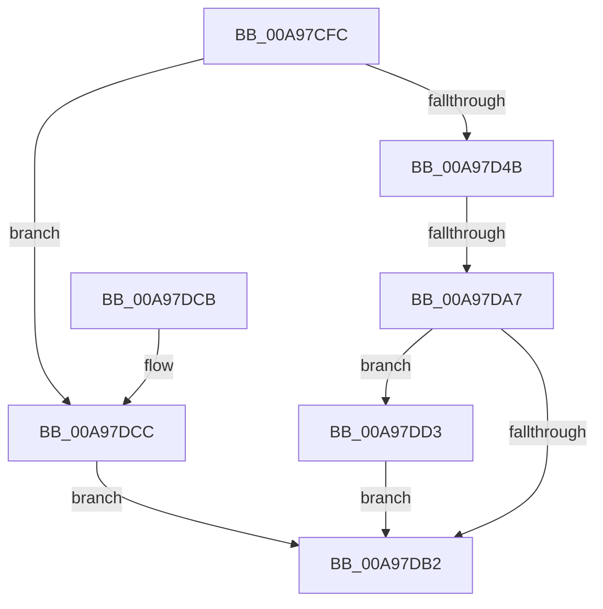

# PpDevCfgProcessDeviceOperations

- RVA: `0x00A97CFC`–`0x00A97DDA` (길이 `222` bytes)
- VA: `0x0000000140A97CFC`
- 실행 섹션: `PAGE`
- PDB 이름 있음: `예`; PDB Function 태그: `예`
- unwind 정보 RVA: `0x000B9F0C`
- 디코드: `60`개 명령, `222/222` bytes 표시
- 미해석 바이트: `0` (있으면 어셈블리에 `.byte`로 보존)

> 이 문서는 커널 이미지의 기계어와 PDB 기호를 분석해 생성했습니다. 4번과 5번은 함수 원형과 자료형을 바이너리 사용 방식에서 추정한 C 해석이며 원본 소스 복구 결과는 아닙니다.

## 1. Dependencies

- 직접 호출 지점: **4**; 고유 호출 대상: **4**
- 직접 호출자로 확인된 함수: **2**
- RIP 상대 이미지 참조: **1**

### Outgoing calls
- `0x00A97D2B` → [memset](../../text/6C/memset_function_006C6C40.md) (function, `0x006C6C40`)
- `0x00A97D95` → [ZwOpenKey](../../text/6A/ZwOpenKey_function_006AD310.md) (function, `0x006AD310`)
- `0x00A97DB6` → [PiDevCfgFreeDeviceContext](../70/PiDevCfgFreeDeviceContext_function_00704A00.md) (function, `0x00704A00`)
- `0x00A97DD3` → [ZwClose](../../text/6A/ZwClose_function_006AD2B0.md) (function, `0x006AD2B0`)

### Direct callers
- [PiProcessNewDeviceNode](../A2/PiProcessNewDeviceNode_function_00A28F20.md) at `0x00A2A1D4`
- [sub_00B420B0](../B4/Unknown_function_00B420B0.md) at `0x00B4234B`

### Static image references
- `0x00A97D62` → RVA `0x00AFE880` (` ?? ::NNGAKEGL::`string'`; read)

## 2. Other-region calls and transfers

- 다른 실행 섹션으로 향하는 call: **3**
  - `0x00A97D2B` → [memset](../../text/6C/memset_function_006C6C40.md) (`PAGE` → `.text`)
  - `0x00A97D95` → [ZwOpenKey](../../text/6A/ZwOpenKey_function_006AD310.md) (`PAGE` → `.text`)
  - `0x00A97DD3` → [ZwClose](../../text/6A/ZwClose_function_006AD2B0.md) (`PAGE` → `.text`)
- call이 아닌 외부 분기/꼬리 이동: **1**
  - `0x00A97DA1` → [sub_00B47D18](../B4/Unknown_function_00B47D18.md) (`tail-transfer`)

## 3. Assembly (complete function range)

```asm
00A97CFC  40 55                           push rbp
00A97CFE  53                              push rbx
00A97CFF  56                              push rsi
00A97D00  57                              push rdi
00A97D01  41 56                           push r14
00A97D03  48 8D 6C 24 C9                  lea rbp, [rsp - 0x37]
00A97D08  48 81 EC F0 00 00 00            sub rsp, 0xf0
00A97D0F  48 83 65 8F 00                  and qword ptr [rbp - 0x71], 0
00A97D14  48 8B F2                        mov rsi, rdx
00A97D17  33 D2                           xor edx, edx
00A97D19  48 8B F9                        mov rdi, rcx
00A97D1C  0F 57 C0                        xorps xmm0, xmm0
00A97D1F  48 8D 4D D7                     lea rcx, [rbp - 0x29]
00A97D23  0F 11 45 97                     movups xmmword ptr [rbp - 0x69], xmm0
00A97D27  44 8D 42 58                     lea r8d, [rdx + 0x58]
00A97D2B  E8 10 EF C2 FF                  call 0x1406c6c40
00A97D30  83 65 67 00                     and dword ptr [rbp + 0x67], 0
00A97D34  83 65 7F 00                     and dword ptr [rbp + 0x7f], 0
00A97D38  83 65 87 00                     and dword ptr [rbp - 0x79], 0
00A97D3C  83 65 77 00                     and dword ptr [rbp + 0x77], 0
00A97D40  48 83 7F 30 00                  cmp qword ptr [rdi + 0x30], 0
00A97D45  0F 84 81 00 00 00               je 0x140a97dcc
00A97D4B  83 65 C3 00                     and dword ptr [rbp - 0x3d], 0
00A97D4F  48 8D 45 97                     lea rax, [rbp - 0x69]
00A97D53  0F 57 C0                        xorps xmm0, xmm0
00A97D56  48 C7 45 A7 30 00 00 00         mov qword ptr [rbp - 0x59], 0x30
00A97D5E  83 65 AB 00                     and dword ptr [rbp - 0x55], 0
00A97D62  4C 8D 35 17 6B 06 00            lea r14, [rip + 0x66b17]
00A97D69  4C 8D 45 A7                     lea r8, [rbp - 0x59]
00A97D6D  4C 89 75 9F                     mov qword ptr [rbp - 0x61], r14
00A97D71  BA 19 00 02 00                  mov edx, 0x20019
00A97D76  48 89 45 B7                     mov qword ptr [rbp - 0x49], rax
00A97D7A  48 8D 4D 8F                     lea rcx, [rbp - 0x71]
00A97D7E  C7 45 97 28 00 2A 00            mov dword ptr [rbp - 0x69], 0x2a0028
00A97D85  F3 0F 7F 45 C7                  movdqu xmmword ptr [rbp - 0x39], xmm0
00A97D8A  48 89 75 AF                     mov qword ptr [rbp - 0x51], rsi
00A97D8E  C7 45 BF 40 02 00 00            mov dword ptr [rbp - 0x41], 0x240
00A97D95  E8 76 55 C1 FF                  call 0x1406ad310
00A97D9A  8B D8                           mov ebx, eax
00A97D9C  3D 34 00 00 C0                  cmp eax, 0xc0000034
00A97DA1  0F 85 71 FF 0A 00               jne 0x140b47d18
00A97DA7  33 DB                           xor ebx, ebx
00A97DA9  48 8B 4D 8F                     mov rcx, qword ptr [rbp - 0x71]
00A97DAD  48 85 C9                        test rcx, rcx
00A97DB0  75 21                           jne 0x140a97dd3
00A97DB2  48 8D 4D D7                     lea rcx, [rbp - 0x29]
00A97DB6  E8 45 CC C6 FF                  call 0x140704a00
00A97DBB  8B C3                           mov eax, ebx
00A97DBD  48 81 C4 F0 00 00 00            add rsp, 0xf0
00A97DC4  41 5E                           pop r14
00A97DC6  5F                              pop rdi
00A97DC7  5E                              pop rsi
00A97DC8  5B                              pop rbx
00A97DC9  5D                              pop rbp
00A97DCA  C3                              ret
00A97DCB  CC                              int3
00A97DCC  BB 10 00 00 C0                  mov ebx, 0xc0000010
00A97DD1  EB DF                           jmp 0x140a97db2
00A97DD3  E8 D8 54 C1 FF                  call 0x1406ad2b0
00A97DD8  EB D8                           jmp 0x140a97db2
```

## 4. C-style interpretation (structured pseudocode)

```c
__int64 __fastcall PpDevCfgProcessDeviceOperations(__int64 a1, __int64 a2)
{
    __int64 result;
    __int64 v_rbx;
    __int64 v_rsp;
    unsigned __int64 v_stack_m5F;
    unsigned __int64 v_stack_m88;
    unsigned __int64 v_stack_m98;
    unsigned int v_stack_m9C;
    unsigned int v_stack_mA0;
    unsigned __int64 v_stack_mA8;
    unsigned __int64 v_stack_mB0;
    unsigned int v_stack_mB4;
    unsigned __int64 v_stack_mB8;
    unsigned __int64 v_stack_mC0;
    unsigned __int64 v_stack_mC8;
    unsigned __int64 v_stack_mD0;
    unsigned int v_stack_mD8;
    unsigned int v_stack_p18;
    unsigned int v_stack_p20;
    unsigned int v_stack_p8;

    v_rsp = (v_rsp) - (240);
    a2 = 0;
    v_stack_mC8 = v_xmm0;
    result = memset(v_stack_m88, a2, a2 + 88, a4);
    if ((*(unsigned __int64 *)(a1 + 48)) == 0) goto loc_00A97DCC;
    v_stack_mB8 = 48;
    v_stack_mC0 = v_rip + 420631;
    v_stack_mA8 = v_stack_mC8;
    v_stack_mC8 = 0x2A0028ULL;
    v_stack_m98 = v_xmm0;
    v_stack_mB0 = 0;
    v_stack_mA0 = 576;
    result = ZwOpenKey(v_stack_mD0, (unsigned int)(0x20019ULL), v_stack_mB8, a4);
    v_rbx = 0;
    if (v_stack_mD0 != 0) goto loc_00A97DD3;
loc_00A97DB2:
    result = PiDevCfgFreeDeviceContext(v_stack_m88, (unsigned int)(0x20019ULL), v_stack_mB8, a4);
    v_rsp = (v_rsp) + (240);
    return 0;
loc_00A97DCC:
    goto loc_00A97DB2;
loc_00A97DD3:
    result = ZwClose(v_stack_m88, (unsigned int)(0x20019ULL), v_stack_mB8, a4);
    goto loc_00A97DB2;
}
```

## 5. (Beta) C Style

```c
int64_t PpDevCfgProcessDeviceOperations(void *Arg1, int64_t Arg2)
{
    uint8_t *arg1 = (uint8_t *)Arg1;

    int64_t result;
    int64_t local_rbx;
    int64_t local_rsp;
    uint64_t v_stack_m5F;
    uint64_t v_stack_m88;
    uint64_t v_stack_m98;
    uint32_t v_stack_m9C;
    uint32_t v_stack_mA0;
    uint64_t v_stack_mA8;
    uint64_t v_stack_mB0;
    uint32_t v_stack_mB4;
    uint64_t v_stack_mB8;
    uint64_t v_stack_mC0;
    uint64_t v_stack_mC8;
    uint64_t v_stack_mD0;
    uint32_t v_stack_mD8;
    uint32_t v_stack_p18;
    uint32_t v_stack_p20;
    uint32_t v_stack_p8;

    local_rsp = (local_rsp) - (240);
    Arg2 = 0;
    v_stack_mC8 = v_xmm0;
    result = memset(v_stack_m88, Arg2, Arg2 + 88, a4);
    if ((*(uint64_t *)(arg1 + 0x30)) == 0) goto loc_00A97DCC;
    v_stack_mB8 = 48;
    v_stack_mC0 = v_rip + 420631;
    v_stack_mA8 = v_stack_mC8;
    v_stack_mC8 = 0x2A0028ULL;
    v_stack_m98 = v_xmm0;
    v_stack_mB0 = 0;
    v_stack_mA0 = 576;
    result = ZwOpenKey(v_stack_mD0, (uint32_t)(0x20019ULL), v_stack_mB8, a4);
    local_rbx = 0;
    if (v_stack_mD0 != 0) goto loc_00A97DD3;
loc_00A97DB2:
    result = PiDevCfgFreeDeviceContext(v_stack_m88, (uint32_t)(0x20019ULL), v_stack_mB8, a4);
    local_rsp = (local_rsp) + (240);
    return 0;
loc_00A97DCC:
    goto loc_00A97DB2;
loc_00A97DD3:
    result = ZwClose(v_stack_m88, (uint32_t)(0x20019ULL), v_stack_mB8, a4);
    goto loc_00A97DB2;
}
```

### 관측된 메모리 오프셋

구조체 형식이 확인되지 않은 접근은 인자 기준의 오프셋으로만 기록했습니다.

| 기준 인자 | 오프셋 표현 | 폭 (bit) | 접근 |
|---|---:|---:|---|
| `Arg1` | `+ 0x30` | `64` | `R` |

## 6. Execution-region graph

[열기: 2D/3D 그래프와 함수 탐색 컨트롤 패널](../../../control-panel.html?section=page&rva=0x00A97CFC&view=graph)

- 2D 그래프는 위에서 아래로 흐르고, 3D 그래프는 빈 공간을 드래그해 회전합니다. Shift+드래그는 이동, 휠은 확대·축소, 함수 노드 선택은 대상 보고서 이동입니다.

### Static fallback


