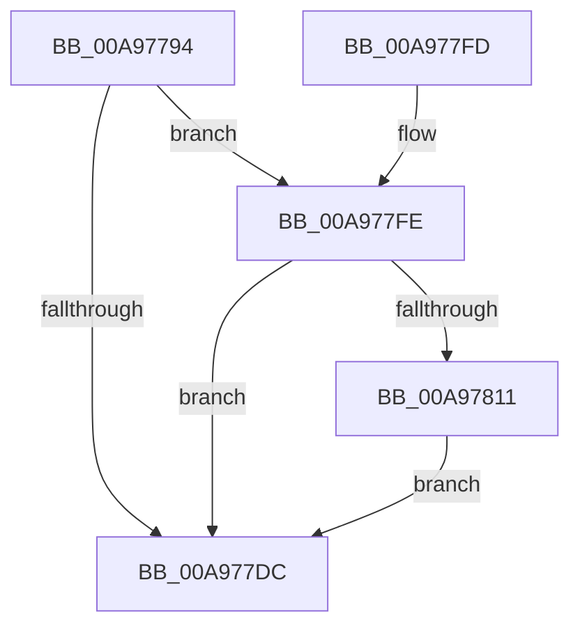

# PpmEventHeteroPolicy

- RVA: `0x00A97794`–`0x00A979AD` (길이 `537` bytes)
- VA: `0x0000000140A97794`
- 실행 섹션: `PAGE`
- PDB 이름 있음: `예`; PDB Function 태그: `아니요`
- unwind 정보 RVA: `0x000B9DAC`
- 디코드: `123`개 명령, `537/537` bytes 표시
- 미해석 바이트: `0` (있으면 어셈블리에 `.byte`로 보존)

> 이 문서는 커널 이미지의 기계어와 PDB 기호를 분석해 생성했습니다. 4번과 5번은 함수 원형과 자료형을 바이너리 사용 방식에서 추정한 C 해석이며 원본 소스 복구 결과는 아닙니다.

## 1. Dependencies

- 직접 호출 지점: **3**; 고유 호출 대상: **3**
- 직접 호출자로 확인된 함수: **2**
- RIP 상대 이미지 참조: **26**

### Outgoing calls
- `0x00A977E3` → [_security_check_cookie](../../text/6A/_security_check_cookie_function_006AC640.md) (function, `0x006AC640`)
- `0x00A97808` → [EtwEventEnabled](../../text/39/EtwEventEnabled_function_00392450.md) (function, `0x00392450`)
- `0x00A979A3` → [EtwWrite](../../text/41/EtwWrite_function_0041C720.md) (function, `0x0041C720`)

### Direct callers
- [PpmEventTraceControlCallback](../A5/PpmEventTraceControlCallback_function_00A51F60.md) at `0x00A520DF`
- [PopInitializeHeteroProcessors](../A5/PopInitializeHeteroProcessors_function_00A53570.md) at `0x00A538EB`

### Static image references
- `0x00A977AB` → RVA `0x00E0A740` (`.data`; read)
- `0x00A977BB` → RVA `0x0001C4D8` (`.rdata`; read)
- `0x00A977C8` → RVA `0x0001C4E8` (`.rdata`; read)
- `0x00A977D3` → RVA `0x00E67A39` (`.data`; read)
- `0x00A977FE` → RVA `0x00F083E8` (`.data`; read)
- `0x00A97811` → RVA `0x00FC6C2C` (`ALMOSTRO`; read)
- `0x00A97818` → RVA `0x00FC5038` (`ALMOSTRO`; read)
- `0x00A9781F` → RVA `0x00FC5003` (`ALMOSTRO`; read)
- `0x00A97837` → RVA `0x00FC6B40` (`ALMOSTRO`; read)
- `0x00A97842` → RVA `0x00FC51AC` (`ALMOSTRO`; read)
- `0x00A9784D` → RVA `0x00FC5474` (`ALMOSTRO`; read)
- `0x00A97858` → RVA `0x00FC5080` (`ALMOSTRO`; read)
- `0x00A97863` → RVA `0x00FC5464` (`ALMOSTRO`; read)
- `0x00A9786E` → RVA `0x00FC5460` (`ALMOSTRO`; read)
- `0x00A97879` → RVA `0x00FC5118` (`ALMOSTRO`; read)
- `0x00A97884` → RVA `0x00FC51A8` (`ALMOSTRO`; read)
- `0x00A9788F` → RVA `0x00FC5184` (`ALMOSTRO`; read)
- `0x00A978A3` → RVA `0x00FC6D48` (`ALMOSTRO`; read)
- `0x00A978B7` → RVA `0x00FC501C` (`ALMOSTRO`; read)
- `0x00A978F4` → RVA `0x00FC6AEF` (`ALMOSTRO`; read)
- `0x00A9790C` → RVA `0x00FC6A86` (`ALMOSTRO`; read)
- `0x00A9791C` → RVA `0x00FC6AEE` (`ALMOSTRO`; read)
- `0x00A9792C` → RVA `0x00FC6AF4` (`ALMOSTRO`; read)
- `0x00A9793C` → RVA `0x00FC6D4C` (`ALMOSTRO`; read)
- `0x00A9794B` → RVA `0x00FC6A96` (`ALMOSTRO`; read)
- `0x00A9795B` → RVA `0x00FC6A94` (`ALMOSTRO`; read)

## 2. Other-region calls and transfers

- 다른 실행 섹션으로 향하는 call: **3**
  - `0x00A977E3` → [_security_check_cookie](../../text/6A/_security_check_cookie_function_006AC640.md) (`PAGE` → `.text`)
  - `0x00A97808` → [EtwEventEnabled](../../text/39/EtwEventEnabled_function_00392450.md) (`PAGE` → `.text`)
  - `0x00A979A3` → [EtwWrite](../../text/41/EtwWrite_function_0041C720.md) (`PAGE` → `.text`)
- 별도 외부 분기/꼬리 이동을 확인하지 못했습니다.

## 3. Assembly (complete function range)

```asm
00A97794  48 89 5C 24 08                  mov qword ptr [rsp + 8], rbx
00A97799  48 89 7C 24 10                  mov qword ptr [rsp + 0x10], rdi
00A9779E  55                              push rbp
00A9779F  48 8D 6C 24 A9                  lea rbp, [rsp - 0x57]
00A977A4  48 81 EC F0 00 00 00            sub rsp, 0xf0
00A977AB  48 8B 05 8E 2F 37 00            mov rax, qword ptr [rip + 0x372f8e]
00A977B2  48 33 C4                        xor rax, rsp
00A977B5  48 89 45 47                     mov qword ptr [rbp + 0x47], rax
00A977B9  33 FF                           xor edi, edi
00A977BB  48 8D 05 16 4D 58 FF            lea rax, [rip - 0xa7b2ea]
00A977C2  84 C9                           test cl, cl
00A977C4  48 89 7D 97                     mov qword ptr [rbp - 0x69], rdi
00A977C8  48 8D 1D 19 4D 58 FF            lea rbx, [rip - 0xa7b2e7]
00A977CF  48 0F 44 D8                     cmove rbx, rax
00A977D3  40 38 3D 5F 02 3D 00            cmp byte ptr [rip + 0x3d025f], dil
00A977DA  75 22                           jne 0x140a977fe
00A977DC  48 8B 4D 47                     mov rcx, qword ptr [rbp + 0x47]
00A977E0  48 33 CC                        xor rcx, rsp
00A977E3  E8 58 4E C1 FF                  call 0x1406ac640
00A977E8  4C 8D 9C 24 F0 00 00 00         lea r11, [rsp + 0xf0]
00A977F0  49 8B 5B 10                     mov rbx, qword ptr [r11 + 0x10]
00A977F4  49 8B 7B 18                     mov rdi, qword ptr [r11 + 0x18]
00A977F8  49 8B E3                        mov rsp, r11
00A977FB  5D                              pop rbp
00A977FC  C3                              ret
00A977FD  CC                              int3
00A977FE  48 8B 0D E3 0B 47 00            mov rcx, qword ptr [rip + 0x470be3]
00A97805  48 8B D3                        mov rdx, rbx
00A97808  E8 43 AC 8F FF                  call 0x140392450
00A9780D  84 C0                           test al, al
00A9780F  74 CB                           je 0x140a977dc
00A97811  44 8B 05 14 F4 52 00            mov r8d, dword ptr [rip + 0x52f414]
00A97818  48 8D 05 19 D8 52 00            lea rax, [rip + 0x52d819]
00A9781F  0F B6 0D DD D7 52 00            movzx ecx, byte ptr [rip + 0x52d7dd]
00A97826  41 83 E0 0F                     and r8d, 0xf
00A9782A  48 89 45 A7                     mov qword ptr [rbp - 0x59], rax
00A9782E  BA 04 00 00 00                  mov edx, 4
00A97833  49 C1 E0 2E                     shl r8, 0x2e
00A97837  48 8D 05 02 F3 52 00            lea rax, [rip + 0x52f302]
00A9783E  48 89 45 B7                     mov qword ptr [rbp - 0x49], rax
00A97842  48 8D 05 63 D9 52 00            lea rax, [rip + 0x52d963]
00A97849  48 89 45 C7                     mov qword ptr [rbp - 0x39], rax
00A9784D  48 8D 05 20 DC 52 00            lea rax, [rip + 0x52dc20]
00A97854  48 89 45 D7                     mov qword ptr [rbp - 0x29], rax
00A97858  48 8D 05 21 D8 52 00            lea rax, [rip + 0x52d821]
00A9785F  48 89 45 E7                     mov qword ptr [rbp - 0x19], rax
00A97863  48 8D 05 FA DB 52 00            lea rax, [rip + 0x52dbfa]
00A9786A  48 89 45 F7                     mov qword ptr [rbp - 9], rax
00A9786E  48 8D 05 EB DB 52 00            lea rax, [rip + 0x52dbeb]
00A97875  48 89 45 07                     mov qword ptr [rbp + 7], rax
00A97879  48 8D 05 98 D8 52 00            lea rax, [rip + 0x52d898]
00A97880  48 89 45 17                     mov qword ptr [rbp + 0x17], rax
00A97884  48 8D 05 1D D9 52 00            lea rax, [rip + 0x52d91d]
00A9788B  48 89 45 27                     mov qword ptr [rbp + 0x27], rax
00A9788F  8B 05 EF D8 52 00               mov eax, dword ptr [rip + 0x52d8ef]
00A97895  83 E0 01                        and eax, 1
00A97898  48 C1 E1 35                     shl rcx, 0x35
00A9789C  4C 0B C0                        or r8, rax
00A9789F  48 89 55 AF                     mov qword ptr [rbp - 0x51], rdx
00A978A3  8B 05 9F F4 52 00               mov eax, dword ptr [rip + 0x52f49f]
00A978A9  83 E0 01                        and eax, 1
00A978AC  49 C1 E0 03                     shl r8, 3
00A978B0  48 0B C8                        or rcx, rax
00A978B3  48 89 55 BF                     mov qword ptr [rbp - 0x41], rdx
00A978B7  8B 05 5F D7 52 00               mov eax, dword ptr [rip + 0x52d75f]
00A978BD  48 83 E1 F1                     and rcx, 0xfffffffffffffff1
00A978C1  48 23 C2                        and rax, rdx
00A978C4  48 89 55 CF                     mov qword ptr [rbp - 0x31], rdx
00A978C8  4C 0B C1                        or r8, rcx
00A978CB  48 89 55 DF                     mov qword ptr [rbp - 0x21], rdx
00A978CF  4C 0B C0                        or r8, rax
00A978D2  48 89 55 EF                     mov qword ptr [rbp - 0x11], rdx
00A978D6  8B 05 40 D7 52 00               mov eax, dword ptr [rip + 0x52d740]
00A978DC  48 B9 00 F8 FF FF FF FF FF 00   movabs rcx, 0xfffffffffff800
00A978E6  83 E0 02                        and eax, 2
00A978E9  48 89 55 FF                     mov qword ptr [rbp - 1], rdx
00A978ED  4C 0B C0                        or r8, rax
00A978F0  48 89 55 0F                     mov qword ptr [rbp + 0xf], rdx
00A978F4  0F B6 05 F4 F1 52 00            movzx eax, byte ptr [rip + 0x52f1f4]
00A978FB  4D 03 C0                        add r8, r8
00A978FE  83 E0 01                        and eax, 1
00A97901  48 89 55 1F                     mov qword ptr [rbp + 0x1f], rdx
00A97905  4C 0B C0                        or r8, rax
00A97908  48 89 55 2F                     mov qword ptr [rbp + 0x2f], rdx
00A9790C  0F B6 05 73 F1 52 00            movzx eax, byte ptr [rip + 0x52f173]
00A97913  4D 03 C0                        add r8, r8
00A97916  83 E0 01                        and eax, 1
00A97919  4C 0B C0                        or r8, rax
00A9791C  0F B6 05 CB F1 52 00            movzx eax, byte ptr [rip + 0x52f1cb]
00A97923  83 E0 01                        and eax, 1
00A97926  4D 03 C0                        add r8, r8
00A97929  4C 0B C0                        or r8, rax
00A9792C  0F B6 05 C1 F1 52 00            movzx eax, byte ptr [rip + 0x52f1c1]
00A97933  83 E0 01                        and eax, 1
00A97936  4D 03 C0                        add r8, r8
00A97939  4C 0B C0                        or r8, rax
00A9793C  8B 05 0A F4 52 00               mov eax, dword ptr [rip + 0x52f40a]
00A97942  83 E0 01                        and eax, 1
00A97945  4D 03 C0                        add r8, r8
00A97948  4C 0B C0                        or r8, rax
00A9794B  0F B6 05 44 F1 52 00            movzx eax, byte ptr [rip + 0x52f144]
00A97952  83 E0 01                        and eax, 1
00A97955  4D 03 C0                        add r8, r8
00A97958  4C 0B C0                        or r8, rax
00A9795B  0F B6 05 32 F1 52 00            movzx eax, byte ptr [rip + 0x52f132]
00A97962  83 E0 01                        and eax, 1
00A97965  4D 03 C0                        add r8, r8
00A97968  4C 0B C0                        or r8, rax
00A9796B  48 8B 45 97                     mov rax, qword ptr [rbp - 0x69]
00A9796F  48 23 C1                        and rax, rcx
00A97972  4C 0B C0                        or r8, rax
00A97975  4C 89 45 97                     mov qword ptr [rbp - 0x69], r8
00A97979  48 8B 0D 68 0A 47 00            mov rcx, qword ptr [rip + 0x470a68]
00A97980  48 8D 45 97                     lea rax, [rbp - 0x69]
00A97984  48 89 45 37                     mov qword ptr [rbp + 0x37], rax
00A97988  44 8D 4A 06                     lea r9d, [rdx + 6]
00A9798C  48 8D 45 A7                     lea rax, [rbp - 0x59]
00A97990  48 C7 45 3F 08 00 00 00         mov qword ptr [rbp + 0x3f], 8
00A97998  45 33 C0                        xor r8d, r8d
00A9799B  48 89 44 24 20                  mov qword ptr [rsp + 0x20], rax
00A979A0  48 8B D3                        mov rdx, rbx
00A979A3  E8 78 4D 98 FF                  call 0x14041c720
00A979A8  E9 2F FE FF FF                  jmp 0x140a977dc
```

## 4. C-style interpretation (structured pseudocode)

```c
__int64 __fastcall PpmEventHeteroPolicy(unsigned __int8 a1)
{
    __int64 result;
    __int64 v_rbx;
    __int64 v_rdi;
    __int64 v_rsp;
    unsigned __int64 v_stack_m18;
    unsigned __int64 v_stack_m20;
    unsigned __int64 v_stack_m28;
    unsigned __int64 v_stack_m30;
    unsigned __int64 v_stack_m38;
    unsigned __int64 v_stack_m40;
    unsigned __int64 v_stack_m48;
    unsigned __int64 v_stack_m50;
    unsigned __int64 v_stack_m58;
    unsigned __int64 v_stack_m5F;
    unsigned __int64 v_stack_m60;
    unsigned __int64 v_stack_m68;
    unsigned __int64 v_stack_m70;
    unsigned __int64 v_stack_m78;
    unsigned __int64 v_stack_m8;
    unsigned __int64 v_stack_m80;
    unsigned __int64 v_stack_m88;
    unsigned __int64 v_stack_m90;
    unsigned __int64 v_stack_m98;
    unsigned __int64 v_stack_mA0;
    unsigned __int64 v_stack_mA8;
    unsigned __int64 v_stack_mB0;
    unsigned __int64 v_stack_mB8;
    unsigned __int64 v_stack_mC8;
    unsigned __int64 v_stack_mD0;
    unsigned __int64 v_stack_p10;
    unsigned __int64 v_stack_p8;

    v_stack_p8 = v_rbx;
    v_stack_p10 = v_rdi;
    v_rsp = (v_rsp) - (240);
    result = (*(unsigned __int64 *)(v_rip + 3616654)) ^ (v_rsp);
    v_stack_m18 = result;
    v_rdi = 0;
    v_stack_mC8 = 0;
    v_rbx = v_rip - 10990311;
    if (a1 == 0) { v_rbx = v_rip - 10990314; }
    if ((*(unsigned __int8 *)(v_rip + 3998303)) != 0) goto loc_00A977FE;
loc_00A977DC:
    a1 = (v_stack_m18) ^ (v_rsp);
    result = _security_check_cookie(a1, a2, a3, a4);
    return result;
loc_00A977FE:
    result = EtwEventEnabled(*(unsigned __int64 *)(v_rip + 4656099), *(unsigned __int64 *)(v_stack_m8 + 16), a3, a4);
    if ((unsigned __int8)(result) == 0) goto loc_00A977DC;
    a3 = (unsigned int)(((unsigned int)(*(unsigned int *)(v_rip + 5436436))) & (15));
    v_stack_mB8 = v_rip + 5429273;
    a3 = (a3) << (46);
    v_stack_mA8 = v_rip + 5436162;
    v_stack_m98 = v_rip + 5429603;
    v_stack_m88 = v_rip + 5430304;
    v_stack_m78 = v_rip + 5429281;
    v_stack_m68 = v_rip + 5430266;
    v_stack_m58 = v_rip + 5430251;
    v_stack_m48 = v_rip + 5429400;
    v_stack_m38 = v_rip + 5429533;
    result = (unsigned int)(((unsigned int)(*(unsigned int *)(v_rip + 5429487))) & (1));
    a1 = (*(unsigned __int8 *)(v_rip + 5429213)) << (53);
    a3 = (a3) | (result);
    v_stack_mB0 = 4;
    result = (unsigned int)(((unsigned int)(*(unsigned int *)(v_rip + 5436575))) & (1));
    a3 = (a3) << (3);
    a1 = (a1) | (result);
    v_stack_mA0 = 4;
    a1 = (a1) & (-15);
    result = ((unsigned int)(*(unsigned int *)(v_rip + 5429087))) & (4);
    v_stack_m90 = 4;
    a3 = (a3) | (a1);
    v_stack_m80 = 4;
    a3 = (a3) | (result);
    v_stack_m70 = 4;
    result = (unsigned int)(((unsigned int)(*(unsigned int *)(v_rip + 5429056))) & (2));
    v_stack_m60 = 4;
    a3 = (a3) | (result);
    v_stack_m50 = 4;
    a3 = (a3) + (a3);
    result = (unsigned int)((*(unsigned __int8 *)(v_rip + 5435892)) & (1));
    v_stack_m40 = 4;
    a3 = (a3) | (result);
    v_stack_m30 = 4;
    a3 = (a3) + (a3);
    result = (unsigned int)((*(unsigned __int8 *)(v_rip + 5435763)) & (1));
    a3 = (a3) | (result);
    result = (unsigned int)((*(unsigned __int8 *)(v_rip + 5435851)) & (1));
    a3 = (a3) + (a3);
    a3 = (a3) | (result);
    result = (unsigned int)((*(unsigned __int8 *)(v_rip + 5435841)) & (1));
    a3 = (a3) + (a3);
    a3 = (a3) | (result);
    result = (unsigned int)(((unsigned int)(*(unsigned int *)(v_rip + 5436426))) & (1));
    a3 = (a3) + (a3);
    a3 = (a3) | (result);
    result = (unsigned int)((*(unsigned __int8 *)(v_rip + 5435716)) & (1));
    a3 = (a3) + (a3);
    a3 = (a3) | (result);
    result = (unsigned int)((*(unsigned __int8 *)(v_rip + 5435698)) & (1));
    a3 = (a3) + (a3);
    a3 = (a3) | (result);
    result = (v_stack_mC8) & (a1);
    a3 = (a3) | (result);
    v_stack_mC8 = a3;
    v_stack_m28 = v_stack_mC8;
    v_stack_m20 = 8;
    a3 = 0;
    v_stack_mD0 = v_stack_mB8;
    result = EtwWrite(*(unsigned __int64 *)(v_rip + 4655720), *(unsigned __int64 *)(v_stack_m8 + 16), a3, 4 + 6);
    goto loc_00A977DC;
}
```

## 5. (Beta) C Style

```c
int64_t PpmEventHeteroPolicy(uint8_t Arg1)
{
    int64_t result;
    int64_t local_rbx;
    int64_t local_rdi;
    int64_t local_rsp;
    uint64_t v_stack_m18;
    uint64_t v_stack_m20;
    uint64_t v_stack_m28;
    uint64_t v_stack_m30;
    uint64_t v_stack_m38;
    uint64_t v_stack_m40;
    uint64_t v_stack_m48;
    uint64_t v_stack_m50;
    uint64_t v_stack_m58;
    uint64_t v_stack_m5F;
    uint64_t v_stack_m60;
    uint64_t v_stack_m68;
    uint64_t v_stack_m70;
    uint64_t v_stack_m78;
    uint64_t v_stack_m8;
    uint64_t v_stack_m80;
    uint64_t v_stack_m88;
    uint64_t v_stack_m90;
    uint64_t v_stack_m98;
    uint64_t v_stack_mA0;
    uint64_t v_stack_mA8;
    uint64_t v_stack_mB0;
    uint64_t v_stack_mB8;
    uint64_t v_stack_mC8;
    uint64_t v_stack_mD0;
    uint64_t v_stack_p10;
    uint64_t v_stack_p8;

    v_stack_p8 = local_rbx;
    v_stack_p10 = local_rdi;
    local_rsp = (local_rsp) - (240);
    result = (*(uint64_t *)(v_rip + 0x372F8E)) ^ (local_rsp);
    v_stack_m18 = result;
    local_rdi = 0;
    v_stack_mC8 = 0;
    local_rbx = v_rip - 10990311;
    if (Arg1 == 0) { local_rbx = v_rip - 10990314; }
    if ((*(uint8_t *)(v_rip + 0x3D025F)) != 0) goto loc_00A977FE;
loc_00A977DC:
    Arg1 = (v_stack_m18) ^ (local_rsp);
    result = _security_check_cookie(Arg1, a2, a3, a4);
    return result;
loc_00A977FE:
    result = EtwEventEnabled(*(uint64_t *)(v_rip + 0x470BE3), *(uint64_t *)(v_stack_m8 + 0x10), a3, a4);
    if ((uint8_t)(result) == 0) goto loc_00A977DC;
    a3 = (uint32_t)(((uint32_t)(*(uint32_t *)(v_rip + 0x52F414))) & (15));
    v_stack_mB8 = v_rip + 5429273;
    a3 = (a3) << (46);
    v_stack_mA8 = v_rip + 5436162;
    v_stack_m98 = v_rip + 5429603;
    v_stack_m88 = v_rip + 5430304;
    v_stack_m78 = v_rip + 5429281;
    v_stack_m68 = v_rip + 5430266;
    v_stack_m58 = v_rip + 5430251;
    v_stack_m48 = v_rip + 5429400;
    v_stack_m38 = v_rip + 5429533;
    result = (uint32_t)(((uint32_t)(*(uint32_t *)(v_rip + 0x52D8EF))) & (1));
    Arg1 = (*(uint8_t *)(v_rip + 0x52D7DD)) << (53);
    a3 = (a3) | (result);
    v_stack_mB0 = 4;
    result = (uint32_t)(((uint32_t)(*(uint32_t *)(v_rip + 0x52F49F))) & (1));
    a3 = (a3) << (3);
    Arg1 = (Arg1) | (result);
    v_stack_mA0 = 4;
    Arg1 = (Arg1) & (-15);
    result = ((uint32_t)(*(uint32_t *)(v_rip + 0x52D75F))) & (4);
    v_stack_m90 = 4;
    a3 = (a3) | (Arg1);
    v_stack_m80 = 4;
    a3 = (a3) | (result);
    v_stack_m70 = 4;
    result = (uint32_t)(((uint32_t)(*(uint32_t *)(v_rip + 0x52D740))) & (2));
    v_stack_m60 = 4;
    a3 = (a3) | (result);
    v_stack_m50 = 4;
    a3 = (a3) + (a3);
    result = (uint32_t)((*(uint8_t *)(v_rip + 0x52F1F4)) & (1));
    v_stack_m40 = 4;
    a3 = (a3) | (result);
    v_stack_m30 = 4;
    a3 = (a3) + (a3);
    result = (uint32_t)((*(uint8_t *)(v_rip + 0x52F173)) & (1));
    a3 = (a3) | (result);
    result = (uint32_t)((*(uint8_t *)(v_rip + 0x52F1CB)) & (1));
    a3 = (a3) + (a3);
    a3 = (a3) | (result);
    result = (uint32_t)((*(uint8_t *)(v_rip + 0x52F1C1)) & (1));
    a3 = (a3) + (a3);
    a3 = (a3) | (result);
    result = (uint32_t)(((uint32_t)(*(uint32_t *)(v_rip + 0x52F40A))) & (1));
    a3 = (a3) + (a3);
    a3 = (a3) | (result);
    result = (uint32_t)((*(uint8_t *)(v_rip + 0x52F144)) & (1));
    a3 = (a3) + (a3);
    a3 = (a3) | (result);
    result = (uint32_t)((*(uint8_t *)(v_rip + 0x52F132)) & (1));
    a3 = (a3) + (a3);
    a3 = (a3) | (result);
    result = (v_stack_mC8) & (Arg1);
    a3 = (a3) | (result);
    v_stack_mC8 = a3;
    v_stack_m28 = v_stack_mC8;
    v_stack_m20 = 8;
    a3 = 0;
    v_stack_mD0 = v_stack_mB8;
    result = EtwWrite(*(uint64_t *)(v_rip + 0x470A68), *(uint64_t *)(v_stack_m8 + 0x10), a3, 4 + 6);
    goto loc_00A977DC;
}
```

## 6. Execution-region graph

[열기: 2D/3D 그래프와 함수 탐색 컨트롤 패널](../../../control-panel.html?section=page&rva=0x00A97794&view=graph)

- 2D 그래프는 위에서 아래로 흐르고, 3D 그래프는 빈 공간을 드래그해 회전합니다. Shift+드래그는 이동, 휠은 확대·축소, 함수 노드 선택은 대상 보고서 이동입니다.

### Static fallback


