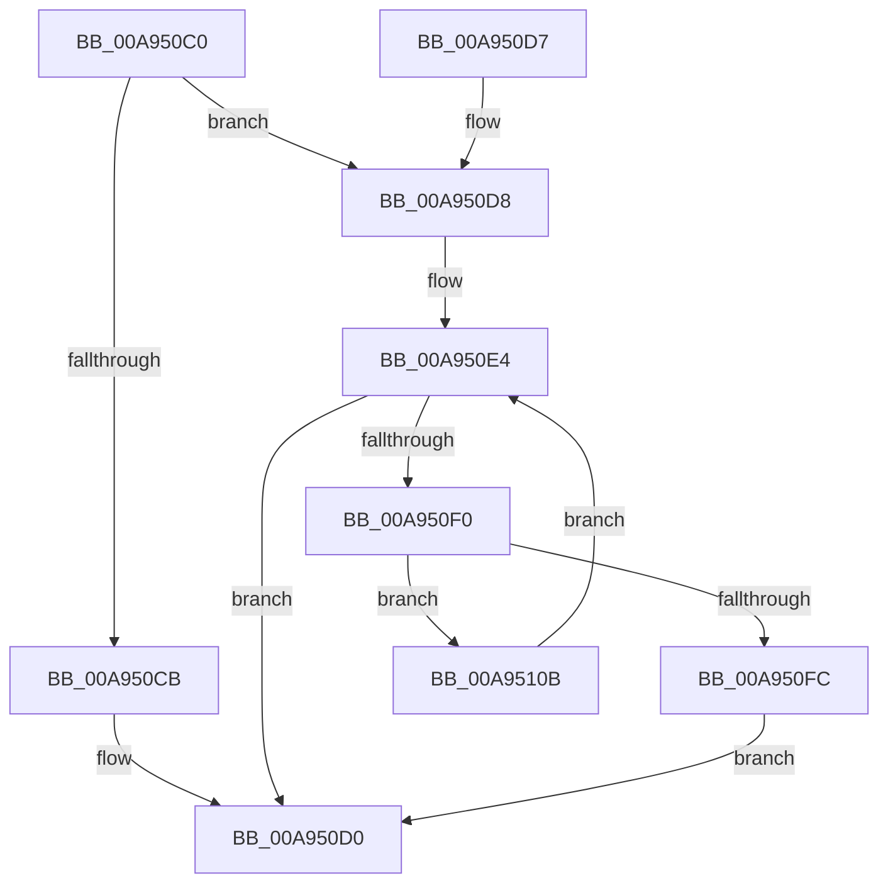

# PpmPerfQueryProcMeasurementValues

- RVA: `0x00A950C0`–`0x00A95110` (길이 `80` bytes)
- VA: `0x0000000140A950C0`
- 실행 섹션: `PAGE`
- PDB 이름 있음: `예`; PDB Function 태그: `아니요`
- unwind 정보 RVA: `0x000B969C`
- 디코드: `24`개 명령, `80/80` bytes 표시
- 미해석 바이트: `0` (있으면 어셈블리에 `.byte`로 보존)

> 이 문서는 커널 이미지의 기계어와 PDB 기호를 분석해 생성했습니다. 4번과 5번은 함수 원형과 자료형을 바이너리 사용 방식에서 추정한 C 해석이며 원본 소스 복구 결과는 아닙니다.

## 1. Dependencies

- 직접 호출 지점: **1**; 고유 호출 대상: **1**
- 직접 호출자로 확인된 함수: **1**
- RIP 상대 이미지 참조: **1**

### Outgoing calls
- `0x00A95102` → [guard_dispatch_icall](../../text/6B/guard_dispatch_icall_function_006BAAD0.md) (function, `0x006BAAD0`)

### Direct callers
- [PopPowerInformationInternal](../A8/PopPowerInformationInternal_function_00A8B7C0.md) at `0x00A8CEFC`
- [PopPowerInformationInternal](../A8/PopPowerInformationInternal_function_00A8B7C0.md) at `0x00A8CFA1`

### Static image references
- `0x00A950D8` → RVA `0x00FC6BA8` (`ALMOSTRO`; read)

## 2. Other-region calls and transfers

- 다른 실행 섹션으로 향하는 call: **1**
  - `0x00A95102` → [guard_dispatch_icall](../../text/6B/guard_dispatch_icall_function_006BAAD0.md) (`PAGE` → `.text`)
- 별도 외부 분기/꼬리 이동을 확인하지 못했습니다.

## 3. Assembly (complete function range)

```asm
00A950C0  48 83 EC 38                     sub rsp, 0x38
00A950C4  44 8B D9                        mov r11d, ecx
00A950C7  85 C9                           test ecx, ecx
00A950C9  75 0D                           jne 0x140a950d8
00A950CB  B9 0D 00 00 C0                  mov ecx, 0xc000000d
00A950D0  8B C1                           mov eax, ecx
00A950D2  48 83 C4 38                     add rsp, 0x38
00A950D6  C3                              ret
00A950D7  CC                              int3
00A950D8  48 8B 05 C9 1A 53 00            mov rax, qword ptr [rip + 0x531ac9]
00A950DF  B9 02 00 00 C0                  mov ecx, 0xc0000002
00A950E4  4C 8D 15 BD 1A 53 00            lea r10, [rip + 0x531abd]
00A950EB  49 3B C2                        cmp rax, r10
00A950EE  74 E0                           je 0x140a950d0
00A950F0  4C 8B 90 B0 01 00 00            mov r10, qword ptr [rax + 0x1b0]
00A950F7  4D 85 D2                        test r10, r10
00A950FA  74 0F                           je 0x140a9510b
00A950FC  41 8B CB                        mov ecx, r11d
00A950FF  49 8B C2                        mov rax, r10
00A95102  E8 C9 59 C2 FF                  call 0x1406baad0
00A95107  8B C8                           mov ecx, eax
00A95109  EB C5                           jmp 0x140a950d0
00A9510B  48 8B 00                        mov rax, qword ptr [rax]
00A9510E  EB D4                           jmp 0x140a950e4
```

## 4. C-style interpretation (structured pseudocode)

```c
__int64 __fastcall PpmPerfQueryProcMeasurementValues(int a1)
{
    __int64 result;
    __int64 v_rsp;

    v_rsp = (v_rsp) - (56);
    if (a1 != 0) goto loc_00A950D8;
loc_00A950D0:
    v_rsp = (v_rsp) + (56);
    return (unsigned int)((unsigned int)((unsigned int)(0xC000000DULL)));
loc_00A950D8:
loc_00A950E4:
    if ((*(unsigned __int64 *)(v_rip + 5446345)) == (v_rip + 5446333)) goto loc_00A950D0;
    if (*(unsigned __int64 *)(*(unsigned __int64 *)(v_rip + 5446345) + 432) == 0) goto loc_00A9510B;
    result = guard_dispatch_icall((unsigned int)((unsigned int)((unsigned int)(a1))), a2, a3, a4);
    goto loc_00A950D0;
loc_00A9510B:
    goto loc_00A950E4;
}
```

## 5. (Beta) C Style

```c
int64_t PpmPerfQueryProcMeasurementValues(int32_t Arg1)
{
    int64_t result;
    int64_t local_rsp;

    local_rsp = (local_rsp) - (56);
    if (Arg1 != 0) goto loc_00A950D8;
loc_00A950D0:
    local_rsp = (local_rsp) + (56);
    return (uint32_t)((uint32_t)((uint32_t)(0xC000000DULL)));
loc_00A950D8:
loc_00A950E4:
    if ((*(uint64_t *)(v_rip + 0x531AC9)) == (v_rip + 5446333)) goto loc_00A950D0;
    if (*(uint64_t *)(*(uint64_t *)(v_rip + 0x531AC9) + 0x1B0) == 0) goto loc_00A9510B;
    result = guard_dispatch_icall((uint32_t)((uint32_t)((uint32_t)(Arg1))), a2, a3, a4);
    goto loc_00A950D0;
loc_00A9510B:
    goto loc_00A950E4;
}
```

## 6. Execution-region graph

[열기: 2D/3D 그래프와 함수 탐색 컨트롤 패널](../../../control-panel.html?section=page&rva=0x00A950C0&view=graph)

- 2D 그래프는 위에서 아래로 흐르고, 3D 그래프는 빈 공간을 드래그해 회전합니다. Shift+드래그는 이동, 휠은 확대·축소, 함수 노드 선택은 대상 보고서 이동입니다.

### Static fallback


