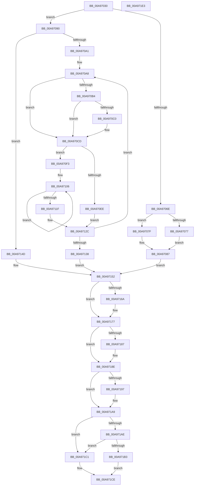

# PpmPerfUpdateDomainPolicy

- RVA: `0x00A97030`–`0x00A971E4` (길이 `436` bytes)
- VA: `0x0000000140A97030`
- 실행 섹션: `PAGE`
- PDB 이름 있음: `예`; PDB Function 태그: `아니요`
- unwind 정보 RVA: `0x000B9D04`
- 디코드: `126`개 명령, `436/436` bytes 표시
- 미해석 바이트: `0` (있으면 어셈블리에 `.byte`로 보존)

> 이 문서는 커널 이미지의 기계어와 PDB 기호를 분석해 생성했습니다. 4번과 5번은 함수 원형과 자료형을 바이너리 사용 방식에서 추정한 C 해석이며 원본 소스 복구 결과는 아닙니다.

## 1. Dependencies

- 직접 호출 지점: **10**; 고유 호출 대상: **9**
- 직접 호출자로 확인된 함수: **5**
- RIP 상대 이미지 참조: **7**

### Outgoing calls
- `0x00A970AB` → [PpmPerfCalculateQosClassPolicies](../../text/42/PpmPerfCalculateQosClassPolicies_function_0042BFC8.md) (function, `0x0042BFC8`)
- `0x00A970B7` → [Feature_DisableUserPresenceQosByPolicy__private_IsEnabledDeviceUsageNoInline](../../text/4F/Feature_DisableUserPresenceQosByPolicy__private_IsEnabledDeviceUsageNoInline_function_004F42EC.md) (function, `0x004F42EC`)
- `0x00A97157` → [PpmPerfUpdateQosDisableReasons](../../text/49/PpmPerfUpdateQosDisableReasons_function_004991F0.md) (function, `0x004991F0`)
- `0x00A9717E` → [PpmPerfUpdateMultimediaPowerModel](../../text/4B/PpmPerfUpdateMultimediaPowerModel_function_004BA06C.md) (function, `0x004BA06C`)
- `0x00A97189` → [PpmEventQosSupport](../AA/PpmEventQosSupport_function_00AA3B50.md) (function, `0x00AA3B50`)
- `0x00A9718E` → [Feature_DisableUserPresenceQosByPolicy__private_IsEnabledDeviceUsageNoInline](../../text/4F/Feature_DisableUserPresenceQosByPolicy__private_IsEnabledDeviceUsageNoInline_function_004F42EC.md) (function, `0x004F42EC`)
- `0x00A971A4` → [PsRefreshUserPresencePpmPolicies](../../text/4F/PsRefreshUserPresencePpmPolicies_function_004F4FC0.md) (function, `0x004F4FC0`)
- `0x00A971BA` → [PpmReleaseLock](../../text/2D/PpmReleaseLock_function_002DA428.md) (function, `0x002DA428`)
- `0x00A971C1` → [PpmPerfSetAllDomainsToUpdate](../../text/3B/PpmPerfSetAllDomainsToUpdate_function_003BF044.md) (function, `0x003BF044`)
- `0x00A971C9` → [PpmCheckApplyPerfConstraints](PpmCheckApplyPerfConstraints_function_00A971EC.md) (function, `0x00A971EC`)

### Direct callers
- [PpmRegisterPerfStates](../75/PpmRegisterPerfStates_function_0075B084.md) at `0x0075BC23`
- [PpmUpdatePerfStates](../75/PpmUpdatePerfStates_function_0075BD90.md) at `0x0075BE38`
- [PpmReapplyPerfPolicy](../A5/PpmReapplyPerfPolicy_function_00A53148.md) at `0x00A532DA`
- [PopPowerInformationInternal](../A8/PopPowerInformationInternal_function_00A8B7C0.md) at `0x00A8C0EA`
- [PopPowerRequestCallbackPerfBoostRequired](PopPowerRequestCallbackPerfBoostRequired_function_00A96F70.md) at `0x00A96FA1`
- [PopPowerRequestCallbackPerfBoostRequired](PopPowerRequestCallbackPerfBoostRequired_function_00A96F70.md) at `0x00A9700E`

### Static image references
- `0x00A97048` → RVA `0x00FC6BA8` (`ALMOSTRO`; read)
- `0x00A9706E` → RVA `0x00FC6AED` (`ALMOSTRO`; read)
- `0x00A97161` → RVA `0x00FC6AA6` (`ALMOSTRO`; read)
- `0x00A9716A` → RVA `0x00FC6AA6` (`ALMOSTRO`; write)
- `0x00A97177` → RVA `0x00F0E178` (`.data`; write)
- `0x00A97197` → RVA `0x00F0CE0C` (`.data`; read)
- `0x00A971B3` → RVA `0x00F0CC00` (`.data`; read)

## 2. Other-region calls and transfers

- 다른 실행 섹션으로 향하는 call: **8**
  - `0x00A970AB` → [PpmPerfCalculateQosClassPolicies](../../text/42/PpmPerfCalculateQosClassPolicies_function_0042BFC8.md) (`PAGE` → `.text`)
  - `0x00A970B7` → [Feature_DisableUserPresenceQosByPolicy__private_IsEnabledDeviceUsageNoInline](../../text/4F/Feature_DisableUserPresenceQosByPolicy__private_IsEnabledDeviceUsageNoInline_function_004F42EC.md) (`PAGE` → `.text`)
  - `0x00A97157` → [PpmPerfUpdateQosDisableReasons](../../text/49/PpmPerfUpdateQosDisableReasons_function_004991F0.md) (`PAGE` → `.text`)
  - `0x00A9717E` → [PpmPerfUpdateMultimediaPowerModel](../../text/4B/PpmPerfUpdateMultimediaPowerModel_function_004BA06C.md) (`PAGE` → `.text`)
  - `0x00A9718E` → [Feature_DisableUserPresenceQosByPolicy__private_IsEnabledDeviceUsageNoInline](../../text/4F/Feature_DisableUserPresenceQosByPolicy__private_IsEnabledDeviceUsageNoInline_function_004F42EC.md) (`PAGE` → `.text`)
  - `0x00A971A4` → [PsRefreshUserPresencePpmPolicies](../../text/4F/PsRefreshUserPresencePpmPolicies_function_004F4FC0.md) (`PAGE` → `.text`)
  - `0x00A971BA` → [PpmReleaseLock](../../text/2D/PpmReleaseLock_function_002DA428.md) (`PAGE` → `.text`)
  - `0x00A971C1` → [PpmPerfSetAllDomainsToUpdate](../../text/3B/PpmPerfSetAllDomainsToUpdate_function_003BF044.md) (`PAGE` → `.text`)
- 별도 외부 분기/꼬리 이동을 확인하지 못했습니다.

## 3. Assembly (complete function range)

```asm
00A97030  48 89 5C 24 18                  mov qword ptr [rsp + 0x18], rbx
00A97035  88 4C 24 08                     mov byte ptr [rsp + 8], cl
00A97039  55                              push rbp
00A9703A  56                              push rsi
00A9703B  57                              push rdi
00A9703C  41 54                           push r12
00A9703E  41 55                           push r13
00A97040  41 56                           push r14
00A97042  41 57                           push r15
00A97044  48 83 EC 20                     sub rsp, 0x20
00A97048  48 8B 1D 59 FB 52 00            mov rbx, qword ptr [rip + 0x52fb59]
00A9704F  48 8D 05 52 FB 52 00            lea rax, [rip + 0x52fb52]
00A97056  45 33 ED                        xor r13d, r13d
00A97059  44 8A F1                        mov r14b, cl
00A9705C  45 8A E5                        mov r12b, r13b
00A9705F  41 8A ED                        mov bpl, r13b
00A97062  41 8D 75 01                     lea esi, [r13 + 1]
00A97066  44 8A FE                        mov r15b, sil
00A97069  48 3B D8                        cmp rbx, rax
00A9706C  75 22                           jne 0x140a97090
00A9706E  44 38 2D 78 FA 52 00            cmp byte ptr [rip + 0x52fa78], r13b
00A97075  74 08                           je 0x140a9707f
00A97077  40 8A FE                        mov dil, sil
00A9707A  41 8B C5                        mov eax, r13d
00A9707D  EB 08                           jmp 0x140a97087
00A9707F  41 8A FD                        mov dil, r13b
00A97082  B8 80 00 00 00                  mov eax, 0x80
00A97087  89 44 24 68                     mov dword ptr [rsp + 0x68], eax
00A9708B  E9 C2 00 00 00                  jmp 0x140a97152
00A97090  41 8A FD                        mov dil, r13b
00A97093  44 89 6C 24 68                  mov dword ptr [rsp + 0x68], r13d
00A97098  41 8B F5                        mov esi, r13d
00A9709B  0F 84 AC 00 00 00               je 0x140a9714d
00A970A1  4C 8D 35 00 FB 52 00            lea r14, [rip + 0x52fb00]
00A970A8  48 8B CB                        mov rcx, rbx
00A970AB  E8 18 4F 99 FF                  call 0x14042bfc8
00A970B0  84 C0                           test al, al
00A970B2  74 19                           je 0x140a970cd
00A970B4  41 B4 01                        mov r12b, 1
00A970B7  E8 30 D2 A5 FF                  call 0x1404f42ec
00A970BC  85 C0                           test eax, eax
00A970BE  74 0D                           je 0x140a970cd
00A970C0  8B 83 FC 02 00 00               mov eax, dword ptr [rbx + 0x2fc]
00A970C6  F7 D8                           neg eax
00A970C8  1A C9                           sbb cl, cl
00A970CA  44 22 F9                        and r15b, cl
00A970CD  F7 83 04 03 00 00 C3 01 00 00   test dword ptr [rbx + 0x304], 0x1c3
00A970D7  41 BB 01 00 00 00               mov r11d, 1
00A970DD  40 0F B6 ED                     movzx ebp, bpl
00A970E1  41 0F 44 EB                     cmove ebp, r11d
00A970E5  44 38 AB 22 03 00 00            cmp byte ptr [rbx + 0x322], r13b
00A970EC  74 05                           je 0x140a970f3
00A970EE  41 8A FB                        mov dil, r11b
00A970F1  EB 39                           jmp 0x140a9712c
00A970F3  41 8B D5                        mov edx, r13d
00A970F6  4C 8D 83 FC 02 00 00            lea r8, [rbx + 0x2fc]
00A970FD  45 8A CB                        mov r9b, r11b
00A97100  41 BA 06 00 00 00               mov r10d, 6
00A97106  41 8B 08                        mov ecx, dword ptr [r8]
00A97109  8B C1                           mov eax, ecx
00A9710B  24 02                           and al, 2
00A9710D  4D 8D 40 04                     lea r8, [r8 + 4]
00A97111  F6 D8                           neg al
00A97113  1A C0                           sbb al, al
00A97115  0B D1                           or edx, ecx
00A97117  44 22 C8                        and r9b, al
00A9711A  4D 2B D3                        sub r10, r11
00A9711D  75 E7                           jne 0x140a97106
00A9711F  8B C2                           mov eax, edx
00A97121  83 E0 FD                        and eax, 0xfffffffd
00A97124  45 84 C9                        test r9b, r9b
00A97127  0F 45 C2                        cmovne eax, edx
00A9712A  0B F0                           or esi, eax
00A9712C  48 8B 1B                        mov rbx, qword ptr [rbx]
00A9712F  49 3B DE                        cmp rbx, r14
00A97132  0F 85 70 FF FF FF               jne 0x140a970a8
00A97138  44 8A 74 24 60                  mov r14b, byte ptr [rsp + 0x60]
00A9713D  40 84 FF                        test dil, dil
00A97140  41 0F 45 F5                     cmovne esi, r13d
00A97144  89 74 24 68                     mov dword ptr [rsp + 0x68], esi
00A97148  49 8B F3                        mov rsi, r11
00A9714B  EB 05                           jmp 0x140a97152
00A9714D  BE 01 00 00 00                  mov esi, 1
00A97152  48 8D 4C 24 68                  lea rcx, [rsp + 0x68]
00A97157  E8 94 20 A0 FF                  call 0x1404991f0
00A9715C  84 C0                           test al, al
00A9715E  0F 95 C3                        setne bl
00A97161  40 3A 3D 3E F9 52 00            cmp dil, byte ptr [rip + 0x52f93e]
00A97168  74 0D                           je 0x140a97177
00A9716A  40 88 3D 35 F9 52 00            mov byte ptr [rip + 0x52f935], dil
00A97171  44 8A F6                        mov r14b, sil
00A97174  40 8A DE                        mov bl, sil
00A97177  40 88 2D FA 6F 47 00            mov byte ptr [rip + 0x476ffa], bpl
00A9717E  E8 E9 2E A2 FF                  call 0x1404ba06c
00A97183  84 DB                           test bl, bl
00A97185  74 07                           je 0x140a9718e
00A97187  33 C9                           xor ecx, ecx
00A97189  E8 C2 C9 00 00                  call 0x140aa3b50
00A9718E  E8 59 D1 A5 FF                  call 0x1404f42ec
00A97193  85 C0                           test eax, eax
00A97195  74 12                           je 0x140a971a9
00A97197  44 39 2D 6E 5C 47 00            cmp dword ptr [rip + 0x475c6e], r13d
00A9719E  41 8A CF                        mov cl, r15b
00A971A1  0F 94 C2                        sete dl
00A971A4  E8 17 DE A5 FF                  call 0x1404f4fc0
00A971A9  45 84 E4                        test r12b, r12b
00A971AC  75 13                           jne 0x140a971c1
00A971AE  45 84 F6                        test r14b, r14b
00A971B1  75 0E                           jne 0x140a971c1
00A971B3  48 8D 0D 46 5A 47 00            lea rcx, [rip + 0x475a46]
00A971BA  E8 69 32 84 FF                  call 0x1402da428
00A971BF  EB 0D                           jmp 0x140a971ce
00A971C1  E8 7E 7E 92 FF                  call 0x1403bf044
00A971C6  41 8A CE                        mov cl, r14b
00A971C9  E8 1E 00 00 00                  call 0x140a971ec
00A971CE  48 8B 5C 24 70                  mov rbx, qword ptr [rsp + 0x70]
00A971D3  48 83 C4 20                     add rsp, 0x20
00A971D7  41 5F                           pop r15
00A971D9  41 5E                           pop r14
00A971DB  41 5D                           pop r13
00A971DD  41 5C                           pop r12
00A971DF  5F                              pop rdi
00A971E0  5E                              pop rsi
00A971E1  5D                              pop rbp
00A971E2  C3                              ret
00A971E3  CC                              int3
```

## 4. C-style interpretation (structured pseudocode)

```c
__int64 __fastcall PpmPerfUpdateDomainPolicy(unsigned __int8 a1)
{
    __int64 result;
    __int64 v_r10;
    __int64 v_r13;
    __int64 v_r14;
    __int64 v_r15;
    __int64 v_rbp;
    __int64 v_rbx;
    __int64 v_rsi;
    __int64 v_rsp;
    unsigned int v_stack_p10;
    unsigned __int64 v_stack_p18;
    unsigned __int8 v_stack_p8;

    v_stack_p18 = v_rbx;
    v_stack_p8 = a1;
    v_rsp = (v_rsp) - (32);
    v_r13 = 0;
    if ((*(unsigned __int64 *)(v_rip + 5438297)) != (v_rip + 5438290)) goto loc_00A97090;
    if ((*(unsigned __int8 *)(v_rip + 5438072)) == 0) goto loc_00A9707F;
    goto loc_00A97087;
loc_00A9707F:
loc_00A97087:
    v_stack_p10 = 128;
    goto loc_00A97152;
loc_00A97090:
    v_stack_p10 = 0;
    if ((*(unsigned __int8 *)(v_rip + 5438072)) == 0) goto loc_00A9714D;
loc_00A970A8:
    result = PpmPerfCalculateQosClassPolicies(*(unsigned __int64 *)(v_rip + 5438297), a2, a3, a4);
    if ((unsigned __int8)(result) == 0) goto loc_00A970CD;
    result = Feature_DisableUserPresenceQosByPolicy__private_IsEnabledDeviceUsageNoInline(*(unsigned __int64 *)(v_rip + 5438297), a2, a3, a4);
    v_r15 = (unsigned __int8)(v_r13 + 1);
    if ((unsigned int)(result) != 0) {
        result = *(unsigned int *)(*(unsigned __int64 *)(v_rip + 5438297) + 764);
        result = (unsigned int)(-(result));
        v_r15 = (unsigned __int8)(((unsigned __int8)(v_r13 + 1)) & ((unsigned __int8)(*(unsigned __int64 *)(v_rip + 5438297))));
    }
    v_rbp = 0;
    if (((*(unsigned int *)(*(unsigned __int64 *)(v_rip + 5438297) + 772)) & (451)) == 0) { v_rbp = 1; }
    if ((*(unsigned __int8 *)(*(unsigned __int64 *)(v_rip + 5438297) + 802)) == 0) goto loc_00A970F3;
    goto loc_00A9712C;
loc_00A970F3:
loc_00A97106:
    result = (unsigned __int8)(((unsigned int)((unsigned int)((unsigned int)(*(unsigned int *)(*(unsigned __int64 *)(v_rip + 5438297) + 764))))) & (2));
    result = (unsigned __int8)(-(result));
    a2 = (unsigned int)((0) | ((unsigned int)((unsigned int)(*(unsigned int *)(*(unsigned __int64 *)(v_rip + 5438297) + 764)))));
    a4 = (unsigned __int8)((1) & ((unsigned __int8)(result)));
    v_r10 = (6) - (1);
    if (condition_is_not_equal) goto loc_00A97106;
    result = (unsigned int)(((unsigned int)((unsigned int)(a2))) & (0xFFFFFFFDULL));
    if ((unsigned __int8)(a4) != 0) { result = (unsigned int)(a2); }
    v_rsi = (unsigned int)((0) | ((unsigned int)(result)));
loc_00A9712C:
    if ((*(unsigned __int64 *)(*(unsigned __int64 *)(v_rip + 5438297))) != (v_rip + 5438208)) goto loc_00A970A8;
    if (1 != 0) { v_rsi = 0; }
    v_stack_p10 = (unsigned int)(v_rsi);
    goto loc_00A97152;
loc_00A9714D:
loc_00A97152:
    result = PpmPerfUpdateQosDisableReasons(v_stack_p10, a2, *(unsigned __int64 *)(v_rip + 5438297) + 764 + 4, a4);
    v_rbx = ((unsigned __int8)(result) != 0) ? 1 : 0;
    v_r14 = v_stack_p8;
    if (1 != (*(unsigned __int8 *)(v_rip + 5437758))) {
        *(unsigned __int8 *)(v_rip + 5437749) = 1;
        v_r14 = 1;
        v_rbx = 1;
    }
    *(unsigned __int8 *)(v_rip + 4681722) = (unsigned __int8)(v_rbp);
    result = PpmPerfUpdateMultimediaPowerModel(v_stack_p10, a2, *(unsigned __int64 *)(v_rip + 5438297) + 764 + 4, a4);
    if ((unsigned __int8)(v_rbx) != 0) {
        a1 = 0;
        result = PpmEventQosSupport(a1, a2, *(unsigned __int64 *)(v_rip + 5438297) + 764 + 4, a4);
    }
    result = Feature_DisableUserPresenceQosByPolicy__private_IsEnabledDeviceUsageNoInline(a1, a2, *(unsigned __int64 *)(v_rip + 5438297) + 764 + 4, a4);
    if ((unsigned int)(result) != 0) {
        a1 = (unsigned __int8)(v_r15);
        a2 = ((*(unsigned int *)(v_rip + 4676718)) == 0) ? 1 : 0;
        result = PsRefreshUserPresencePpmPolicies(a1, a2, *(unsigned __int64 *)(v_rip + 5438297) + 764 + 4, a4);
    }
    if (1 != 0) goto loc_00A971C1;
    if ((unsigned __int8)(v_r14) != 0) goto loc_00A971C1;
    result = PpmReleaseLock(v_rip + 4676166, a2, *(unsigned __int64 *)(v_rip + 5438297) + 764 + 4, a4);
    goto loc_00A971CE;
loc_00A971C1:
    result = PpmPerfSetAllDomainsToUpdate(v_rip + 4676166, a2, *(unsigned __int64 *)(v_rip + 5438297) + 764 + 4, a4);
    result = PpmCheckApplyPerfConstraints((unsigned __int8)(v_r14), a2, *(unsigned __int64 *)(v_rip + 5438297) + 764 + 4, a4);
loc_00A971CE:
    v_rsp = (v_rsp) + (32);
    return result;
}
```

## 5. (Beta) C Style

```c
int64_t PpmPerfUpdateDomainPolicy(uint8_t Arg1)
{
    int64_t result;
    int64_t local_r10;
    int64_t local_r13;
    int64_t local_r14;
    int64_t local_r15;
    int64_t local_rbp;
    int64_t local_rbx;
    int64_t local_rsi;
    int64_t local_rsp;
    uint32_t v_stack_p10;
    uint64_t v_stack_p18;
    uint8_t v_stack_p8;

    v_stack_p18 = local_rbx;
    v_stack_p8 = Arg1;
    local_rsp = (local_rsp) - (32);
    local_r13 = 0;
    if ((*(uint64_t *)(v_rip + 0x52FB59)) != (v_rip + 5438290)) goto loc_00A97090;
    if ((*(uint8_t *)(v_rip + 0x52FA78)) == 0) goto loc_00A9707F;
    goto loc_00A97087;
loc_00A9707F:
loc_00A97087:
    v_stack_p10 = 128;
    goto loc_00A97152;
loc_00A97090:
    v_stack_p10 = 0;
    if ((*(uint8_t *)(v_rip + 0x52FA78)) == 0) goto loc_00A9714D;
loc_00A970A8:
    result = PpmPerfCalculateQosClassPolicies(*(uint64_t *)(v_rip + 0x52FB59), a2, a3, a4);
    if ((uint8_t)(result) == 0) goto loc_00A970CD;
    result = Feature_DisableUserPresenceQosByPolicy__private_IsEnabledDeviceUsageNoInline(*(uint64_t *)(v_rip + 0x52FB59), a2, a3, a4);
    local_r15 = (uint8_t)(local_r13 + 1);
    if ((uint32_t)(result) != 0) {
        result = *(uint32_t *)(*(uint64_t *)(v_rip + 0x52FB59) + 0x2FC);
        result = (uint32_t)(-(result));
        local_r15 = (uint8_t)(((uint8_t)(local_r13 + 1)) & ((uint8_t)(*(uint64_t *)(v_rip + 0x52FB59))));
    }
    local_rbp = 0;
    if (((*(uint32_t *)(*(uint64_t *)(v_rip + 0x52FB59) + 0x304)) & (451)) == 0) { local_rbp = 1; }
    if ((*(uint8_t *)(*(uint64_t *)(v_rip + 0x52FB59) + 0x322)) == 0) goto loc_00A970F3;
    goto loc_00A9712C;
loc_00A970F3:
loc_00A97106:
    result = (uint8_t)(((uint32_t)((uint32_t)((uint32_t)(*(uint32_t *)(*(uint64_t *)(v_rip + 0x52FB59) + 0x2FC))))) & (2));
    result = (uint8_t)(-(result));
    a2 = (uint32_t)((0) | ((uint32_t)((uint32_t)(*(uint32_t *)(*(uint64_t *)(v_rip + 0x52FB59) + 0x2FC)))));
    a4 = (uint8_t)((1) & ((uint8_t)(result)));
    local_r10 = (6) - (1);
    if (condition_is_not_equal) goto loc_00A97106;
    result = (uint32_t)(((uint32_t)((uint32_t)(a2))) & (0xFFFFFFFDULL));
    if ((uint8_t)(a4) != 0) { result = (uint32_t)(a2); }
    local_rsi = (uint32_t)((0) | ((uint32_t)(result)));
loc_00A9712C:
    if ((*(uint64_t *)(*(uint64_t *)(v_rip + 0x52FB59))) != (v_rip + 5438208)) goto loc_00A970A8;
    if (1 != 0) { local_rsi = 0; }
    v_stack_p10 = (uint32_t)(local_rsi);
    goto loc_00A97152;
loc_00A9714D:
loc_00A97152:
    result = PpmPerfUpdateQosDisableReasons(v_stack_p10, a2, *(uint64_t *)(v_rip + 0x52FB59) + 764 + 4, a4);
    local_rbx = ((uint8_t)(result) != 0) ? 1 : 0;
    local_r14 = v_stack_p8;
    if (1 != (*(uint8_t *)(v_rip + 0x52F93E))) {
        *(uint8_t *)(v_rip + 0x52F935) = 1;
        local_r14 = 1;
        local_rbx = 1;
    }
    *(uint8_t *)(v_rip + 0x476FFA) = (uint8_t)(local_rbp);
    result = PpmPerfUpdateMultimediaPowerModel(v_stack_p10, a2, *(uint64_t *)(v_rip + 0x52FB59) + 764 + 4, a4);
    if ((uint8_t)(local_rbx) != 0) {
        Arg1 = 0;
        result = PpmEventQosSupport(Arg1, a2, *(uint64_t *)(v_rip + 0x52FB59) + 764 + 4, a4);
    }
    result = Feature_DisableUserPresenceQosByPolicy__private_IsEnabledDeviceUsageNoInline(Arg1, a2, *(uint64_t *)(v_rip + 0x52FB59) + 764 + 4, a4);
    if ((uint32_t)(result) != 0) {
        Arg1 = (uint8_t)(local_r15);
        a2 = ((*(uint32_t *)(v_rip + 0x475C6E)) == 0) ? 1 : 0;
        result = PsRefreshUserPresencePpmPolicies(Arg1, a2, *(uint64_t *)(v_rip + 0x52FB59) + 764 + 4, a4);
    }
    if (1 != 0) goto loc_00A971C1;
    if ((uint8_t)(local_r14) != 0) goto loc_00A971C1;
    result = PpmReleaseLock(v_rip + 4676166, a2, *(uint64_t *)(v_rip + 0x52FB59) + 764 + 4, a4);
    goto loc_00A971CE;
loc_00A971C1:
    result = PpmPerfSetAllDomainsToUpdate(v_rip + 4676166, a2, *(uint64_t *)(v_rip + 0x52FB59) + 764 + 4, a4);
    result = PpmCheckApplyPerfConstraints((uint8_t)(local_r14), a2, *(uint64_t *)(v_rip + 0x52FB59) + 764 + 4, a4);
loc_00A971CE:
    local_rsp = (local_rsp) + (32);
    return result;
}
```

## 6. Execution-region graph

[열기: 2D/3D 그래프와 함수 탐색 컨트롤 패널](../../../control-panel.html?section=page&rva=0x00A97030&view=graph)

- 2D 그래프는 위에서 아래로 흐르고, 3D 그래프는 빈 공간을 드래그해 회전합니다. Shift+드래그는 이동, 휠은 확대·축소, 함수 노드 선택은 대상 보고서 이동입니다.

### Static fallback


