# PsCreateVsmEnclave

- RVA: `0x00A9BCCC`–`0x00A9C183` (길이 `1,207` bytes)
- VA: `0x0000000140A9BCCC`
- 실행 섹션: `PAGE`
- PDB 이름 있음: `예`; PDB Function 태그: `아니요`
- unwind 정보 RVA: `0x000BA55C`
- 디코드: `320`개 명령, `1,207/1,207` bytes 표시
- 미해석 바이트: `0` (있으면 어셈블리에 `.byte`로 보존)

> 이 문서는 커널 이미지의 기계어와 PDB 기호를 분석해 생성했습니다. 4번과 5번은 함수 원형과 자료형을 바이너리 사용 방식에서 추정한 C 해석이며 원본 소스 복구 결과는 아닙니다.

## 1. Dependencies

- 직접 호출 지점: **19**; 고유 호출 대상: **11**
- 직접 호출자로 확인된 함수: **1**
- RIP 상대 이미지 참조: **0**

### Outgoing calls
- `0x00A9BD3D` → [KeAbPreAcquire](../../text/21/KeAbPreAcquire_function_00210230.md) (function, `0x00210230`)
- `0x00A9BD56` → [ExfAcquirePushLockExclusiveEx](../../text/20/ExfAcquirePushLockExclusiveEx_function_0020FC90.md) (function, `0x0020FC90`)
- `0x00A9BD7D` → [ExAllocatePool2](../../poolcode/B8/ExAllocatePool2_function_00B820F0.md) (function, `0x00B820F0`)
- `0x00A9BD9A` → [ExAllocatePool2](../../poolcode/B8/ExAllocatePool2_function_00B820F0.md) (function, `0x00B820F0`)
- `0x00A9BDD9` → [ExFreePoolWithTag](../../poolcode/B8/ExFreePoolWithTag_function_00B82870.md) (function, `0x00B82870`)
- `0x00A9BDEF` → [ExfTryToWakePushLock](../../text/26/ExfTryToWakePushLock_function_00265DD0.md) (function, `0x00265DD0`)
- `0x00A9BDF7` → [KeAbPostRelease](../../text/2E/KeAbPostRelease_function_002E1600.md) (function, `0x002E1600`)
- `0x00A9BDFC` → [KeLeaveCriticalRegion](../../text/25/KeLeaveCriticalRegion_function_0025D8B0.md) (function, `0x0025D8B0`)
- `0x00A9BE20` → [ExAllocatePool2](../../poolcode/B8/ExAllocatePool2_function_00B820F0.md) (function, `0x00B820F0`)
- `0x00A9BE6E` → [VslCreateEnclave](VslCreateEnclave_function_00A9C18C.md) (function, `0x00A9C18C`)
- `0x00A9BE81` → [ExFreePoolWithTag](../../poolcode/B8/ExFreePoolWithTag_function_00B82870.md) (function, `0x00B82870`)
- `0x00A9BEB0` → [KeInitializeEvent](../../text/40/KeInitializeEvent_function_0040DD10.md) (function, `0x0040DD10`)
- `0x00A9BEFC` → [KeAbPreAcquire](../../text/21/KeAbPreAcquire_function_00210230.md) (function, `0x00210230`)
- `0x00A9BF16` → [ExfAcquirePushLockExclusiveEx](../../text/20/ExfAcquirePushLockExclusiveEx_function_0020FC90.md) (function, `0x0020FC90`)
- `0x00A9BF56` → [PspVsmEnclaveHashAllocator](../78/PspVsmEnclaveHashAllocator_function_00788D8C.md) (function, `0x00788D8C`)
- `0x00A9C096` → [AlpcpFreeBuffer](../90/AlpcpFreeBuffer_function_009071C0.md) (function, `0x009071C0`)
- `0x00A9C145` → [ExfTryToWakePushLock](../../text/26/ExfTryToWakePushLock_function_00265DD0.md) (function, `0x00265DD0`)
- `0x00A9C14D` → [KeAbPostRelease](../../text/2E/KeAbPostRelease_function_002E1600.md) (function, `0x002E1600`)
- `0x00A9C152` → [KeLeaveCriticalRegion](../../text/25/KeLeaveCriticalRegion_function_0025D8B0.md) (function, `0x0025D8B0`)

### Direct callers
- [MiCreateVsmEnclave](../80/MiCreateVsmEnclave_function_00808890.md) at `0x00808990`

### Static image references
- 디코드된 RIP-relative 메모리 참조가 없습니다.

## 2. Other-region calls and transfers

- 다른 실행 섹션으로 향하는 call: **16**
  - `0x00A9BD3D` → [KeAbPreAcquire](../../text/21/KeAbPreAcquire_function_00210230.md) (`PAGE` → `.text`)
  - `0x00A9BD56` → [ExfAcquirePushLockExclusiveEx](../../text/20/ExfAcquirePushLockExclusiveEx_function_0020FC90.md) (`PAGE` → `.text`)
  - `0x00A9BD7D` → [ExAllocatePool2](../../poolcode/B8/ExAllocatePool2_function_00B820F0.md) (`PAGE` → `POOLCODE`)
  - `0x00A9BD9A` → [ExAllocatePool2](../../poolcode/B8/ExAllocatePool2_function_00B820F0.md) (`PAGE` → `POOLCODE`)
  - `0x00A9BDD9` → [ExFreePoolWithTag](../../poolcode/B8/ExFreePoolWithTag_function_00B82870.md) (`PAGE` → `POOLCODE`)
  - `0x00A9BDEF` → [ExfTryToWakePushLock](../../text/26/ExfTryToWakePushLock_function_00265DD0.md) (`PAGE` → `.text`)
  - `0x00A9BDF7` → [KeAbPostRelease](../../text/2E/KeAbPostRelease_function_002E1600.md) (`PAGE` → `.text`)
  - `0x00A9BDFC` → [KeLeaveCriticalRegion](../../text/25/KeLeaveCriticalRegion_function_0025D8B0.md) (`PAGE` → `.text`)
  - `0x00A9BE20` → [ExAllocatePool2](../../poolcode/B8/ExAllocatePool2_function_00B820F0.md) (`PAGE` → `POOLCODE`)
  - `0x00A9BE81` → [ExFreePoolWithTag](../../poolcode/B8/ExFreePoolWithTag_function_00B82870.md) (`PAGE` → `POOLCODE`)
  - `0x00A9BEB0` → [KeInitializeEvent](../../text/40/KeInitializeEvent_function_0040DD10.md) (`PAGE` → `.text`)
  - `0x00A9BEFC` → [KeAbPreAcquire](../../text/21/KeAbPreAcquire_function_00210230.md) (`PAGE` → `.text`)
  - `0x00A9BF16` → [ExfAcquirePushLockExclusiveEx](../../text/20/ExfAcquirePushLockExclusiveEx_function_0020FC90.md) (`PAGE` → `.text`)
  - `0x00A9C145` → [ExfTryToWakePushLock](../../text/26/ExfTryToWakePushLock_function_00265DD0.md) (`PAGE` → `.text`)
  - `0x00A9C14D` → [KeAbPostRelease](../../text/2E/KeAbPostRelease_function_002E1600.md) (`PAGE` → `.text`)
  - `0x00A9C152` → [KeLeaveCriticalRegion](../../text/25/KeLeaveCriticalRegion_function_0025D8B0.md) (`PAGE` → `.text`)
- 별도 외부 분기/꼬리 이동을 확인하지 못했습니다.

## 3. Assembly (complete function range)

```asm
00A9BCCC  48 8B C4                        mov rax, rsp
00A9BCCF  48 89 58 08                     mov qword ptr [rax + 8], rbx
00A9BCD3  48 89 68 18                     mov qword ptr [rax + 0x18], rbp
00A9BCD7  48 89 70 20                     mov qword ptr [rax + 0x20], rsi
00A9BCDB  48 89 50 10                     mov qword ptr [rax + 0x10], rdx
00A9BCDF  57                              push rdi
00A9BCE0  41 54                           push r12
00A9BCE2  41 55                           push r13
00A9BCE4  41 56                           push r14
00A9BCE6  41 57                           push r15
00A9BCE8  48 83 EC 60                     sub rsp, 0x60
00A9BCEC  44 8A BC 24 B0 00 00 00         mov r15b, byte ptr [rsp + 0xb0]
00A9BCF4  48 83 CB FF                     or rbx, 0xffffffffffffffff
00A9BCF8  45 33 F6                        xor r14d, r14d
00A9BCFB  4D 8B E9                        mov r13, r9
00A9BCFE  4D 8B E0                        mov r12, r8
00A9BD01  48 8B FA                        mov rdi, rdx
00A9BD04  48 8B E9                        mov rbp, rcx
00A9BD07  45 84 FF                        test r15b, r15b
00A9BD0A  0F 85 02 01 00 00               jne 0x140a9be12
00A9BD10  4C 39 B1 48 06 00 00            cmp qword ptr [rcx + 0x648], r14
00A9BD17  0F 85 F5 00 00 00               jne 0x140a9be12
00A9BD1D  65 48 8B 04 25 88 01 00 00      mov rax, qword ptr gs:[0x188]
00A9BD26  48 8D B1 58 06 00 00            lea rsi, [rcx + 0x658]
00A9BD2D  45 33 C0                        xor r8d, r8d
00A9BD30  33 D2                           xor edx, edx
00A9BD32  48 8B CE                        mov rcx, rsi
00A9BD35  66 01 98 E4 01 00 00            add word ptr [rax + 0x1e4], bx
00A9BD3C  90                              nop
00A9BD3D  E8 EE 44 77 FF                  call 0x140210230
00A9BD42  F0 48 0F BA 2E 00               lock bts qword ptr [rsi], 0
00A9BD48  48 8B F8                        mov rdi, rax
00A9BD4B  73 0E                           jae 0x140a9bd5b
00A9BD4D  4C 8B C6                        mov r8, rsi
00A9BD50  48 8B D0                        mov rdx, rax
00A9BD53  48 8B CE                        mov rcx, rsi
00A9BD56  E8 35 3F 77 FF                  call 0x14020fc90
00A9BD5B  48 85 FF                        test rdi, rdi
00A9BD5E  74 04                           je 0x140a9bd64
00A9BD60  C6 47 0A 01                     mov byte ptr [rdi + 0xa], 1
00A9BD64  4C 39 B5 48 06 00 00            cmp qword ptr [rbp + 0x648], r14
00A9BD6B  75 71                           jne 0x140a9bdde
00A9BD6D  BA 20 00 00 00                  mov edx, 0x20
00A9BD72  B9 01 01 00 00                  mov ecx, 0x101
00A9BD77  41 B8 50 73 45 48               mov r8d, 0x48457350
00A9BD7D  E8 6E 63 0E 00                  call 0x140b820f0
00A9BD82  48 8B F8                        mov rdi, rax
00A9BD85  48 85 C0                        test rax, rax
00A9BD88  74 54                           je 0x140a9bdde
00A9BD8A  BA 10 00 00 00                  mov edx, 0x10
00A9BD8F  B9 01 01 00 00                  mov ecx, 0x101
00A9BD94  41 B8 50 73 45 48               mov r8d, 0x48457350
00A9BD9A  E8 51 63 0E 00                  call 0x140b820f0
00A9BD9F  48 89 85 48 06 00 00            mov qword ptr [rbp + 0x648], rax
00A9BDA6  48 85 C0                        test rax, rax
00A9BDA9  74 29                           je 0x140a9bdd4
00A9BDAB  48 8D 4F 20                     lea rcx, [rdi + 0x20]
00A9BDAF  44 89 30                        mov dword ptr [rax], r14d
00A9BDB2  48 89 78 08                     mov qword ptr [rax + 8], rdi
00A9BDB6  C7 40 04 80 00 00 00            mov dword ptr [rax + 4], 0x80
00A9BDBD  48 83 C8 01                     or rax, 1
00A9BDC1  48 3B CF                        cmp rcx, rdi
00A9BDC4  48 1B C9                        sbb rcx, rcx
00A9BDC7  48 F7 D1                        not rcx
00A9BDCA  83 E1 04                        and ecx, 4
00A9BDCD  76 0F                           jbe 0x140a9bdde
00A9BDCF  F3 48 AB                        rep stosq qword ptr [rdi], rax
00A9BDD2  EB 0A                           jmp 0x140a9bdde
00A9BDD4  33 D2                           xor edx, edx
00A9BDD6  48 8B CF                        mov rcx, rdi
00A9BDD9  E8 92 6A 0E 00                  call 0x140b82870
00A9BDDE  48 8B C3                        mov rax, rbx
00A9BDE1  F0 48 0F C1 06                  lock xadd qword ptr [rsi], rax
00A9BDE6  24 06                           and al, 6
00A9BDE8  3C 02                           cmp al, 2
00A9BDEA  75 08                           jne 0x140a9bdf4
00A9BDEC  48 8B CE                        mov rcx, rsi
00A9BDEF  E8 DC 9F 7C FF                  call 0x140265dd0
00A9BDF4  48 8B CE                        mov rcx, rsi
00A9BDF7  E8 04 58 84 FF                  call 0x1402e1600
00A9BDFC  E8 AF 1A 7C FF                  call 0x14025d8b0
00A9BE01  4C 39 B5 48 06 00 00            cmp qword ptr [rbp + 0x648], r14
00A9BE08  74 23                           je 0x140a9be2d
00A9BE0A  48 8B BC 24 98 00 00 00         mov rdi, qword ptr [rsp + 0x98]
00A9BE12  BA 88 00 00 00                  mov edx, 0x88
00A9BE17  41 B8 50 73 56 65               mov r8d, 0x65567350
00A9BE1D  8D 4A B9                        lea ecx, [rdx - 0x47]
00A9BE20  E8 CB 62 0E 00                  call 0x140b820f0
00A9BE25  4C 8B F0                        mov r14, rax
00A9BE28  48 85 C0                        test rax, rax
00A9BE2B  75 0A                           jne 0x140a9be37
00A9BE2D  B8 9A 00 00 C0                  mov eax, 0xc000009a
00A9BE32  E9 2D 03 00 00                  jmp 0x140a9c164
00A9BE37  48 83 C0 18                     add rax, 0x18
00A9BE3B  4D 8B CC                        mov r9, r12
00A9BE3E  48 89 44 24 40                  mov qword ptr [rsp + 0x40], rax
00A9BE43  4C 8B C7                        mov r8, rdi
00A9BE46  8B 84 24 C0 00 00 00            mov eax, dword ptr [rsp + 0xc0]
00A9BE4D  48 8B D5                        mov rdx, rbp
00A9BE50  44 88 7C 24 38                  mov byte ptr [rsp + 0x38], r15b
00A9BE55  49 8B CE                        mov rcx, r14
00A9BE58  89 44 24 30                     mov dword ptr [rsp + 0x30], eax
00A9BE5C  48 8B 84 24 B8 00 00 00         mov rax, qword ptr [rsp + 0xb8]
00A9BE64  48 89 44 24 28                  mov qword ptr [rsp + 0x28], rax
00A9BE69  4C 89 6C 24 20                  mov qword ptr [rsp + 0x20], r13
00A9BE6E  E8 19 03 00 00                  call 0x140a9c18c
00A9BE73  33 D2                           xor edx, edx
00A9BE75  45 33 ED                        xor r13d, r13d
00A9BE78  8B F8                           mov edi, eax
00A9BE7A  85 C0                           test eax, eax
00A9BE7C  79 0F                           jns 0x140a9be8d
00A9BE7E  49 8B CE                        mov rcx, r14
00A9BE81  E8 EA 69 0E 00                  call 0x140b82870
00A9BE86  8B C7                           mov eax, edi
00A9BE88  E9 D7 02 00 00                  jmp 0x140a9c164
00A9BE8D  49 8D 4E 50                     lea rcx, [r14 + 0x50]
00A9BE91  49 C7 46 10 01 00 00 00         mov qword ptr [r14 + 0x10], 1
00A9BE99  45 33 C0                        xor r8d, r8d
00A9BE9C  45 88 7E 4C                     mov byte ptr [r14 + 0x4c], r15b
00A9BEA0  4D 89 66 20                     mov qword ptr [r14 + 0x20], r12
00A9BEA4  4D 89 6E 70                     mov qword ptr [r14 + 0x70], r13
00A9BEA8  4D 89 6E 68                     mov qword ptr [r14 + 0x68], r13
00A9BEAC  4D 89 6E 30                     mov qword ptr [r14 + 0x30], r13
00A9BEB0  E8 5B 1E 97 FF                  call 0x14040dd10
00A9BEB5  45 84 FF                        test r15b, r15b
00A9BEB8  0F 85 99 02 00 00               jne 0x140a9c157
00A9BEBE  4D 39 6E 08                     cmp qword ptr [r14 + 8], r13
00A9BEC2  75 18                           jne 0x140a9bedc
00A9BEC4  B8 01 00 00 00                  mov eax, 1
00A9BEC9  F0 48 0F C1 85 50 06 00 00      lock xadd qword ptr [rbp + 0x650], rax
00A9BED2  48 83 C0 01                     add rax, 1
00A9BED6  49 89 46 08                     mov qword ptr [r14 + 8], rax
00A9BEDA  74 E8                           je 0x140a9bec4
00A9BEDC  65 48 8B 04 25 88 01 00 00      mov rax, qword ptr gs:[0x188]
00A9BEE5  4C 8D A5 58 06 00 00            lea r12, [rbp + 0x658]
00A9BEEC  45 33 C0                        xor r8d, r8d
00A9BEEF  33 D2                           xor edx, edx
00A9BEF1  49 8B CC                        mov rcx, r12
00A9BEF4  66 01 98 E4 01 00 00            add word ptr [rax + 0x1e4], bx
00A9BEFB  90                              nop
00A9BEFC  E8 2F 43 77 FF                  call 0x140210230
00A9BF01  F0 49 0F BA 2C 24 00            lock bts qword ptr [r12], 0
00A9BF08  48 8B F8                        mov rdi, rax
00A9BF0B  73 0E                           jae 0x140a9bf1b
00A9BF0D  4D 8B C4                        mov r8, r12
00A9BF10  48 8B D0                        mov rdx, rax
00A9BF13  49 8B CC                        mov rcx, r12
00A9BF16  E8 75 3D 77 FF                  call 0x14020fc90
00A9BF1B  48 85 FF                        test rdi, rdi
00A9BF1E  74 04                           je 0x140a9bf24
00A9BF20  C6 47 0A 01                     mov byte ptr [rdi + 0xa], 1
00A9BF24  4C 8B BD 48 06 00 00            mov r15, qword ptr [rbp + 0x648]
00A9BF2B  41 8B 77 04                     mov esi, dword ptr [r15 + 4]
00A9BF2F  C1 EE 05                        shr esi, 5
00A9BF32  8D 04 B5 00 00 00 00            lea eax, [rsi*4]
00A9BF39  41 39 07                        cmp dword ptr [r15], eax
00A9BF3C  0F 82 59 01 00 00               jb 0x140a9c09b
00A9BF42  B8 04 00 00 00                  mov eax, 4
00A9BF47  03 F6                           add esi, esi
00A9BF49  3B F0                           cmp esi, eax
00A9BF4B  0F 42 F0                        cmovb esi, eax
00A9BF4E  33 D2                           xor edx, edx
00A9BF50  8B CE                           mov ecx, esi
00A9BF52  48 C1 E1 03                     shl rcx, 3
00A9BF56  E8 31 CE CE FF                  call 0x140788d8c
00A9BF5B  4C 8B C0                        mov r8, rax
00A9BF5E  48 85 C0                        test rax, rax
00A9BF61  0F 84 34 01 00 00               je 0x140a9c09b
00A9BF67  8D 4E FF                        lea ecx, [rsi - 1]
00A9BF6A  85 CE                           test esi, ecx
00A9BF6C  74 14                           je 0x140a9bf82
00A9BF6E  83 C9 FF                        or ecx, 0xffffffff
00A9BF71  85 F6                           test esi, esi
00A9BF73  74 06                           je 0x140a9bf7b
00A9BF75  FF C1                           inc ecx
00A9BF77  D1 EE                           shr esi, 1
00A9BF79  75 FA                           jne 0x140a9bf75
00A9BF7B  BE 01 00 00 00                  mov esi, 1
00A9BF80  D3 E6                           shl esi, cl
00A9BF82  B8 00 00 00 04                  mov eax, 0x4000000
00A9BF87  3B F0                           cmp esi, eax
00A9BF89  0F 47 F0                        cmova esi, eax
00A9BF8C  49 8B C7                        mov rax, r15
00A9BF8F  48 83 C8 01                     or rax, 1
00A9BF93  8B CE                           mov ecx, esi
00A9BF95  49 8D 14 F0                     lea rdx, [r8 + rsi*8]
00A9BF99  4C 3B C2                        cmp r8, rdx
00A9BF9C  49 0F 47 CD                     cmova rcx, r13
00A9BFA0  48 85 C9                        test rcx, rcx
00A9BFA3  74 06                           je 0x140a9bfab
00A9BFA5  49 8B F8                        mov rdi, r8
00A9BFA8  F3 48 AB                        rep stosq qword ptr [rdi], rax
00A9BFAB  41 8B 57 04                     mov edx, dword ptr [r15 + 4]
00A9BFAF  4C 8B D3                        mov r10, rbx
00A9BFB2  8B CA                           mov ecx, edx
00A9BFB4  41 8B FD                        mov edi, r13d
00A9BFB7  83 E1 1F                        and ecx, 0x1f
00A9BFBA  49 D3 E2                        shl r10, cl
00A9BFBD  F7 C2 E0 FF FF FF               test edx, 0xffffffe0
00A9BFC3  0F 86 B2 00 00 00               jbe 0x140a9c07b
00A9BFC9  4D 8B 6F 08                     mov r13, qword ptr [r15 + 8]
00A9BFCD  44 8B DF                        mov r11d, edi
00A9BFD0  4F 8B 4C DD 00                  mov r9, qword ptr [r13 + r11*8]
00A9BFD5  41 F6 C1 01                     test r9b, 1
00A9BFD9  0F 85 89 00 00 00               jne 0x140a9c068
00A9BFDF  49 8B 01                        mov rax, qword ptr [r9]
00A9BFE2  4B 89 44 DD 00                  mov qword ptr [r13 + r11*8], rax
00A9BFE7  49 8B 41 08                     mov rax, qword ptr [r9 + 8]
00A9BFEB  49 23 C2                        and rax, r10
00A9BFEE  48 89 44 24 50                  mov qword ptr [rsp + 0x50], rax
00A9BFF3  0F B6 C0                        movzx eax, al
00A9BFF6  48 05 CB 5D B1 00               add rax, 0xb15dcb
00A9BFFC  48 6B C8 25                     imul rcx, rax, 0x25
00A9C000  0F B6 44 24 51                  movzx eax, byte ptr [rsp + 0x51]
00A9C005  48 03 C8                        add rcx, rax
00A9C008  0F B6 44 24 52                  movzx eax, byte ptr [rsp + 0x52]
00A9C00D  48 6B D1 25                     imul rdx, rcx, 0x25
00A9C011  48 03 D0                        add rdx, rax
00A9C014  0F B6 44 24 53                  movzx eax, byte ptr [rsp + 0x53]
00A9C019  48 6B CA 25                     imul rcx, rdx, 0x25
00A9C01D  48 03 C8                        add rcx, rax
00A9C020  0F B6 44 24 54                  movzx eax, byte ptr [rsp + 0x54]
00A9C025  48 6B D1 25                     imul rdx, rcx, 0x25
00A9C029  48 03 D0                        add rdx, rax
00A9C02C  0F B6 44 24 55                  movzx eax, byte ptr [rsp + 0x55]
00A9C031  48 6B CA 25                     imul rcx, rdx, 0x25
00A9C035  48 03 C8                        add rcx, rax
00A9C038  0F B6 44 24 56                  movzx eax, byte ptr [rsp + 0x56]
00A9C03D  48 6B D1 25                     imul rdx, rcx, 0x25
00A9C041  48 03 D0                        add rdx, rax
00A9C044  0F B6 44 24 57                  movzx eax, byte ptr [rsp + 0x57]
00A9C049  48 6B CA 25                     imul rcx, rdx, 0x25
00A9C04D  8D 56 FF                        lea edx, [rsi - 1]
00A9C050  48 03 C1                        add rax, rcx
00A9C053  8B C0                           mov eax, eax
00A9C055  48 23 D0                        and rdx, rax
00A9C058  49 8B 04 D0                     mov rax, qword ptr [r8 + rdx*8]
00A9C05C  49 89 01                        mov qword ptr [r9], rax
00A9C05F  4D 89 0C D0                     mov qword ptr [r8 + rdx*8], r9
00A9C063  E9 68 FF FF FF                  jmp 0x140a9bfd0
00A9C068  41 8B 57 04                     mov edx, dword ptr [r15 + 4]
00A9C06C  FF C7                           inc edi
00A9C06E  8B C2                           mov eax, edx
00A9C070  C1 E8 05                        shr eax, 5
00A9C073  3B F8                           cmp edi, eax
00A9C075  0F 82 4E FF FF FF               jb 0x140a9bfc9
00A9C07B  49 8B 4F 08                     mov rcx, qword ptr [r15 + 8]
00A9C07F  83 E2 1F                        and edx, 0x1f
00A9C082  C1 E6 05                        shl esi, 5
00A9C085  0B D6                           or edx, esi
00A9C087  4D 89 47 08                     mov qword ptr [r15 + 8], r8
00A9C08B  41 89 57 04                     mov dword ptr [r15 + 4], edx
00A9C08F  48 85 C9                        test rcx, rcx
00A9C092  74 07                           je 0x140a9c09b
00A9C094  33 D2                           xor edx, edx
00A9C096  E8 25 B1 E6 FF                  call 0x1409071c0
00A9C09B  4C 8B 85 48 06 00 00            mov r8, qword ptr [rbp + 0x648]
00A9C0A2  48 8B C3                        mov rax, rbx
00A9C0A5  41 8B 48 04                     mov ecx, dword ptr [r8 + 4]
00A9C0A9  8B F9                           mov edi, ecx
00A9C0AB  83 E1 1F                        and ecx, 0x1f
00A9C0AE  C1 EF 05                        shr edi, 5
00A9C0B1  48 D3 E0                        shl rax, cl
00A9C0B4  49 23 46 08                     and rax, qword ptr [r14 + 8]
00A9C0B8  48 89 44 24 50                  mov qword ptr [rsp + 0x50], rax
00A9C0BD  0F B6 C0                        movzx eax, al
00A9C0C0  48 05 CB 5D B1 00               add rax, 0xb15dcb
00A9C0C6  48 6B C8 25                     imul rcx, rax, 0x25
00A9C0CA  0F B6 44 24 51                  movzx eax, byte ptr [rsp + 0x51]
00A9C0CF  48 03 C8                        add rcx, rax
00A9C0D2  0F B6 44 24 52                  movzx eax, byte ptr [rsp + 0x52]
00A9C0D7  48 6B D1 25                     imul rdx, rcx, 0x25
00A9C0DB  48 03 D0                        add rdx, rax
00A9C0DE  0F B6 44 24 53                  movzx eax, byte ptr [rsp + 0x53]
00A9C0E3  48 6B CA 25                     imul rcx, rdx, 0x25
00A9C0E7  48 03 C8                        add rcx, rax
00A9C0EA  0F B6 44 24 54                  movzx eax, byte ptr [rsp + 0x54]
00A9C0EF  48 6B D1 25                     imul rdx, rcx, 0x25
00A9C0F3  48 03 D0                        add rdx, rax
00A9C0F6  0F B6 44 24 55                  movzx eax, byte ptr [rsp + 0x55]
00A9C0FB  48 6B CA 25                     imul rcx, rdx, 0x25
00A9C0FF  48 03 C8                        add rcx, rax
00A9C102  0F B6 44 24 56                  movzx eax, byte ptr [rsp + 0x56]
00A9C107  48 6B D1 25                     imul rdx, rcx, 0x25
00A9C10B  48 03 D0                        add rdx, rax
00A9C10E  0F B6 44 24 57                  movzx eax, byte ptr [rsp + 0x57]
00A9C113  48 6B CA 25                     imul rcx, rdx, 0x25
00A9C117  8D 57 FF                        lea edx, [rdi - 1]
00A9C11A  48 03 C1                        add rax, rcx
00A9C11D  49 8B 48 08                     mov rcx, qword ptr [r8 + 8]
00A9C121  8B C0                           mov eax, eax
00A9C123  48 23 D0                        and rdx, rax
00A9C126  48 8B 04 D1                     mov rax, qword ptr [rcx + rdx*8]
00A9C12A  49 89 06                        mov qword ptr [r14], rax
00A9C12D  4C 89 34 D1                     mov qword ptr [rcx + rdx*8], r14
00A9C131  41 FF 00                        inc dword ptr [r8]
00A9C134  F0 49 0F C1 1C 24               lock xadd qword ptr [r12], rbx
00A9C13A  80 E3 06                        and bl, 6
00A9C13D  80 FB 02                        cmp bl, 2
00A9C140  75 08                           jne 0x140a9c14a
00A9C142  49 8B CC                        mov rcx, r12
00A9C145  E8 86 9C 7C FF                  call 0x140265dd0
00A9C14A  49 8B CC                        mov rcx, r12
00A9C14D  E8 AE 54 84 FF                  call 0x1402e1600
00A9C152  E8 59 17 7C FF                  call 0x14025d8b0
00A9C157  48 8B 84 24 C8 00 00 00         mov rax, qword ptr [rsp + 0xc8]
00A9C15F  4C 89 30                        mov qword ptr [rax], r14
00A9C162  33 C0                           xor eax, eax
00A9C164  4C 8D 5C 24 60                  lea r11, [rsp + 0x60]
00A9C169  49 8B 5B 30                     mov rbx, qword ptr [r11 + 0x30]
00A9C16D  49 8B 6B 40                     mov rbp, qword ptr [r11 + 0x40]
00A9C171  49 8B 73 48                     mov rsi, qword ptr [r11 + 0x48]
00A9C175  49 8B E3                        mov rsp, r11
00A9C178  41 5F                           pop r15
00A9C17A  41 5E                           pop r14
00A9C17C  41 5D                           pop r13
00A9C17E  41 5C                           pop r12
00A9C180  5F                              pop rdi
00A9C181  C3                              ret
00A9C182  CC                              int3
```

## 4. C-style interpretation (structured pseudocode)

```c
__int64 __fastcall PsCreateVsmEnclave(__int64 a1, __int64 a2, __int64 a3, __int64 a4, unsigned __int8 a5, __int64 a6, unsigned int a7, __int64 a8)
{
    __int64 result;
    __int64 v_r10;
    __int64 v_r13;
    __int64 v_r14;
    __int64 v_rbx;
    __int64 v_rdi;
    __int64 v_rsi;
    __int64 v_rsp;
    unsigned __int64 v_stack_m28;
    unsigned __int8 v_stack_m31;
    unsigned __int8 v_stack_m32;
    unsigned __int8 v_stack_m33;
    unsigned __int8 v_stack_m34;
    unsigned __int8 v_stack_m35;
    unsigned __int8 v_stack_m36;
    unsigned __int8 v_stack_m37;
    unsigned __int64 v_stack_m38;
    unsigned __int64 v_stack_m48;
    unsigned __int8 v_stack_m50;
    unsigned int v_stack_m58;
    unsigned __int64 v_stack_m60;
    unsigned __int64 v_stack_m68;
    unsigned __int64 v_stack_p10;

    *(unsigned __int64 *)(v_rsp + 8) = v_rbx;
    *(unsigned __int64 *)(v_rsp + 24) = v_rbp;
    *(unsigned __int64 *)(v_rsp + 32) = v_rsi;
    *(unsigned __int64 *)(v_rsp + 16) = a2;
    v_rsp = (v_rsp) - (96);
    v_rbx = (v_rbx) | (-1);
    v_r14 = 0;
    if (a5 != 0) goto loc_00A9BE12;
    if ((*(unsigned __int64 *)(a1 + 1608)) != 0) goto loc_00A9BE12;
    a3 = 0;
    a2 = 0;
    result = KeAbPreAcquire(a1 + 1624, a2, a3, a4);
    if (!(condition_is_above_or_equal)) {
        a3 = a1 + 1624;
        a2 = result;
        a1 = a1 + 1624;
        result = ExfAcquirePushLockExclusiveEx(a1, a2, a3, a4);
    }
    if (result != 0) {
        *(unsigned __int8 *)(result + 10) = 1;
    }
    if ((*(unsigned __int64 *)(a1 + 1608)) != 0) goto loc_00A9BDDE;
    result = ExAllocatePool2(257, 32, (unsigned int)(0x48457350ULL), a4);
    if (result == 0) goto loc_00A9BDDE;
    result = ExAllocatePool2(257, 16, (unsigned int)(0x48457350ULL), a4);
    *(unsigned __int64 *)(a1 + 1608) = result;
    if (result == 0) goto loc_00A9BDD4;
    *(unsigned int *)(result) = 0;
    *(unsigned __int64 *)(result + 8) = result;
    *(unsigned int *)(result + 4) = 128;
    result = (result) | (1);
    a1 = ~(result + 32);
    a1 = (unsigned int)((a1) & (4));
    if (condition_is_below_or_equal) goto loc_00A9BDDE;
    goto loc_00A9BDDE;
loc_00A9BDD4:
    a2 = 0;
    result = ExFreePoolWithTag(result, a2, (unsigned int)(0x48457350ULL), a4);
loc_00A9BDDE:
    result = (unsigned __int8)((v_rbx) & (6));
    if (((unsigned __int8)(result)) == 2) {
        a1 = a1 + 1624;
        result = ExfTryToWakePushLock(a1, a2, (unsigned int)(0x48457350ULL), a4);
    }
    result = KeAbPostRelease(a1 + 1624, a2, (unsigned int)(0x48457350ULL), a4);
    result = KeLeaveCriticalRegion(a1 + 1624, a2, (unsigned int)(0x48457350ULL), a4);
    if ((*(unsigned __int64 *)(a1 + 1608)) == 0) goto loc_00A9BE2D;
loc_00A9BE12:
    result = ExAllocatePool2(136 - 71, 136, (unsigned int)(0x65567350ULL), a4);
    if (result != 0) goto loc_00A9BE37;
loc_00A9BE2D:
    goto loc_00A9C164;
loc_00A9BE37:
    result = ((unsigned int)(0xC000009AULL)) + (24);
    v_stack_m48 = result;
    v_stack_m50 = a5;
    v_stack_m58 = (unsigned int)((unsigned int)(a7));
    v_stack_m60 = a6;
    v_stack_m68 = a4;
    result = VslCreateEnclave(result, a1, v_stack_p10, a3);
    a2 = 0;
    v_r13 = 0;
    if (!sign_flag) goto loc_00A9BE8D;
    result = ExFreePoolWithTag(result, a2, v_stack_p10, a3);
    goto loc_00A9C164;
loc_00A9BE8D:
    *(unsigned __int64 *)(result + 16) = 1;
    a3 = 0;
    *(unsigned __int8 *)(result + 76) = a5;
    *(unsigned __int64 *)(result + 32) = 0;
    *(unsigned __int64 *)(result + 112) = 0;
    *(unsigned __int64 *)(result + 104) = 0;
    *(unsigned __int64 *)(result + 48) = 0;
    result = KeInitializeEvent(result + 80, a2, a3, a3);
    if (a5 != 0) goto loc_00A9C157;
    if ((*(unsigned __int64 *)(result + 8)) != 0) goto loc_00A9BEDC;
loc_00A9BEC4:
    result = (1) + (1);
    *(unsigned __int64 *)(result + 8) = result;
    if (condition_is_equal) goto loc_00A9BEC4;
loc_00A9BEDC:
    a3 = 0;
    a2 = 0;
    result = KeAbPreAcquire(a1 + 1624, a2, a3, a3);
    if (!(condition_is_above_or_equal)) {
        a3 = a1 + 1624;
        a2 = result;
        a1 = a1 + 1624;
        result = ExfAcquirePushLockExclusiveEx(a1, a2, a3, a3);
    }
    if (result != 0) {
        *(unsigned __int8 *)(result + 10) = 1;
    }
    v_rsi = (unsigned int)(((unsigned int)(*(unsigned int *)(*(unsigned __int64 *)(a1 + 1608) + 4))) >> (5));
    if ((*(unsigned int *)(*(unsigned __int64 *)(a1 + 1608))) < ((unsigned int)(v_rsi * 4))) goto loc_00A9C09B;
    v_rsi = (unsigned int)((v_rsi) + ((unsigned int)(v_rsi)));
    if (((unsigned int)(v_rsi)) < 4) { v_rsi = 4; }
    a2 = 0;
    a1 = ((unsigned int)((unsigned int)(v_rsi))) << (3);
    result = PspVsmEnclaveHashAllocator(a1, a2, a3, a3);
    if (result == 0) goto loc_00A9C09B;
    if ((((unsigned int)(v_rsi)) & ((unsigned int)(v_rsi - 1))) == 0) goto loc_00A9BF82;
    a1 = (unsigned int)((v_rsi - 1) | (0xFFFFFFFFULL));
    if ((unsigned int)(v_rsi) == 0) goto loc_00A9BF7B;
loc_00A9BF75:
    a1 = (unsigned int)((a1) + 1);
    v_rsi = (unsigned int)((v_rsi) >> (1));
    if (condition_is_not_equal) goto loc_00A9BF75;
loc_00A9BF7B:
    v_rsi = (unsigned int)((1) << ((unsigned __int8)(a1)));
loc_00A9BF82:
    if (((unsigned int)(v_rsi)) > ((unsigned int)((unsigned int)(0x4000000ULL)))) { v_rsi = (unsigned int)((unsigned int)(0x4000000ULL)); }
    result = (*(unsigned __int64 *)(a1 + 1608)) | (1);
    a1 = (unsigned int)((unsigned int)(v_rsi));
    if (result > (result + v_rsi * 8)) { a1 = 0; }
    v_rdi = result;
    if (a1 != 0) {
        v_rdi = result;
    }
    a1 = (unsigned int)(((unsigned int)((unsigned int)((unsigned int)(*(unsigned int *)(*(unsigned __int64 *)(a1 + 1608) + 4))))) & (31));
    v_r10 = (v_rbx) << ((unsigned __int8)(a1));
    if (condition_is_below_or_equal) goto loc_00A9C07B;
loc_00A9BFC9:
loc_00A9BFD0:
    if ((((unsigned __int8)(*(unsigned __int64 *)(*(unsigned __int64 *)(*(unsigned __int64 *)(a1 + 1608) + 8) + 0 * 8))) & (1)) != 0) goto loc_00A9C068;
    *(unsigned __int64 *)(*(unsigned __int64 *)(*(unsigned __int64 *)(a1 + 1608) + 8) + 0 * 8) = *(unsigned __int64 *)(*(unsigned __int64 *)(*(unsigned __int64 *)(*(unsigned __int64 *)(a1 + 1608) + 8) + 0 * 8));
    result = (*(unsigned __int64 *)(*(unsigned __int64 *)(*(unsigned __int64 *)(*(unsigned __int64 *)(a1 + 1608) + 8) + 0 * 8) + 8)) & (v_r10);
    v_stack_m38 = result;
    result = ((unsigned __int8)(result)) + (0xB15DCBULL);
    a1 = (a1) * (result);
    a1 = (a1) + (v_stack_m37);
    a2 = ((unsigned int)(*(unsigned int *)(*(unsigned __int64 *)(a1 + 1608) + 4))) * (a1);
    a2 = (a2) + (v_stack_m36);
    a1 = (a1) * (a2);
    a1 = (a1) + (v_stack_m35);
    a2 = (a2) * (a1);
    a2 = (a2) + (v_stack_m34);
    a1 = (a1) * (a2);
    a1 = (a1) + (v_stack_m33);
    a2 = (a2) * (a1);
    a2 = (a2) + (v_stack_m32);
    a1 = (a1) * (a2);
    result = (v_stack_m31) + (a1);
    a2 = (v_rsi - 1) & ((unsigned int)((unsigned int)(result)));
    *(unsigned __int64 *)(*(unsigned __int64 *)(*(unsigned __int64 *)(*(unsigned __int64 *)(a1 + 1608) + 8) + 0 * 8)) = *(unsigned __int64 *)(result + a2 * 8);
    *(unsigned __int64 *)(result + a2 * 8) = *(unsigned __int64 *)(*(unsigned __int64 *)(*(unsigned __int64 *)(a1 + 1608) + 8) + 0 * 8);
    goto loc_00A9BFD0;
loc_00A9C068:
    v_rdi = (unsigned int)((0) + 1);
    result = (unsigned int)(((unsigned int)((unsigned int)((unsigned int)(*(unsigned int *)(*(unsigned __int64 *)(a1 + 1608) + 4))))) >> (5));
    if (((unsigned int)(v_rdi)) < ((unsigned int)(result))) goto loc_00A9BFC9;
loc_00A9C07B:
    a2 = (unsigned int)(((unsigned int)(*(unsigned int *)(*(unsigned __int64 *)(a1 + 1608) + 4))) & (31));
    v_rsi = (unsigned int)((v_rsi) << (5));
    a2 = (unsigned int)((a2) | ((unsigned int)(v_rsi)));
    *(unsigned __int64 *)(*(unsigned __int64 *)(a1 + 1608) + 8) = result;
    *(unsigned int *)(*(unsigned __int64 *)(a1 + 1608) + 4) = (unsigned int)(a2);
    if (*(unsigned __int64 *)(*(unsigned __int64 *)(a1 + 1608) + 8) != 0) {
        a2 = 0;
        result = AlpcpFreeBuffer(*(unsigned __int64 *)(*(unsigned __int64 *)(a1 + 1608) + 8), a2, result, *(unsigned __int64 *)(*(unsigned __int64 *)(*(unsigned __int64 *)(a1 + 1608) + 8) + 0 * 8));
    }
    a1 = (unsigned int)(((unsigned int)(*(unsigned int *)(*(unsigned __int64 *)(a1 + 1608) + 4))) & (31));
    v_rdi = (unsigned int)(((unsigned int)((unsigned int)((unsigned int)(*(unsigned int *)(*(unsigned __int64 *)(a1 + 1608) + 4))))) >> (5));
    result = (v_rbx) << ((unsigned __int8)(a1));
    result = (result) & (*(unsigned __int64 *)(result + 8));
    v_stack_m38 = result;
    result = ((unsigned __int8)(result)) + (0xB15DCBULL);
    a1 = (a1) * (result);
    a1 = (a1) + (v_stack_m37);
    a2 = (a2) * (a1);
    a2 = (a2) + (v_stack_m36);
    a1 = (a1) * (a2);
    a1 = (a1) + (v_stack_m35);
    a2 = (a2) * (a1);
    a2 = (a2) + (v_stack_m34);
    a1 = (a1) * (a2);
    a1 = (a1) + (v_stack_m33);
    a2 = (a2) * (a1);
    a2 = (a2) + (v_stack_m32);
    a1 = (a1) * (a2);
    result = (v_stack_m31) + (a1);
    a2 = (v_rdi - 1) & ((unsigned int)((unsigned int)(result)));
    *(unsigned __int64 *)(result) = *(unsigned __int64 *)(*(unsigned __int64 *)(*(unsigned __int64 *)(a1 + 1608) + 8) + a2 * 8);
    *(unsigned __int64 *)(*(unsigned __int64 *)(*(unsigned __int64 *)(a1 + 1608) + 8) + a2 * 8) = result;
    v_rbx = (unsigned __int8)((v_rbx) & (6));
    result = *(unsigned __int64 *)(*(unsigned __int64 *)(*(unsigned __int64 *)(a1 + 1608) + 8) + a2 * 8);
    if (((unsigned __int8)(v_rbx)) == 2) {
        a1 = a1 + 1624;
        result = ExfTryToWakePushLock(a1, a2, *(unsigned __int64 *)(a1 + 1608), *(unsigned __int64 *)(*(unsigned __int64 *)(*(unsigned __int64 *)(a1 + 1608) + 8) + 0 * 8));
    }
    result = KeAbPostRelease(a1 + 1624, a2, *(unsigned __int64 *)(a1 + 1608), *(unsigned __int64 *)(*(unsigned __int64 *)(*(unsigned __int64 *)(a1 + 1608) + 8) + 0 * 8));
    result = KeLeaveCriticalRegion(a1 + 1624, a2, *(unsigned __int64 *)(a1 + 1608), *(unsigned __int64 *)(*(unsigned __int64 *)(*(unsigned __int64 *)(a1 + 1608) + 8) + 0 * 8));
loc_00A9C157:
    *(unsigned __int64 *)(a8) = result;
    result = 0;
loc_00A9C164:
    return result;
}
```

## 5. (Beta) C Style

```c
int64_t PsCreateVsmEnclave(void *Arg1, int64_t Arg2, int64_t Arg3, int64_t Arg4, uint8_t Arg5, int64_t Arg6, uint32_t Arg7, void *Arg8)
{
    uint8_t *arg1 = (uint8_t *)Arg1;
    uint8_t *arg8 = (uint8_t *)Arg8;

    int64_t result;
    int64_t local_r10;
    int64_t local_r13;
    int64_t local_r14;
    int64_t local_rbx;
    int64_t local_rdi;
    int64_t local_rsi;
    int64_t local_rsp;
    uint64_t v_stack_m28;
    uint8_t v_stack_m31;
    uint8_t v_stack_m32;
    uint8_t v_stack_m33;
    uint8_t v_stack_m34;
    uint8_t v_stack_m35;
    uint8_t v_stack_m36;
    uint8_t v_stack_m37;
    uint64_t v_stack_m38;
    uint64_t v_stack_m48;
    uint8_t v_stack_m50;
    uint32_t v_stack_m58;
    uint64_t v_stack_m60;
    uint64_t v_stack_m68;
    uint64_t v_stack_p10;

    *(uint64_t *)(local_rsp + 0x8) = local_rbx;
    *(uint64_t *)(local_rsp + 0x18) = local_rbp;
    *(uint64_t *)(local_rsp + 0x20) = local_rsi;
    *(uint64_t *)(local_rsp + 0x10) = Arg2;
    local_rsp = (local_rsp) - (96);
    local_rbx = (local_rbx) | (-1);
    local_r14 = 0;
    if (Arg5 != 0) goto loc_00A9BE12;
    if ((*(uint64_t *)(arg1 + 0x648)) != 0) goto loc_00A9BE12;
    Arg3 = 0;
    Arg2 = 0;
    result = KeAbPreAcquire(Arg1 + 1624, Arg2, Arg3, Arg4);
    if (!(condition_is_above_or_equal)) {
        Arg3 = Arg1 + 1624;
        Arg2 = result;
        Arg1 = Arg1 + 1624;
        result = ExfAcquirePushLockExclusiveEx(Arg1, Arg2, Arg3, Arg4);
    }
    if (result != 0) {
        *(uint8_t *)(result + 0xA) = 1;
    }
    if ((*(uint64_t *)(arg1 + 0x648)) != 0) goto loc_00A9BDDE;
    result = ExAllocatePool2(257, 32, (uint32_t)(0x48457350ULL), Arg4);
    if (result == 0) goto loc_00A9BDDE;
    result = ExAllocatePool2(257, 16, (uint32_t)(0x48457350ULL), Arg4);
    *(uint64_t *)(arg1 + 0x648) = result;
    if (result == 0) goto loc_00A9BDD4;
    *(uint32_t *)(result) = 0;
    *(uint64_t *)(result + 0x8) = result;
    *(uint32_t *)(result + 0x4) = 128;
    result = (result) | (1);
    Arg1 = ~(result + 32);
    Arg1 = (uint32_t)((Arg1) & (4));
    if (condition_is_below_or_equal) goto loc_00A9BDDE;
    goto loc_00A9BDDE;
loc_00A9BDD4:
    Arg2 = 0;
    result = ExFreePoolWithTag(result, Arg2, (uint32_t)(0x48457350ULL), Arg4);
loc_00A9BDDE:
    result = (uint8_t)((local_rbx) & (6));
    if (((uint8_t)(result)) == 2) {
        Arg1 = Arg1 + 1624;
        result = ExfTryToWakePushLock(Arg1, Arg2, (uint32_t)(0x48457350ULL), Arg4);
    }
    result = KeAbPostRelease(Arg1 + 1624, Arg2, (uint32_t)(0x48457350ULL), Arg4);
    result = KeLeaveCriticalRegion(Arg1 + 1624, Arg2, (uint32_t)(0x48457350ULL), Arg4);
    if ((*(uint64_t *)(arg1 + 0x648)) == 0) goto loc_00A9BE2D;
loc_00A9BE12:
    result = ExAllocatePool2(136 - 71, 136, (uint32_t)(0x65567350ULL), Arg4);
    if (result != 0) goto loc_00A9BE37;
loc_00A9BE2D:
    goto loc_00A9C164;
loc_00A9BE37:
    result = ((uint32_t)(0xC000009AULL)) + (24);
    v_stack_m48 = result;
    v_stack_m50 = Arg5;
    v_stack_m58 = (uint32_t)((uint32_t)(Arg7));
    v_stack_m60 = Arg6;
    v_stack_m68 = Arg4;
    result = VslCreateEnclave(result, Arg1, v_stack_p10, Arg3);
    Arg2 = 0;
    local_r13 = 0;
    if (!sign_flag) goto loc_00A9BE8D;
    result = ExFreePoolWithTag(result, Arg2, v_stack_p10, Arg3);
    goto loc_00A9C164;
loc_00A9BE8D:
    *(uint64_t *)(result + 0x10) = 1;
    Arg3 = 0;
    *(uint8_t *)(result + 0x4C) = Arg5;
    *(uint64_t *)(result + 0x20) = 0;
    *(uint64_t *)(result + 0x70) = 0;
    *(uint64_t *)(result + 0x68) = 0;
    *(uint64_t *)(result + 0x30) = 0;
    result = KeInitializeEvent(result + 80, Arg2, Arg3, Arg3);
    if (Arg5 != 0) goto loc_00A9C157;
    if ((*(uint64_t *)(result + 0x8)) != 0) goto loc_00A9BEDC;
loc_00A9BEC4:
    result = (1) + (1);
    *(uint64_t *)(result + 0x8) = result;
    if (condition_is_equal) goto loc_00A9BEC4;
loc_00A9BEDC:
    Arg3 = 0;
    Arg2 = 0;
    result = KeAbPreAcquire(Arg1 + 1624, Arg2, Arg3, Arg3);
    if (!(condition_is_above_or_equal)) {
        Arg3 = Arg1 + 1624;
        Arg2 = result;
        Arg1 = Arg1 + 1624;
        result = ExfAcquirePushLockExclusiveEx(Arg1, Arg2, Arg3, Arg3);
    }
    if (result != 0) {
        *(uint8_t *)(result + 0xA) = 1;
    }
    local_rsi = (uint32_t)(((uint32_t)(*(uint32_t *)(*(uint64_t *)(arg1 + 0x648) + 0x4))) >> (5));
    if ((*(uint32_t *)(*(uint64_t *)(arg1 + 0x648))) < ((uint32_t)(local_rsi * 4))) goto loc_00A9C09B;
    local_rsi = (uint32_t)((local_rsi) + ((uint32_t)(local_rsi)));
    if (((uint32_t)(local_rsi)) < 4) { local_rsi = 4; }
    Arg2 = 0;
    Arg1 = ((uint32_t)((uint32_t)(local_rsi))) << (3);
    result = PspVsmEnclaveHashAllocator(Arg1, Arg2, Arg3, Arg3);
    if (result == 0) goto loc_00A9C09B;
    if ((((uint32_t)(local_rsi)) & ((uint32_t)(local_rsi - 1))) == 0) goto loc_00A9BF82;
    Arg1 = (uint32_t)((local_rsi - 1) | (0xFFFFFFFFULL));
    if ((uint32_t)(local_rsi) == 0) goto loc_00A9BF7B;
loc_00A9BF75:
    Arg1 = (uint32_t)((Arg1) + 1);
    local_rsi = (uint32_t)((local_rsi) >> (1));
    if (condition_is_not_equal) goto loc_00A9BF75;
loc_00A9BF7B:
    local_rsi = (uint32_t)((1) << ((uint8_t)(Arg1)));
loc_00A9BF82:
    if (((uint32_t)(local_rsi)) > ((uint32_t)((uint32_t)(0x4000000ULL)))) { local_rsi = (uint32_t)((uint32_t)(0x4000000ULL)); }
    result = (*(uint64_t *)(arg1 + 0x648)) | (1);
    Arg1 = (uint32_t)((uint32_t)(local_rsi));
    if (result > (result + local_rsi * 8)) { Arg1 = 0; }
    local_rdi = result;
    if (Arg1 != NULL) {
        local_rdi = result;
    }
    Arg1 = (uint32_t)(((uint32_t)((uint32_t)((uint32_t)(*(uint32_t *)(*(uint64_t *)(arg1 + 0x648) + 0x4))))) & (31));
    local_r10 = (local_rbx) << ((uint8_t)(Arg1));
    if (condition_is_below_or_equal) goto loc_00A9C07B;
loc_00A9BFC9:
loc_00A9BFD0:
    if ((((uint8_t)(*(uint64_t *)(*(uint64_t *)(*(uint64_t *)(arg1 + 0x648) + 0x8) + 0x0 * 8))) & (1)) != 0) goto loc_00A9C068;
    *(uint64_t *)(*(uint64_t *)(*(uint64_t *)(arg1 + 0x648) + 0x8) + 0x0 * 8) = *(uint64_t *)(*(uint64_t *)(*(uint64_t *)(*(uint64_t *)(arg1 + 0x648) + 0x8) + 0x0 * 8));
    result = (*(uint64_t *)(*(uint64_t *)(*(uint64_t *)(*(uint64_t *)(arg1 + 0x648) + 0x8) + 0x0 * 8) + 0x8)) & (local_r10);
    v_stack_m38 = result;
    result = ((uint8_t)(result)) + (0xB15DCBULL);
    Arg1 = (Arg1) * (result);
    Arg1 = (Arg1) + (v_stack_m37);
    Arg2 = ((uint32_t)(*(uint32_t *)(*(uint64_t *)(arg1 + 0x648) + 0x4))) * (Arg1);
    Arg2 = (Arg2) + (v_stack_m36);
    Arg1 = (Arg1) * (Arg2);
    Arg1 = (Arg1) + (v_stack_m35);
    Arg2 = (Arg2) * (Arg1);
    Arg2 = (Arg2) + (v_stack_m34);
    Arg1 = (Arg1) * (Arg2);
    Arg1 = (Arg1) + (v_stack_m33);
    Arg2 = (Arg2) * (Arg1);
    Arg2 = (Arg2) + (v_stack_m32);
    Arg1 = (Arg1) * (Arg2);
    result = (v_stack_m31) + (Arg1);
    Arg2 = (local_rsi - 1) & ((uint32_t)((uint32_t)(result)));
    *(uint64_t *)(*(uint64_t *)(*(uint64_t *)(*(uint64_t *)(arg1 + 0x648) + 0x8) + 0x0 * 8)) = *(uint64_t *)(result + Arg2 * 8);
    *(uint64_t *)(result + Arg2 * 8) = *(uint64_t *)(*(uint64_t *)(*(uint64_t *)(arg1 + 0x648) + 0x8) + 0x0 * 8);
    goto loc_00A9BFD0;
loc_00A9C068:
    local_rdi = (uint32_t)((0) + 1);
    result = (uint32_t)(((uint32_t)((uint32_t)((uint32_t)(*(uint32_t *)(*(uint64_t *)(arg1 + 0x648) + 0x4))))) >> (5));
    if (((uint32_t)(local_rdi)) < ((uint32_t)(result))) goto loc_00A9BFC9;
loc_00A9C07B:
    Arg2 = (uint32_t)(((uint32_t)(*(uint32_t *)(*(uint64_t *)(arg1 + 0x648) + 0x4))) & (31));
    local_rsi = (uint32_t)((local_rsi) << (5));
    Arg2 = (uint32_t)((Arg2) | ((uint32_t)(local_rsi)));
    *(uint64_t *)(*(uint64_t *)(arg1 + 0x648) + 0x8) = result;
    *(uint32_t *)(*(uint64_t *)(arg1 + 0x648) + 0x4) = (uint32_t)(Arg2);
    if (*(uint64_t *)(*(uint64_t *)(arg1 + 0x648) + 0x8) != 0) {
        Arg2 = 0;
        result = AlpcpFreeBuffer(*(uint64_t *)(*(uint64_t *)(arg1 + 0x648) + 0x8), Arg2, result, *(uint64_t *)(*(uint64_t *)(*(uint64_t *)(arg1 + 0x648) + 0x8) + 0x0 * 8));
    }
    Arg1 = (uint32_t)(((uint32_t)(*(uint32_t *)(*(uint64_t *)(arg1 + 0x648) + 0x4))) & (31));
    local_rdi = (uint32_t)(((uint32_t)((uint32_t)((uint32_t)(*(uint32_t *)(*(uint64_t *)(arg1 + 0x648) + 0x4))))) >> (5));
    result = (local_rbx) << ((uint8_t)(Arg1));
    result = (result) & (*(uint64_t *)(result + 0x8));
    v_stack_m38 = result;
    result = ((uint8_t)(result)) + (0xB15DCBULL);
    Arg1 = (Arg1) * (result);
    Arg1 = (Arg1) + (v_stack_m37);
    Arg2 = (Arg2) * (Arg1);
    Arg2 = (Arg2) + (v_stack_m36);
    Arg1 = (Arg1) * (Arg2);
    Arg1 = (Arg1) + (v_stack_m35);
    Arg2 = (Arg2) * (Arg1);
    Arg2 = (Arg2) + (v_stack_m34);
    Arg1 = (Arg1) * (Arg2);
    Arg1 = (Arg1) + (v_stack_m33);
    Arg2 = (Arg2) * (Arg1);
    Arg2 = (Arg2) + (v_stack_m32);
    Arg1 = (Arg1) * (Arg2);
    result = (v_stack_m31) + (Arg1);
    Arg2 = (local_rdi - 1) & ((uint32_t)((uint32_t)(result)));
    *(uint64_t *)(result) = *(uint64_t *)(*(uint64_t *)(*(uint64_t *)(arg1 + 0x648) + 0x8) + Arg2 * 8);
    *(uint64_t *)(*(uint64_t *)(*(uint64_t *)(arg1 + 0x648) + 0x8) + Arg2 * 8) = result;
    local_rbx = (uint8_t)((local_rbx) & (6));
    result = *(uint64_t *)(*(uint64_t *)(*(uint64_t *)(arg1 + 0x648) + 0x8) + Arg2 * 8);
    if (((uint8_t)(local_rbx)) == 2) {
        Arg1 = Arg1 + 1624;
        result = ExfTryToWakePushLock(Arg1, Arg2, *(uint64_t *)(arg1 + 0x648), *(uint64_t *)(*(uint64_t *)(*(uint64_t *)(arg1 + 0x648) + 0x8) + 0x0 * 8));
    }
    result = KeAbPostRelease(Arg1 + 1624, Arg2, *(uint64_t *)(arg1 + 0x648), *(uint64_t *)(*(uint64_t *)(*(uint64_t *)(arg1 + 0x648) + 0x8) + 0x0 * 8));
    result = KeLeaveCriticalRegion(Arg1 + 1624, Arg2, *(uint64_t *)(arg1 + 0x648), *(uint64_t *)(*(uint64_t *)(*(uint64_t *)(arg1 + 0x648) + 0x8) + 0x0 * 8));
loc_00A9C157:
    *(uint64_t *)(arg8) = result;
    result = 0;
loc_00A9C164:
    return result;
}
```

### 관측된 메모리 오프셋

구조체 형식이 확인되지 않은 접근은 인자 기준의 오프셋으로만 기록했습니다.

| 기준 인자 | 오프셋 표현 | 폭 (bit) | 접근 |
|---|---:|---:|---|
| `Arg1` | `+ 0x0` | `64` | `R/W` |
| `Arg1` | `+ 0x648` | `64` | `R` |
| `Arg1` | `+ 0x648` | `64` | `W` |
| `Arg1` | `+ 0x650` | `64` | `R/W` |
| `Arg1` | `+ 0x658` | `64` | `R` |
| `Arg8` | `+ 0x0` | `64` | `W` |

## 6. Execution-region graph

[열기: 2D/3D 그래프와 함수 탐색 컨트롤 패널](../../../control-panel.html?section=page&rva=0x00A9BCCC&view=graph)

- 2D 그래프는 위에서 아래로 흐르고, 3D 그래프는 빈 공간을 드래그해 회전합니다. Shift+드래그는 이동, 휠은 확대·축소, 함수 노드 선택은 대상 보고서 이동입니다.

### Static fallback

```mermaid
flowchart TD
  bb_00A9BCCC[BB_00A9BCCC]
  bb_00A9BD10[BB_00A9BD10]
  bb_00A9BD1D[BB_00A9BD1D]
  bb_00A9BD4D[BB_00A9BD4D]
  bb_00A9BD5B[BB_00A9BD5B]
  bb_00A9BD60[BB_00A9BD60]
  bb_00A9BD64[BB_00A9BD64]
  bb_00A9BD6D[BB_00A9BD6D]
  bb_00A9BD8A[BB_00A9BD8A]
  bb_00A9BDAB[BB_00A9BDAB]
  bb_00A9BDCF[BB_00A9BDCF]
  bb_00A9BDD4[BB_00A9BDD4]
  bb_00A9BDDE[BB_00A9BDDE]
  bb_00A9BDEC[BB_00A9BDEC]
  bb_00A9BDF4[BB_00A9BDF4]
  bb_00A9BE0A[BB_00A9BE0A]
  bb_00A9BE12[BB_00A9BE12]
  bb_00A9BE2D[BB_00A9BE2D]
  bb_00A9BE37[BB_00A9BE37]
  bb_00A9BE7E[BB_00A9BE7E]
  bb_00A9BE8D[BB_00A9BE8D]
  bb_00A9BEBE[BB_00A9BEBE]
  bb_00A9BEC4[BB_00A9BEC4]
  bb_00A9BEDC[BB_00A9BEDC]
  bb_00A9BF0D[BB_00A9BF0D]
  bb_00A9BF1B[BB_00A9BF1B]
  bb_00A9BF20[BB_00A9BF20]
  bb_00A9BF24[BB_00A9BF24]
  bb_00A9BF42[BB_00A9BF42]
  bb_00A9BF67[BB_00A9BF67]
  bb_00A9BF6E[BB_00A9BF6E]
  bb_00A9BF75[BB_00A9BF75]
  bb_00A9BF7B[BB_00A9BF7B]
  bb_00A9BF82[BB_00A9BF82]
  bb_00A9BFA5[BB_00A9BFA5]
  bb_00A9BFAB[BB_00A9BFAB]
  bb_00A9BFC9[BB_00A9BFC9]
  bb_00A9BFD0[BB_00A9BFD0]
  bb_00A9BFDF[BB_00A9BFDF]
  bb_00A9C068[BB_00A9C068]
  bb_00A9C07B[BB_00A9C07B]
  bb_00A9C094[BB_00A9C094]
  bb_00A9C09B[BB_00A9C09B]
  bb_00A9C142[BB_00A9C142]
  bb_00A9C14A[BB_00A9C14A]
  bb_00A9C157[BB_00A9C157]
  bb_00A9C164[BB_00A9C164]
  bb_00A9C182[BB_00A9C182]
  bb_00A9BCCC -->|branch| bb_00A9BE12
  bb_00A9BCCC -->|fallthrough| bb_00A9BD10
  bb_00A9BD10 -->|branch| bb_00A9BE12
  bb_00A9BD10 -->|fallthrough| bb_00A9BD1D
  bb_00A9BD1D -->|branch| bb_00A9BD5B
  bb_00A9BD1D -->|fallthrough| bb_00A9BD4D
  bb_00A9BD4D -->|flow| bb_00A9BD5B
  bb_00A9BD5B -->|branch| bb_00A9BD64
  bb_00A9BD5B -->|fallthrough| bb_00A9BD60
  bb_00A9BD60 -->|flow| bb_00A9BD64
  bb_00A9BD64 -->|branch| bb_00A9BDDE
  bb_00A9BD64 -->|fallthrough| bb_00A9BD6D
  bb_00A9BD6D -->|branch| bb_00A9BDDE
  bb_00A9BD6D -->|fallthrough| bb_00A9BD8A
  bb_00A9BD8A -->|branch| bb_00A9BDD4
  bb_00A9BD8A -->|fallthrough| bb_00A9BDAB
  bb_00A9BDAB -->|branch| bb_00A9BDDE
  bb_00A9BDAB -->|fallthrough| bb_00A9BDCF
  bb_00A9BDCF -->|branch| bb_00A9BDDE
  bb_00A9BDD4 -->|flow| bb_00A9BDDE
  bb_00A9BDDE -->|branch| bb_00A9BDF4
  bb_00A9BDDE -->|fallthrough| bb_00A9BDEC
  bb_00A9BDEC -->|flow| bb_00A9BDF4
  bb_00A9BDF4 -->|branch| bb_00A9BE2D
  bb_00A9BDF4 -->|fallthrough| bb_00A9BE0A
  bb_00A9BE0A -->|flow| bb_00A9BE12
  bb_00A9BE12 -->|branch| bb_00A9BE37
  bb_00A9BE12 -->|fallthrough| bb_00A9BE2D
  bb_00A9BE2D -->|branch| bb_00A9C164
  bb_00A9BE37 -->|branch| bb_00A9BE8D
  bb_00A9BE37 -->|fallthrough| bb_00A9BE7E
  bb_00A9BE7E -->|branch| bb_00A9C164
  bb_00A9BE8D -->|branch| bb_00A9C157
  bb_00A9BE8D -->|fallthrough| bb_00A9BEBE
  bb_00A9BEBE -->|branch| bb_00A9BEDC
  bb_00A9BEBE -->|fallthrough| bb_00A9BEC4
  bb_00A9BEC4 -->|branch| bb_00A9BEC4
  bb_00A9BEC4 -->|fallthrough| bb_00A9BEDC
  bb_00A9BEDC -->|branch| bb_00A9BF1B
  bb_00A9BEDC -->|fallthrough| bb_00A9BF0D
  bb_00A9BF0D -->|flow| bb_00A9BF1B
  bb_00A9BF1B -->|branch| bb_00A9BF24
  bb_00A9BF1B -->|fallthrough| bb_00A9BF20
  bb_00A9BF20 -->|flow| bb_00A9BF24
  bb_00A9BF24 -->|branch| bb_00A9C09B
  bb_00A9BF24 -->|fallthrough| bb_00A9BF42
  bb_00A9BF42 -->|branch| bb_00A9C09B
  bb_00A9BF42 -->|fallthrough| bb_00A9BF67
  bb_00A9BF67 -->|branch| bb_00A9BF82
  bb_00A9BF67 -->|fallthrough| bb_00A9BF6E
  bb_00A9BF6E -->|branch| bb_00A9BF7B
  bb_00A9BF6E -->|fallthrough| bb_00A9BF75
  bb_00A9BF75 -->|branch| bb_00A9BF75
  bb_00A9BF75 -->|fallthrough| bb_00A9BF7B
  bb_00A9BF7B -->|flow| bb_00A9BF82
  bb_00A9BF82 -->|branch| bb_00A9BFAB
  bb_00A9BF82 -->|fallthrough| bb_00A9BFA5
  bb_00A9BFA5 -->|flow| bb_00A9BFAB
  bb_00A9BFAB -->|branch| bb_00A9C07B
  bb_00A9BFAB -->|fallthrough| bb_00A9BFC9
  bb_00A9BFC9 -->|flow| bb_00A9BFD0
  bb_00A9BFD0 -->|branch| bb_00A9C068
  bb_00A9BFD0 -->|fallthrough| bb_00A9BFDF
  bb_00A9BFDF -->|branch| bb_00A9BFD0
  bb_00A9C068 -->|branch| bb_00A9BFC9
  bb_00A9C068 -->|fallthrough| bb_00A9C07B
  bb_00A9C07B -->|branch| bb_00A9C09B
  bb_00A9C07B -->|fallthrough| bb_00A9C094
  bb_00A9C094 -->|flow| bb_00A9C09B
  bb_00A9C09B -->|branch| bb_00A9C14A
  bb_00A9C09B -->|fallthrough| bb_00A9C142
  bb_00A9C142 -->|flow| bb_00A9C14A
  bb_00A9C14A -->|flow| bb_00A9C157
  bb_00A9C157 -->|flow| bb_00A9C164
```


