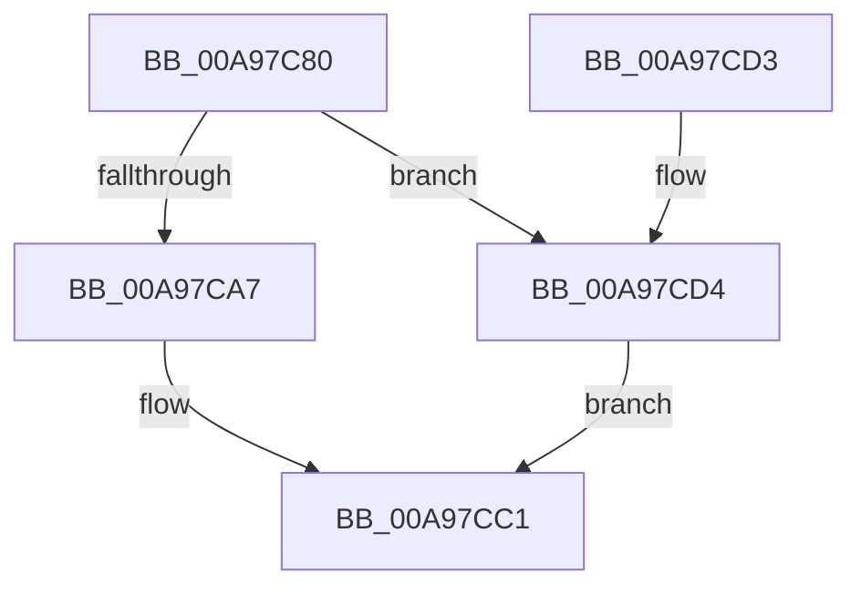

# PsSetProcessesWindowState

- RVA: `0x00A97C80`–`0x00A97CDB` (길이 `91` bytes)
- VA: `0x0000000140A97C80`
- 실행 섹션: `PAGE`
- PDB 이름 있음: `예`; PDB Function 태그: `아니요`
- unwind 정보 RVA: `0x0006383C`
- 디코드: `26`개 명령, `91/91` bytes 표시
- 미해석 바이트: `0` (있으면 어셈블리에 `.byte`로 보존)

> 이 문서는 커널 이미지의 기계어와 PDB 기호를 분석해 생성했습니다. 4번과 5번은 함수 원형과 자료형을 바이너리 사용 방식에서 추정한 C 해석이며 원본 소스 복구 결과는 아닙니다.

## 1. Dependencies

- 직접 호출 지점: **3**; 고유 호출 대상: **3**
- 직접 호출자로 확인된 함수: **0**
- RIP 상대 이미지 참조: **1**

### Outgoing calls
- `0x00A97C9B` → [ExGetExtensionTable](../../text/42/ExGetExtensionTable_function_00428814.md) (function, `0x00428814`)
- `0x00A97CB0` → [guard_dispatch_icall](../../text/6B/guard_dispatch_icall_function_006BAAD0.md) (function, `0x006BAAD0`)
- `0x00A97CBC` → [ExReleaseExtensionTable](../../text/45/ExReleaseExtensionTable_function_00456DC0.md) (function, `0x00456DC0`)

### Direct callers
- 이 함수 시작 RVA로 연결되는 직접 call은 확인되지 않았습니다. 간접 호출은 완전히 역산할 수 없습니다.

### Static image references
- `0x00A97C94` → RVA `0x00FC6CA0` (`ALMOSTRO`; read)

## 2. Other-region calls and transfers

- 다른 실행 섹션으로 향하는 call: **3**
  - `0x00A97C9B` → [ExGetExtensionTable](../../text/42/ExGetExtensionTable_function_00428814.md) (`PAGE` → `.text`)
  - `0x00A97CB0` → [guard_dispatch_icall](../../text/6B/guard_dispatch_icall_function_006BAAD0.md) (`PAGE` → `.text`)
  - `0x00A97CBC` → [ExReleaseExtensionTable](../../text/45/ExReleaseExtensionTable_function_00456DC0.md) (`PAGE` → `.text`)
- 별도 외부 분기/꼬리 이동을 확인하지 못했습니다.

## 3. Assembly (complete function range)

```asm
00A97C80  48 89 5C 24 08                  mov qword ptr [rsp + 8], rbx
00A97C85  48 89 74 24 10                  mov qword ptr [rsp + 0x10], rsi
00A97C8A  57                              push rdi
00A97C8B  48 83 EC 20                     sub rsp, 0x20
00A97C8F  8B F1                           mov esi, ecx
00A97C91  48 8B FA                        mov rdi, rdx
00A97C94  48 8B 0D 05 F0 52 00            mov rcx, qword ptr [rip + 0x52f005]
00A97C9B  E8 74 0B 99 FF                  call 0x140428814
00A97CA0  33 DB                           xor ebx, ebx
00A97CA2  48 85 C0                        test rax, rax
00A97CA5  74 2D                           je 0x140a97cd4
00A97CA7  48 8B 40 28                     mov rax, qword ptr [rax + 0x28]
00A97CAB  48 8B D7                        mov rdx, rdi
00A97CAE  8B CE                           mov ecx, esi
00A97CB0  E8 1B 2E C2 FF                  call 0x1406baad0
00A97CB5  48 8B 0D E4 EF 52 00            mov rcx, qword ptr [rip + 0x52efe4]
00A97CBC  E8 FF F0 9B FF                  call 0x140456dc0
00A97CC1  48 8B 74 24 38                  mov rsi, qword ptr [rsp + 0x38]
00A97CC6  8B C3                           mov eax, ebx
00A97CC8  48 8B 5C 24 30                  mov rbx, qword ptr [rsp + 0x30]
00A97CCD  48 83 C4 20                     add rsp, 0x20
00A97CD1  5F                              pop rdi
00A97CD2  C3                              ret
00A97CD3  CC                              int3
00A97CD4  BB 02 00 00 C0                  mov ebx, 0xc0000002
00A97CD9  EB E6                           jmp 0x140a97cc1
```

## 4. C-style interpretation (structured pseudocode)

```c
__int64 __fastcall PsSetProcessesWindowState(int a1, __int64 a2)
{
    __int64 result;
    __int64 v_rbx;
    __int64 v_rsp;
    unsigned __int64 v_stack_p10;
    unsigned __int64 v_stack_p8;

    v_stack_p8 = v_rbx;
    v_stack_p10 = v_rsi;
    v_rsp = (v_rsp) - (32);
    result = ExGetExtensionTable(*(unsigned __int64 *)(v_rip + 5435397), a2, a3, a4);
    v_rbx = 0;
    if (result == 0) goto loc_00A97CD4;
    result = guard_dispatch_icall((unsigned int)((unsigned int)((unsigned int)(a1))), a2, a3, a4);
    result = ExReleaseExtensionTable(*(unsigned __int64 *)(v_rip + 5435364), a2, a3, a4);
loc_00A97CC1:
    v_rsp = (v_rsp) + (32);
    return 0;
loc_00A97CD4:
    goto loc_00A97CC1;
}
```

## 5. (Beta) C Style

```c
int64_t PsSetProcessesWindowState(int32_t Arg1, int64_t Arg2)
{
    int64_t result;
    int64_t local_rbx;
    int64_t local_rsp;
    uint64_t v_stack_p10;
    uint64_t v_stack_p8;

    v_stack_p8 = local_rbx;
    v_stack_p10 = local_rsi;
    local_rsp = (local_rsp) - (32);
    result = ExGetExtensionTable(*(uint64_t *)(v_rip + 0x52F005), Arg2, a3, a4);
    local_rbx = 0;
    if (result == 0) goto loc_00A97CD4;
    result = guard_dispatch_icall((uint32_t)((uint32_t)((uint32_t)(Arg1))), Arg2, a3, a4);
    result = ExReleaseExtensionTable(*(uint64_t *)(v_rip + 0x52EFE4), Arg2, a3, a4);
loc_00A97CC1:
    local_rsp = (local_rsp) + (32);
    return 0;
loc_00A97CD4:
    goto loc_00A97CC1;
}
```

## 6. Execution-region graph

[열기: 2D/3D 그래프와 함수 탐색 컨트롤 패널](../../../control-panel.html?section=page&rva=0x00A97C80&view=graph)

- 2D 그래프는 위에서 아래로 흐르고, 3D 그래프는 빈 공간을 드래그해 회전합니다. Shift+드래그는 이동, 휠은 확대·축소, 함수 노드 선택은 대상 보고서 이동입니다.

### Static fallback


