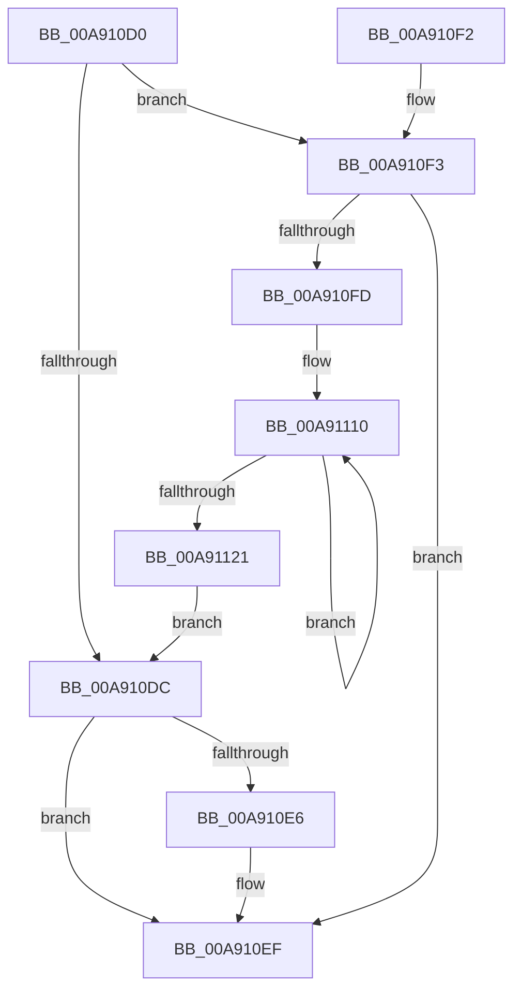

# PspEnableWakeCounters

- RVA: `0x00A910D0`–`0x00A91131` (길이 `97` bytes)
- VA: `0x0000000140A910D0`
- 실행 섹션: `PAGE`
- PDB 이름 있음: `예`; PDB Function 태그: `아니요`
- unwind 정보 RVA: `0x000DB714`
- 디코드: `23`개 명령, `97/97` bytes 표시
- 미해석 바이트: `0` (있으면 어셈블리에 `.byte`로 보존)

> 이 문서는 커널 이미지의 기계어와 PDB 기호를 분석해 생성했습니다. 4번과 5번은 함수 원형과 자료형을 바이너리 사용 방식에서 추정한 C 해석이며 원본 소스 복구 결과는 아닙니다.

## 1. Dependencies

- 직접 호출 지점: **0**; 고유 호출 대상: **0**
- 직접 호출자로 확인된 함수: **0**
- RIP 상대 이미지 참조: **0**

### Outgoing calls
- 직접 디코드된 call 명령이 없습니다.

### Direct callers
- 이 함수 시작 RVA로 연결되는 직접 call은 확인되지 않았습니다. 간접 호출은 완전히 역산할 수 없습니다.

### Static image references
- 디코드된 RIP-relative 메모리 참조가 없습니다.

## 2. Other-region calls and transfers

- 다른 실행 섹션으로 향하는 call: **0**
- 별도 외부 분기/꼬리 이동을 확인하지 못했습니다.

## 3. Assembly (complete function range)

```asm
00A910D0  48 8B 91 18 05 00 00            mov rdx, qword ptr [rcx + 0x518]
00A910D7  48 85 D2                        test rdx, rdx
00A910DA  75 17                           jne 0x140a910f3
00A910DC  0F BA A1 10 06 00 00 0C         bt dword ptr [rcx + 0x610], 0xc
00A910E4  72 09                           jb 0x140a910ef
00A910E6  F0 0F BA A9 10 06 00 00 0C      lock bts dword ptr [rcx + 0x610], 0xc
00A910EF  33 C0                           xor eax, eax
00A910F1  C3                              ret
00A910F2  CC                              int3
00A910F3  0F BA A2 10 06 00 00 0C         bt dword ptr [rdx + 0x610], 0xc
00A910FB  72 F2                           jb 0x140a910ef
00A910FD  4C 8B C9                        mov r9, rcx
00A91100  4C 8D 82 60 04 00 00            lea r8, [rdx + 0x460]
00A91107  4C 2B CA                        sub r9, rdx
00A9110A  41 BA 07 00 00 00               mov r10d, 7
00A91110  4B 8B 04 01                     mov rax, qword ptr [r9 + r8]
00A91114  49 01 00                        add qword ptr [r8], rax
00A91117  4D 8D 40 08                     lea r8, [r8 + 8]
00A9111B  49 83 EA 01                     sub r10, 1
00A9111F  75 EF                           jne 0x140a91110
00A91121  48 8B 81 98 04 00 00            mov rax, qword ptr [rcx + 0x498]
00A91128  48 01 82 98 04 00 00            add qword ptr [rdx + 0x498], rax
00A9112F  EB AB                           jmp 0x140a910dc
```

## 4. C-style interpretation (structured pseudocode)

```c
__int64 __fastcall PspEnableWakeCounters(__int64 a1)
{
    __int64 result;
    __int64 v_r10;

    if (*(unsigned __int64 *)(a1 + 1304) != 0) goto loc_00A910F3;
loc_00A910DC:
    if (!(condition_is_below)) {
    }
    result = 0;
    return result;
loc_00A910F3:
    if (condition_is_below) goto loc_00A910EF;
    a4 = (a1) - (*(unsigned __int64 *)(a1 + 1304));
loc_00A91110:
    v_r10 = (7) - (1);
    if (condition_is_not_equal) goto loc_00A91110;
    goto loc_00A910DC;
}
```

## 5. (Beta) C Style

```c
int64_t PspEnableWakeCounters(void *Arg1)
{
    uint8_t *arg1 = (uint8_t *)Arg1;

    int64_t result;
    int64_t local_r10;

    if (*(uint64_t *)(arg1 + 0x518) != 0) goto loc_00A910F3;
loc_00A910DC:
    if (!(condition_is_below)) {
    }
    result = 0;
    return result;
loc_00A910F3:
    if (condition_is_below) goto loc_00A910EF;
    a4 = (Arg1) - (*(uint64_t *)(arg1 + 0x518));
loc_00A91110:
    local_r10 = (7) - (1);
    if (condition_is_not_equal) goto loc_00A91110;
    goto loc_00A910DC;
}
```

### 관측된 메모리 오프셋

구조체 형식이 확인되지 않은 접근은 인자 기준의 오프셋으로만 기록했습니다.

| 기준 인자 | 오프셋 표현 | 폭 (bit) | 접근 |
|---|---:|---:|---|
| `Arg1` | `+ 0x0 + r8*1` | `64` | `R` |
| `Arg1` | `+ 0x498` | `64` | `R` |
| `Arg1` | `+ 0x518` | `64` | `R` |
| `Arg1` | `+ 0x610` | `32` | `R` |
| `Arg1` | `+ 0x610` | `32` | `R/W` |

## 6. Execution-region graph

[열기: 2D/3D 그래프와 함수 탐색 컨트롤 패널](../../../control-panel.html?section=page&rva=0x00A910D0&view=graph)

- 2D 그래프는 위에서 아래로 흐르고, 3D 그래프는 빈 공간을 드래그해 회전합니다. Shift+드래그는 이동, 휠은 확대·축소, 함수 노드 선택은 대상 보고서 이동입니다.

### Static fallback


